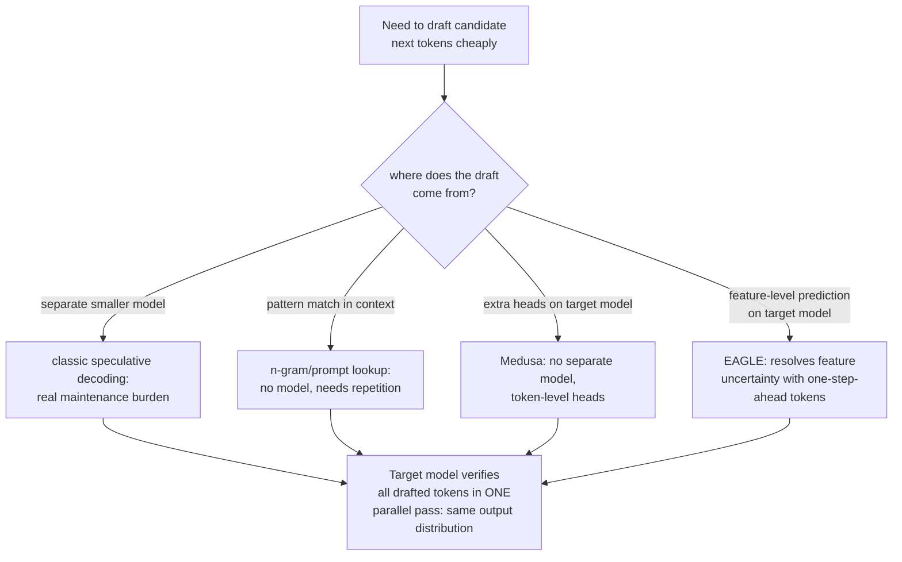

# पाठ 18. Speculative Decoding

**मिशन से संबंध:** चरण 1 ने स्थापित किया कि एक बार में एक token generate करना महँगा क्यों है: हर step model के पूरे weights को memory से दोबारा load करता है, और arithmetic ख़ुद तुलना में सस्ता है। **Speculative decoding** वह मुख्य latency उपाय है जिसका इस पूरी रूपरेखा ने कभी ज़िक्र नहीं किया, और वह ठीक उसी असंतुलन का फ़ायदा उठाता है: कई अनुमानित tokens को एक pass में verify करने की लागत लगभग उतनी है जितनी एक token आम तौर पर generate करने की, इसलिए सही अनुमान लगभग मुफ़्त अतिरिक्त throughput है।
**मुख्य स्रोत:** [पेपर: "Fast Inference from Transformers via Speculative Decoding", Leviathan et al., 2022](https://arxiv.org/abs/2211.17192)
**पूर्व-आवश्यकताएँ:** [पाठ 1](0001-the-kv-cache.md), [पाठ 6](0006-throughput-latency-tradeoff.md)

## वार्म-अप

1. ▢ एक बार में एक token decode करना हर एक step पर model के पूरे weights को memory से दोबारा load क्यों करता है?

जाँचें

हर नया token पिछले token के output पर निर्भर है, इसलिए model को हर token के लिए अपना पूरा forward pass फिर चलाना पड़ता है, हर बार अपने parameters को memory से compute unit तक ले जाते हुए, उस memory की आवाजाही को कई steps में batch कर पाने के बजाय।

2. ▢ Batch size throughput और प्रति-token latency के बीच सौदा कैसे करता है?

जाँचें

बड़ा batch weight-loading की उसी लागत को ज़्यादा concurrent requests में बाँटने देता है, जिससे कुल throughput बढ़ता है, पर हर अकेली request के अपने tokens आने में ज़्यादा समय ले सकते हैं क्योंकि batch को साथ process करना पड़ता है, जिससे उसमें किसी एक request के लिए प्रति-token latency बढ़ती है।

## यह जानें

### K tokens को parallel में verify करने की लागत लगभग एक token generate करने जितनी होती है

Decoding **memory-bandwidth-bound** है: generation के एक step की मुख्य लागत model के weights को memory से compute unit तक ले जाना है, matrix arithmetic नहीं, जो तुलना में सस्ता है। इसका मतलब है कि कई संभावित अगले-token positions को एक forward pass में score करना, यानी जाँचना कि अनुमानों का पूरा sequence सही था या नहीं, सिर्फ़ एक को score करने जितना ही पड़ता है, क्योंकि वही weights दोनों हालत में load होते हैं। **Speculative decoding** इसका सीधा फ़ायदा उठाता है: छोटा, सस्ता **draft model** कई tokens आगे का सुझाव देता है, और बड़ा **target model** उन सबको एक ही parallel pass में verify करता है, उन्हें एक-एक करके ख़ुद generate करने के बजाय।

### Output सटीक है, अनुमानित नहीं

पेपर का अपना ढाँचा साफ़ है कि यह गुणवत्ता का trade-off नहीं है: उसकी sampling विधि बड़े model से सटीक decoding को तेज़ बनाती है, output distribution को बिल्कुल बदले बिना। जहाँ भी draft model का अनुमान उससे मेल खाता है जो target model वैसे भी sample करता, वह स्वीकार हो जाता है; जहाँ नहीं, वहाँ सुधारने वाला resampling step ठीक वही नतीजा देता है जो अकेला target model उस position पर देता। अंत से अंत तक का output प्रमाणित रूप से वही है जो target model को अकेले, token-दर-token चलाने पर मिलता; सिर्फ़ wall-clock लागत बदलती है, क्योंकि target model का अपना महँगा forward pass अब सिर्फ़ एक की जगह कई draft tokens को verify करता है।

### Draft का एक पूरे अलग model से आना ज़रूरी नहीं

Draft model (target model का छोटा, सस्ता रूप) मूल design है, पर उसके साथ असली संचालन-लागत आती है: पूरा दूसरा model पाना और सँभालना, target model बदलने पर उसे संगत रखना, अपने-आप में एक बोझ है। **N-gram** (prompt-lookup) drafting किसी model के बिना ही इससे बचता है: वह मौजूदा prompt या generate हुए context में ऐसा हिस्सा खोजता है जो आख़िरी कुछ tokens से मेल खाए, और अनुमान लगाता है कि उस हिस्से के बाद पहले जो आया था वही फिर आएगा। यह ख़ासकर तब अच्छा काम करता है जब task में असली दोहराव हो (code edit करना, लंबे document का हवाला देना) और जहाँ फ़ायदा उठाने को कोई दोहराव नहीं वहाँ कुछ नहीं देता, पर उसे कोई model, कोई training और कोई रखरखाव नहीं चाहिए।

### Medusa और EAGLE अलग model की जगह target model से ही draft करते हैं

**Medusa** अलग-draft-model के बोझ को दूसरे ढंग से हटाता है: पूरे दूसरे model के बजाय वह target model पर सीधे अतिरिक्त decoding heads जोड़ता है, हर एक उसी forward pass से अगले कई token positions में से एक का parallel में अनुमान लगाता है, कोई अलग model पाने या synchronized रखने की ज़रूरत ही नहीं। **EAGLE** इसे और परिष्कृत करता है: उसने देखा कि model की अपनी अंदरूनी features (उसके hidden representations) के स्तर पर अनुमान लगाना सीधे कच्चे tokens का अनुमान लगाने से ज़्यादा सुलझा हुआ है, पर अकेली feature-स्तर की भविष्यवाणी में असली अनिश्चितता है; EAGLE उस अनिश्चितता को एक समय-कदम आगे बढ़े token sequence को भी भीतर डालकर सुलझाता है, और उसके अपने रिपोर्ट किए नतीजे (70B model पर 2.7 से 3.5 गुना latency speedup, लगभग दोगुना throughput) साफ़ पुष्टि करते हैं कि यह उसी output distribution को बनाए रखते हुए आता है जो अकेला target model देता।

### हर रूप वही सौदा अलग जगह करता है

Draft-model speculative decoding, n-gram drafting, Medusa और EAGLE सब सत्यापन की कुछ बरबादी मान लेते हैं (ठुकराया गया अनुमान बिना फ़ायदे के थोड़ा अतिरिक्त काम खाता है) इसके बदले कि हर महँगे forward pass पर एक की जगह कई tokens generate होने का असली मौक़ा मिले। उनके बीच फ़र्क़ सिर्फ़ इसमें है कि draft असल में कहाँ से आता है: अलग छोटा model, मौजूदा context का pattern-matching, उसी model पर अतिरिक्त heads, या उसी model पर feature-स्तर का predictor जिसे एक-कदम-आगे के tokens से सुधारा गया हो। कोई भी इसे नहीं बदलता कि क्या generate होता है; सब यह बदलते हैं कि उसे generate करने में target model के कितने सचमुच महँगे forward passes लगते हैं।

## अभ्यास

1. ▢ 4 संभावित tokens को एक forward pass में verify करने की लागत लगभग एक token आम तौर पर generate करने जितनी क्यों होती है, 4 गुना क्यों नहीं?

संकेत

सोचें कि पहली जगह decoding के एक step की लागत पर असल में क्या हावी है।

जाँचें

Decoding memory-bandwidth-bound है: मुख्य लागत model के weights को memory से ले जाना है, जो एक ही बार होता है चाहे उसी pass में कितने भी candidate positions score किए जाएँ। 1 की जगह 4 positions score करना उस memory-आवाजाही की लागत के ऊपर तुलनात्मक रूप से थोड़ा-सा अतिरिक्त arithmetic जोड़ता है जो वैसे भी चुकानी थी।

2. ▢ एक team को चिंता है कि speculative decoding गति के बदले output की गुणवत्ता का सौदा करता है, क्योंकि उसमें छोटा, कम सक्षम model tokens का अनुमान लगाता है। क्या यह चिंता सही है?

जाँचें

नहीं। पेपर की विधि ख़ास तौर पर इस तरह बनी है कि अंतिम output distribution वही रहे जो अकेले target model को चलाने पर होता; सही draft अनुमान स्वीकार हो जाता है, और ग़लत वाला resampling से सुधार दिया जाता है, इसलिए अंतिम नतीजा वही है जो target model ख़ुद देता, गुणवत्ता का कोई trade-off नहीं, सिर्फ़ latency का बदलाव।

3. ▢ N-gram (prompt-lookup) drafting open-ended creative writing की तुलना में code-editing task के लिए बेहतर क्यों बैठ सकता है?

जाँचें

N-gram drafting अनुमान लगाता है कि आख़िरी कुछ tokens से मेल खाते हिस्से के बाद वही आएगा जो context में कहीं और उसके बाद पहले आया था; code editing और ऐसे दोहराव वाले tasks में इस तरह का शब्दशः दोहराव open-ended creative writing की तुलना में कहीं ज़्यादा होता है, जहाँ n-gram drafting को अनुमान लगाने के लिए शायद ही कभी कोई मेल खाता हिस्सा मिलेगा।

4. ▢ मूल draft-model तरीक़े की तुलना में Medusa कौन-सी ख़ास समस्या हल करता है, और Medusa के तरीक़े के ऊपर EAGLE क्या जोड़ता है?

जाँचें

Medusa अलग draft model पाने और सँभालने का बोझ हटाता है, target model पर ही अतिरिक्त decoding heads जोड़कर। EAGLE कच्चे tokens के बजाय model की अंदरूनी features के स्तर पर draft करके अनुमान की सटीकता और बढ़ाता है, और feature-स्तर की भविष्यवाणी के साथ आने वाली अतिरिक्त अनिश्चितता को एक समय-कदम आगे बढ़े token sequence को भी शामिल करके सुलझाता है।

5. ▢ Draft-model, n-gram, Medusa और EAGLE speculative decoding में जो बात साझा है उसका सही वर्णन कौन-सा दावा करता है?

    - a) हर रूप गति के बदले output की कुछ गुणवत्ता छोड़ता है, अलग-अलग मात्रा में
    - b) सब सस्ते में, अलग-अलग स्रोतों से, संभावित tokens draft करते हैं, फिर target model को उन्हें एक parallel pass में verify करने देते हैं जिसकी लागत लगभग एक token generate करने जितनी है, और वह सटीक output distribution सुरक्षित रखते हैं जो अकेला target model देता
    - c) सिर्फ़ मूल draft-model तरीक़ा सटीक output distribution सुरक्षित रखता है; नए रूप सन्निकटन हैं
    - d) N-gram drafting के लिए target model के अपने outputs पर एक छोटा neural network train करना पड़ता है

जाँचें

**b)** यही वह साझा तंत्र और गारंटी है जो इस पाठ में कवर किए हर रूप में है। (a) ग़लत है: हर रूप target model का सटीक output distribution सुरक्षित रखता है; कोई भी गुणवत्ता के बदले गति नहीं देता। (c) ग़लत है: Medusa और EAGLE दोनों साफ़ रिपोर्ट करते हैं कि वे target model के output distribution से मेल खाते हैं, मूल तरीक़े की तरह। (d) ग़लत है: n-gram drafting को कोई model या training नहीं चाहिए, सिर्फ़ मौजूदा context के विरुद्ध pattern-matching चाहिए।

## असली दुनिया का अभ्यास

- [ ] जिस serving stack तक आपकी पहुँच है (vLLM या कोई और) उसके लिए जाँचें कि वह speculative decoding support करता है या नहीं, और अगर हाँ तो कौन-सा रूप (draft model, n-gram/prompt-lookup, या head-आधारित विधि)।
- [ ] किसी जाने-पहचाने workload के लिए आँकें कि उसमें n-gram drafting के मदद करने लायक़ शब्दशः दोहराव (code, संरचित documents) है या draft model या head-आधारित विधि बेहतर बैठेगी।
- [ ] कल: मुख्य स्रोत का acceptance rate वाला खंड पूरा पढ़ें, और नोट करें कि draft model के अनुमान कितनी बार असल में स्वीकार होते हैं यह किससे तय होता है, और वह acceptance rate असली speedup में कैसे बदलता है।

## आगे बढ़ने के लिए

- [पेपर: "Fast Inference from Transformers via Speculative Decoding", Leviathan et al., 2022](https://arxiv.org/abs/2211.17192)
- [पेपर: "Medusa: Simple LLM Inference Acceleration Framework with Multiple Decoding Heads", Cai et al., 2024](https://arxiv.org/abs/2401.10774)
- [पेपर: "EAGLE: Speculative Sampling Requires Rethinking Feature Uncertainty", Li et al., 2024](https://arxiv.org/abs/2401.15077)
- [संसाधन](../RESOURCES.md)

---

बात नहीं बन रही? ऊपर दिए मुख्य स्रोत को दोबारा पढ़ें, क्योंकि यह पाठ उसे संक्षिप्त करता है और समझ संक्षेप में ही रिसती है। जो शब्द फिसलन भरा लगे, उसके लिए [शब्दावली](../GLOSSARY.md) देखें।

अगर दिक़्क़त सामग्री की नहीं बल्कि पाठ की ही है, तो वह एक खोट है: [issue खोलें](https://github.com/TokenCemetery/teach/issues)।
