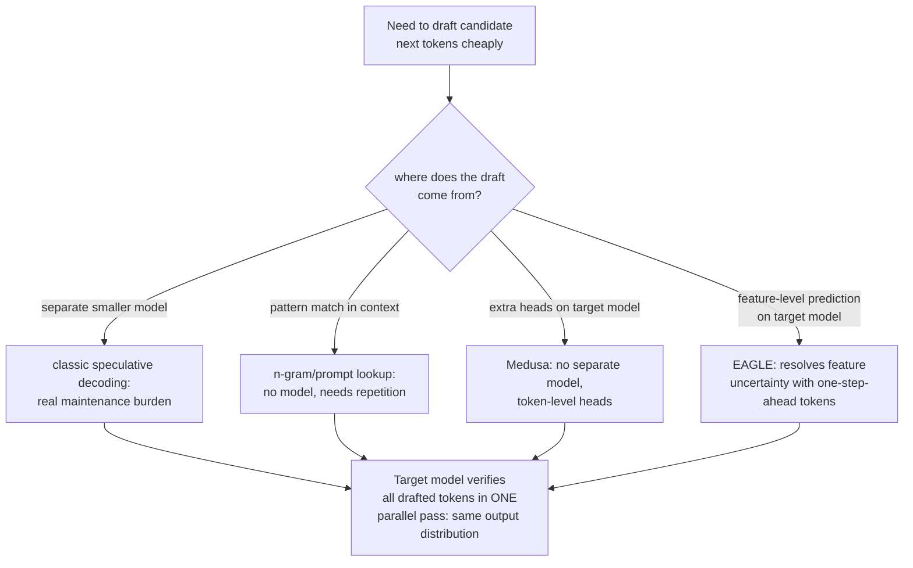

# Lição 18. Speculative decoding

**Ligação com a missão:** A etapa 1 estabeleceu por que gerar um token por vez é caro: cada passo recarrega da memória os pesos completos do modelo, e a aritmética em si é barata em comparação. A **speculative decoding** é a principal alavanca de latência que este arco nunca mencionou, e ela explora exatamente esse desequilíbrio: verificar vários tokens chutados em uma passada custa aproximadamente o que custa gerar um token normalmente, então um palpite correto é throughput extra quase de graça.
**Fonte principal:** [Artigo científico: "Fast Inference from Transformers via Speculative Decoding", Leviathan et al., 2022](https://arxiv.org/abs/2211.17192)
**Pré-requisitos:** [Lição 1](0001-the-kv-cache.md), [Lição 6](0006-throughput-latency-tradeoff.md)

## Aquecimento

1. ▢ Por que decodificar um token por vez recarrega da memória os pesos completos do modelo a cada passo?

Verificação

Cada novo token depende da saída do anterior, então o modelo precisa rodar a sua passada forward completa de novo para cada token, movendo os seus parâmetros da memória para a unidade de computação a cada vez, em vez de poder agrupar essa movimentação de memória entre vários passos.

2. ▢ Como o batch size troca throughput por latência por token?

Verificação

Um batch maior permite que o mesmo custo de carregar os pesos seja amortizado entre mais requisições concorrentes, elevando o throughput total, mas os tokens de cada requisição individual podem demorar mais a chegar, já que o batch precisa ser processado junto, elevando a latência por token de qualquer requisição nele.

## Saiba isto

### Verificar K tokens em paralelo custa aproximadamente o que custa gerar um token

O decode é **limitado pela largura de banda de memória**: o custo dominante de um passo de geração é mover os pesos do modelo da memória para a unidade de computação, e não a aritmética de matrizes em si, que é comparativamente barata. Isso significa que pontuar várias posições candidatas de próximo token em uma passada forward, verificando se uma sequência inteira de palpites estava certa, custa aproximadamente o mesmo que pontuar apenas uma, já que os mesmos pesos são carregados de qualquer jeito. A **speculative decoding** explora isso diretamente: um **modelo draft** pequeno e barato propõe vários tokens à frente, e o **modelo alvo** grande verifica todos eles em uma única passada paralela, em vez de gerá-los um de cada vez por conta própria.

### A saída é exata, e não aproximada

O próprio enquadramento do artigo é específico: isso não é um trade-off de qualidade, e o seu método de amostragem torna mais rápida a decodificação exata do modelo grande, sem mudar em nada a distribuição de saída. Onde o palpite do modelo draft coincide com o que o modelo alvo teria amostrado de qualquer forma, ele é aceito; onde não coincide, um passo corretivo de reamostragem produz o mesmo resultado que o modelo alvo sozinho teria produzido naquela posição. A saída de ponta a ponta é comprovadamente idêntica à de rodar o modelo alvo sozinho, token por token; só o custo em tempo real muda, já que a cara passada forward do próprio modelo alvo agora consegue verificar vários tokens do draft em vez de produzir apenas um.

### O draft não precisa vir de um modelo totalmente separado

Um modelo draft (uma versão menor e mais barata do modelo alvo) é o design original, mas vem com um custo operacional real: adquirir e manter um segundo modelo inteiro, mantido compatível conforme o modelo alvo muda, é um fardo por si só. O draft por **n-gram** (prompt-lookup) contorna isso por não usar modelo algum: ele procura um trecho do prompt ou do contexto gerado que coincida com os últimos tokens e especula que o que veio depois desse trecho antes virá de novo. Isso funciona bem especificamente quando uma tarefa envolve repetição real (editar código, referenciar um documento longo) e não compra nada quando não há repetição a explorar, mas não precisa de modelo, de treinamento nem de manutenção alguma.

### Medusa e EAGLE fazem o draft a partir do próprio modelo alvo, e não de um separado

O **Medusa** remove o fardo do modelo draft separado de outro jeito: em vez de um segundo modelo inteiro, ele adiciona cabeças de decodificação extras diretamente ao modelo alvo, cada uma prevendo, em paralelo e a partir da mesma passada forward, uma das próximas várias posições de token, sem nenhum modelo separado a adquirir ou manter sincronizado. O **EAGLE** refina isso ainda mais: ele observou que prever no nível das próprias features internas do modelo (as suas representações ocultas) é mais tratável do que prever tokens brutos diretamente, mas que a predição só no nível de feature carrega incerteza real; o EAGLE resolve essa incerteza ao alimentar também a sequência de tokens avançada em um passo de tempo, e os seus próprios resultados reportados (speedup de latência de 2,7x a 3,5x, throughput aproximadamente dobrado em um modelo de 70B) confirmam explicitamente que isso vem mantendo a mesma distribuição de saída que o modelo alvo sozinho teria produzido.

### Toda variante faz a mesma troca em um lugar diferente

A speculative decoding com modelo draft, o draft por n-gram, o Medusa e o EAGLE aceitam, todos, alguma fração de verificação desperdiçada (um palpite rejeitado custa um pouco de trabalho extra sem benefício) em troca de uma chance real de gerar vários tokens por passada forward cara em vez de um. O que difere entre eles é apenas de onde o draft de fato vem: um modelo menor separado, a correspondência de padrões no contexto existente, cabeças extras no mesmo modelo ou um preditor no nível de feature no mesmo modelo, corrigido por tokens um passo à frente. Nenhum deles muda o que é gerado; todos mudam quantas das passadas forward realmente caras do modelo alvo são necessárias para gerá-lo.

## Prática

1. ▢ Por que verificar 4 tokens candidatos em uma passada forward custa aproximadamente o mesmo que gerar um único token normalmente, e não 4 vezes mais?

Dica

Considere o que de fato domina o custo de um passo de decodificação, para começar.

Verificação

O decode é limitado pela largura de banda de memória: o custo dominante é mover os pesos do modelo da memória, o que acontece uma vez, independentemente de quantas posições candidatas são pontuadas nessa mesma passada. Pontuar 4 posições em vez de 1 acrescenta uma quantidade comparativamente pequena de aritmética extra sobre um custo de movimentação de memória que seria pago de qualquer jeito.

2. ▢ Uma equipe teme que a speculative decoding troque qualidade de saída por velocidade, já que envolve um modelo menor e menos capaz chutando tokens. Essa preocupação procede?

Verificação

Não. O método do artigo é projetado especificamente para que a distribuição final de saída seja idêntica à de rodar o modelo alvo sozinho; um palpite correto do draft é aceito, e um incorreto é corrigido por reamostragem, então o resultado final coincide com o que o modelo alvo teria produzido sozinho, sem trade-off de qualidade, apenas uma mudança de latência.

3. ▢ Por que o draft por n-gram (prompt-lookup) poderia se adequar melhor a uma tarefa de edição de código do que à escrita criativa aberta?

Verificação

O draft por n-gram especula que um trecho que coincide com os últimos tokens será seguido pelo que o seguiu antes em outro ponto do contexto; a edição de código e tarefas repetitivas semelhantes têm muito mais desse tipo de repetição literal a explorar do que a escrita criativa aberta, em que o draft por n-gram raramente encontraria um trecho correspondente a partir do qual especular.

4. ▢ Que problema específico o Medusa resolve em relação à abordagem original com modelo draft, e o que o EAGLE acrescenta sobre a abordagem do Medusa?

Verificação

O Medusa remove o fardo de adquirir e manter um modelo draft separado, ao adicionar cabeças de decodificação extras diretamente ao modelo alvo. O EAGLE melhora ainda mais a acurácia da predição ao fazer o draft no nível das features internas do modelo em vez de tokens brutos, resolvendo a incerteza extra que vem com a predição no nível de feature ao incorporar também a sequência de tokens avançada em um passo de tempo.

5. ▢ Qual afirmação descreve corretamente o que é comum entre a speculative decoding com modelo draft, n-gram, Medusa e EAGLE?

    - a) Cada variante troca alguma qualidade de saída por velocidade adicional, em quantidades diferentes
    - b) Todas fazem o draft de tokens candidatos de forma barata, a partir de fontes diferentes, e depois deixam o modelo alvo verificá-los em uma passada paralela que custa aproximadamente o que custa gerar um token, preservando a distribuição de saída exata que o modelo alvo sozinho produziria
    - c) Só a abordagem original com modelo draft preserva a distribuição de saída exata; as variantes mais novas são aproximações
    - d) O draft por n-gram exige treinar uma pequena rede neural nas próprias saídas do modelo alvo

Verificação

**b)** Esse é o mecanismo e a garantia compartilhados por toda variante que esta lição cobre. (a) é falsa: toda variante preserva a distribuição de saída exata do modelo alvo; nenhuma troca qualidade por velocidade. (c) é falsa: Medusa e EAGLE reportam explicitamente igualar a distribuição de saída do modelo alvo, como a abordagem original. (d) é falsa: o draft por n-gram não precisa de modelo nem de treinamento algum, apenas de correspondência de padrões contra o contexto existente.

## Prática no mundo real

- [ ] Para uma stack de serving a que você tenha acesso (vLLM ou outra), verifique se ela suporta speculative decoding e, se sim, qual variante (modelo draft, n-gram/prompt-lookup ou um método baseado em cabeças).
- [ ] Para uma carga de trabalho que você conhece, avalie se ela tem repetição literal suficiente (código, documentos estruturados) para o draft por n-gram ajudar, ou se um modelo draft ou um método baseado em cabeças seria mais adequado.
- [ ] Amanhã: leia por inteiro a seção da fonte principal sobre a taxa de aceitação e anote o que determina com que frequência os palpites do modelo draft são de fato aceitos, e como essa taxa de aceitação se traduz em um speedup real.

## Para ir além

- [Artigo científico: "Fast Inference from Transformers via Speculative Decoding", Leviathan et al., 2022](https://arxiv.org/abs/2211.17192)
- [Artigo científico: "Medusa: Simple LLM Inference Acceleration Framework with Multiple Decoding Heads", Cai et al., 2024](https://arxiv.org/abs/2401.10774)
- [Artigo científico: "EAGLE: Speculative Sampling Requires Rethinking Feature Uncertainty", Li et al., 2024](https://arxiv.org/abs/2401.15077)
- [Recursos](../RESOURCES.md)

---

Não ficou claro? Releia a fonte principal no topo, já que esta lição a comprime e é na compressão que o entendimento escapa. Consulte o [glossário](../GLOSSARY.md) para qualquer termo que pareceu escorregadio.

Se o problema é a lição em si, e não o material, isso é um defeito: [abra uma issue](https://github.com/TokenCemetery/teach/issues).
