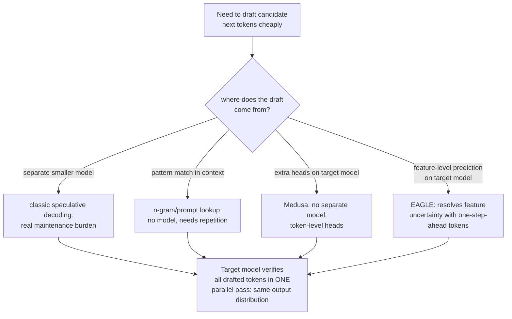

# Урок 18. Спекулятивное декодирование

**Связь с целью курса:** Этап 1 установил, почему генерация по одному токену дорога: каждый шаг заново загружает из памяти все веса модели, а сама арифметика по сравнению с этим дешева. **Спекулятивное декодирование** это главный рычаг задержки, который эта линия курса до сих пор не упоминала, и он использует именно этот дисбаланс: проверка нескольких угаданных токенов за один проход стоит примерно столько же, сколько обычная генерация одного токена, так что верная догадка это почти бесплатная дополнительная пропускная способность.
**Первоисточник:** [Научная статья: "Fast Inference from Transformers via Speculative Decoding", Leviathan et al., 2022](https://arxiv.org/abs/2211.17192)
**Предварительные требования:** [Урок 1](0001-the-kv-cache.md), [Урок 6](0006-throughput-latency-tradeoff.md)

## Разминка

1. ▢ Почему декодирование по одному токену заново загружает из памяти все веса модели на каждом шаге?

Проверка

Каждый новый токен зависит от выхода предыдущего, поэтому модели приходится заново выполнять полный прямой проход для каждого токена, каждый раз перемещая параметры из памяти в вычислительный блок, а не иметь возможность объединить это перемещение памяти на несколько шагов.

2. ▢ Как размер батча обменивает пропускную способность на задержку на токен?

Проверка

Больший батч позволяет распределить ту же стоимость загрузки весов между большим числом одновременных запросов, повышая общую пропускную способность, но токены каждого отдельного запроса могут приходить дольше, поскольку батч нужно обрабатывать вместе, что повышает задержку на токен для любого запроса в нём.

## Что нужно знать

### Проверка K токенов параллельно стоит примерно столько же, сколько генерация одного токена

Декодирование **ограничено пропускной способностью памяти (memory-bandwidth-bound)**: главная стоимость одного шага генерации это перемещение весов модели из памяти в вычислительный блок, а не сама матричная арифметика, которая сравнительно дешева. Это означает, что оценка нескольких позиций следующего токена-кандидата за один прямой проход, то есть проверка того, была ли верной целая последовательность догадок, стоит примерно столько же, сколько оценка лишь одной, поскольку одни и те же веса загружаются в любом случае. **Спекулятивное декодирование** использует это напрямую: небольшая дешёвая **черновая модель (draft model)** предлагает несколько токенов вперёд, а большая **целевая модель (target model)** проверяет их все за один параллельный проход, а не генерирует их сама по одному.

### Вывод точный, а не приближённый

Формулировка самой статьи конкретна: это не компромисс по качеству, её метод сэмплирования ускоряет точное декодирование из большой модели, вообще не меняя распределение вывода. Там, где догадка черновой модели совпадает с тем, что целевая модель всё равно сэмплировала бы, она принимается; там, где нет, корректирующий шаг пересэмплирования даёт тот же результат, который одна целевая модель дала бы в этой позиции. Сквозной вывод доказуемо идентичен запуску одной целевой модели токен за токеном; меняется лишь стоимость по часам, поскольку собственный дорогой прямой проход целевой модели теперь проверяет несколько черновых токенов вместо того, чтобы выдавать лишь один.

### Черновик не обязан поступать от целой отдельной модели

Черновая модель (меньшая, более дешёвая версия целевой модели) это исходный дизайн, но он несёт реальные эксплуатационные издержки: приобретение и сопровождение целой второй модели, поддерживаемой совместимой по мере изменения целевой, само по себе бремя. **N-граммный** (поиск по промпту, prompt-lookup) черновик обходит это, не используя модель вообще: он ищет в существующем промпте или сгенерированном контексте отрезок, совпадающий с последними несколькими токенами, и предполагает, что то, что шло за этим отрезком раньше, пойдёт и снова. Это хорошо работает именно тогда, когда в задаче есть реальные повторы (правка кода, ссылки на длинный документ), и ничего не даёт, когда повторов для использования нет, но он не требует ни модели, ни обучения, ни сопровождения.

### Medusa и EAGLE составляют черновик из самой целевой модели, а не из отдельной

**Medusa** снимает бремя отдельной черновой модели иначе: вместо целой второй модели она добавляет дополнительные головы декодирования прямо на целевую модель, каждая из которых предсказывает одну из следующих нескольких позиций токенов параллельно за тот же прямой проход, и приобретать отдельную модель или поддерживать её синхронной вообще не нужно. **EAGLE** уточняет это дальше: он заметил, что предсказывать на уровне собственных внутренних признаков модели (её скрытых представлений) удобнее, чем предсказывать сырые токены напрямую, но что одно предсказание на уровне признаков несёт реальную неопределённость; EAGLE снимает эту неопределённость, подавая дополнительно последовательность токенов, сдвинутую на один шаг по времени, и его собственные заявленные результаты (ускорение задержки в 2,7-3,5 раза, примерно вдвое большая пропускная способность на модели 70B) явно подтверждают, что это достигается при сохранении того же распределения вывода, которое дала бы одна целевая модель.

### Каждый вариант делает один и тот же обмен в разном месте

Спекулятивное декодирование с черновой моделью, n-граммный черновик, Medusa и EAGLE все принимают некоторую долю впустую потраченной проверки (отвергнутая догадка стоит немного лишней работы без пользы) в обмен на реальный шанс сгенерировать несколько токенов за один дорогой прямой проход вместо одного. Различается между ними лишь то, откуда на самом деле берётся черновик: из отдельной меньшей модели, из сопоставления с шаблоном в существующем контексте, из дополнительных голов на той же модели или из предсказателя на уровне признаков на той же модели, корректируемого токенами на шаг вперёд. Ни один из них не меняет то, что генерируется; все они меняют то, сколько по-настоящему дорогих прямых проходов целевой модели требуется, чтобы это сгенерировать.

## Практика

1. ▢ Почему проверка 4 токенов-кандидатов за один прямой проход стоит примерно столько же, сколько обычная генерация одного токена, а не в 4 раза больше?

Подсказка

Подумайте о том, что вообще доминирует в стоимости одного шага декодирования.

Проверка

Декодирование ограничено пропускной способностью памяти: главная стоимость это перемещение весов модели из памяти, которое происходит один раз независимо от того, сколько позиций-кандидатов оценивается за тот же проход. Оценка 4 позиций вместо 1 добавляет сравнительно малый объём дополнительной арифметики поверх стоимости перемещения памяти, которая в любом случае была бы оплачена.

2. ▢ Команда опасается, что спекулятивное декодирование обменивает качество вывода на скорость, поскольку в нём токены угадывает меньшая, менее способная модель. Верно ли это опасение?

Проверка

Нет. Метод статьи специально устроен так, чтобы итоговое распределение вывода было идентично запуску одной целевой модели; верная догадка черновика принимается, а неверная исправляется пересэмплированием, так что конечный результат совпадает с тем, что целевая модель дала бы сама, без компромисса по качеству, меняется лишь задержка.

3. ▢ Почему n-граммный (prompt-lookup) черновик может лучше подходить для задачи правки кода, чем для свободного творческого письма?

Проверка

N-граммный черновик предполагает, что за отрезком, совпадающим с последними несколькими токенами, пойдёт то, что шло за ним раньше в другом месте контекста; в правке кода и похожих повторяющихся задачах гораздо больше такого буквального повтора для использования, чем в свободном творческом письме, где n-граммный черновик редко нашёл бы совпадающий отрезок, на основании которого можно строить догадку.

4. ▢ Какую конкретную проблему решает Medusa по сравнению с исходным подходом с черновой моделью и что EAGLE добавляет к подходу Medusa?

Проверка

Medusa снимает бремя приобретения и сопровождения отдельной черновой модели, добавляя вместо неё дополнительные головы декодирования прямо на целевую модель. EAGLE дополнительно повышает точность предсказания, составляя черновик на уровне внутренних признаков модели, а не сырых токенов, и снимает дополнительную неопределённость предсказания на уровне признаков, привлекая также последовательность токенов, сдвинутую на один шаг по времени.

5. ▢ Какое утверждение верно описывает то, что общего у спекулятивного декодирования с черновой моделью, n-граммами, Medusa и EAGLE?

    - a) Каждый вариант обменивает часть качества вывода на дополнительную скорость, в разных количествах
    - b) Все они дёшево составляют токены-кандидаты из разных источников, затем позволяют целевой модели проверить их за один параллельный проход, стоящий примерно столько же, сколько генерация одного токена, сохраняя точное распределение вывода, которое дала бы одна целевая модель
    - c) Только исходный подход с черновой моделью сохраняет точное распределение вывода; новые варианты это приближения
    - d) N-граммный черновик требует обучения небольшой нейросети на собственных выходах целевой модели

Проверка

**b)** Это общий механизм и гарантия всех вариантов, которые охватывает этот урок. (a) неверно: каждый вариант сохраняет точное распределение вывода целевой модели; ни один не обменивает качество на скорость. (c) неверно: и Medusa, и EAGLE явно сообщают о совпадении с распределением вывода целевой модели, как и исходный подход. (d) неверно: n-граммному черновику не нужны ни модель, ни обучение, только сопоставление с шаблоном в существующем контексте.

## Практика в реальной работе

- [ ] Для стека обслуживания, к которому у вас есть доступ (vLLM или другого), проверьте, поддерживает ли он спекулятивное декодирование и, если да, какой вариант (с черновой моделью, n-граммный или prompt-lookup, или на основе голов).
- [ ] Для знакомой вам нагрузки оцените, достаточно ли в ней буквальных повторов (код, структурированные документы), чтобы n-граммный черновик помог, или лучше подойдёт черновая модель или метод на основе голов.
- [ ] Завтра: прочитайте полностью раздел первоисточника о доле принятия и отметьте, что определяет, как часто догадки черновой модели действительно принимаются и как эта доля принятия превращается в реальное ускорение.

## Что почитать дальше

- [Научная статья: "Fast Inference from Transformers via Speculative Decoding", Leviathan et al., 2022](https://arxiv.org/abs/2211.17192)
- [Научная статья: "Medusa: Simple LLM Inference Acceleration Framework with Multiple Decoding Heads", Cai et al., 2024](https://arxiv.org/abs/2401.10774)
- [Научная статья: "EAGLE: Speculative Sampling Requires Rethinking Feature Uncertainty", Li et al., 2024](https://arxiv.org/abs/2401.15077)
- [Ресурсы](../RESOURCES.md)

---

Не доходит? Перечитайте первоисточник в начале: этот урок его сжимает, а при сжатии понимание как раз и теряется. Загляните в [глоссарий](../GLOSSARY.md), если какой-то термин показался скользким.

Если неясен сам урок, а не материал, это дефект: [откройте issue](https://github.com/TokenCemetery/teach/issues).
