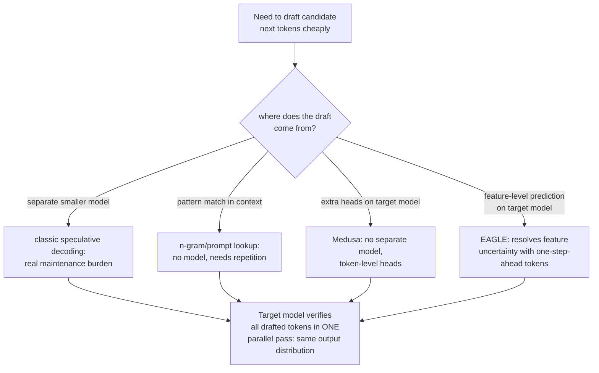

# 第 18 课：推测解码

**使命关联:** 第 1 阶段说明了为什么一次生成一个 token 是昂贵的：每一步都要把模型的全部权重从内存里重新加载一遍，相比之下算术本身很便宜。**推测解码**是本系列此前从未提及的主要延迟杠杆，它利用的正是这种失衡：在一次计算中验证若干个猜出来的 token，开销大致相当于正常生成一个 token，所以猜对了，就近乎白得额外的吞吐量。
**主要来源:** [论文：“Fast Inference from Transformers via Speculative Decoding”，Leviathan 等，2022](https://arxiv.org/abs/2211.17192)
**前置知识:** [第 1 课](0001-the-kv-cache.md)、[第 6 课](0006-throughput-latency-tradeoff.md)

## 热身

1. ▢ 为什么一次解码一个 token，每一步都要把模型的全部权重从内存里重新加载一遍？

检查

每个新 token 都依赖前一个 token 的输出，所以模型必须为每个 token 重新跑一遍完整的前向计算，每次都把它的参数从内存搬到计算单元，而不能把这种内存搬运在多个步骤之间批在一起。

2. ▢ 批大小如何在吞吐量与每 token 延迟之间做权衡？

检查

更大的批次，让同样的权重加载开销分摊到更多并发请求上，从而提高总吞吐量，但批次必须一起处理，所以其中任何一个请求自己的 token 可能要更久才到达，提高了每 token 延迟。

## 要点

### 并行验证 K 个 token，开销大致相当于生成一个 token

解码**受内存带宽限制**：一个生成步的主要开销，是把模型的权重从内存搬到计算单元，而不是矩阵算术本身，后者相对便宜。这意味着在一次前向计算中给若干个候选的下一个 token 位置打分，也就是检查一整串猜测是否正确，开销大致与只给一个位置打分相同，因为无论哪种方式，加载的都是同样的权重。**推测解码**直接利用了这一点：一个小而便宜的**草稿模型**提前提出若干个 token，而大的**目标模型**在一次并行计算中把它们全部验证，而不是由它自己一个一个地生成。

### 输出是精确的，而不是近似的

论文自己的表述很明确，这不是质量上的取舍：它的采样方法使大模型的精确解码变得更快，完全不改变输出分布。草稿模型的猜测，凡是与目标模型本来也会采样出的结果一致的，就被接受；凡是不一致的，纠正性的重新采样步骤就会在该位置产生与目标模型单独运行时相同的结果。端到端的输出，可证明地与目标模型自己逐个 token 地运行完全一致；变的只有实际耗时，因为目标模型自己那次昂贵的前向计算，现在可以验证多个草稿 token，而不是只产生一个。

### 草稿不一定要来自一个完整的独立模型

草稿模型（目标模型的一个更小、更便宜的版本）是最初的设计，但它有实实在在的运维成本：获取并维护整整第二个模型，并在目标模型变化时保持兼容，本身就是一种负担。**N-gram**（提示词查找）起草绕开了这一点，它完全不使用模型：它在已有的提示词或已生成的上下文中，查找与最后几个 token 匹配的一段，并推测之前跟在这一段后面的内容，这次还会跟在后面。这在任务确实涉及重复（编辑代码、引用长文档）时效果很好，而当没有重复可利用时一无所获，但它不需要模型，不需要训练，也完全不需要维护。

### Medusa 和 EAGLE 从目标模型自身起草，而不是用独立的模型

**Medusa** 用另一种方式去掉了独立草稿模型的负担：不用整整第二个模型，而是直接在目标模型上加额外的解码头，每个头从同一次前向计算中并行预测接下来若干个 token 位置中的一个，根本没有需要获取或保持同步的独立模型。**EAGLE** 进一步改进了这一点：它观察到，在模型自己的内部特征（它的隐藏表示）层面做预测，比直接预测原始 token 更容易处理，但仅靠特征层面的预测会带来实实在在的不确定性；EAGLE 通过同时输入提前一个时间步的 token 序列来化解这种不确定性，而它自己报告的结果（延迟加速 2.7 倍到 3.5 倍，在一个 70B 模型上吞吐量大约翻倍）明确证实，这是在保持目标模型单独运行时会产生的同一输出分布的前提下做到的。

### 每一种变体都是在不同的地方做同一笔交易

草稿模型的推测解码、n-gram 起草、Medusa 和 EAGLE，都接受一部分验证被浪费（一次被拒绝的猜测，白花了一点额外的工作），以换取一次真正的机会：每次昂贵的前向计算生成若干个 token，而不是一个。它们之间的区别，只在于草稿究竟来自哪里：一个独立的更小的模型、对已有上下文做模式匹配、同一个模型上的额外头，或者同一个模型上的特征层面预测器，再由提前一步的 token 来纠正。它们都不改变生成出来的内容；它们改变的，是生成它需要目标模型做多少次真正昂贵的前向计算。

## 练习

1. ▢ 为什么在一次前向计算中验证 4 个候选 token，开销大致与正常生成单个 token 相同，而不是 4 倍？

提示

想想究竟是什么主导了一个解码步的开销。

检查

解码受内存带宽限制：主要开销是从内存搬运模型的权重，无论在同一次计算中给多少个候选位置打分，这件事都只发生一次。给 4 个位置而不是 1 个位置打分，只是在一笔无论如何都要付的内存搬运开销之上，增加了相对很少的额外算术。

2. ▢ 一个团队担心推测解码是用输出质量去换速度，因为它涉及一个更小、能力更弱的模型来猜 token。这种担心准确吗？

检查

不准确。论文的方法专门设计成使最终的输出分布与单独运行目标模型完全相同；草稿猜对了就被接受，猜错了就通过重新采样来纠正，所以最终结果与目标模型自己会产生的一致，没有质量上的取舍，只有延迟上的变化。

3. ▢ 为什么 n-gram（提示词查找）起草，更适合代码编辑任务，而不是开放式的创意写作？

检查

N-gram 起草推测的是：与最后几个 token 匹配的一段，后面会跟着它在上下文别处曾经跟过的内容；代码编辑和类似的重复性任务，比开放式的创意写作拥有多得多这种字面上的重复可以利用，而在创意写作中，n-gram 起草很少能找到可供推测的匹配片段。

4. ▢ 相对于最初的草稿模型做法，Medusa 解决了什么具体问题，EAGLE 又在 Medusa 的做法之上增加了什么？

检查

Medusa 通过直接在目标模型上加额外的解码头，去掉了获取并维护独立草稿模型的负担。EAGLE 进一步提高预测准确度，办法是在模型的内部特征而不是原始 token 层面起草，并通过同时纳入提前一个时间步的 token 序列，来化解特征层面预测所带来的额外不确定性。

5. ▢ 下面哪种说法正确描述了草稿模型、n-gram、Medusa 和 EAGLE 这几种推测解码的共同之处？

    - a) 每种变体都用一些输出质量去换额外的速度，只是多少不同
    - b) 它们都从不同的来源廉价地起草候选 token，然后让目标模型在一次并行计算中验证，开销大致相当于生成一个 token，并保持目标模型单独运行时会产生的精确输出分布
    - c) 只有最初的草稿模型做法保持精确的输出分布；较新的变体都是近似
    - d) N-gram 起草需要在目标模型自己的输出上训练一个小神经网络

检查

**b)** 这就是本课涵盖的每一种变体所共有的机制和保证。(a) 是错的：每种变体都保持目标模型的精确输出分布；没有哪一种用质量去换速度。(c) 是错的：Medusa 和 EAGLE 都明确报告与目标模型的输出分布一致，与最初的做法相同。(d) 是错的：n-gram 起草完全不需要模型或训练，只需要对已有上下文做模式匹配。

## 实战练习

- [ ] 对你能用到的某个服务栈（vLLM 或别的），检查它是否支持推测解码，如果支持，是哪种变体（草稿模型、n-gram/提示词查找，或基于头的方法）。
- [ ] 针对你熟悉的某个工作负载，判断它是否有足够的字面重复（代码、结构化文档）让 n-gram 起草有所帮助，还是草稿模型或基于头的方法更合适。
- [ ] 明天：完整读一遍主要来源中关于接受率的那一节，记下是什么决定了草稿模型的猜测实际被接受的频率，以及这个接受率如何转化为实际的加速。

## 延伸阅读

- [论文：“Fast Inference from Transformers via Speculative Decoding”，Leviathan 等，2022](https://arxiv.org/abs/2211.17192)
- [论文：“Medusa: Simple LLM Inference Acceleration Framework with Multiple Decoding Heads”，Cai 等，2024](https://arxiv.org/abs/2401.10774)
- [论文：“EAGLE: Speculative Sampling Requires Rethinking Feature Uncertainty”，Li 等，2024](https://arxiv.org/abs/2401.15077)
- [资源](../RESOURCES.md)

---

没学明白？请重读顶部的主要来源，因为本课是对它的压缩，而理解正是在压缩中流失的。如果有哪个术语觉得含糊，可以查看[术语表](../GLOSSARY.md)。

如果问题出在课程本身，而不是学习材料，那就是一个缺陷：[提交 issue](https://github.com/TokenCemetery/teach/issues)。
