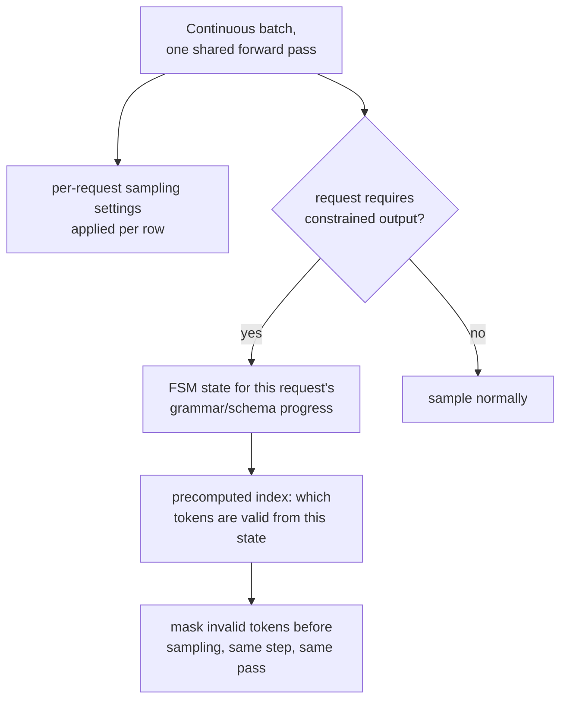

# Lección 19. Muestreo y decodificación restringida al servir

**Vínculo con la misión:** La etapa 2 estableció el batching continuo: muchas solicitudes comparten una pasada forward para que el costoso costo de carga de pesos del servidor se amortice entre todas ellas. Esta lección cubre dos cosas que esa pasada tiene que hacer por solicitud, no de forma uniforme en todo el lote: aplicar los ajustes de muestreo propios de cada solicitud y, cuando se pide, garantizar que la salida de una solicitud sea siempre JSON válido o se ajuste a una gramática, sin añadir un costo real por token para lograrlo.
**Fuente principal:** [Paper: "Efficient Guided Generation for Large Language Models" (Outlines), Willard and Louf, 2023](https://arxiv.org/abs/2307.09702)
**Requisitos previos:** [Lección 4](0004-static-vs-continuous-batching.md), [Lección 18](0018-speculative-decoding.md)

## Calentamiento

1. ▢ ¿Por qué el batching continuo supera al batching estático con un flujo de solicitudes de longitudes mixtas?

Comprobación

El batching estático espera a que termine cada solicitud de un lote fijo antes de empezar uno nuevo, y desperdicia tiempo de GPU en slots cuyas solicitudes ya se completaron. El batching continuo, en cambio, añade y quita solicitudes individuales del lote en ejecución según llegan y terminan, manteniendo el lote lleno de trabajo activo en lugar de inactivo en slots ya terminados.

2. ▢ ¿Por qué verificar varios tokens candidatos en una pasada paralela cuesta aproximadamente lo que cuesta generar un token normalmente?

Comprobación

El decode está limitado por el ancho de banda de memoria: el costo dominante de un paso es mover los pesos del modelo, lo que ocurre una vez sin importar cuántas posiciones candidatas se puntúen en esa misma pasada, así que puntuar varias en lugar de una añade comparativamente poco costo extra.

## Qué debes saber

### Los ajustes de muestreo viven por solicitud, dentro de un lote compartido

Cada solicitud de un lote continuo puede pedir su propia temperature, top-k y top-p (conceptos a nivel de llm/transformers de la lección 18, aplicados aquí en tiempo de serving), y el motor de serving tiene que aplicar los ajustes correctos a cada fila de la pasada forward compartida del lote, no un único ajuste uniforme para todos los que comparten ese paso. Es un costo real de contabilidad por solicitud añadido sobre el lote, ya que dos solicitudes colocadas una al lado de la otra en la misma pasada forward pueden acabar muestreando sus distribuciones del siguiente token de maneras completamente distintas.

### Decodificación restringida: enmascarar los tokens inválidos, la misma idea que ya usaba el enmascaramiento causal

La **decodificación restringida (guiada)** garantiza que la salida de una solicitud siempre se ajuste a una estructura exigida, JSON válido, una gramática concreta, enmascarando todo token que violaría esa estructura antes de que ocurra siquiera el muestreo, la misma idea de fondo que enmascarar la puntuación de una posición futura antes del softmax: las opciones prohibidas quedan fuera de la contienda en lugar de muestrearse y comprobarse después. La diferencia es qué decide la máscara: una máscara causal es el mismo patrón fijo cada vez; la máscara de una restricción de gramática cambia en cada paso, ya que qué tokens son válidos a continuación depende de cuánto de la estructura exigida se ha producido ya.

### Un índice basado en FSM es lo que lo mantiene barato por token

La manera ingenua de construir esa máscara por paso, comprobando cada token del vocabulario contra la gramática desde cero en cada paso, añadiría una sobrecarga real, posiblemente seria, a cada token generado. La contribución real de la fuente principal es replantear la generación restringida como transiciones entre los estados de una **máquina de estados finitos**, lo que permite construir un **índice** una sola vez, por adelantado, sobre todo el vocabulario del modelo: para cada estado de la FSM, qué tokens son transiciones válidas se precalcula en lugar de recalcularse desde cero en cada paso. Eso es lo que quiere decir el paper con añadir poca sobrecarga a la generación de tokens a la vez que se garantiza exactamente la estructura de la salida, en lugar de cambiar una implementación lenta y correcta por una rápida y poco fiable.

### La garantía es estructural, no la esperanza de que el modelo se porte bien

Como los tokens inválidos se enmascaran de la distribución antes de muestrear, y no se corrigen a posteriori, la estructura de la salida queda garantizada por construcción: no hay forma de que el modelo produzca JSON inválido o una violación de la gramática, ya que los tokens que producirían una nunca fueron elegibles para muestrearse en ese paso. Es una garantía más fuerte que pedirle a un modelo "por favor, produce JSON válido" y esperar, igual que la máscara causal de la lección 3 (en la arquitectura que este espacio de trabajo sirve en lugar de derivar) hace estructuralmente imposible atender al futuro en lugar de simplemente desaconsejarlo.

### El costo real es una constante por token, no un añadido por solicitud

Como el índice de la FSM se precalcula una vez por gramática (o esquema) y no por solicitud, el costo por token de imponerlo al servir es una cantidad pequeña y aproximadamente constante de contabilidad extra aplicada a la misma pasada forward que ya necesitaba cualquier otro token, no un paso costoso aparte. Es exactamente el tipo de costo que un presupuesto de latencia defendido (etapa 6) tiene que contabilizar explícitamente: una carga de trabajo que restringe una fracción significativa de sus solicitudes debería medir esa sobrecarga constante del mismo modo que mide el costo del reranking (el marco de decisión de otro espacio de trabajo, pero la misma disciplina), en lugar de suponer que la salida estructurada es gratis solo porque la garantía en sí es fuerte.

## Práctica

1. ▢ Dos solicitudes están en la misma pasada forward de un lote continuo, una con temperature 0.2 y otra con temperature 1.0. ¿Puede el servidor aplicar un único ajuste de muestreo compartido a ambas, como aplica un único conjunto compartido de pesos a ambas?

Pista

Considera qué varía por solicitud frente a qué se comparte en todo el lote.

Comprobación

No. Los pesos del modelo se comparten en todo el lote, pero los ajustes de muestreo son por solicitud; el servidor tiene que aplicar la temperature propia de cada fila (y el top-k/top-p) a la distribución del siguiente token de esa fila dentro de la misma pasada forward compartida, no un único ajuste uniforme para todas las solicitudes que contiene.

2. ▢ ¿Por qué el enfoque ingenuo de la decodificación restringida, comprobar cada token del vocabulario contra la gramática desde cero en cada paso, corre el riesgo de añadir una sobrecarga seria?

Comprobación

Comprobar un vocabulario potencialmente grande contra los requisitos actuales de la gramática desde cero en cada token generado es trabajo real y repetido sobre la propia pasada forward del modelo; sin precalcular nada, este costo se paga por completo en cada paso en lugar de reducirse a una consulta rápida.

3. ▢ ¿Qué le permite precalcular el replanteamiento con máquina de estados finitos del paper de Outlines, y por qué eso mantiene baja la sobrecarga por token?

Comprobación

Permite construir un índice una sola vez, por adelantado, sobre el vocabulario del modelo, que asigna a cada estado de la FSM los tokens que son transiciones válidas desde él. En el momento de la generación, comprobar qué tokens están permitidos pasa a ser una consulta en este índice precalculado en lugar de una comprobación nueva contra la gramática desde cero, que es lo que mantiene pequeña la sobrecarga añadida.

4. ▢ ¿Por qué enmascarar los tokens inválidos antes de muestrear es una garantía más fuerte que pedirle a un modelo que produzca JSON válido y comprobar el resultado después?

Comprobación

El enmascaramiento hace estructuralmente imposible muestrear un token inválido en primer lugar, ya que se elimina de la distribución antes de que ocurra siquiera el muestreo; un modelo al que solo se le ha indicado producir salida válida aún puede no seguir la instrucción, ya que nada le impide muestrear un token inválido, simplemente se le ha pedido que no lo haga.

5. ▢ ¿Qué afirmación describe correctamente el muestreo y la decodificación restringida al servir?

    - a) Los ajustes de muestreo se comparten en todo un lote, igual que los pesos del modelo
    - b) Los ajustes de muestreo se aplican por solicitud dentro de un lote compartido, y la decodificación restringida enmascara los tokens inválidos antes de muestrear usando un índice de máquina de estados finitos precalculado, manteniendo pequeño el costo por token y absoluta la garantía estructural en lugar de meramente fomentada
    - c) La decodificación restringida comprueba la salida del modelo contra la gramática cuando la generación termina, y reintenta si es inválida
    - d) Un índice basado en FSM tiene que reconstruirse desde cero en cada token generado

Comprobación

**b)** Ese es el mecanismo y la garantía precisos que establece esta lección. (a) es falsa: los ajustes de muestreo son específicamente por solicitud, a diferencia de los pesos compartidos del modelo. (c) es falsa: la decodificación restringida enmascara los tokens inválidos antes de muestrear, no cuando termina la generación. (d) es falsa: el sentido de todo el índice de la FSM es que se construye una vez y se reutiliza como una consulta rápida en cada paso, no se recalcula cada vez.

## Prácticas en el mundo real

- [ ] Para un stack de serving al que tengas acceso, comprueba si admite parámetros de muestreo por solicitud en un flujo de solicitudes en lotes, y si ofrece alguna opción de decodificación restringida o guiada (esquema JSON, gramática o regex).
- [ ] Si admite decodificación restringida, mide la latencia por token añadida de una solicitud restringida frente a una no restringida con el mismo prompt, y comprueba si esa sobrecarga es lo bastante pequeña para ignorarla en el presupuesto de tu carga de trabajo.
- [ ] Mañana: lee completa la sección de la fuente primaria sobre las gramáticas libres de contexto, y anota qué tipo de estructura (más allá de las restricciones regulares habituales del esquema JSON) puede imponer una CFG completa que una restricción simple basada en regex no puede.

## Para profundizar

- [Paper: "Efficient Guided Generation for Large Language Models" (Outlines), Willard and Louf, 2023](https://arxiv.org/abs/2307.09702)
- [Recursos](../RESOURCES.md)

---

¿No termina de quedar claro? Vuelve a leer la fuente primaria de arriba, ya que esta lección la comprime y en la compresión es donde se escapa la comprensión. Consulta el [glosario](../GLOSSARY.md) por si algún término te resultó resbaladizo.

Si lo poco claro es la propia lección y no el material, eso es un defecto: [abre un issue](https://github.com/TokenCemetery/teach/issues).
