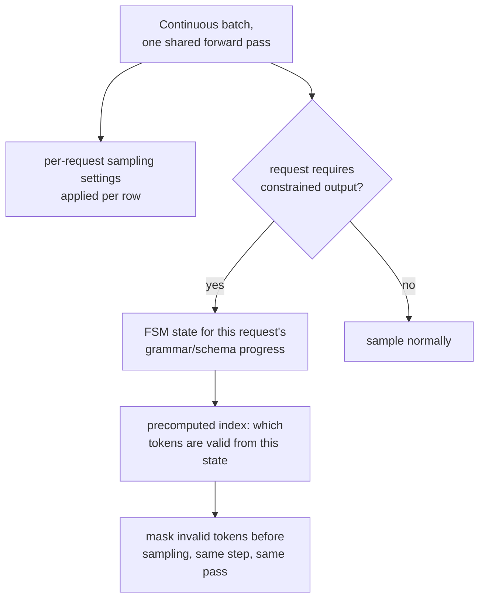

# Leçon 19. Échantillonnage et décodage contraint au moment du serving

**Lien avec la mission :** L'étape 2 a établi le continuous batching : de nombreuses requêtes partagent une même passe avant, de sorte que le coût élevé de chargement des poids du serveur est amorti entre elles toutes. Cette leçon couvre deux choses que cette passe doit faire par requête, et non uniformément pour tout le batch : appliquer les réglages d'échantillonnage propres à chaque requête et, sur demande, garantir que la sortie d'une requête est toujours du JSON valide ou respecte une grammaire, sans ajouter de vrai coût par token pour y parvenir.
**Source primaire :** [Article : "Efficient Guided Generation for Large Language Models" (Outlines), Willard et Louf, 2023](https://arxiv.org/abs/2307.09702)
**Prérequis :** [Leçon 4](0004-static-vs-continuous-batching.md), [Leçon 18](0018-speculative-decoding.md)

## Échauffement

1. ▢ Pourquoi le continuous batching bat-il le batching statique pour un flux de requêtes de longueurs variées ?

Vérifier

Le batching statique attend que chaque requête d'un batch fixe ait terminé avant d'en démarrer un nouveau, ce qui gaspille du temps GPU sur des places dont les requêtes ont déjà fini. Le continuous batching ajoute et retire plutôt des requêtes individuelles du batch en cours à mesure qu'elles arrivent et se terminent, en gardant le batch rempli de travail actif au lieu de rester inactif sur des places déjà terminées.

2. ▢ Pourquoi vérifier plusieurs tokens candidats en une seule passe parallèle coûte-t-il à peu près ce que coûte normalement la génération d'un token ?

Vérifier

Le décodage est limité par la bande passante mémoire : le coût dominant d'une étape est le déplacement des poids du modèle, qui a lieu une seule fois quel que soit le nombre de positions candidates scorées dans cette même passe, donc en scorer plusieurs au lieu d'une n'ajoute comparativement que peu de coût.

## À savoir

### Les réglages d'échantillonnage vivent par requête, à l'intérieur d'un batch partagé

Chaque requête d'un continuous batch peut demander sa propre température, son propre top-k et son propre top-p (des concepts de niveau llm/transformers de la leçon 18, appliqués ici au moment du serving), et le moteur de serving doit appliquer les bons réglages à chaque ligne de la passe avant partagée du batch, et non un réglage uniforme pour tous ceux qui partagent cette étape. C'est un vrai coût de comptabilité par requête, superposé au batch, puisque deux requêtes côte à côte dans la même passe avant peuvent finir par échantillonner leurs distributions du token suivant de façons complètement différentes.

### Décodage contraint : masquer les tokens invalides, la même idée que le masquage causal utilisait déjà

Le **décodage contraint (guidé)** garantit que la sortie d'une requête respecte toujours une structure exigée, du JSON valide, une grammaire précise, en masquant chaque token qui violerait cette structure avant même que l'échantillonnage n'ait lieu, selon la même idée sous-jacente que masquer le score d'une position future avant le softmax : les options interdites sont écartées de la compétition au lieu d'être échantillonnées puis vérifiées après coup. La différence est ce qui décide du masque : un masque causal est le même motif fixe à chaque fois ; le masque d'une contrainte de grammaire change à chaque étape, puisque les tokens valides ensuite dépendent de la part de la structure exigée qui a déjà été produite.

### Un index fondé sur un automate à états finis est ce qui garde cela peu coûteux par token

La façon naïve de construire ce masque par étape, vérifier chaque token du vocabulaire par rapport à la grammaire à neuf à chaque étape, ajouterait un surcoût réel, peut-être sérieux, à chaque token généré. La vraie contribution de la source primaire est de reformuler la génération contrainte comme des transitions entre les états d'un **automate à états finis**, ce qui permet de construire un **index** une seule fois, à l'avance, sur tout le vocabulaire du modèle : pour chaque état de l'automate, les tokens qui sont des transitions valides sont précalculés au lieu d'être recalculés de zéro à chaque étape. C'est ce que l'article entend par ajouter peu de surcoût à la génération de tokens tout en garantissant exactement la structure de la sortie, au lieu d'opposer une implémentation lente et correcte à une implémentation rapide et peu fiable.

### La garantie est structurelle, pas un espoir que le modèle se comporte bien

Parce que les tokens invalides sont masqués de la distribution avant l'échantillonnage, et non corrigés après coup, la structure de la sortie est garantie par construction : le modèle n'a aucun moyen de produire du JSON invalide ou une violation de grammaire, puisque les tokens qui en produiraient une n'étaient pas éligibles à l'échantillonnage à cette étape. C'est une garantie plus forte que de demander à un modèle « merci de produire du JSON valide » en espérant que cela marche, de la même manière que le masque causal de la leçon 3 (dans l'architecture que cet espace de travail sert plutôt que de la dériver) rend structurellement impossible, et non simplement déconseillé, de porter l'attention sur le futur.

### Le vrai coût est une constante par token, pas un à-côté par requête

Parce que l'index de l'automate est précalculé une fois par grammaire (ou schéma) plutôt que par requête, le coût par token de son application au moment du serving est une petite quantité à peu près constante de comptabilité supplémentaire appliquée à la même passe avant dont tout autre token avait déjà besoin, et non une étape coûteuse séparée. C'est exactement le genre de coût qu'un budget de latence défendu (étape 6) doit prendre en compte explicitement : une charge de travail qui contraint une fraction significative de ses requêtes devrait mesurer ce surcoût constant comme elle mesure le coût du reranking (le cadre de décision d'un autre espace de travail, mais la même discipline) au lieu de supposer que la sortie structurée est gratuite sous prétexte que la garantie elle-même est forte.

## Pratique

1. ▢ Deux requêtes se trouvent dans la même passe avant d'un continuous batch, l'une avec une température de 0.2 et l'autre de 1.0. Le serveur peut-il appliquer un seul réglage d'échantillonnage partagé aux deux, comme il applique un seul jeu de poids partagé aux deux ?

Indice

Demandez-vous ce qui varie par requête et ce qui est partagé par tout le batch.

Vérifier

Non. Les poids du modèle sont partagés par tout le batch, mais les réglages d'échantillonnage sont par requête ; le serveur doit appliquer la propre température de chaque ligne (et son top-k/top-p) à la propre distribution du token suivant de cette ligne, dans la même passe avant partagée, et non un réglage uniforme pour toutes les requêtes qu'elle contient.

2. ▢ Pourquoi l'approche naïve du décodage contraint, vérifier chaque token du vocabulaire par rapport à la grammaire à neuf à chaque étape, risque-t-elle d'ajouter un surcoût sérieux ?

Vérifier

Vérifier un vocabulaire potentiellement grand par rapport aux exigences courantes de la grammaire de zéro à chaque token généré est un travail réel et répété, en plus de la propre passe avant du modèle ; sans rien précalculer, ce coût est payé en entier à chaque étape au lieu d'être réduit à une recherche rapide.

3. ▢ Que permet de précalculer la reformulation en automate à états finis de l'article Outlines, et pourquoi cela garde-t-il le surcoût par token faible ?

Vérifier

Elle permet de construire un index une seule fois, à l'avance, sur le vocabulaire du modèle, qui associe chaque état de l'automate aux tokens qui sont des transitions valides depuis lui. Au moment de la génération, vérifier quels tokens sont autorisés devient une recherche dans cet index précalculé plutôt qu'une nouvelle vérification de zéro par rapport à la grammaire, ce qui garde le surcoût ajouté faible.

4. ▢ Pourquoi masquer les tokens invalides avant l'échantillonnage est-il une garantie plus forte que de demander à un modèle de produire du JSON valide et de vérifier le résultat après coup ?

Vérifier

Le masquage rend un token invalide structurellement impossible à échantillonner dès le départ, puisqu'il est retiré de la distribution avant même que l'échantillonnage n'ait lieu ; un modèle simplement instruit de produire une sortie valide peut encore échouer à suivre l'instruction, puisque rien ne l'empêche d'échantillonner un token invalide, on lui a juste demandé de ne pas le faire.

5. ▢ Quelle affirmation décrit correctement l'échantillonnage et le décodage contraint au moment du serving ?

    - a) Les réglages d'échantillonnage sont partagés par tout un batch, comme les poids du modèle
    - b) Les réglages d'échantillonnage s'appliquent par requête au sein d'un batch partagé, et le décodage contraint masque les tokens invalides avant l'échantillonnage à l'aide d'un index d'automate à états finis précalculé, ce qui garde le coût par token faible et la garantie structurelle absolue plutôt que simplement encouragée
    - c) Le décodage contraint vérifie la sortie du modèle par rapport à la grammaire une fois la génération terminée, et réessaie si elle est invalide
    - d) Un index fondé sur un automate à états finis doit être reconstruit de zéro à chaque token généré

Vérifier

**b)** C'est le mécanisme et la garantie précis qu'établit cette leçon. (a) est fausse : les réglages d'échantillonnage sont spécifiquement par requête, contrairement aux poids du modèle partagés. (c) est fausse : le décodage contraint masque les tokens invalides avant l'échantillonnage, pas après la fin de la génération. (d) est fausse : tout l'intérêt de l'index de l'automate est d'être construit une fois et réutilisé comme une recherche rapide à chaque étape, et non recalculé à chaque fois.

## Exercices en situation réelle

- [ ] Pour une pile de serving à laquelle vous avez accès, vérifiez si elle prend en charge des paramètres d'échantillonnage par requête dans un flux de requêtes regroupées, et si elle offre une option de décodage contraint ou guidé (schéma JSON, grammaire ou regex).
- [ ] Si elle prend en charge le décodage contraint, mesurez la latence par token ajoutée d'une requête contrainte par rapport à une requête non contrainte sur le même prompt, et vérifiez si ce surcoût est assez faible pour être ignoré face au budget de votre charge de travail.
- [ ] Demain : lisez en entier la section de la source primaire sur les grammaires non contextuelles, et notez quel genre de structure (au-delà des contraintes habituellement régulières du schéma JSON) une grammaire non contextuelle complète peut imposer qu'une simple contrainte à base de regex ne peut pas.

## Pour aller plus loin

- [Article : "Efficient Guided Generation for Large Language Models" (Outlines), Willard et Louf, 2023](https://arxiv.org/abs/2307.09702)
- [Ressources](../RESOURCES.md)

---

Ça ne passe pas ? Relisez la source primaire en haut de page, car cette leçon la condense et c'est dans la condensation que la compréhension s'échappe. Consultez le [glossaire](../GLOSSARY.md) pour tout terme qui vous a paru glissant.

Si c'est la leçon elle-même qui n'est pas claire plutôt que la matière, c'est un défaut : [ouvrez une issue](https://github.com/TokenCemetery/teach/issues).
