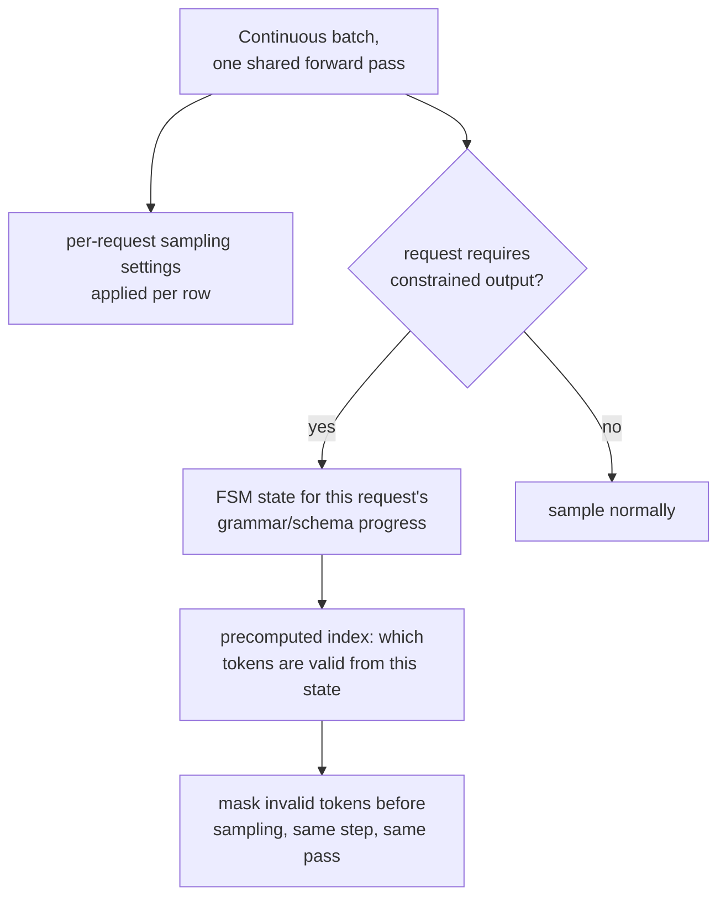

# पाठ 19. Serve Time पर Sampling और Constrained Decoding

**मिशन से संबंध:** चरण 2 ने continuous batching स्थापित की: कई requests एक forward pass साझा करती हैं ताकि server की महँगी weight-loading लागत उन सब में बाँटी जा सके। यह पाठ दो ऐसी चीज़ें कवर करता है जो उस pass को प्रति request करनी पड़ती हैं, पूरे batch में एकसमान नहीं: हर request की अपनी sampling settings लगाना, और, माँगे जाने पर, यह गारंटी देना कि किसी request का output हमेशा valid JSON हो या किसी grammar से मेल खाए, वहाँ पहुँचने के लिए प्रति token असली लागत जोड़े बिना।
**मुख्य स्रोत:** [पेपर: "Efficient Guided Generation for Large Language Models" (Outlines), Willard and Louf, 2023](https://arxiv.org/abs/2307.09702)
**पूर्व-आवश्यकताएँ:** [पाठ 4](0004-static-vs-continuous-batching.md), [पाठ 18](0018-speculative-decoding.md)

## वार्म-अप

1. ▢ मिली-जुली length वाली request stream के लिए continuous batching static batching से बेहतर क्यों है?

जाँचें

Static batching निश्चित batch की हर request के ख़त्म होने का इंतज़ार करके ही नया शुरू करती है, और उन slots पर GPU का समय बरबाद करती है जिनकी requests पहले ही पूरी हो चुकी हैं। Continuous batching इसके बजाय चलते batch में अलग-अलग requests को आने और ख़त्म होने के साथ जोड़ती और हटाती है, batch को पहले से ख़त्म हुए slots पर ख़ाली बैठने के बजाय सक्रिय काम से भरा रखती है।

2. ▢ कई संभावित tokens को एक parallel pass में verify करने की लागत लगभग एक token आम तौर पर generate करने जितनी क्यों होती है?

जाँचें

Decoding memory-bandwidth-bound है: step की मुख्य लागत model के weights को ले जाना है, जो एक ही बार होता है चाहे उसी pass में कितने भी candidate positions score किए जाएँ, इसलिए एक की जगह कई score करना तुलनात्मक रूप से बहुत कम अतिरिक्त लागत जोड़ता है।

## यह जानें

### Sampling settings प्रति request होती हैं, एक साझा batch के भीतर

Continuous batch की हर request अपना temperature, top-k और top-p माँग सकती है (पाठ 18 की llm/transformers-स्तर की अवधारणाएँ, जिन्हें यहाँ serve time पर लगाया गया है), और serving engine को batch के साझा forward pass की हर row पर सही settings लगानी पड़ती है, उस step को साझा करने वाले सबके लिए एक एकसमान setting नहीं। यह batch के ऊपर परतों में लगी प्रति-request bookkeeping की असली लागत है, क्योंकि एक ही forward pass में अगल-बगल बैठी दो requests अपने अगले-token distributions से बिल्कुल अलग ढंग से sample कर सकती हैं।

### Constrained decoding: अमान्य tokens को mask करना, वही विचार जो causal masking पहले से इस्तेमाल करती थी

**Constrained (guided) decoding** गारंटी देती है कि किसी request का output हमेशा ज़रूरी structure से मेल खाए, valid JSON, कोई ख़ास grammar, sampling होने से पहले ही हर उस token को mask करके जो उस structure को तोड़ता, वही बुनियादी विचार जो softmax से पहले भविष्य के position का score mask करने में है: मना किए गए विकल्प sample होकर बाद में जाँचे जाने के बजाय दौड़ से बाहर कर दिए जाते हैं। फ़र्क़ इसमें है कि mask को क्या तय करता है: causal mask हर बार एक ही तय पैटर्न है; grammar constraint का mask हर step पर बदलता है, क्योंकि आगे कौन-से tokens valid हैं यह इस पर निर्भर करता है कि ज़रूरी structure का कितना हिस्सा पहले ही बन चुका है।

### FSM-आधारित index ही इसे प्रति token सस्ता रखता है

उस प्रति-step mask को बनाने का सीधा तरीक़ा, हर step पर शब्दावली के हर token को grammar के विरुद्ध नए सिरे से जाँचना, generate हुए हर एक token में असली, शायद गंभीर overhead जोड़ता। मुख्य स्रोत का असली योगदान constrained generation को **finite-state machine** की states के बीच transitions के रूप में देखना है, जो model की पूरी शब्दावली पर पहले से एक बार **index** बनाने देता है: हर FSM state के लिए कौन-से tokens valid transitions हैं यह हर step पर शुरू से दोबारा निकालने के बजाय पहले से compute रहता है। पेपर इसी का मतलब बताता है जब वह कहता है कि token generation में थोड़ा overhead जुड़ता है जबकि output का structure ठीक-ठीक गारंटीशुदा रहता है, धीमे, सही implementation और तेज़, अविश्वसनीय implementation के बीच सौदा करने के बजाय।

### गारंटी structural है, model के ठीक बरताव की उम्मीद नहीं

क्योंकि अमान्य tokens sampling से पहले distribution से mask कर दिए जाते हैं, बाद में सुधारे नहीं जाते, इसलिए output का structure बनावट से ही गारंटीशुदा है: model के लिए अमान्य JSON या grammar का उल्लंघन बनाने का कोई रास्ता नहीं, क्योंकि जो tokens उसे बनाते वे उस step पर sample होने के योग्य कभी थे ही नहीं। यह model से "कृपया valid JSON दें" कहकर उम्मीद करने से मज़बूत गारंटी है, वैसे ही जैसे पाठ 3 का causal mask (उस architecture में जिसे यह workspace serve करता है, derive नहीं करता) भविष्य पर attend करना सिर्फ़ हतोत्साहित करने के बजाय structurally असंभव बना देता है।

### असली लागत प्रति token एक स्थिरांक है, प्रति request की बाद की सोच नहीं

क्योंकि FSM index प्रति request के बजाय प्रति grammar (या schema) एक बार पहले से compute होता है, serve time पर उसे लागू करने की प्रति-token लागत उसी forward pass पर लगा थोड़ा, लगभग स्थिर अतिरिक्त bookkeeping है जो हर दूसरे token को पहले से चाहिए था, कोई अलग महँगा step नहीं। यह ठीक उसी तरह की लागत है जिसे बचाव किए गए latency budget (चरण 6) को साफ़ गिनना पड़ता है: जो workload अपनी requests के किसी अर्थपूर्ण हिस्से को constrain करता है उसे वह स्थिर overhead उसी तरह नापना चाहिए जैसे वह reranking की लागत नापता है (किसी और workspace का फ़ैसला-ढाँचा, पर वही अनुशासन), यह मानने के बजाय कि structured output मुफ़्त है सिर्फ़ इसलिए कि गारंटी ख़ुद मज़बूत है।

## अभ्यास

1. ▢ दो requests एक ही continuous batch के forward pass में बैठी हैं, एक का temperature 0.2 है और एक का 1.0। क्या server दोनों पर एक साझा sampling setting लगा सकता है, जैसे वह दोनों पर weights का एक साझा सेट लगाता है?

संकेत

सोचें कि प्रति request क्या बदलता है और पूरे batch में क्या साझा है।

जाँचें

नहीं। Model के weights पूरे batch में साझा हैं, पर sampling settings प्रति-request हैं; server को हर row का अपना temperature (और top-k/top-p) उसी साझा forward pass के भीतर उस row के अपने अगले-token distribution पर लगाना पड़ता है, उसमें हर request के लिए एक एकसमान setting नहीं।

2. ▢ Constrained decoding का सीधा तरीक़ा, हर step पर शब्दावली के हर token को grammar के विरुद्ध नए सिरे से जाँचना, गंभीर overhead जोड़ने का जोखिम क्यों रखता है?

जाँचें

संभावित रूप से बड़ी शब्दावली को हर एक generate हुए token पर grammar की मौजूदा ज़रूरतों के विरुद्ध शुरू से जाँचना model के अपने forward pass के ऊपर असली, बार-बार किया जाने वाला काम है; कुछ भी पहले से compute किए बिना, यह लागत हर step पर पूरी चुकानी पड़ती है, तेज़ lookup तक घटने के बजाय।

3. ▢ Outlines पेपर का finite-state-machine वाला नज़रिया उसे क्या पहले से compute करने देता है, और इससे प्रति-token overhead कम क्यों रहता है?

जाँचें

यह model की शब्दावली पर पहले से एक बार index बनाने देता है, जो हर FSM state को उन tokens से जोड़ता है जो उससे valid transitions हैं। Generation के समय यह जाँचना कि कौन-से tokens अनुमत हैं, grammar के विरुद्ध नई जाँच की जगह इस पहले से compute किए index में lookup बन जाता है, और यही जुड़े overhead को छोटा रखता है।

4. ▢ Sampling से पहले अमान्य tokens को mask करना, model से valid JSON बनाने को कहने और नतीजा बाद में जाँचने से मज़बूत गारंटी क्यों है?

जाँचें

Masking अमान्य token को sample होना structurally असंभव बना देती है, क्योंकि वह sampling होने से पहले ही distribution से हटा दिया जाता है; जिस model को सिर्फ़ valid output बनाने का निर्देश दिया गया है वह निर्देश मानने में अब भी चूक सकता है, क्योंकि कुछ उसे अमान्य token sample करने से रोकता नहीं, बस उससे न करने को कहा गया है।

5. ▢ Serve time पर sampling और constrained decoding का सही वर्णन कौन-सा दावा करता है?

    - a) Sampling settings पूरे batch में साझा होती हैं, model weights की तरह
    - b) Sampling settings साझा batch के भीतर प्रति request लागू होती हैं, और constrained decoding पहले से compute किए finite-state-machine index से sampling से पहले अमान्य tokens को mask करती है, प्रति-token लागत छोटी और structural गारंटी सिर्फ़ प्रोत्साहित नहीं बल्कि पूर्ण रखती है
    - c) Constrained decoding generation पूरा होने के बाद model के output को grammar के विरुद्ध जाँचती है, अमान्य होने पर दोबारा कोशिश करती है
    - d) FSM-आधारित index को हर generate हुए token पर शुरू से दोबारा बनाना पड़ता है

जाँचें

**b)** यही वह सटीक तंत्र और गारंटी है जो यह पाठ स्थापित करता है। (a) ग़लत है: sampling settings ख़ास तौर पर प्रति-request हैं, साझा model weights के उलट। (c) ग़लत है: constrained decoding अमान्य tokens को sampling से पहले mask करती है, generation पूरा होने के बाद नहीं। (d) ग़लत है: FSM index का पूरा मक़सद यही है कि वह एक बार बनता है और हर step पर तेज़ lookup की तरह दोबारा इस्तेमाल होता है, हर बार दोबारा compute नहीं होता।

## असली दुनिया का अभ्यास

- [ ] जिस serving stack तक आपकी पहुँच है उसके लिए जाँचें कि वह batched request stream में प्रति-request sampling parameters support करता है या नहीं, और वह कोई constrained या guided decoding विकल्प (JSON schema, grammar, या regex) देता है या नहीं।
- [ ] अगर वह constrained decoding support करता है, तो उसी prompt पर constrained request की जुड़ी प्रति-token latency को unconstrained से नापकर तुलना करें, और जाँचें कि वह overhead आपके workload के budget के लिए अनदेखा करने लायक़ छोटा है या नहीं।
- [ ] कल: मुख्य स्रोत का context-free grammars वाला खंड पूरा पढ़ें, और नोट करें कि पूरा CFG किस तरह का structure (JSON Schema की आम regular बाधाओं से परे) लागू कर सकता है जो सादी regex-आधारित बाधा नहीं कर सकती।

## आगे बढ़ने के लिए

- [पेपर: "Efficient Guided Generation for Large Language Models" (Outlines), Willard and Louf, 2023](https://arxiv.org/abs/2307.09702)
- [संसाधन](../RESOURCES.md)

---

बात नहीं बन रही? ऊपर दिए मुख्य स्रोत को दोबारा पढ़ें, क्योंकि यह पाठ उसे संक्षिप्त करता है और समझ संक्षेप में ही रिसती है। जो शब्द फिसलन भरा लगे, उसके लिए [शब्दावली](../GLOSSARY.md) देखें।

अगर दिक़्क़त सामग्री की नहीं बल्कि पाठ की ही है, तो वह एक खोट है: [issue खोलें](https://github.com/TokenCemetery/teach/issues)।
