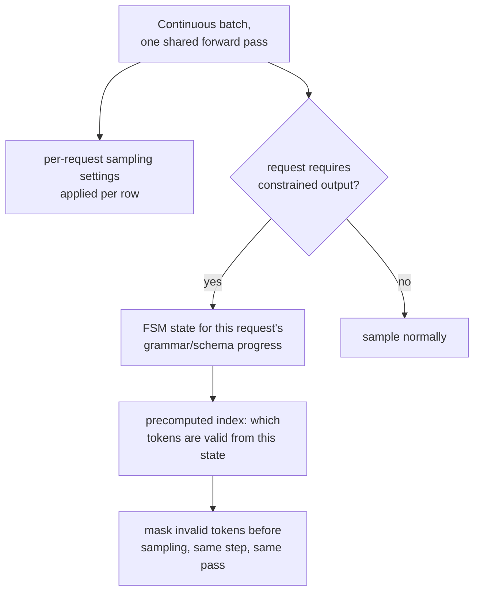

# Lição 19. Amostragem e decodificação restrita no serving

**Ligação com a missão:** A etapa 2 estabeleceu o continuous batching: muitas requisições compartilham uma passada forward, de modo que o caro custo de carregar os pesos do servidor é amortizado entre todas elas. Esta lição cobre duas coisas que essa passada precisa fazer por requisição, e não de forma uniforme para o batch inteiro: aplicar as configurações de amostragem próprias de cada requisição e, quando solicitado, garantir que a saída de uma requisição seja sempre JSON válido ou obedeça a uma gramática, sem acrescentar custo real por token para chegar lá.
**Fonte principal:** [Artigo científico: "Efficient Guided Generation for Large Language Models" (Outlines), Willard e Louf, 2023](https://arxiv.org/abs/2307.09702)
**Pré-requisitos:** [Lição 4](0004-static-vs-continuous-batching.md), [Lição 18](0018-speculative-decoding.md)

## Aquecimento

1. ▢ Por que o continuous batching vence o batching estático para um fluxo de requisições de comprimentos mistos?

Verificação

O batching estático espera todas as requisições de um batch fixo terminarem antes de iniciar um novo, desperdiçando tempo de GPU em slots cujas requisições já terminaram. O continuous batching, em vez disso, adiciona e remove requisições individuais do batch em execução conforme elas chegam e terminam, mantendo o batch cheio de trabalho ativo em vez de ocioso em slots já terminados.

2. ▢ Por que verificar vários tokens candidatos em uma passada paralela custa aproximadamente o que custa gerar um token normalmente?

Verificação

O decode é limitado pela largura de banda de memória: o custo dominante de um passo é mover os pesos do modelo, o que acontece uma vez, independentemente de quantas posições candidatas são pontuadas nessa mesma passada, então pontuar várias em vez de uma acrescenta comparativamente pouco custo extra.

## Saiba isto

### As configurações de amostragem vivem por requisição, dentro de um batch compartilhado

Cada requisição em um batch contínuo pode pedir a sua própria temperatura, top-k e top-p (conceitos de nível llm/transformers da lição 18, aplicados aqui em tempo de serving), e o engine de serving precisa aplicar as configurações certas a cada linha da passada forward compartilhada do batch, e não uma única configuração uniforme para todos que dividem aquele passo. Esse é um custo real de contabilidade por requisição, somado ao do batch, já que duas requisições lado a lado na mesma passada forward podem acabar amostrando as suas distribuições de próximo token de maneiras completamente diferentes.

### Decodificação restrita: mascarar tokens inválidos, a mesma ideia que a máscara causal já usava

A **decodificação restrita (guiada)** garante que a saída de uma requisição sempre obedeça a uma estrutura exigida, JSON válido, uma gramática específica, ao mascarar todo token que violaria essa estrutura antes de a amostragem acontecer, a mesma ideia de fundo de mascarar a pontuação de uma posição futura antes do softmax: as opções proibidas são tiradas da disputa em vez de serem amostradas e verificadas depois. A diferença é o que decide a máscara: uma máscara causal é o mesmo padrão fixo toda vez; a máscara de uma restrição de gramática muda a cada passo, já que quais tokens são válidos em seguida depende de quanto da estrutura exigida já foi produzido.

### Um índice baseado em FSM é o que mantém isso barato por token

A forma ingênua de construir essa máscara por passo, verificando todo token do vocabulário contra a gramática do zero a cada passo, acrescentaria um overhead real, possivelmente sério, a cada token gerado. A contribuição real da fonte principal é reformular a geração restrita como transições entre os estados de uma **máquina de estados finitos**, o que permite construir um **índice** uma vez, de antemão, sobre todo o vocabulário do modelo: para cada estado da FSM, quais tokens são transições válidas é pré-computado, em vez de recalculado do zero a cada passo. É isso que o artigo quer dizer ao falar em acrescentar pouco overhead à geração de tokens e ainda assim garantir exatamente a estrutura da saída, em vez de trocar uma implementação lenta e correta por uma rápida e pouco confiável.

### A garantia é estrutural, e não uma esperança de que o modelo se comporte

Como os tokens inválidos são mascarados da distribuição antes da amostragem, e não corrigidos depois do fato, a estrutura da saída é garantida por construção: não há como o modelo produzir JSON inválido ou uma violação de gramática, já que os tokens que produziriam uma nunca eram elegíveis para serem amostrados naquele passo. Essa é uma garantia mais forte do que pedir a um modelo "por favor, produza JSON válido" e torcer, do mesmo modo que a máscara causal da lição 3 (na arquitetura que este workspace serve em vez de derivar) torna estruturalmente impossível atender ao futuro, em vez de apenas desencorajado.

### O custo real é uma constante por token, e não uma reflexão tardia por requisição

Como o índice da FSM é pré-computado uma vez por gramática (ou schema) em vez de por requisição, o custo por token de aplicá-la em tempo de serving é uma quantidade pequena e aproximadamente constante de contabilidade extra, aplicada à mesma passada forward de que todo outro token já precisava, e não um passo caro separado. Esse é exatamente o tipo de custo que um orçamento de latência defendido (etapa 6) precisa levar em conta explicitamente: uma carga de trabalho que restringe uma fração significativa das suas requisições deveria medir esse overhead constante do mesmo modo que mede o custo do reranking (o framework de decisão de outro workspace, mas a mesma disciplina), em vez de presumir que a saída estruturada é gratuita só porque a garantia em si é forte.

## Prática

1. ▢ Duas requisições estão na mesma passada forward de um batch contínuo, uma com temperatura 0,2 e outra com 1,0. O servidor pode aplicar uma única configuração de amostragem compartilhada às duas, do jeito que aplica um único conjunto de pesos compartilhado às duas?

Dica

Considere o que varia por requisição e o que é compartilhado por todo o batch.

Verificação

Não. Os pesos do modelo são compartilhados por todo o batch, mas as configurações de amostragem são por requisição; o servidor precisa aplicar a temperatura própria de cada linha (e o top-k/top-p) à distribuição de próximo token dessa linha dentro da mesma passada forward compartilhada, e não uma configuração uniforme para todas as requisições nela.

2. ▢ Por que a abordagem ingênua da decodificação restrita, verificar todo token do vocabulário contra a gramática do zero a cada passo, corre o risco de acrescentar um overhead sério?

Verificação

Verificar um vocabulário potencialmente grande contra as exigências atuais da gramática do zero a cada token gerado é trabalho real e repetido, somado à própria passada forward do modelo; sem pré-computar nada, esse custo é pago por inteiro a cada passo, em vez de ser reduzido a uma consulta rápida.

3. ▢ O que a reformulação como máquina de estados finitos do artigo do Outlines permite pré-computar, e por que isso mantém baixo o overhead por token?

Verificação

Permite construir um índice uma vez, de antemão, sobre o vocabulário do modelo, mapeando cada estado da FSM para os tokens que são transições válidas a partir dele. Na hora da geração, verificar quais tokens são permitidos vira uma consulta nesse índice pré-computado, em vez de uma verificação nova contra a gramática do zero, e é isso que mantém pequeno o overhead acrescentado.

4. ▢ Por que mascarar tokens inválidos antes da amostragem é uma garantia mais forte do que pedir a um modelo que produza JSON válido e verificar o resultado depois?

Verificação

O mascaramento torna estruturalmente impossível amostrar um token inválido, já que ele é removido da distribuição antes de a amostragem acontecer; um modelo apenas instruído a produzir saída válida ainda pode falhar em seguir a instrução, já que nada o impede de amostrar um token inválido, apenas lhe pediram que não o fizesse.

5. ▢ Qual afirmação descreve corretamente a amostragem e a decodificação restrita em tempo de serving?

    - a) As configurações de amostragem são compartilhadas por um batch inteiro, como os pesos do modelo
    - b) As configurações de amostragem se aplicam por requisição dentro de um batch compartilhado, e a decodificação restrita mascara tokens inválidos antes da amostragem usando um índice pré-computado de máquina de estados finitos, mantendo pequeno o custo por token e a garantia estrutural absoluta, e não meramente incentivada
    - c) A decodificação restrita verifica a saída do modelo contra a gramática depois de a geração terminar, tentando de novo se for inválida
    - d) Um índice baseado em FSM precisa ser reconstruído do zero a cada token gerado

Verificação

**b)** Esse é o mecanismo e a garantia precisos que esta lição estabelece. (a) é falsa: as configurações de amostragem são especificamente por requisição, ao contrário dos pesos compartilhados do modelo. (c) é falsa: a decodificação restrita mascara tokens inválidos antes da amostragem, e não depois de a geração terminar. (d) é falsa: todo o sentido do índice da FSM é ser construído uma vez e reutilizado como uma consulta rápida a cada passo, e não recalculado toda vez.

## Prática no mundo real

- [ ] Para uma stack de serving a que você tenha acesso, verifique se ela suporta parâmetros de amostragem por requisição em um fluxo de requisições em batch e se oferece alguma opção de decodificação restrita ou guiada (JSON schema, gramática ou regex).
- [ ] Se ela suportar decodificação restrita, meça a latência por token adicionada de uma requisição restrita em comparação com uma irrestrita sobre o mesmo prompt e verifique se esse overhead é pequeno o bastante para ser ignorado no orçamento da sua carga de trabalho.
- [ ] Amanhã: leia por inteiro a seção da fonte principal sobre gramáticas livres de contexto e anote que tipo de estrutura (além das restrições regulares usuais do JSON Schema) uma CFG completa consegue impor e uma restrição simples baseada em regex não consegue.

## Para ir além

- [Artigo científico: "Efficient Guided Generation for Large Language Models" (Outlines), Willard e Louf, 2023](https://arxiv.org/abs/2307.09702)
- [Recursos](../RESOURCES.md)

---

Não ficou claro? Releia a fonte principal no topo, já que esta lição a comprime e é na compressão que o entendimento escapa. Consulte o [glossário](../GLOSSARY.md) para qualquer termo que pareceu escorregadio.

Se o problema é a lição em si, e não o material, isso é um defeito: [abra uma issue](https://github.com/TokenCemetery/teach/issues).
