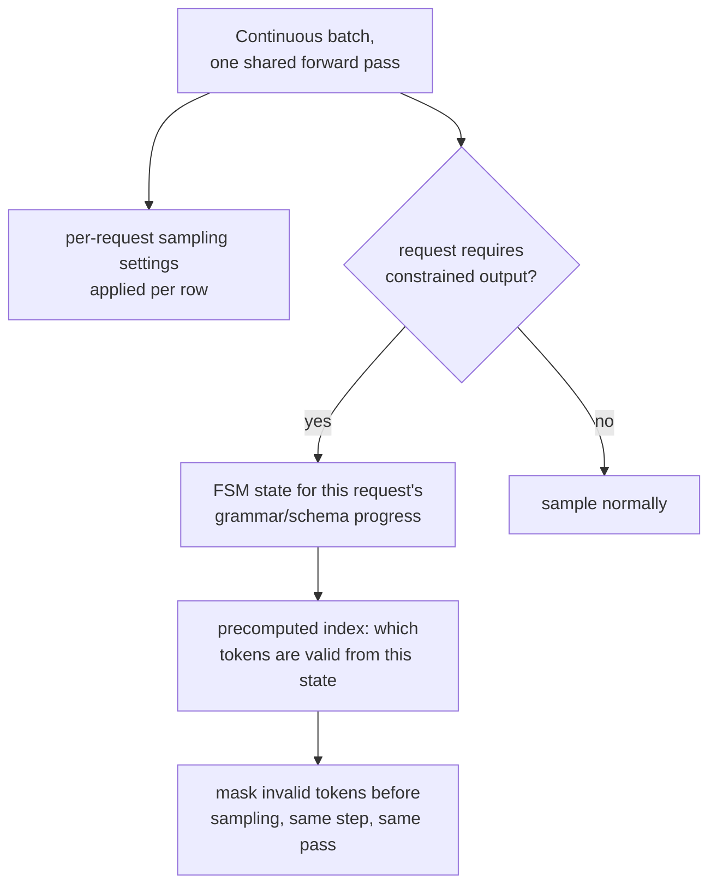

# Урок 19. Сэмплирование и ограниченное декодирование при обслуживании

**Связь с целью курса:** Этап 2 установил непрерывный батчинг: множество запросов делят один прямой проход, так что дорогая стоимость загрузки весов сервера распределяется между всеми ними. Этот урок охватывает две вещи, которые этот проход должен делать по запросам, а не единообразно для всего батча: применять собственные настройки сэмплирования каждого запроса и, когда это нужно, гарантировать, что вывод запроса всегда корректный JSON или соответствует грамматике, не добавляя для этого реальной стоимости на токен.
**Первоисточник:** [Научная статья: "Efficient Guided Generation for Large Language Models" (Outlines), Willard and Louf, 2023](https://arxiv.org/abs/2307.09702)
**Предварительные требования:** [Урок 4](0004-static-vs-continuous-batching.md), [Урок 18](0018-speculative-decoding.md)

## Разминка

1. ▢ Почему непрерывный батчинг лучше статического для потока запросов разной длины?

Проверка

Статический батчинг ждёт завершения каждого запроса в фиксированном батче, прежде чем начать новый, расточая время GPU на слоты, запросы которых уже завершились. Непрерывный батчинг вместо этого добавляет и убирает отдельные запросы из работающего батча по мере их прихода и завершения, держа батч заполненным активной работой, а не простаивающим на уже завершённых слотах.

2. ▢ Почему проверка нескольких токенов-кандидатов за один параллельный проход стоит примерно столько же, сколько обычная генерация одного токена?

Проверка

Декодирование ограничено пропускной способностью памяти: главная стоимость шага это перемещение весов модели, которое происходит один раз независимо от того, сколько позиций-кандидатов оценивается за тот же проход, поэтому оценка нескольких вместо одной добавляет сравнительно немного стоимости.

## Что нужно знать

### Настройки сэмплирования живут по запросам, внутри одного общего батча

Каждый запрос в непрерывном батче может просить свои температуру, top-k и top-p (понятия уровня llm/transformers из урока 18, применённые здесь при обслуживании), и движок обслуживания должен применять правильные настройки к каждой строке общего прямого прохода батча, а не одну единую настройку для всех, кто делит этот шаг. Это реальные накладные расходы учёта по запросам поверх батча, поскольку два запроса, стоящие рядом в одном прямом проходе, могут сэмплировать из своих распределений следующего токена совершенно по-разному.

### Ограниченное декодирование: маскирование недопустимых токенов, та же идея, что уже использовала причинная маска

**Ограниченное (управляемое) декодирование (constrained, guided decoding)** гарантирует, что вывод запроса всегда соответствует требуемой структуре, корректному JSON или конкретной грамматике, маскируя каждый токен, который нарушил бы эту структуру, до того как сэмплирование вообще происходит; это та же идея, что и маскирование оценки будущей позиции перед softmax: запрещённые варианты выводятся из борьбы, а не сэмплируются и затем проверяются. Различие в том, что определяет маску: причинная маска это каждый раз один и тот же фиксированный шаблон; маска грамматического ограничения меняется на каждом шаге, поскольку то, какие токены допустимы следующими, зависит от того, какая часть требуемой структуры уже порождена.

### Индекс на основе конечного автомата делает это дешёвым на токен

Наивный способ построить эту маску на каждом шаге, заново проверяя каждый токен словаря по грамматике на каждом шаге, добавил бы реальные, возможно серьёзные накладные расходы на каждый генерируемый токен. Реальный вклад первоисточника в том, что он переосмысляет ограниченную генерацию как переходы между состояниями **конечного автомата (finite-state machine)**, что позволяет один раз, заранее, построить **индекс (index)** по всему словарю модели: для каждого состояния автомата заранее вычисляется, какие токены являются допустимыми переходами, а не пересчитывается с нуля на каждом шаге. Именно это статья имеет в виду, говоря, что добавляет мало накладных расходов к генерации токенов, при этом точно гарантируя структуру вывода, а не обменивая медленную корректную реализацию на быструю ненадёжную.

### Гарантия структурная, а не надежда, что модель будет вести себя правильно

Поскольку недопустимые токены маскируются в распределении до сэмплирования, а не исправляются постфактум, структура вывода гарантируется построением: у модели нет способа выдать некорректный JSON или нарушение грамматики, поскольку токены, которые привели бы к нему, на этом шаге вообще не были допустимы для сэмплирования. Это более сильная гарантия, чем просить модель «пожалуйста, выдай корректный JSON» и надеяться, так же как причинная маска из урока 3 (в архитектуре, которую это рабочее пространство обслуживает, а не выводит) делает обращение внимания на будущее структурно невозможным, а не просто нежелательным.

### Реальная стоимость это постоянная на токен, а не запоздалая мысль на запрос

Поскольку индекс конечного автомата вычисляется один раз на грамматику (или схему), а не на запрос, стоимость на токен для его применения при обслуживании это небольшой, примерно постоянный объём дополнительного учёта, применяемый к тому же прямому проходу, который каждому другому токену и так был нужен, а не отдельный дорогой шаг. Это именно тот вид стоимости, который защищаемый бюджет задержки (этап 6) должен учитывать явно: нагрузка, ограничивающая заметную долю своих запросов, должна измерить эти постоянные накладные расходы так же, как измеряет стоимость реранкинга (решающая схема другого рабочего пространства, но та же дисциплина), а не считать структурированный вывод бесплатным лишь потому, что сама гарантия сильна.

## Практика

1. ▢ Два запроса стоят в одном прямом проходе непрерывного батча, один с температурой 0,2, другой с температурой 1,0. Может ли сервер применить одну общую настройку сэмплирования к обоим, так же как он применяет к обоим один общий набор весов?

Подсказка

Подумайте о том, что меняется по запросам, а что общее для всего батча.

Проверка

Нет. Веса модели общие для всего батча, а настройки сэмплирования заданы по запросам; сервер должен применить собственную температуру каждой строки (и top-k и top-p) к собственному распределению следующего токена этой строки внутри того же общего прямого прохода, а не одну единую настройку для каждого запроса в нём.

2. ▢ Почему наивный подход к ограниченному декодированию, при котором каждый токен словаря заново проверяется по грамматике на каждом шаге, рискует добавить серьёзные накладные расходы?

Проверка

Проверять потенциально большой словарь на текущие требования грамматики с нуля на каждом генерируемом токене это реальная повторяющаяся работа поверх собственного прямого прохода модели; без какого-либо предвычисления эта стоимость платится полностью на каждом шаге, а не сводится к быстрому поиску.

3. ▢ Что переосмысление через конечный автомат в статье Outlines позволяет предвычислить и почему это сохраняет малые накладные расходы на токен?

Проверка

Оно позволяет один раз, заранее, построить индекс по словарю модели, отображающий каждое состояние автомата в токены, которые являются допустимыми переходами из него. Во время генерации проверка того, какие токены разрешены, становится поиском в этом предвычисленном индексе, а не новой проверкой по грамматике с нуля, и именно это удерживает добавленные накладные расходы малыми.

4. ▢ Почему маскирование недопустимых токенов до сэмплирования это более сильная гарантия, чем просьба к модели выдать корректный JSON с проверкой результата постфактум?

Проверка

Маскирование делает недопустимый токен структурно невозможным для сэмплирования, поскольку он убран из распределения до того, как сэмплирование вообще происходит; модель, которой лишь велено выдавать корректный вывод, всё равно может не последовать указанию, поскольку ничто не мешает ей сэмплировать недопустимый токен, её просто попросили этого не делать.

5. ▢ Какое утверждение верно описывает сэмплирование и ограниченное декодирование при обслуживании?

    - a) Настройки сэмплирования общие для всего батча, как и веса модели
    - b) Настройки сэмплирования применяются по запросам внутри общего батча, а ограниченное декодирование маскирует недопустимые токены до сэмплирования с помощью предвычисленного индекса конечного автомата, сохраняя малую стоимость на токен и абсолютную, а не просто поощряемую структурную гарантию
    - c) Ограниченное декодирование проверяет вывод модели по грамматике после завершения генерации и повторяет попытку, если он недопустим
    - d) Индекс на основе конечного автомата приходится строить с нуля на каждом генерируемом токене

Проверка

**b)** Это точный механизм и гарантия, которые устанавливает этот урок. (a) неверно: настройки сэмплирования заданы именно по запросам, в отличие от общих весов модели. (c) неверно: ограниченное декодирование маскирует недопустимые токены до сэмплирования, а не после завершения генерации. (d) неверно: весь смысл индекса конечного автомата в том, что он строится один раз и используется повторно как быстрый поиск на каждом шаге, а не пересчитывается каждый раз.

## Практика в реальной работе

- [ ] Для стека обслуживания, к которому у вас есть доступ, проверьте, поддерживает ли он параметры сэмплирования по запросам в пакетном потоке запросов и предлагает ли какой-либо вариант ограниченного или управляемого декодирования (схема JSON, грамматика или регулярное выражение).
- [ ] Если он поддерживает ограниченное декодирование, измерьте добавленную задержку на токен для ограниченного запроса по сравнению с неограниченным на том же промпте и проверьте, достаточно ли малы эти накладные расходы, чтобы ими можно было пренебречь для бюджета вашей нагрузки.
- [ ] Завтра: прочитайте полностью раздел первоисточника о контекстно-свободных грамматиках и отметьте, какую структуру (помимо обычных регулярных ограничений схемы JSON) может навязать полная КС-грамматика, а простое ограничение на основе регулярного выражения нет.

## Что почитать дальше

- [Научная статья: "Efficient Guided Generation for Large Language Models" (Outlines), Willard and Louf, 2023](https://arxiv.org/abs/2307.09702)
- [Ресурсы](../RESOURCES.md)

---

Не доходит? Перечитайте первоисточник в начале: этот урок его сжимает, а при сжатии понимание как раз и теряется. Загляните в [глоссарий](../GLOSSARY.md), если какой-то термин показался скользким.

Если неясен сам урок, а не материал, это дефект: [откройте issue](https://github.com/TokenCemetery/teach/issues).
