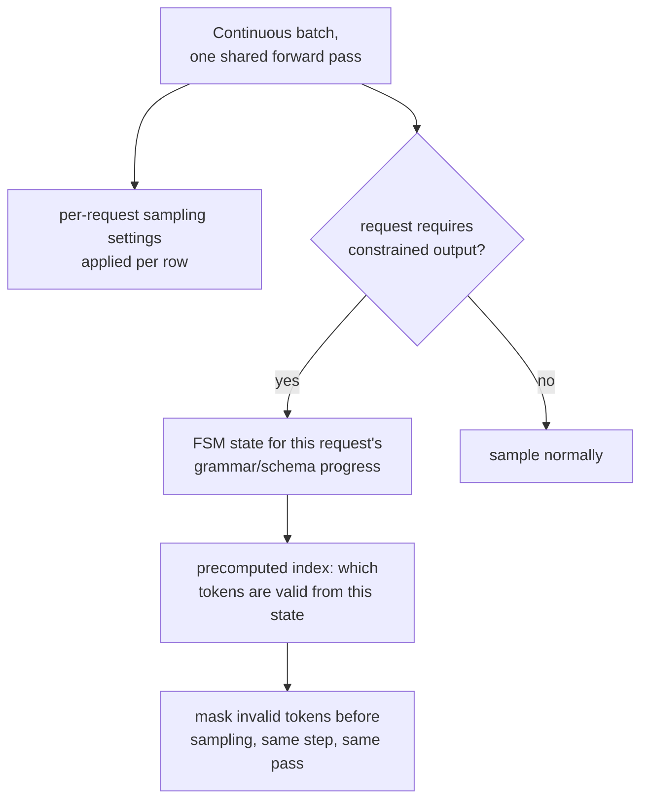

# 第 19 课：服务时的采样与约束解码

**使命关联:** 第 2 阶段确立了连续批处理：许多请求共用一次前向计算，使服务器昂贵的权重加载开销，在所有请求之间摊薄。本课涉及的是这次计算必须逐个请求、而不是对整个批次一刀切地去做的两件事：应用每个请求自己的采样设置，以及在被要求时，保证某个请求的输出始终是合法的 JSON 或符合某种语法，而且为此不增加实质性的逐 token 开销。
**主要来源:** [论文：“Efficient Guided Generation for Large Language Models”（Outlines），Willard 和 Louf，2023](https://arxiv.org/abs/2307.09702)
**前置知识:** [第 4 课](0004-static-vs-continuous-batching.md)、[第 18 课](0018-speculative-decoding.md)

## 热身

1. ▢ 为什么对长度参差不齐的请求流，连续批处理胜过静态批处理？

检查

静态批处理要等一个固定批次里的每个请求都完成，才开始新的一批，把 GPU 的时间浪费在请求已经完成的槽位上。连续批处理则是在请求到达和完成时，把单个请求加入或移出正在运行的批次，让批次始终装满活跃的工作，而不是在已经完成的槽位上空转。

2. ▢ 为什么在一次并行计算中验证若干个候选 token，开销大致相当于正常生成一个 token？

检查

解码受内存带宽限制：一步的主要开销是搬运模型的权重，无论在同一次计算中给多少个候选位置打分，这件事都只发生一次，所以给若干个而不是一个位置打分，增加的开销相对很少。

## 要点

### 采样设置是逐个请求的，在一个共用的批次之内

连续批次里的每个请求，都可以要求自己的温度、top-k 和 top-p（第 18 课的 llm/transformers 层面的概念，这里应用于服务时），服务引擎必须把正确的设置应用到批次共用的前向计算的每一行上，而不是对共用这一步的所有人用同一个统一的设置。这是叠加在批次之上的一笔实实在在的逐请求记账开销，因为并排处在同一次前向计算里的两个请求，最终可能以完全不同的方式，从它们各自的下一个 token 分布中采样。

### 约束解码：屏蔽非法 token，就是因果掩码早已用过的同一个思路

**约束（引导）解码**保证某个请求的输出始终符合所需的结构，比如合法的 JSON 或某种特定的语法，办法是在采样发生之前，先把所有会违反该结构的 token 屏蔽掉，其底层思路与在 softmax 之前屏蔽未来位置的分数相同：被禁止的选项被逐出竞争，而不是先被采样出来、事后再检查。区别在于是什么决定了这个掩码：因果掩码每次都是同一个固定的模式；而语法约束的掩码每一步都在变，因为下一步哪些 token 合法，取决于所需结构已经产生了多少。

### 基于有限状态机的索引，让每个 token 的开销保持很小

构建这个逐步掩码的朴素办法，是在每一步都把词表里的每个 token 重新对照语法检查一遍，这会给生成的每一个 token 都增加实质性的、甚至可能很严重的开销。主要来源真正的贡献，是把约束生成重新表述为**有限状态机**各状态之间的转移，这让一份**索引**可以提前一次性地，覆盖模型的整个词表构建出来：对每个有限状态机的状态，哪些 token 是合法的转移，是预先算好的，而不是在每一步从头重新计算。这就是论文所说的，既给 token 生成增加的开销很小，同时又精确地保证输出的结构，而不是在缓慢但正确的实现与快速但不可靠的实现之间做取舍。

### 这个保证是结构性的，而不是指望模型守规矩

因为非法 token 是在采样之前就从分布中屏蔽掉的，而不是事后纠正的，所以输出的结构是由构造本身来保证的：模型不可能产出非法的 JSON 或违反语法，因为会造成违反的那些 token，在这一步从来就没有资格被采样。这比提示模型“请输出合法的 JSON”然后抱着希望，是更强的保证，就像第 3 课的因果掩码（在本工作区所服务、而不是推导的那个架构中）使关注未来在结构上不可能，而不只是不鼓励。

### 真正的开销是一个逐 token 的常数，而不是逐请求的事后补充

因为有限状态机索引是针对每个语法（或 schema）预先算好一次，而不是针对每个请求，所以在服务时强制执行它的逐 token 开销，是施加在每个其他 token 本来就需要的同一次前向计算上的一小笔、大致恒定的额外记账，而不是一个单独的昂贵步骤。这恰恰是一份被辩护的延迟预算（第 6 阶段）必须明确计入的那种开销：一个有相当比例的请求带有约束的工作负载，应该像测量重排序的开销那样（那是另一个工作区的决策框架，但纪律是一样的），测量这个恒定的开销，而不是仅仅因为保证本身很强，就假定结构化输出是免费的。

## 练习

1. ▢ 两个请求处在同一个连续批次的前向计算里，一个温度是 0.2，一个是 1.0。服务器能不能像对两者应用同一套权重那样，对两者应用同一个共用的采样设置？

提示

想想哪些东西是逐请求变化的，哪些是整个批次共用的。

检查

不能。模型权重在整个批次中是共用的，但采样设置是逐请求的；服务器必须在同一次共用的前向计算之内，把每一行自己的温度（以及 top-k/top-p）应用到那一行自己的下一个 token 分布上，而不是对其中每个请求都用同一个统一的设置。

2. ▢ 为什么约束解码的朴素做法，即每一步都把词表里的每个 token 重新对照语法检查一遍，有可能增加严重的开销？

检查

在每个生成的 token 上，都把可能很大的词表从头对照语法当前的要求检查一遍，是叠加在模型自己的前向计算之上的、实实在在的重复工作；如果不预先算好任何东西，这笔开销在每一步都要全额支付，而不是被简化成一次快速查找。

3. ▢ Outlines 论文的有限状态机的重新表述，让它能预先计算什么，为什么这使逐 token 的开销保持很低？

检查

它让一份索引可以提前一次性地，覆盖模型的词表构建出来，把每个有限状态机的状态，映射到从它出发合法转移的那些 token。在生成时，检查哪些 token 被允许，就变成对这份预先算好的索引的一次查找，而不是每次从头对照语法重新检查，这就是增加的开销保持很小的原因。

4. ▢ 为什么在采样之前屏蔽非法 token，是比提示模型产生合法的 JSON、再在事后检查结果更强的保证？

检查

屏蔽使得非法 token 从一开始就在结构上不可能被采样，因为它在采样发生之前就已从分布中移除；一个只是被指示产出合法输出的模型，仍然可能不遵守指示，因为没有任何东西阻止它采样出非法 token，只是要求它不要这样做而已。

5. ▢ 下面哪种说法正确描述了服务时的采样与约束解码？

    - a) 采样设置在整个批次中是共用的，与模型权重一样
    - b) 采样设置在共用批次内逐个请求地应用，而约束解码使用预先算好的有限状态机索引，在采样之前屏蔽非法 token，使逐 token 的开销保持很小，结构性的保证是绝对的，而不只是被鼓励
    - c) 约束解码在生成完成之后，对照语法检查模型的输出，如果不合法就重试
    - d) 基于有限状态机的索引必须在每个生成的 token 上从头重建

检查

**b)** 这就是本课所确立的精确机制和保证。(a) 是错的：采样设置专门是逐请求的，不像共用的模型权重。(c) 是错的：约束解码是在采样之前屏蔽非法 token，而不是在生成完成之后。(d) 是错的：有限状态机索引的全部意义，就在于它只构建一次，并在每一步作为快速查找重复使用，而不是每次都重新计算。

## 实战练习

- [ ] 对你能用到的某个服务栈，检查它是否在批处理的请求流中支持逐请求的采样参数，以及它是否提供任何约束或引导解码的选项（JSON schema、语法或正则表达式）。
- [ ] 如果它支持约束解码，就在同一个提示词上，测量一个带约束的请求相对于不带约束的请求所增加的逐 token 延迟，并检查这笔开销对你的工作负载的预算来说，是否小到可以忽略。
- [ ] 明天：完整读一遍主要来源中关于上下文无关文法的那一节，记下一个完整的 CFG 能强制执行哪种结构（超出 JSON Schema 通常的正则约束），是简单的基于正则的约束做不到的。

## 延伸阅读

- [论文：“Efficient Guided Generation for Large Language Models”（Outlines），Willard 和 Louf，2023](https://arxiv.org/abs/2307.09702)
- [资源](../RESOURCES.md)

---

没学明白？请重读顶部的主要来源，因为本课是对它的压缩，而理解正是在压缩中流失的。如果有哪个术语觉得含糊，可以查看[术语表](../GLOSSARY.md)。

如果问题出在课程本身，而不是学习材料，那就是一个缺陷：[提交 issue](https://github.com/TokenCemetery/teach/issues)。
