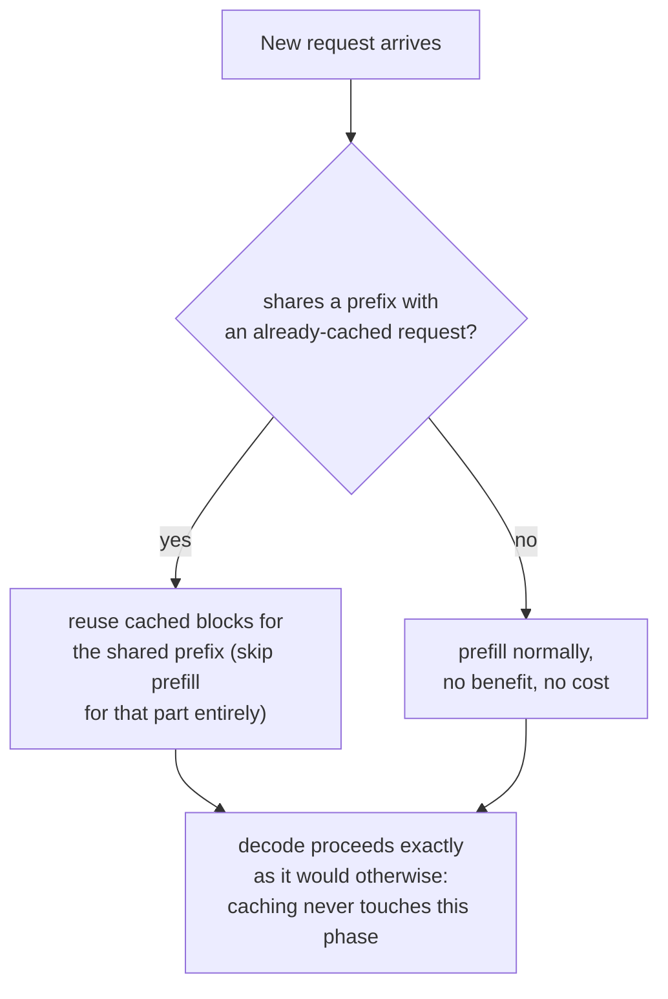

# Lección 20. Prefix caching

**Vínculo con la misión:** La lección 11 mostró que las muestras paralelas de la *misma* solicitud comparten los bloques en caché de un prompt a través de sus tablas de bloques. El **prefix caching** es ese mismo mecanismo de compartición, aplicado a solicitudes que nunca estuvieron relacionadas, siempre que empiecen con los mismos tokens: un system prompt, un documento largo, un turno anterior de la misma conversación.
**Fuente principal:** [Docs: "Automatic Prefix Caching", vLLM Project](https://docs.vllm.ai/en/latest/features/automatic_prefix_caching.html)
**Requisitos previos:** [Lección 11](0011-pagedattention.md), [Lección 5](0005-request-scheduling.md)

## Calentamiento

1. ▢ En PagedAttention, ¿qué permite que las tablas de bloques de dos secuencias distintas apunten al mismo bloque físico?

Comprobación

Como una secuencia llega a su caché de forma indirecta a través de su tabla de bloques en lugar de asumir una disposición física fija, dos tablas de bloques pueden apuntar al mismo bloque físico siempre que su contenido sea idéntico, lo más habitual un prefijo de prompt compartido, hasta que la generación de una secuencia diverge y dispara un copy-on-write.

2. ▢ ¿Por qué el prefill está limitado por cómputo mientras que el decode está limitado por el ancho de banda de memoria?

Comprobación

El prefill procesa un prompt entero en una gran pasada forward paralela, así que hay suficiente trabajo por byte leído para mantener ocupado el cómputo de la GPU. El decode calcula solo un token nuevo por paso, así que el tráfico de memoria de cada paso domina sobre la pequeña cantidad de cómputo nuevo.

## Qué debes saber

### La misma idea de compartir bloques, pero entre solicitudes que nunca estuvieron relacionadas

La compartición de bloques de la lección 11 se aplicaba dentro de una solicitud: varias muestras paralelas del mismo prompt, todas apuntando sus tablas de bloques a los mismos bloques físicos del prompt idéntico que comparten. El **prefix caching** (vLLM llama a su versión **Automatic Prefix Caching**, APC) es el mismo mecanismo aplicado de forma más amplia: siempre que una solicitud *nueva*, por lo demás no relacionada, empieza con los mismos tokens que algo ya guardado en caché, su tabla de bloques también puede apuntar a esos bloques existentes, saltándose por completo el cálculo de la parte compartida en lugar de reprocesarla desde cero.

### Dos cargas de trabajo donde esto es una ganancia grande, no marginal

La fuente principal nombra dos casos en que el prefix caching aporta un gran beneficio específicamente porque el prefijo compartido es largo y se reutiliza constantemente. **Consulta de documentos largos**: se hacen muchas preguntas distintas sobre el mismo documento largo (un manual, un informe); sin caché, cada pregunta reprocesaría el prefill completo del documento desde cero, mientras que con caché, el documento se prefilla una vez y cada pregunta posterior reutiliza esa caché, pagando solo por su propia pregunta corta y por el prefijo del documento ya guardado en caché. **Conversación de varias rondas**: cada turno nuevo de una sesión de chat exigiría de otro modo reprocesar de nuevo todo el historial de la conversación; la caché permite que cada turno nuevo reutilice todo lo ya procesado en turnos anteriores, pagando solo por lo que es realmente nuevo.

### La ganancia cae específicamente en el prefill, nunca en el decode

La fuente es explícita sobre este límite: el prefix caching solo reduce el tiempo dedicado a procesar las consultas, la fase de prefill, y no reduce en absoluto el tiempo dedicado a generar tokens nuevos, la fase de decode. Esto se sigue directamente de lo que cuesta realmente cada una: el costo del prefill viene de calcular la KV cache de tokens que ya estaban ahí para leerse, que la caché puede saltarse por completo para un prefijo idéntico; el costo del decode viene de la naturaleza secuencial y limitada por el ancho de banda de memoria de generar cada token nuevo uno a uno (el problema de la lección 18, que es lo que aborda en su lugar el speculative decoding), trabajo que no tiene nada que ver con ningún prefijo y que guardar en caché un prefijo compartido no puede tocar en absoluto.

### Cuando no ayuda, tampoco perjudica, simplemente no se aplica

El prefix caching no aporta beneficio, pero tampoco costo, en dos situaciones: cuando una carga de trabajo pasa la mayor parte del tiempo generando una respuesta larga en lugar de procesando la entrada (domina el decode, y la caché nunca tocó el decode en primer lugar), o cuando las solicitudes nuevas simplemente no comparten un prefijo con nada ya guardado en caché (no hay nada que reutilizar). Ninguno de los dos casos es un fallo del mecanismo; simplemente quedan fuera de lo que una caché indexada por prefijos compartidos se construyó para acelerar.

## Práctica

1. ▢ Los usuarios de un chatbot hacen cada uno preguntas puntuales sin un system prompt compartido ni un historial de conversación entre ellos. ¿Ayudaría a esta carga de trabajo habilitar el prefix caching?

Pista

Considera qué requiere realmente el prefix caching para aportar algún beneficio.

Comprobación

No, o no de forma significativa: el prefix caching solo ayuda cuando las solicitudes comparten un prefijo con algo ya guardado en caché. Si el contenido de cada solicitud es genuinamente ajeno al de todas las demás, no hay nada que reutilizar, así que habilitarlo no cuesta nada pero tampoco compra nada.

2. ▢ Una carga de QA sobre documentos largos hace 50 preguntas distintas sobre el mismo manual de 10,000 tokens. Sin prefix caching, ¿qué tiene que ocurrir 50 veces que la caché permitiría que ocurriera una sola vez?

Comprobación

El prefill completo del manual de 10,000 tokens, calculando su KV cache, tendría que rehacerse desde cero para cada una de las 50 preguntas. Con prefix caching, el manual se prefilla una vez, y las 50 preguntas reutilizan ese mismo prefijo en caché, pagando cada una solo por su propia pregunta corta encima de él.

3. ▢ Las solicitudes de una carga de trabajo comparten un prefijo largo e idéntico, pero cada solicitud genera además después una respuesta muy larga. ¿Por qué habilitar el prefix caching podría producir solo una aceleración global modesta, aunque la coincidencia del prefijo sea perfecta?

Comprobación

El prefix caching solo acelera la fase de prefill; si la mayor parte del tiempo total de la solicitud se pasa realmente en el decode, generando esa respuesta larga token a token, la fase que la caché no puede tocar en absoluto, entonces incluso un prefijo perfectamente guardado en caché solo elimina una pequeña fracción del tiempo total de procesamiento de la solicitud.

4. ▢ ¿Por qué el prefix caching no puede reducir el tiempo de decode, ni siquiera en principio, como reduce el tiempo de prefill para un prefijo compartido?

Comprobación

El costo del decode viene del trabajo secuencial y limitado por el ancho de banda de memoria de generar cada token nuevo uno a uno, que no tiene nada que ver con reprocesar ningún prefijo; no hay trabajo de prefill redundante y ya calculado que una caché pueda saltarse durante el decode, ya que cada token decodificado es genuinamente nuevo.

5. ▢ ¿Qué afirmación describe correctamente la relación del prefix caching con la compartición de bloques de PagedAttention de la lección 11?

    - a) El prefix caching es un mecanismo totalmente separado de la compartición de bloques de PagedAttention, y requiere su propio gestor de memoria
    - b) El prefix caching es el mismo mecanismo de compartición de bloques que describió la lección 11 para las muestras paralelas de una solicitud, extendido a solicitudes por lo demás no relacionadas que comparten un prefijo, y acelera específicamente el prefill, nunca el decode
    - c) El prefix caching acelera por igual el prefill y el decode de cualquier solicitud que comparta un prefijo en caché
    - d) El prefix caching solo funciona dentro de una única solicitud, el mismo ámbito que ya cubrió la lección 11

Comprobación

**b)** Esa es la relación y el límite precisos que establece esta lección. (a) es falsa: es el mismo mecanismo de compartición de tablas de bloques, solo que aplicado a un conjunto más amplio de solicitudes. (c) es falsa: la fuente es explícita en que el tiempo de decode no se toca. (d) es falsa: el sentido del prefix caching es extender la compartición más allá de una sola solicitud a cualquier solicitud con un prefijo coincidente.

## Prácticas en el mundo real

- [ ] Para un stack de serving al que tengas acceso, comprueba si el prefix caching (o una función equivalente) está habilitado, y si las solicitudes de tu carga de trabajo comparten realmente prefijos significativos (un system prompt, un documento compartido, un historial de conversación) que se beneficiarían de él.
- [ ] Estima, para una carga de trabajo que conozcas, aproximadamente qué fracción del tiempo total por solicitud es prefill frente a decode, y úsalo para juzgar cuánto podría ayudar plausiblemente el prefix caching incluso con una coincidencia de prefijo perfecta.
- [ ] Mañana: lee el documento de diseño enlazado desde la fuente primaria sobre cómo implementa vLLM internamente el prefix caching, y anota qué usa como clave de caché para hacer coincidir el prefijo de una solicitud nueva con los ya guardados en caché.

## Para profundizar

- [Docs: "Automatic Prefix Caching", vLLM Project](https://docs.vllm.ai/en/latest/features/automatic_prefix_caching.html)
- [Paper: "Efficient Memory Management for Large Language Model Serving with PagedAttention", Kwon et al., SOSP 2023](https://arxiv.org/abs/2309.06180)
- [Recursos](../RESOURCES.md)

---

¿No termina de quedar claro? Vuelve a leer la fuente primaria de arriba, ya que esta lección la comprime y en la compresión es donde se escapa la comprensión. Consulta el [glosario](../GLOSSARY.md) por si algún término te resultó resbaladizo.

Si lo poco claro es la propia lección y no el material, eso es un defecto: [abre un issue](https://github.com/TokenCemetery/teach/issues).
