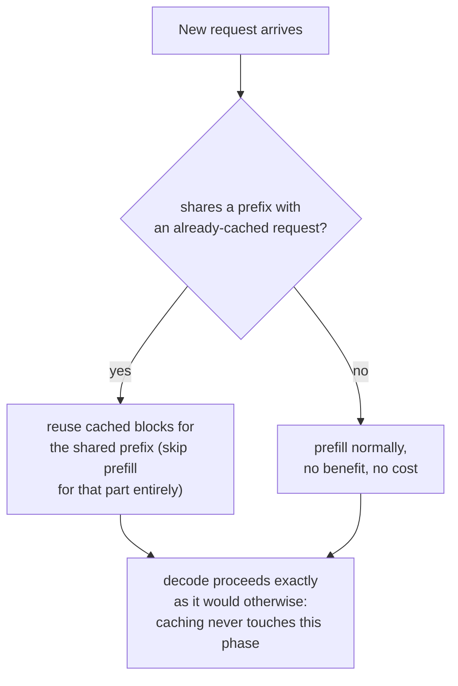

# Leçon 20. Prefix caching

**Lien avec la mission :** La leçon 11 a montré des échantillons parallèles de la *même* requête qui partagent les blocs en cache d'un seul prompt par leurs tables de blocs. Le **prefix caching** est ce même mécanisme de partage, appliqué à des requêtes qui n'avaient au départ aucun lien, dès qu'elles commencent par les mêmes tokens : un system prompt, un long document, un tour précédent de la même conversation.
**Source primaire :** [Doc : "Automatic Prefix Caching", vLLM Project](https://docs.vllm.ai/en/latest/features/automatic_prefix_caching.html)
**Prérequis :** [Leçon 11](0011-pagedattention.md), [Leçon 5](0005-request-scheduling.md)

## Échauffement

1. ▢ Dans PagedAttention, qu'est-ce qui permet aux tables de blocs de deux séquences différentes de pointer vers le même bloc physique ?

Vérifier

Parce qu'une séquence atteint son cache indirectement par sa table de blocs plutôt qu'en supposant une disposition physique fixe, deux tables de blocs peuvent pointer vers le même bloc physique dès que son contenu est identique, le plus souvent un préfixe de prompt partagé, jusqu'à ce que la génération d'une séquence diverge et déclenche un copy-on-write.

2. ▢ Pourquoi le prefill est-il limité par le calcul alors que le decode est limité par la bande passante mémoire ?

Vérifier

Le prefill traite un prompt entier en une seule grande passe avant parallèle, il y a donc assez de travail par octet lu pour occuper le calcul du GPU. Le decode ne calcule qu'un seul nouveau token par étape, si bien que le trafic mémoire de chaque étape domine la faible quantité de nouveau calcul.

## À savoir

### La même idée de partage de blocs, mais entre des requêtes qui n'avaient aucun lien

Le partage de blocs de la leçon 11 s'appliquait à l'intérieur d'une seule requête : plusieurs échantillons parallèles du même prompt, tous pointant leurs tables de blocs vers les mêmes blocs physiques pour le prompt identique qu'ils partagent. Le **prefix caching** (vLLM appelle sa version **Automatic Prefix Caching**, APC) est le même mécanisme appliqué plus largement : dès qu'une *nouvelle* requête par ailleurs sans lien commence par les mêmes tokens que quelque chose de déjà en cache, sa table de blocs peut elle aussi pointer vers ces blocs existants, ce qui évite entièrement le calcul de la partie partagée au lieu de la retraiter de zéro.

### Deux charges de travail où le gain est grand, et non marginal

La source primaire nomme deux cas où le prefix caching apporte un grand bénéfice précisément parce que le préfixe partagé est à la fois long et réutilisé constamment. **Question sur un long document** : de nombreuses questions différentes sont posées sur le même long document (un manuel, un rapport) ; sans cache, chaque question retraiterait de zéro tout le prefill du document, alors qu'avec le cache, le document est prérempli une seule fois et chaque question suivante réutilise ce cache, ne payant que sa propre courte question et le préfixe déjà en cache du document. **Conversation multi-tours** : chaque nouveau tour d'une session de chat exigerait autrement de retraiter à nouveau tout l'historique de la conversation ; le cache permet à chaque nouveau tour de réutiliser tout ce qui a déjà été traité lors des tours précédents, ne payant que ce qui est réellement nouveau.

### Le gain se porte spécifiquement sur le prefill, jamais sur le decode

La source est explicite sur cette limite : le prefix caching ne réduit que le temps passé à traiter les requêtes, la phase de prefill, et ne réduit pas du tout le temps passé à générer de nouveaux tokens, la phase de decode. Cela découle directement de ce que coûtent réellement le prefill et le decode : le coût du prefill vient du calcul du KV cache pour des tokens qui étaient déjà là pour être lus, ce que le cache peut éviter entièrement pour un préfixe identique ; le coût du decode vient de la nature séquentielle et limitée par la bande passante mémoire de la génération de chaque nouveau token un par un (le problème de la leçon 18, que le décodage spéculatif traite à la place), un travail qui n'a rien à voir avec un préfixe quelconque et que la mise en cache d'un préfixe partagé ne peut pas toucher du tout.

### Quand il n'aide pas, il ne nuit pas non plus, il ne s'applique simplement pas

Le prefix caching n'apporte aucun bénéfice, mais aucun coût non plus, dans deux situations : quand une charge de travail passe l'essentiel de son temps à générer une longue réponse plutôt qu'à traiter l'entrée (le decode domine, et le cache n'a jamais touché au decode au départ), ou quand les nouvelles requêtes ne partagent simplement pas de préfixe avec quoi que ce soit de déjà en cache (il n'y a rien à réutiliser). Aucun des deux cas n'est un échec du mécanisme ; ils sont simplement en dehors de ce qu'un cache indexé sur des préfixes partagés a jamais été conçu pour accélérer.

## Pratique

1. ▢ Les utilisateurs d'un chatbot posent chacun des questions ponctuelles sans system prompt partagé ni historique de conversation commun. Activer le prefix caching aiderait-il cette charge de travail ?

Indice

Demandez-vous ce que le prefix caching exige réellement pour apporter le moindre bénéfice.

Vérifier

Non, ou pas de façon significative : le prefix caching n'aide que quand les requêtes partagent un préfixe avec quelque chose de déjà en cache. Si le contenu de chaque requête est réellement sans lien avec celui de toutes les autres, il n'y a rien à réutiliser, donc l'activer ne coûte rien mais n'achète rien non plus.

2. ▢ Une charge de travail de questions-réponses sur de longs documents pose 50 questions différentes sur le même manuel de 10 000 tokens. Sans prefix caching, qu'est-ce qui doit se produire 50 fois que le cache permettrait de ne faire qu'une fois ?

Vérifier

Tout le prefill du manuel de 10 000 tokens, c'est-à-dire le calcul de son KV cache, serait autrement refait de zéro pour chacune des 50 questions. Avec le prefix caching, le manuel est prérempli une seule fois, et les 50 questions réutilisent ce même préfixe en cache, chacune ne payant que sa propre courte question par-dessus.

3. ▢ Les requêtes d'une charge de travail partagent un long préfixe identique, mais chaque requête génère aussi ensuite une très longue réponse. Pourquoi activer le prefix caching pourrait-il ne produire qu'une accélération globale modeste, alors que la correspondance du préfixe est parfaite ?

Vérifier

Le prefix caching n'accélère que la phase de prefill ; si l'essentiel du temps total de la requête est en réalité passé dans le decode, à générer cette longue réponse token par token, la phase que le cache ne peut pas toucher du tout, alors même un préfixe parfaitement en cache ne retire qu'une petite fraction du temps de traitement total de la requête.

4. ▢ Pourquoi le prefix caching ne peut-il pas réduire le temps de decode, même en principe, comme il réduit le temps de prefill pour un préfixe partagé ?

Vérifier

Le coût du decode vient du travail séquentiel, limité par la bande passante mémoire, de génération de chaque nouveau token un par un, qui n'a rien à voir avec le retraitement d'un préfixe ; il n'y a pas de travail de prefill redondant, déjà calculé, qu'un cache pourrait éviter pendant le decode, puisque chaque token décodé est réellement nouveau.

5. ▢ Quelle affirmation décrit correctement la relation du prefix caching avec le partage de blocs de PagedAttention de la leçon 11 ?

    - a) Le prefix caching est un mécanisme entièrement distinct du partage de blocs de PagedAttention, qui exige son propre gestionnaire de mémoire
    - b) Le prefix caching est le même mécanisme de partage de blocs que celui que la leçon 11 a décrit pour les échantillons parallèles d'une requête, étendu à des requêtes par ailleurs sans lien qui partagent un préfixe, et il accélère spécifiquement le prefill, jamais le decode
    - c) Le prefix caching accélère à égalité le prefill et le decode pour toute requête qui partage un préfixe en cache
    - d) Le prefix caching ne fonctionne qu'au sein d'une seule requête, la même portée que celle que couvrait déjà la leçon 11

Vérifier

**b)** C'est la relation et la limite précises qu'établit cette leçon. (a) est fausse : c'est le même mécanisme de partage de tables de blocs, simplement appliqué à un ensemble de requêtes plus large. (c) est fausse : la source est explicite sur le fait que le temps de decode n'est pas touché. (d) est fausse : tout l'intérêt du prefix caching est d'étendre le partage au-delà d'une seule requête à toute requête dont le préfixe correspond.

## Exercices en situation réelle

- [ ] Pour une pile de serving à laquelle vous avez accès, vérifiez si le prefix caching (ou une fonctionnalité équivalente) est activé, et si les requêtes de votre charge de travail partagent réellement des préfixes significatifs (un system prompt, un document partagé, un historique de conversation) qui en bénéficieraient.
- [ ] Estimez, pour une charge de travail que vous connaissez, quelle fraction du temps total par requête est du prefill et quelle fraction du decode, et servez-vous-en pour juger dans quelle mesure le prefix caching pourrait plausiblement aider même avec une correspondance de préfixe parfaite.
- [ ] Demain : lisez le document de conception lié par la source primaire sur la façon dont vLLM implémente le prefix caching en interne, et notez ce qu'il utilise comme clé de cache pour faire correspondre le préfixe d'une nouvelle requête à ceux déjà en cache.

## Pour aller plus loin

- [Doc : "Automatic Prefix Caching", vLLM Project](https://docs.vllm.ai/en/latest/features/automatic_prefix_caching.html)
- [Article : "Efficient Memory Management for Large Language Model Serving with PagedAttention", Kwon et al., SOSP 2023](https://arxiv.org/abs/2309.06180)
- [Ressources](../RESOURCES.md)

---

Ça ne passe pas ? Relisez la source primaire en haut de page, car cette leçon la condense et c'est dans la condensation que la compréhension s'échappe. Consultez le [glossaire](../GLOSSARY.md) pour tout terme qui vous a paru glissant.

Si c'est la leçon elle-même qui n'est pas claire plutôt que la matière, c'est un défaut : [ouvrez une issue](https://github.com/TokenCemetery/teach/issues).
