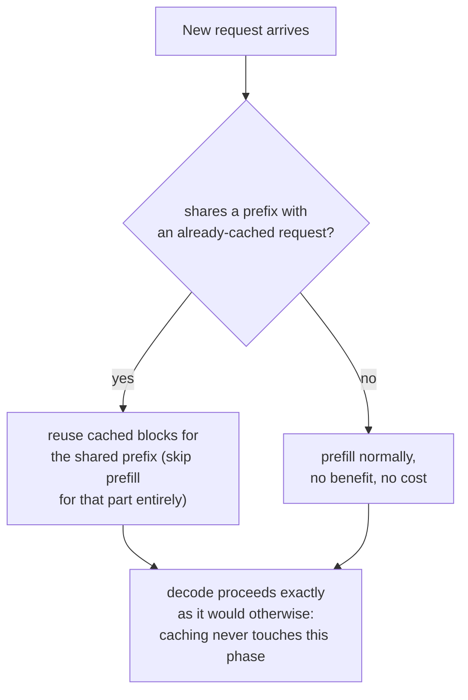

# पाठ 20. Prefix Caching

**मिशन से संबंध:** पाठ 11 ने दिखाया कि *एक ही* request के parallel samples अपनी block tables के ज़रिए एक prompt के cached blocks साझा करते हैं। **Prefix caching** वही एक जैसा साझेदारी का तंत्र है, उन requests के पार लागू जो शुरू से कभी जुड़ी नहीं थीं, जब भी वे संयोग से एक जैसे tokens से शुरू होती हैं, एक system prompt, कोई लंबा document, उसी बातचीत का कोई पिछला turn।
**मुख्य स्रोत:** [दस्तावेज़: "Automatic Prefix Caching", vLLM Project](https://docs.vllm.ai/en/latest/features/automatic_prefix_caching.html)
**पूर्व-आवश्यकताएँ:** [पाठ 11](0011-pagedattention.md), [पाठ 5](0005-request-scheduling.md)

## वार्म-अप

1. ▢ PagedAttention में, दो अलग sequences की block tables को एक ही physical block की ओर क्या इशारा करने देता है?

जाँचें

क्योंकि sequence अपने cache तक किसी निश्चित physical layout को मानकर नहीं बल्कि अपनी block table से परोक्ष रूप से पहुँचता है, दो block tables एक ही physical block की ओर तब इशारा कर सकती हैं जब उसकी सामग्री एक जैसी हो, सबसे आम तौर पर साझा prompt prefix, जब तक कि किसी sequence का generation अलग न हो जाए और copy-on-write न चालू करे।

2. ▢ Prefill compute-bound और decode memory-bandwidth-bound क्यों है?

जाँचें

Prefill पूरे prompt को एक बड़े, parallel forward pass में process करता है, इसलिए हर पढ़े गए byte पर इतना काम है कि GPU का compute व्यस्त रहे। Decode हर step में सिर्फ़ एक नया token compute करता है, इसलिए हर step का memory traffic थोड़े-से नए compute पर हावी रहता है।

## यह जानें

### वही block-sharing का विचार, पर उन requests के पार जो कभी जुड़ी नहीं थीं

पाठ 11 की block sharing एक request के भीतर लागू थी: एक ही prompt के कई parallel samples, सब अपनी block tables को उस एक जैसे prompt के लिए उन्हीं physical blocks की ओर इशारा करते हुए जो वे साझा करते हैं। **Prefix caching** (vLLM अपने रूप को **Automatic Prefix Caching**, APC, कहता है) वही तंत्र ज़्यादा व्यापक रूप से लागू है: जब भी कोई *नई*, बाक़ी बेमेल request संयोग से उन्हीं tokens से शुरू होती है जो पहले से cached किसी चीज़ में हैं, तो उसकी block table भी उन मौजूदा blocks की ओर इशारा कर सकती है, साझा हिस्से की computation पूरी तरह छोड़कर, उसे शुरू से दोबारा process करने के बजाय।

### दो workloads जहाँ यह मामूली नहीं, बड़ी जीत है

मुख्य स्रोत दो मामले बताता है जहाँ prefix caching बड़ा फ़ायदा देता है, ख़ासकर इसलिए कि साझा prefix लंबा भी है और लगातार दोबारा इस्तेमाल भी होता है। **लंबे document पर query**: एक ही लंबे document (manual, report) के विरुद्ध कई अलग सवाल पूछे जाते हैं; caching के बिना हर सवाल पूरे document का prefill शुरू से दोबारा process करता, जबकि caching के साथ document एक बार prefill होता है और हर अगला सवाल वही cache दोबारा इस्तेमाल करता है, सिर्फ़ अपने छोटे सवाल और document के पहले से cached prefix की क़ीमत चुकाते हुए। **Multi-round बातचीत**: chat session का हर नया turn अन्यथा पूरी बातचीत का इतिहास फिर से process करवाता; caching हर नए turn को पिछले turns में जो कुछ पहले process हो चुका उसे दोबारा इस्तेमाल करने देती है, सिर्फ़ उसकी क़ीमत चुकाते हुए जो असल में नया है।

### फ़ायदा ख़ास तौर पर prefill पर पड़ता है, decode पर कभी नहीं

स्रोत इस सीमा के बारे में साफ़ है: prefix caching सिर्फ़ queries process करने में लगने वाला समय, यानी prefill चरण, घटाता है, और नए tokens generate करने में लगने वाला समय, यानी decode चरण, बिल्कुल नहीं घटाता। यह सीधे इससे निकलता है कि prefill और decode में से हर एक की असल में क्या लागत है: prefill की लागत उन tokens के लिए KV cache compute करने से आती है जो पढ़े जाने को पहले से वहाँ थे, जिसे caching एक जैसे prefix के लिए पूरी तरह छोड़ सकती है; decode की लागत हर नया token एक-एक करके generate करने की क्रमिक, memory-bandwidth-bound प्रकृति से आती है (पाठ 18 की समस्या, जिसे speculative decoding सँभालता है), ऐसा काम जिसका किसी prefix से कोई लेना-देना नहीं और जिसे साझा prefix को cache करना छू नहीं सकता।

### जब मदद नहीं करता, नुक़सान भी नहीं करता, बस लागू नहीं होता

Prefix caching दो स्थितियों में कोई फ़ायदा नहीं देता, पर कोई क़ीमत भी नहीं लेता: जब workload अपना ज़्यादातर समय input process करने के बजाय लंबा जवाब generate करने में बिताता है (decode हावी है, और caching ने decode को कभी छुआ ही नहीं), या जब नई requests किसी पहले से cached चीज़ के साथ prefix साझा करती ही नहीं (दोबारा इस्तेमाल करने को कुछ नहीं)। दोनों में से कोई मामला तंत्र की विफलता नहीं है; वे बस उसके बाहर हैं जिसे तेज़ करने के लिए साझा prefixes पर टिका cache कभी बना था।

## अभ्यास

1. ▢ किसी chatbot के users हर एक अकेले सवाल पूछते हैं, जिनके बीच कोई साझा system prompt या बातचीत का इतिहास नहीं। क्या prefix caching चालू करने से इस workload की मदद होगी?

संकेत

सोचें कि prefix caching को कोई भी फ़ायदा देने के लिए असल में क्या चाहिए।

जाँचें

नहीं, या अर्थपूर्ण रूप से नहीं: prefix caching तभी मदद करता है जब requests किसी पहले से cached चीज़ के साथ prefix साझा करें। अगर हर request की सामग्री बाक़ी हर एक से सचमुच बेमेल है, तो दोबारा इस्तेमाल करने को कुछ नहीं, इसलिए उसे चालू करने की कोई क़ीमत नहीं पर कोई फ़ायदा भी नहीं।

2. ▢ एक लंबे-document QA workload उसी 10,000-token के manual के विरुद्ध 50 अलग सवाल पूछता है। Prefix caching के बिना, कौन-सी चीज़ 50 बार होनी पड़ती है जिसे caching सिर्फ़ एक बार होने देती?

जाँचें

10,000-token के manual का पूरा prefill, उसका KV cache compute करना, अन्यथा 50 सवालों में से हर एक के लिए शुरू से दोबारा करना पड़ता। Prefix caching के साथ manual एक बार prefill होता है, और सभी 50 सवाल उसी cached prefix को दोबारा इस्तेमाल करते हैं, हर एक उसके ऊपर सिर्फ़ अपने छोटे सवाल की क़ीमत चुकाते हुए।

3. ▢ किसी workload की requests एक लंबा, एक जैसा prefix साझा करती हैं, पर हर request बाद में बहुत लंबा जवाब भी generate करती है। Prefix match पूरा होने पर भी prefix caching चालू करने से कुल मिलाकर सिर्फ़ मामूली speedup क्यों मिल सकता है?

जाँचें

Prefix caching सिर्फ़ prefill चरण को तेज़ करता है; अगर request का कुल समय ज़्यादातर असल में decode में बीतता है, उस लंबे जवाब को token-दर-token generate करने में, जिस चरण को caching छू ही नहीं सकती, तो पूरी तरह cached prefix भी request के कुल processing समय का सिर्फ़ छोटा हिस्सा हटाता है।

4. ▢ Prefix caching, साझा prefix के लिए prefill का समय जैसे घटाता है वैसे decode का समय सिद्धांत में भी क्यों नहीं घटा सकता?

जाँचें

Decode की लागत हर नया token एक-एक करके generate करने के क्रमिक, memory-bandwidth-bound काम से आती है, जिसका किसी prefix को दोबारा process करने से कोई लेना-देना नहीं; decode के दौरान cache के छोड़ने के लिए कोई फ़ालतू, पहले से compute हुआ prefill काम नहीं है, क्योंकि हर decode हुआ token सचमुच नया है।

5. ▢ पाठ 11 की PagedAttention की block sharing से prefix caching के संबंध का सही वर्णन कौन-सा दावा करता है?

    - a) Prefix caching PagedAttention की block sharing से पूरी तरह अलग तंत्र है, जिसे अपना memory manager चाहिए
    - b) Prefix caching वही block-sharing तंत्र है जो पाठ 11 ने एक request के parallel samples के लिए बताया, उन बाक़ी बेमेल requests के पार बढ़ाया गया जो संयोग से prefix साझा करती हैं, और वह ख़ास तौर पर prefill तेज़ करता है, decode कभी नहीं
    - c) Prefix caching किसी cached prefix को साझा करने वाली किसी भी request के लिए prefill और decode दोनों को बराबर तेज़ करता है
    - d) Prefix caching सिर्फ़ एक अकेली request के भीतर काम करता है, वही दायरा जो पाठ 11 पहले कवर कर चुका

जाँचें

**b)** यही वह सटीक संबंध और सीमा है जो यह पाठ स्थापित करता है। (a) ग़लत है: यह वही block-table-sharing तंत्र है, बस requests के ज़्यादा व्यापक सेट पर लागू। (c) ग़लत है: स्रोत साफ़ है कि decode का समय अछूता रहता है। (d) ग़लत है: prefix caching का पूरा मक़सद साझेदारी को एक अकेली request से आगे बढ़ाकर मेल खाते prefix वाली किसी भी request तक ले जाना है।

## असली दुनिया का अभ्यास

- [ ] जिस serving stack तक आपकी पहुँच है उसके लिए जाँचें कि prefix caching (या उसके समकक्ष feature) चालू है या नहीं, और आपके workload की requests असल में ऐसे अर्थपूर्ण prefixes (system prompt, साझा document, बातचीत का इतिहास) साझा करती हैं या नहीं जिनसे उसका फ़ायदा हो।
- [ ] किसी जाने-पहचाने workload के लिए मोटे तौर पर आँकें कि प्रति-request कुल समय का कितना हिस्सा prefill है और कितना decode, और उससे परखें कि पूरी तरह मेल खाते prefix के साथ भी prefix caching कितनी मदद कर सकता है।
- [ ] कल: मुख्य स्रोत में link किया design document पढ़ें कि vLLM prefix caching को भीतर से कैसे लागू करता है, और नोट करें कि नई request के prefix को मौजूदा cached से मिलाने के लिए वह cache key के रूप में क्या इस्तेमाल करता है।

## आगे बढ़ने के लिए

- [दस्तावेज़: "Automatic Prefix Caching", vLLM Project](https://docs.vllm.ai/en/latest/features/automatic_prefix_caching.html)
- [पेपर: "Efficient Memory Management for Large Language Model Serving with PagedAttention", Kwon et al., SOSP 2023](https://arxiv.org/abs/2309.06180)
- [संसाधन](../RESOURCES.md)

---

बात नहीं बन रही? ऊपर दिए मुख्य स्रोत को दोबारा पढ़ें, क्योंकि यह पाठ उसे संक्षिप्त करता है और समझ संक्षेप में ही रिसती है। जो शब्द फिसलन भरा लगे, उसके लिए [शब्दावली](../GLOSSARY.md) देखें।

अगर दिक़्क़त सामग्री की नहीं बल्कि पाठ की ही है, तो वह एक खोट है: [issue खोलें](https://github.com/TokenCemetery/teach/issues)।
