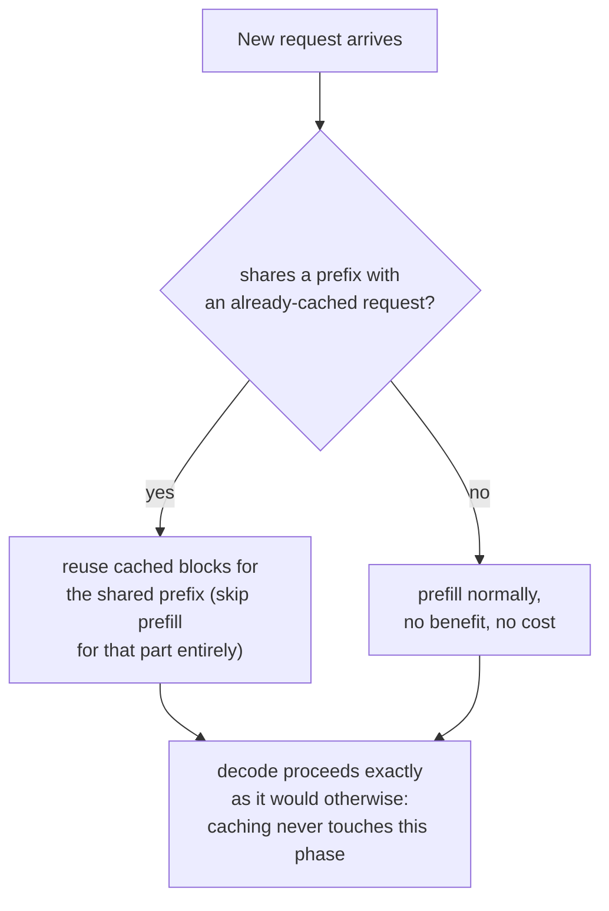

# Lição 20. Prefix caching

**Ligação com a missão:** A lição 11 mostrou amostras paralelas da *mesma* requisição compartilhando os blocos em cache de um prompt por meio das suas block tables. O **prefix caching** é esse mesmo mecanismo de compartilhamento, aplicado entre requisições que nunca tiveram relação entre si, sempre que elas por acaso começam com os mesmos tokens: um system prompt, um documento longo, um turno anterior da mesma conversa.
**Fonte principal:** [Documentação: "Automatic Prefix Caching", vLLM Project](https://docs.vllm.ai/en/latest/features/automatic_prefix_caching.html)
**Pré-requisitos:** [Lição 11](0011-pagedattention.md), [Lição 5](0005-request-scheduling.md)

## Aquecimento

1. ▢ No PagedAttention, o que permite que as block tables de duas sequências diferentes apontem para o mesmo bloco físico?

Verificação

Como uma sequência alcança o seu cache indiretamente, pela sua block table, em vez de presumir um layout físico fixo, duas block tables podem apontar para o mesmo bloco físico sempre que o seu conteúdo for idêntico, mais comumente um prefixo de prompt compartilhado, até que a geração de uma sequência divirja e dispare um copy-on-write.

2. ▢ Por que o prefill é limitado por compute enquanto o decode é limitado pela largura de banda de memória?

Verificação

O prefill processa um prompt inteiro em uma única passada forward grande e paralela, então há trabalho suficiente por byte lido para manter o compute da GPU ocupado. O decode calcula apenas um novo token por passo, então o tráfego de memória de cada passo domina a pequena quantidade de compute novo.

## Saiba isto

### A mesma ideia de compartilhamento de blocos, mas entre requisições que nunca tiveram relação

O compartilhamento de blocos da lição 11 se aplicava dentro de uma requisição: várias amostras paralelas do mesmo prompt, todas apontando as suas block tables para os mesmos blocos físicos do prompt idêntico que compartilham. O **prefix caching** (o vLLM chama a sua versão de **Automatic Prefix Caching**, APC) é o mesmo mecanismo aplicado de forma mais ampla: sempre que uma *nova* requisição, de resto sem relação, por acaso começa com os mesmos tokens de algo já em cache, a sua block table também pode apontar para esses blocos existentes, pulando por completo a computação da parte compartilhada em vez de reprocessá-la do zero.

### Duas cargas de trabalho em que isso é um ganho grande, e não marginal

A fonte principal nomeia dois casos em que o prefix caching traz um grande benefício justamente porque o prefixo compartilhado é, ao mesmo tempo, longo e constantemente reutilizado. **Consulta a documento longo**: muitas perguntas diferentes são feitas sobre o mesmo documento longo (um manual, um relatório); sem cache, cada pergunta reprocessaria o prefill do documento inteiro do zero, enquanto com cache o documento é preenchido uma vez e toda pergunta seguinte reaproveita esse cache, pagando apenas pela sua própria pergunta curta e pelo prefixo do documento já em cache. **Conversa de várias rodadas**: cada novo turno de uma sessão de chat exigiria, de outra forma, reprocessar todo o histórico da conversa de novo; o cache permite que cada novo turno reaproveite tudo o que já foi processado nos turnos anteriores, pagando apenas pelo que é realmente novo.

### O ganho recai especificamente sobre o prefill, nunca sobre o decode

A fonte é explícita sobre esse limite: o prefix caching só reduz o tempo gasto processando consultas, a fase de prefill, e não reduz o tempo gasto gerando novos tokens, a fase de decode, de forma alguma. Isso decorre diretamente do que o prefill e o decode realmente custam: o custo do prefill vem de calcular o KV cache de tokens que já estavam lá para serem lidos, o que o cache pode pular por completo para um prefixo idêntico; o custo do decode vem da natureza sequencial e limitada pela largura de banda de memória de gerar cada novo token, um de cada vez (o problema da lição 18, que é o que a speculative decoding aborda), trabalho que não tem nada a ver com nenhum prefixo e em que o cache de um prefixo compartilhado não consegue tocar.

### Quando não ajuda, também não atrapalha, apenas não se aplica

O prefix caching não traz benefício, mas também não traz custo, em duas situações: quando uma carga de trabalho passa a maior parte do tempo gerando uma resposta longa em vez de processar a entrada (o decode domina, e o cache nunca tocou no decode, para começar), ou quando as novas requisições simplesmente não compartilham um prefixo com nada já em cache (não há nada a reutilizar). Nenhum dos casos é uma falha do mecanismo; são simplesmente coisas fora do que um cache indexado por prefixos compartilhados foi construído para acelerar.

## Prática

1. ▢ Os usuários de um chatbot fazem, cada um, perguntas avulsas, sem system prompt nem histórico de conversa compartilhado entre eles. Habilitar o prefix caching ajudaria essa carga de trabalho?

Dica

Considere o que o prefix caching realmente exige para trazer algum benefício.

Verificação

Não, ou não de forma significativa: o prefix caching só ajuda quando as requisições compartilham um prefixo com algo já em cache. Se o conteúdo de cada requisição é genuinamente sem relação com o de todas as outras, não há nada a reutilizar, então habilitá-lo não custa nada, mas também não compra nada.

2. ▢ Uma carga de trabalho de QA sobre documento longo faz 50 perguntas diferentes sobre o mesmo manual de 10.000 tokens. Sem prefix caching, o que precisa acontecer 50 vezes que o cache permitiria acontecer uma só vez?

Verificação

O prefill inteiro do manual de 10.000 tokens, calculando o seu KV cache, seria refeito do zero para cada uma das 50 perguntas. Com prefix caching, o manual é preenchido uma vez, e as 50 perguntas reaproveitam esse mesmo prefixo em cache, cada uma pagando apenas pela sua própria pergunta curta por cima dele.

3. ▢ As requisições de uma carga de trabalho compartilham um prefixo longo e idêntico, mas cada requisição também gera uma resposta muito longa depois. Por que habilitar o prefix caching poderia produzir apenas um ganho geral modesto, mesmo com a correspondência de prefixo perfeita?

Verificação

O prefix caching só acelera a fase de prefill; se a maior parte do tempo total da requisição é na verdade gasta no decode, gerando essa resposta longa token por token, a fase em que o cache não consegue tocar, então mesmo um prefixo perfeitamente em cache remove apenas uma pequena fração do tempo total de processamento da requisição.

4. ▢ Por que o prefix caching não consegue reduzir o tempo de decode, nem em princípio, do jeito que reduz o tempo de prefill de um prefixo compartilhado?

Verificação

O custo do decode vem do trabalho sequencial, limitado pela largura de banda de memória, de gerar cada novo token um de cada vez, que não tem nada a ver com reprocessar nenhum prefixo; não há trabalho de prefill redundante e já calculado para um cache pular durante o decode, já que todo token decodificado é genuinamente novo.

5. ▢ Qual afirmação descreve corretamente a relação do prefix caching com o compartilhamento de blocos do PagedAttention da lição 11?

    - a) O prefix caching é um mecanismo totalmente separado do compartilhamento de blocos do PagedAttention, exigindo o seu próprio gerenciador de memória
    - b) O prefix caching é o mesmo mecanismo de compartilhamento de blocos que a lição 11 descreveu para amostras paralelas de uma requisição, estendido a requisições, de resto sem relação, que por acaso compartilham um prefixo, e ele acelera especificamente o prefill, nunca o decode
    - c) O prefix caching acelera igualmente o prefill e o decode de qualquer requisição que compartilhe um prefixo em cache
    - d) O prefix caching só funciona dentro de uma única requisição, o mesmo escopo que a lição 11 já cobriu

Verificação

**b)** Essa é a relação e o limite precisos que esta lição estabelece. (a) é falsa: é o mesmo mecanismo de compartilhamento de block table, apenas aplicado a um conjunto mais amplo de requisições. (c) é falsa: a fonte é explícita de que o tempo de decode não é tocado. (d) é falsa: o objetivo central do prefix caching é estender o compartilhamento além de uma única requisição, a qualquer requisição com um prefixo correspondente.

## Prática no mundo real

- [ ] Para uma stack de serving a que você tenha acesso, verifique se o prefix caching (ou uma funcionalidade equivalente) está habilitado e se as requisições da sua carga de trabalho realmente compartilham prefixos relevantes (um system prompt, um documento compartilhado, histórico de conversa) que se beneficiariam dele.
- [ ] Estime, para uma carga de trabalho que você conhece, aproximadamente que fração do tempo total por requisição é prefill versus decode, e use isso para julgar quanto o prefix caching poderia plausivelmente ajudar mesmo com uma correspondência de prefixo perfeita.
- [ ] Amanhã: leia o documento de design vinculado pela fonte principal sobre como o vLLM implementa o prefix caching internamente e anote o que ele usa como chave de cache para casar o prefixo de uma nova requisição com os já em cache.

## Para ir além

- [Documentação: "Automatic Prefix Caching", vLLM Project](https://docs.vllm.ai/en/latest/features/automatic_prefix_caching.html)
- [Artigo científico: "Efficient Memory Management for Large Language Model Serving with PagedAttention", Kwon et al., SOSP 2023](https://arxiv.org/abs/2309.06180)
- [Recursos](../RESOURCES.md)

---

Não ficou claro? Releia a fonte principal no topo, já que esta lição a comprime e é na compressão que o entendimento escapa. Consulte o [glossário](../GLOSSARY.md) para qualquer termo que pareceu escorregadio.

Se o problema é a lição em si, e não o material, isso é um defeito: [abra uma issue](https://github.com/TokenCemetery/teach/issues).
