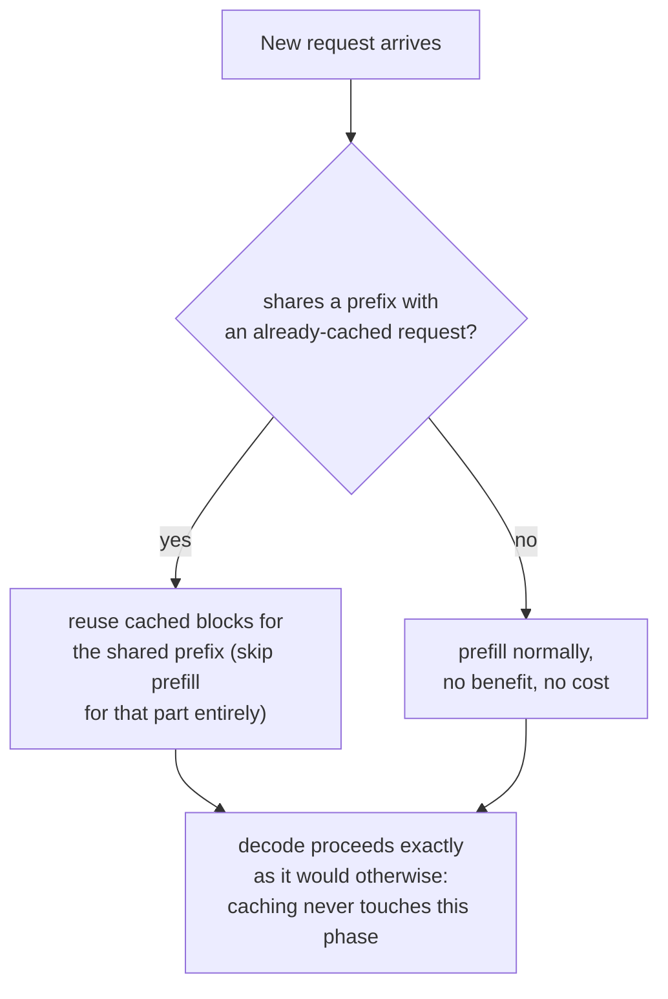

# Урок 20. Кеширование префиксов

**Связь с целью курса:** Урок 11 показал, как параллельные сэмплы *одного и того же* запроса делят кешированные блоки одного промпта через свои таблицы блоков. **Кеширование префиксов** это тот же самый механизм совместного использования, применённый к запросам, которые изначально никак не были связаны, всякий раз, когда они случайно начинаются с одних и тех же токенов: системного промпта, длинного документа, предыдущего хода того же разговора.
**Первоисточник:** [Документация: "Automatic Prefix Caching", vLLM Project](https://docs.vllm.ai/en/latest/features/automatic_prefix_caching.html)
**Предварительные требования:** [Урок 11](0011-pagedattention.md), [Урок 5](0005-request-scheduling.md)

## Разминка

1. ▢ Что в PagedAttention позволяет таблицам блоков двух разных последовательностей указывать на один и тот же физический блок?

Проверка

Поскольку последовательность обращается к своему кешу косвенно, через таблицу блоков, а не предполагая фиксированную физическую раскладку, таблицы блоков могут указывать на один и тот же физический блок, когда его содержимое одинаково, чаще всего это общий префикс промпта, пока генерация одной из последовательностей не разойдётся и не запустит копирование при записи.

2. ▢ Почему префилл ограничен вычислениями, а декодирование ограничено пропускной способностью памяти?

Проверка

Префилл обрабатывает весь промпт одним большим параллельным прямым проходом, поэтому на каждый прочитанный байт приходится достаточно работы, чтобы занять вычисления GPU. Декодирование вычисляет только один новый токен за шаг, так что обмен с памятью на каждом шаге доминирует над малым объёмом новых вычислений.

## Что нужно знать

### Та же идея совместного использования блоков, но между запросами, которые никогда не были связаны

Совместное использование блоков из урока 11 применялось внутри одного запроса: несколько параллельных сэмплов одного промпта, все направляющие свои таблицы блоков на одни и те же физические блоки для идентичного общего промпта. **Кеширование префиксов (prefix caching)** (vLLM называет свою версию **автоматическим кешированием префиксов (Automatic Prefix Caching)**, APC) это тот же механизм, применённый шире: всякий раз, когда *новый*, в остальном несвязанный запрос случайно начинается с тех же токенов, что и нечто уже закешированное, его таблица блоков тоже может указывать на эти существующие блоки, полностью пропуская вычисление общей части, а не обрабатывая её заново с нуля.

### Две нагрузки, где это большой, а не незначительный выигрыш

Первоисточник называет два случая, где кеширование префиксов даёт большую выгоду именно потому, что общий префикс одновременно длинный и постоянно используется повторно. **Запросы по длинному документу**: к одному и тому же длинному документу (руководству, отчёту) задаётся много разных вопросов; без кеширования каждый вопрос заново обрабатывал бы префилл всего документа с нуля, а с кешированием документ префиллится один раз, и каждый последующий вопрос использует этот кеш, платя только за собственный короткий вопрос и уже кешированный префикс документа. **Многораундовый разговор**: каждый новый ход в сессии чата иначе потребовал бы заново обрабатывать всю историю разговора; кеширование позволяет каждому новому ходу использовать всё, что уже обработано в предыдущих ходах, платя только за то, что действительно ново.

### Выигрыш приходится именно на префилл и никогда на декодирование

Источник явно говорит об этом пределе: кеширование префиксов лишь сокращает время обработки запросов, то есть фазу префилла, и вообще не сокращает время генерации новых токенов, фазу декодирования. Это прямо следует из того, чего стоят префилл и декодирование: стоимость префилла происходит от вычисления KV-кеша для токенов, которые уже были и которые можно было просто прочитать, и кеширование может полностью пропустить это для идентичного префикса; стоимость декодирования происходит от последовательной, ограниченной пропускной способностью памяти природы генерации каждого нового токена по одному (проблема, о которой шла речь в уроке 18 и которую вместо этого решает спекулятивное декодирование), работы, не имеющей никакого отношения к какому-либо префиксу и недоступной для кеширования общего префикса.

### Когда оно не помогает, оно и не вредит, оно просто не применимо

Кеширование префиксов не даёт выгоды, но и не создаёт издержек в двух ситуациях: когда нагрузка тратит большую часть времени на генерацию длинного ответа, а не на обработку входа (доминирует декодирование, и кеширование его никогда не затрагивало), или когда новые запросы просто не делят префикс ни с чем уже закешированным (повторно использовать нечего). Ни тот, ни другой случай не является сбоем механизма; они просто лежат за пределами того, что кеш, ключом которого служат общие префиксы, когда-либо строился ускорять.

## Практика

1. ▢ Пользователи чат-бота задают разовые вопросы без общего системного промпта или истории разговора между ними. Поможет ли включение кеширования префиксов этой нагрузке?

Подсказка

Подумайте о том, что на самом деле требуется кешированию префиксов, чтобы дать хоть какую-то выгоду.

Проверка

Нет, или не заметно: кеширование префиксов помогает только тогда, когда запросы делят префикс с чем-то уже закешированным. Если содержимое каждого запроса действительно не связано с остальными, повторно использовать нечего, так что включение ничего не стоит, но и ничего не даёт.

2. ▢ Нагрузка с вопросами по длинному документу задаёт 50 разных вопросов к одному и тому же руководству на 10 000 токенов. Без кеширования префиксов что должно произойти 50 раз, тогда как кеширование позволило бы этому произойти лишь один раз?

Проверка

Весь префилл руководства на 10 000 токенов, то есть вычисление его KV-кеша, иначе повторялся бы с нуля для каждого из 50 вопросов. С кешированием префиксов руководство префиллится один раз, и все 50 вопросов используют тот же кешированный префикс, платя каждый только за собственный короткий вопрос поверх него.

3. ▢ Запросы нагрузки делят длинный идентичный префикс, но каждый запрос после этого ещё и генерирует очень длинный ответ. Почему включение кеширования префиксов может дать лишь скромное общее ускорение, хотя совпадение префикса идеально?

Проверка

Кеширование префиксов ускоряет только фазу префилла; если большая часть общего времени запроса на самом деле уходит на декодирование, генерацию этого длинного ответа токен за токеном, то есть фазу, которой кеширование вообще не касается, то даже идеально закешированный префикс убирает лишь малую долю общего времени обработки запроса.

4. ▢ Почему кеширование префиксов не может сократить время декодирования, даже в принципе, так, как оно сокращает время префилла для общего префикса?

Проверка

Стоимость декодирования происходит от последовательной, ограниченной пропускной способностью памяти работы по генерации каждого нового токена по одному, не имеющей отношения к повторной обработке какого-либо префикса; при декодировании нет избыточной, уже вычисленной работы префилла, которую кеш мог бы пропустить, поскольку каждый декодируемый токен действительно нов.

5. ▢ Какое утверждение верно описывает связь кеширования префиксов с совместным использованием блоков в PagedAttention из урока 11?

    - a) Кеширование префиксов это совершенно отдельный механизм от совместного использования блоков в PagedAttention, требующий собственного менеджера памяти
    - b) Кеширование префиксов это тот же механизм совместного использования блоков, который урок 11 описал для параллельных сэмплов одного запроса, распространённый на несвязанные запросы, случайно делящие префикс, и оно ускоряет именно префилл, но никогда не декодирование
    - c) Кеширование префиксов ускоряет и префилл, и декодирование одинаково для любого запроса, делящего кешированный префикс
    - d) Кеширование префиксов работает только внутри одного запроса, в той же области, которую уже охватил урок 11

Проверка

**b)** Это точная связь и предел, которые устанавливает этот урок. (a) неверно: это тот же механизм совместного использования таблиц блоков, просто применённый к более широкому набору запросов. (c) неверно: источник явно говорит, что время декодирования не затрагивается. (d) неверно: весь смысл кеширования префиксов в распространении совместного использования за пределы одного запроса на любой запрос с совпадающим префиксом.

## Практика в реальной работе

- [ ] Для стека обслуживания, к которому у вас есть доступ, проверьте, включено ли кеширование префиксов (или эквивалентная функция) и делят ли запросы вашей нагрузки действительно значимые префиксы (системный промпт, общий документ, история разговора), которым оно пошло бы на пользу.
- [ ] Для знакомой вам нагрузки оцените примерно, какая доля общего времени на запрос приходится на префилл, а какая на декодирование, и по этому судите, насколько кеширование префиксов могло бы помочь даже при идеальном совпадении префикса.
- [ ] Завтра: прочитайте связанный в первоисточнике документ о дизайне, как vLLM реализует кеширование префиксов внутри, и отметьте, что он использует как ключ кеша для сопоставления префикса нового запроса с уже закешированными.

## Что почитать дальше

- [Документация: "Automatic Prefix Caching", vLLM Project](https://docs.vllm.ai/en/latest/features/automatic_prefix_caching.html)
- [Научная статья: "Efficient Memory Management for Large Language Model Serving with PagedAttention", Kwon et al., SOSP 2023](https://arxiv.org/abs/2309.06180)
- [Ресурсы](../RESOURCES.md)

---

Не доходит? Перечитайте первоисточник в начале: этот урок его сжимает, а при сжатии понимание как раз и теряется. Загляните в [глоссарий](../GLOSSARY.md), если какой-то термин показался скользким.

Если неясен сам урок, а не материал, это дефект: [откройте issue](https://github.com/TokenCemetery/teach/issues).
