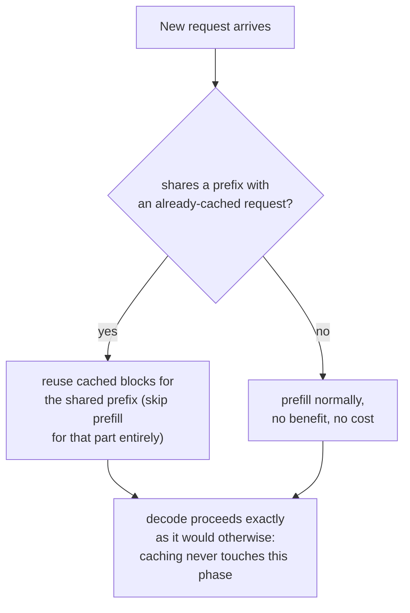

# 第 20 课：前缀缓存

**使命关联:** 第 11 课展示了*同一个*请求的并行样本，通过它们的块表共享一个提示词的缓存块。**前缀缓存**就是这同一种共享机制，应用到本来毫不相关的请求之间，只要它们碰巧以同样的 token 开头，比如系统提示词、一份长文档，或同一场对话中较早的轮次。
**主要来源:** [文档：“Automatic Prefix Caching”，vLLM Project](https://docs.vllm.ai/en/latest/features/automatic_prefix_caching.html)
**前置知识:** [第 11 课](0011-pagedattention.md)、[第 5 课](0005-request-scheduling.md)

## 热身

1. ▢ 在 PagedAttention 中，是什么让两个不同序列的块表可以指向同一个物理块？

检查

因为序列是通过它的块表间接触达缓存的，而不是假定一个固定的物理布局，所以只要内容相同（最常见的是共享的提示词前缀），两张块表就可以指向同一个物理块，直到某个序列的生成发生分歧，并触发写时复制。

2. ▢ 为什么预填充受算力限制，而解码受内存带宽限制？

检查

预填充在一次大型的并行前向计算中处理整个提示词，所以每读一个字节都有足够的工作量让 GPU 的算力保持忙碌。解码每步只算一个新 token，所以每步的内存流量压过了少量的新计算。

## 要点

### 同样的块共享思路，用在从未相关的请求之间

第 11 课的块共享应用在一个请求之内：同一个提示词的若干并行样本，把它们的块表都指向它们所共享的那个相同提示词的同样物理块。**前缀缓存**（vLLM 把它的版本叫作**自动前缀缓存**，APC）是同一种机制的更广泛应用：只要一个*新的*、原本无关的请求，碰巧以与某个已缓存内容相同的 token 开头，它的块表也可以指向那些已有的块，完全跳过共享部分的计算，而不是从头重新处理。

### 两种工作负载，收益很大，而不是微不足道

主要来源点名了两种情形，前缀缓存在其中提供很大的收益，具体是因为共享的前缀既长，又被不断复用。**长文档查询**：针对同一份长文档（手册、报告）提出许多不同的问题；没有缓存时，每一个问题都要把整份文档的预填充从头处理一遍，而有了缓存，文档只预填充一次，之后的每个问题都复用那份缓存，只为它自己那个简短的问题付费，文档那部分前缀是已经缓存好的。**多轮对话**：聊天会话中的每个新一轮，本来都要把整个对话历史重新处理一遍；缓存让每个新的一轮可以复用早先几轮中已经处理完的一切，只为真正新增的部分付费。

### 收益专门落在预填充上，从不落在解码上

主要来源对这个局限说得很明确：前缀缓存只减少处理查询所花的时间，也就是预填充阶段，完全不减少生成新 token 所花的时间，也就是解码阶段。这直接来自预填充和解码各自实际花费的是什么：预填充的开销来自为本来就在那里、可供读取的 token 计算 KV 缓存，对相同的前缀，缓存可以完全跳过它；解码的开销来自一个一个生成新 token 这种顺序的、受内存带宽限制的特性（第 18 课的问题，推测解码解决的是它），这些工作与任何前缀都毫无关系，缓存一个共享的前缀对它完全无能为力。

### 当它没有帮助时，也没有坏处，只是不适用

前缀缓存在两种情形下没有收益，但也没有代价：当工作负载大部分时间花在生成一个很长的答案，而不是处理输入时（解码占主导，而缓存从一开始就没碰过解码）；或者新请求根本与任何已缓存内容没有共同的前缀时（没有什么可复用的）。这两种情形都不是这套机制的失败；它们只是处在一个以共享前缀为键的缓存本来就不是为加速而构建的范围之外。

## 练习

1. ▢ 一个聊天机器人的用户各自问一次性的问题，彼此之间没有共享的系统提示词或对话历史。启用前缀缓存对这个工作负载有帮助吗？

提示

想想前缀缓存究竟需要什么，才能提供任何收益。

检查

没有，或者没有实质帮助：前缀缓存只有在请求与某个已缓存内容有共同的前缀时才有帮助。如果每个请求的内容与其他每个请求的内容真的毫不相关，就没有什么可复用的，所以启用它不花什么，也换不来什么。

2. ▢ 一个长文档问答的工作负载，针对同一本 10000 个 token 的手册提出 50 个不同的问题。没有前缀缓存时，什么事情必须做 50 次，而缓存能让它只做一次？

检查

那本 10000 个 token 的手册的整个预填充，也就是计算它的 KV 缓存，否则要为 50 个问题中的每一个从头重做一遍。有了前缀缓存，手册只预填充一次，50 个问题都复用同一份缓存好的前缀，各自只为叠加在它之上的那个简短的问题付费。

3. ▢ 一个工作负载的请求共享一个很长的相同前缀，但每个请求之后还会生成一个很长的答案。为什么即使前缀匹配得很完美，启用前缀缓存也可能只带来适度的整体加速？

检查

前缀缓存只加快预填充阶段；如果请求的总时间大部分实际花在解码上，也就是一个 token 一个 token 地生成那个很长的答案，而缓存对这个阶段完全无能为力，那么即使前缀缓存得很完美，也只去掉了请求总处理时间的一小部分。

4. ▢ 为什么前缀缓存即使在原则上，也不能像对共享前缀减少预填充时间那样，减少解码时间？

检查

解码的开销来自一个一个生成新 token 这种顺序的、受内存带宽限制的工作，与重新处理任何前缀毫无关系；在解码期间，没有冗余的、已经算过的预填充工作可供缓存跳过，因为每个被解码出来的 token 都是真正新的。

5. ▢ 下面哪种说法正确描述了前缀缓存与第 11 课 PagedAttention 的块共享之间的关系？

    - a) 前缀缓存是与 PagedAttention 块共享完全分开的机制，需要它自己的内存管理器
    - b) 前缀缓存就是第 11 课针对一个请求的并行样本所描述的同一种块共享机制，扩展到碰巧共享前缀的、原本无关的请求之间，它专门加快预填充，从不加快解码
    - c) 对任何共享已缓存前缀的请求，前缀缓存对预填充和解码的加速程度相同
    - d) 前缀缓存只在单个请求之内起作用，也就是第 11 课已经涵盖的范围

检查

**b)** 这就是本课所确立的精确关系和局限。(a) 是错的：它是同一个块表共享的机制，只是应用到了更广泛的一组请求上。(c) 是错的：主要来源明确指出，解码时间不受影响。(d) 是错的：前缀缓存的全部意义，就是把共享扩展到单个请求之外，扩展到任何前缀相同的请求。

## 实战练习

- [ ] 对你能用到的某个服务栈，检查前缀缓存（或等价的功能）是否启用，以及你的工作负载的请求是否真的共享有意义的前缀（系统提示词、共享文档、对话历史），从而能从中受益。
- [ ] 针对你熟悉的某个工作负载，粗略估计每个请求的总时间中，预填充和解码各占多大比例，并以此判断即使前缀完美匹配，前缀缓存可能带来多大的帮助。
- [ ] 明天：读主要来源链接的、关于 vLLM 内部如何实现前缀缓存的设计文档，记下它用什么作为缓存的键，来把新请求的前缀与已有的缓存内容做匹配。

## 延伸阅读

- [文档：“Automatic Prefix Caching”，vLLM Project](https://docs.vllm.ai/en/latest/features/automatic_prefix_caching.html)
- [论文：“Efficient Memory Management for Large Language Model Serving with PagedAttention”，Kwon 等，SOSP 2023](https://arxiv.org/abs/2309.06180)
- [资源](../RESOURCES.md)

---

没学明白？请重读顶部的主要来源，因为本课是对它的压缩，而理解正是在压缩中流失的。如果有哪个术语觉得含糊，可以查看[术语表](../GLOSSARY.md)。

如果问题出在课程本身，而不是学习材料，那就是一个缺陷：[提交 issue](https://github.com/TokenCemetery/teach/issues)。
