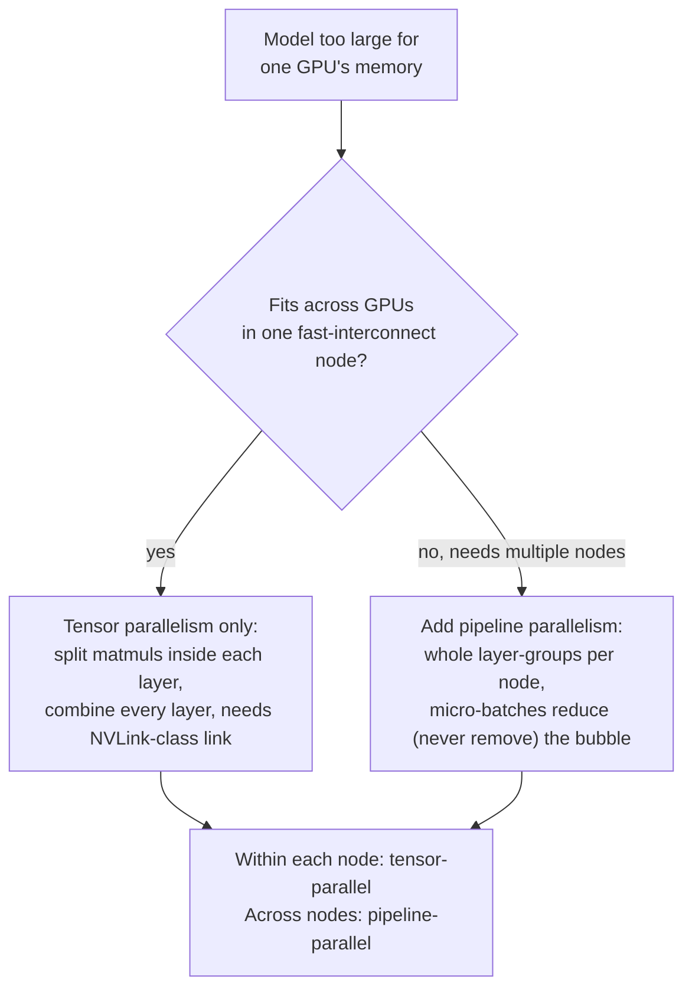

# Lección 21. Tensor parallelism y pipeline parallelism

**Vínculo con la misión:** La lección 12 presentó `--tensor-parallel-size` como el parámetro que permite que un modelo demasiado grande para una GPU se ejecute en varias, y se detuvo ahí. Esta lección abre el mecanismo que hay dentro de ese parámetro, el **tensor parallelism**, presenta la otra manera de dividir un modelo entre dispositivos, el **pipeline parallelism**, y da un procedimiento de decisión para elegir entre ellos, o combinar ambos, en lugar de recurrir al que aparezca primero en un tutorial.
**Fuente principal:** [Paper: "Megatron-LM: Training Multi-Billion Parameter Language Models Using Model Parallelism", Shoeybi et al., 2019](https://arxiv.org/abs/1909.08053), [Paper: "GPipe: Efficient Training of Giant Neural Networks using Pipeline Parallelism", Huang et al., 2018](https://arxiv.org/abs/1811.06965)
**Requisitos previos:** [Lección 12](0012-vllm-tuning-knobs.md)

## Calentamiento

1. ▢ ¿Qué dijo la lección 12 que hace `--tensor-parallel-size`, al nivel al que se enseñó?

Comprobación

Divide los pesos de un modelo, y el cómputo sobre ellos, entre varias GPU, de modo que un modelo demasiado grande para caber en la memoria de una GPU puede ejecutarse en varias, por ejemplo los pesos en fp16 de un modelo de 70B repartidos entre dos GPU de 80 GB con `--tensor-parallel-size 2`. La lección 12 se detuvo ahí: sin explicar cómo se divide realmente una multiplicación de matrices, y sin mencionar ninguna manera alternativa de dividir un modelo.

2. ▢ ¿Por qué tiene sentido combinar el tensor parallelism con la cuantización, en lugar de tratarlos como opciones que compiten?

Comprobación

La cuantización reduce cuánta memoria necesita el modelo en primer lugar; el tensor parallelism reparte la huella de memoria que quede entre más GPU. Actúan sobre ejes distintos de la misma restricción (cuánta memoria hace falta frente a cuánta memoria hay disponible por dispositivo), así que un modelo puede cuantizarse y dividirse a la vez.

## Qué debes saber

### El tensor parallelism divide realmente las multiplicaciones de matrices dentro de una capa

La contribución de Megatron-LM es un esquema de paralelismo de modelo **intra-capa**: en lugar de poner capas enteras en GPU distintas, divide las grandes multiplicaciones de matrices *dentro* de los bloques de atención y MLP de una sola capa de transformer entre las GPU, y hace que cada GPU calcule en paralelo su propia porción del resultado. Una matriz de pesos se particiona por columnas o por filas (los dos estilos de partición se eligen juntos, por bloque, específicamente para que la salida de un estilo de partición alimente directamente al otro sin necesitar un paso de sincronización intermedio); cuando ambas GPU terminan su porción local del cálculo, un paso de comunicación combina los resultados parciales en el mismo valor que habría obtenido cada GPU de un cálculo sin dividir. El paper es explícito en que esto no necesita ningún compilador ni biblioteca nuevos, "la inserción de unas pocas operaciones de comunicación en PyTorch nativo" basta, porque la división solo cambia cómo se reparte el trabajo de la multiplicación de matrices, no lo que calcula la capa.

### Ese paso de combinación es un punto de sincronización en la ruta crítica, en cada capa

El paso de comunicación que recombina el resultado parcial de cada GPU no es una contabilidad opcional que se haga una vez al arrancar: tiene que ocurrir en puntos concretos dentro de cada capa del transformer, en cada pasada forward, antes de que pueda continuar la siguiente etapa del cálculo, porque cada GPU solo tiene una porción del verdadero valor intermedio hasta que se combinan los resultados. Por eso el costo de comunicación del tensor parallelism escala con cuántas capas tiene un modelo y cuántos tokens se procesan, y por eso necesita una interconexión rápida entre las GPU implicadas (como NVLink dentro de un servidor) para evitar que esa sincronización por capa se convierta en el cuello de botella. También es la razón de que el tensor parallelism se limite normalmente a las GPU de un solo nodo: extender esa misma sincronización por capa a través de un enlace de red más lento (entre nodos) convierte una combinación local rápida en un viaje de ida y vuelta lento repetido en cada capa.

### El pipeline parallelism divide en el otro sentido: capas enteras, no dentro de ellas

El **pipeline parallelism** particiona un eje distinto del mismo problema: en lugar de dividir lo que ocurre dentro de una capa, particiona la *secuencia de capas* del modelo en grupos consecutivos (el propio planteamiento de GPipe: cualquier red expresable como una secuencia de capas puede dividirse así), y coloca cada grupo en un acelerador distinto. Los datos fluyen por los dispositivos en orden, la salida del dispositivo 1 se convierte en la entrada del dispositivo 2, igual que las capas se ejecutarían en orden en un solo dispositivo, salvo que cada grupo vive ahora en su propia GPU. A diferencia del tensor parallelism, el cálculo de ninguna capa se divide nunca, así que no hay un paso de combinación por capa; la comunicación solo ocurre en la frontera entre el grupo de capas de un dispositivo y el siguiente.

### El pipelining ingenuo deja inactiva a la mayor parte de la flota; los micro-lotes son la solución

Dividir las capas entre dispositivos de esta manera tiene un problema evidente: mientras el dispositivo 2 trabaja con los datos del lote, el dispositivo 1 espera inactivo a que el dispositivo 2 (y los siguientes) terminen antes de que pueda empezar el lote siguiente, y lo contrario ocurre a la vuelta durante la retropropagación. La solución de GPipe es dividir cada lote en **micro-lotes** más pequeños y canalizarlos por la secuencia de dispositivos uno tras otro, de modo que cuando el dispositivo 1 termina el micro-lote 1 y se lo entrega al dispositivo 2, el dispositivo 1 ya está empezando el micro-lote 2 en lugar de esperar. Esto mantiene ocupada a más flota a la vez, aunque nunca puede eliminar por completo el tiempo ocioso: sigue habiendo un retraso de arranque antes de que todos los dispositivos tengan trabajo (llenar el pipeline) y un retraso de vaciado al final (vaciarlo), la **burbuja de pipeline**, que se reduce a medida que fluyen más micro-lotes pero nunca desaparece del todo.

### Elegirlos (o combinarlos) es una pregunta sobre qué es realmente escaso

El tensor parallelism cambia una sincronización rápida, frecuente y por capa por la capacidad de dividir dentro de una capa, por eso quiere una interconexión rápida y normalmente se mantiene dentro de un nodo. El pipeline parallelism cambia una burbuja de pipeline (algo de tiempo ocioso, peor con lotes pequeños) por una comunicación que solo ocurre en las fronteras de los grupos, que tolera un enlace más lento y es lo que permite siquiera que un modelo abarque varios nodos. Un modelo que cabe entre las GPU de un solo nodo con interconexión rápida necesita solo tensor parallelism; un modelo demasiado grande para eso recurre al pipeline parallelism para abarcar nodos adicionales, y los despliegues multinodo de producción suelen combinar ambos: tensor parallelism dentro de cada nodo (enlace rápido, divisiones por capa), pipeline parallelism entre nodos (enlace más lento, solo fronteras de grupos de capas enteras). Es la misma disciplina de "cuál es realmente la restricción" que la lección 12 ya aplicó a sus propios parámetros de ajuste, aplicada aquí a una elección entre dos ejes para dividir un modelo en lugar de entre dos parámetros de un mismo eje.

## Práctica

1. ▢ Las matrices de pesos de atención y MLP de un modelo se dividen entre 4 GPU con tensor parallelism. ¿Qué tiene que ocurrir después de que cada GPU calcule su porción local de una multiplicación de matrices, antes de que pueda continuar la siguiente etapa de la capa?

Pista

Cada GPU solo tiene una parte del verdadero resultado hasta que ocurre algo.

Comprobación

Un paso de comunicación combina el resultado parcial de cada GPU en el único valor que habría producido el cálculo completo sin dividir. Esto tiene que ocurrir en puntos concretos dentro de cada capa, en cada pasada forward, ya que la siguiente etapa del cálculo necesita el valor combinado, no la porción parcial de una sola GPU.

2. ▢ ¿Por qué el tensor parallelism necesita una interconexión rápida como NVLink, mientras que el pipeline parallelism puede tolerar un enlace más lento entre nodos?

Comprobación

El paso de combinación del tensor parallelism ocurre en cada capa, en cada pasada forward, así que su comunicación es frecuente y está en la ruta crítica; un enlace lento lo convierte en un cuello de botella repetido. El pipeline parallelism solo se comunica en la frontera entre el grupo de capas de un dispositivo y el siguiente, mucho menos a menudo, así que tolera un enlace más lento, que es exactamente lo que le permite abarcar varios nodos.

3. ▢ Un equipo canaliza las capas de un modelo entre 4 GPU pero envía todo el lote como una única unidad en lugar de dividirlo en micro-lotes. ¿Qué le pasa a la GPU 1 mientras la GPU 4 procesa ese lote?

Comprobación

La GPU 1 queda inactiva: ya terminó su propio grupo de capas para ese lote y no tiene nada más que hacer hasta que todo el lote termine de pasar por las GPU restantes y llegue un lote nuevo. Dividir el lote en micro-lotes es lo que permite a la GPU 1 empezar con el siguiente micro-lote en lugar de quedarse inactiva.

4. ▢ ¿Dividir un lote en más micro-lotes elimina por completo la burbuja de pipeline, o solo la reduce?

Comprobación

Solo la reduce. Sigue habiendo un retraso de arranque antes de que todos los dispositivos del pipeline tengan trabajo que hacer, y un retraso de vaciado al final después de que el último micro-lote haya pasado, sin importar en cuántos micro-lotes se divida el lote; más micro-lotes hacen que esa fracción ociosa sea menor respecto del trabajo total, pero nunca la eliminan.

5. ▢ Un modelo cabe cómodamente entre las 8 GPU con interconexión rápida de un solo servidor. ¿Qué afirmación describe correctamente la elección de paralelismo que esto requiere?

    - a) Solo pipeline parallelism, ya que es más nuevo que el tensor parallelism
    - b) El tensor parallelism por sí solo basta: el enlace rápido dentro del nodo tolera su frecuente paso de combinación por capa, y no hay un segundo nodo que el pipeline parallelism tenga que abarcar
    - c) Ambos son necesarios siempre que un modelo necesita más de una GPU, sin ningún caso en que solo se aplique uno
    - d) No se aplica ninguno; solo la cuantización puede abordar un modelo demasiado grande para una GPU

Comprobación

**b)** Ese es el procedimiento de decisión que establece esta lección. (a) es falsa: la novedad no es el criterio, lo son la velocidad de la interconexión y cuántos nodos intervienen. (c) es falsa: un solo nodo con interconexión rápida necesita solo tensor parallelism, el pipeline parallelism se gana su lugar específicamente al abarcar varios nodos. (d) es falsa: la cuantización reduce la huella de memoria pero no divide el cómputo entre dispositivos como lo hace cualquiera de los dos esquemas de paralelismo, y la lección 12 ya estableció que se combinan en lugar de sustituirse.

## Prácticas en el mundo real

- [ ] Para un stack de serving multi-GPU al que tengas acceso, comprueba si expone parámetros separados para el grado de tensor parallelism y de pipeline parallelism (`--tensor-parallel-size` y `--pipeline-parallel-size` de vLLM son un ejemplo), y anota cuál está realmente fijado y por qué.
- [ ] Si tienes acceso a un clúster de GPU multinodo, comprueba la interconexión entre GPU dentro de un nodo frente a la que hay entre nodos (ancho de banda de NVLink frente a Ethernet/InfiniBand), y usa el procedimiento de decisión de esta lección para juzgar si la división tensor/pipeline del despliegue encaja con ese hardware.
- [ ] Mañana: lee la sección del paper de Megatron-LM que describe exactamente qué dos estilos de partición (por columnas frente a por filas) usa para las proyecciones del bloque de atención, y anota por qué ese emparejamiento concreto evita un paso de sincronización adicional entre ellas.

## Para profundizar

- [Paper: "Megatron-LM: Training Multi-Billion Parameter Language Models Using Model Parallelism", Shoeybi et al., 2019](https://arxiv.org/abs/1909.08053)
- [Paper: "GPipe: Efficient Training of Giant Neural Networks using Pipeline Parallelism", Huang et al., 2018](https://arxiv.org/abs/1811.06965)
- [Recursos](../RESOURCES.md)

---

¿No termina de quedar claro? Vuelve a leer la fuente primaria de arriba, ya que esta lección la comprime y en la compresión es donde se escapa la comprensión. Consulta el [glosario](../GLOSSARY.md) por si algún término te resultó resbaladizo.

Si lo poco claro es la propia lección y no el material, eso es un defecto: [abre un issue](https://github.com/TokenCemetery/teach/issues).
