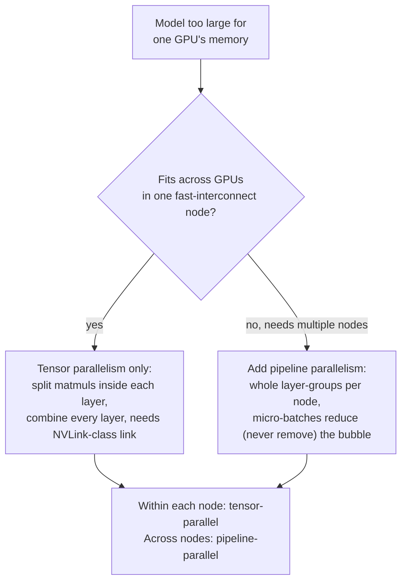

# Leçon 21. Parallélisme tensoriel et de pipeline

**Lien avec la mission :** La leçon 12 a présenté `--tensor-parallel-size` comme l'option qui permet à un modèle trop grand pour un GPU de tourner sur plusieurs, et s'est arrêtée là. Cette leçon ouvre le mécanisme qui se trouve derrière cette option, le **parallélisme tensoriel**, présente l'autre façon de répartir un modèle entre des appareils, le **parallélisme de pipeline**, et donne une procédure de décision pour choisir entre eux, ou combiner les deux, au lieu de prendre celui qui apparaît en premier dans un tutoriel.
**Source primaire :** [Article : "Megatron-LM: Training Multi-Billion Parameter Language Models Using Model Parallelism", Shoeybi et al., 2019](https://arxiv.org/abs/1909.08053), [Article : "GPipe: Efficient Training of Giant Neural Networks using Pipeline Parallelism", Huang et al., 2018](https://arxiv.org/abs/1811.06965)
**Prérequis :** [Leçon 12](0012-vllm-tuning-knobs.md)

## Échauffement

1. ▢ Qu'a dit la leçon 12 que fait `--tensor-parallel-size`, au niveau où elle l'a enseigné ?

Vérifier

Elle répartit les poids d'un modèle, et le calcul sur eux, entre plusieurs GPU, de sorte qu'un modèle trop grand pour tenir dans la mémoire d'un GPU puisse tourner sur plusieurs, par exemple les poids fp16 d'un modèle 70B répartis sur deux GPU de 80 GB avec `--tensor-parallel-size 2`. La leçon 12 s'est arrêtée là : pas d'explication de la façon dont une multiplication matricielle est réellement divisée, et aucune mention d'une autre façon de répartir un modèle.

2. ▢ Pourquoi combiner le parallélisme tensoriel avec la quantification a-t-il du sens, plutôt que de les traiter comme des options concurrentes ?

Vérifier

La quantification réduit la quantité de mémoire dont le modèle a besoin au départ ; le parallélisme tensoriel répartit l'empreinte mémoire qui reste sur davantage de GPU. Elles agissent sur des axes différents de la même contrainte (combien de mémoire est nécessaire contre combien de mémoire est disponible par appareil), donc un modèle peut être quantifié et réparti en même temps.

## À savoir

### Le parallélisme tensoriel répartit réellement les multiplications matricielles à l'intérieur d'une couche

La contribution de Megatron-LM est un schéma de parallélisme de modèle **intra-couche** : au lieu de placer des couches entières sur des GPU différents, il répartit entre les GPU les grosses multiplications matricielles *à l'intérieur* des blocs d'attention et de MLP d'une seule couche de transformer, et fait calculer à chaque GPU sa propre tranche du résultat en parallèle. Une matrice de poids est partitionnée soit par colonnes, soit par lignes (les deux styles de partition sont choisis ensemble, par bloc, précisément pour que la sortie d'un style de partition alimente directement l'autre sans qu'une étape de synchronisation soit nécessaire entre les deux) ; une fois que les deux GPU ont terminé leur tranche locale du calcul, une étape de communication recombine les résultats partiels en la même valeur que chaque GPU aurait obtenue d'un calcul non réparti. L'article est explicite sur le fait que cela n'exige ni nouveau compilateur ni nouvelle bibliothèque, « the insertion of a few communication operations in native PyTorch » suffit, parce que la répartition ne change que la façon dont le travail de la multiplication matricielle est divisé, pas ce que la couche calcule.

### Cette étape de recombinaison est un point de synchronisation sur le chemin critique, à chaque couche

L'étape de communication qui recombine le résultat partiel de chaque GPU n'est pas une comptabilité facultative faite une fois au démarrage : elle doit avoir lieu à des points précis à l'intérieur de chaque couche de transformer, à chaque passe avant, avant que l'étape de calcul suivante puisse se poursuivre, parce que chaque GPU ne détient qu'une tranche de la vraie valeur intermédiaire tant que les résultats ne sont pas combinés. C'est pourquoi le coût de communication du parallélisme tensoriel croît avec le nombre de couches d'un modèle et le nombre de tokens traités, et pourquoi il exige une interconnexion rapide entre les GPU concernés (comme NVLink au sein d'un même serveur) pour éviter que cette synchronisation par couche devienne le goulot d'étranglement. C'est aussi pourquoi le parallélisme tensoriel est normalement limité aux GPU d'un seul nœud : étendre cette même synchronisation par couche sur une liaison réseau plus lente (entre nœuds) transforme une recombinaison locale rapide en un aller-retour lent répété à chaque couche.

### Le parallélisme de pipeline répartit dans l'autre sens : des couches entières, pas l'intérieur des couches

Le **parallélisme de pipeline** partitionne un autre axe du même problème : au lieu de répartir ce qui se passe à l'intérieur d'une couche, il partitionne la *suite de couches* du modèle en groupes consécutifs (le cadrage propre de GPipe : tout réseau exprimable comme une suite de couches peut être réparti ainsi), et place chaque groupe sur un accélérateur différent. Les données traversent les appareils dans l'ordre, la sortie de l'appareil 1 devient l'entrée de l'appareil 2, comme les couches s'exécuteraient dans l'ordre sur un seul appareil, sauf que chaque groupe vit maintenant sur son propre GPU. Contrairement au parallélisme tensoriel, le calcul d'aucune couche n'est jamais réparti, donc il n'y a pas d'étape de recombinaison par couche ; la communication n'a lieu qu'à la frontière entre le groupe de couches d'un appareil et le suivant.

### Un pipeline naïf laisse la plupart de la flotte inactive ; le micro-batching y remédie

Répartir ainsi les couches entre des appareils pose un problème évident : pendant que l'appareil 2 travaille sur les données du batch, l'appareil 1 reste inactif à attendre que l'appareil 2 (et les suivants) termine avant que le batch suivant puisse démarrer, et l'inverse se produit au retour lors de la rétropropagation. La solution de GPipe est de découper chaque batch en **micro-batchs** plus petits et de les faire passer dans la suite d'appareils l'un après l'autre, si bien que le temps que l'appareil 1 termine le micro-batch 1 et le passe à l'appareil 2, l'appareil 1 commence déjà le micro-batch 2 au lieu d'attendre. Cela garde une plus grande part de la flotte occupée à la fois, sans jamais pouvoir éliminer entièrement le temps d'inactivité : il reste un délai de démarrage avant que chaque appareil ait du travail (le remplissage du pipeline) et un délai de vidange à la fin (sa vidange), la **bulle de pipeline**, qui diminue à mesure que davantage de micro-batchs passent mais ne disparaît jamais complètement.

### Choisir (ou combiner) les deux est une question sur ce qui est réellement rare

Le parallélisme tensoriel échange une synchronisation rapide, fréquente, par couche contre la possibilité de répartir à l'intérieur d'une couche, ce qui explique qu'il veuille une interconnexion rapide et soit normalement limité à un seul nœud. Le parallélisme de pipeline échange une bulle de pipeline (un peu de temps d'inactivité, pire pour les petits batchs) contre une communication qui n'a lieu qu'aux frontières de groupes, ce qui tolère une liaison plus lente et permet à un modèle de s'étendre sur plusieurs nœuds. Un modèle qui tient sur les GPU d'un seul nœud à interconnexion rapide n'a besoin que du parallélisme tensoriel ; un modèle trop grand pour cela recourt au parallélisme de pipeline pour s'étendre sur des nœuds supplémentaires, et les déploiements de production multi-nœuds combinent couramment les deux : parallélisme tensoriel à l'intérieur de chaque nœud (liaison rapide, répartitions par couche), parallélisme de pipeline entre les nœuds (liaison plus lente, frontières de groupes de couches entières seulement). C'est la même discipline du « qu'est-ce qui est réellement la contrainte » que la leçon 12 a déjà appliquée à ses propres paramètres de réglage, appliquée ici à un choix entre deux axes de répartition d'un modèle plutôt qu'entre deux options sur un seul axe.

## Pratique

1. ▢ Les matrices de poids d'attention et de MLP d'un modèle sont réparties sur 4 GPU avec le parallélisme tensoriel. Que doit-il se passer après que chaque GPU a calculé sa tranche locale d'une multiplication matricielle, avant que l'étape suivante de la couche puisse se poursuivre ?

Indice

Chaque GPU ne détient qu'une partie du vrai résultat tant que quelque chose ne se produit pas.

Vérifier

Une étape de communication recombine le résultat partiel de chaque GPU en la valeur unique que le calcul complet, non réparti, aurait produite. Cela doit avoir lieu à des points précis à l'intérieur de chaque couche, à chaque passe avant, puisque l'étape de calcul suivante a besoin de la valeur combinée, et non de la tranche partielle d'un seul GPU.

2. ▢ Pourquoi le parallélisme tensoriel exige-t-il une interconnexion rapide comme NVLink, alors que le parallélisme de pipeline peut tolérer une liaison plus lente entre nœuds ?

Vérifier

L'étape de recombinaison du parallélisme tensoriel a lieu à chaque couche, à chaque passe avant, donc sa communication est fréquente et se trouve sur le chemin critique ; une liaison lente en fait un goulot d'étranglement répété. Le parallélisme de pipeline ne communique qu'à la frontière entre le groupe de couches d'un appareil et le suivant, bien moins souvent, donc il tolère une liaison plus lente, ce qui est exactement ce qui lui permet de s'étendre sur plusieurs nœuds.

3. ▢ Une équipe fait un pipeline des couches d'un modèle sur 4 GPU mais envoie le batch entier comme une seule unité au lieu de le découper en micro-batchs. Que se passe-t-il pour le GPU 1 pendant que le GPU 4 traite ce batch ?

Vérifier

Le GPU 1 reste inactif : il a déjà terminé son propre groupe de couches pour ce batch et n'a rien d'autre à faire tant que tout le batch n'a pas fini de traverser les GPU restants et qu'un nouveau batch n'est pas arrivé. Découper le batch en micro-batchs est ce qui permet au GPU 1 de commencer le micro-batch suivant au lieu de rester inactif.

4. ▢ Découper un batch en davantage de micro-batchs élimine-t-il entièrement la bulle de pipeline, ou la réduit-il seulement ?

Vérifier

Il la réduit seulement. Il reste un délai de démarrage avant que chaque appareil du pipeline ait du travail, et un délai de vidange à la fin après le passage du dernier micro-batch, quel que soit le nombre de micro-batchs en lesquels le batch est découpé ; davantage de micro-batchs rendent cette fraction d'inactivité plus petite par rapport au travail total, mais ne la suppriment jamais.

5. ▢ Un modèle tient confortablement sur les 8 GPU à interconnexion rapide d'un seul serveur. Quelle affirmation décrit correctement le choix de parallélisme que cela appelle ?

    - a) Le parallélisme de pipeline seul, puisqu'il est plus récent que le parallélisme tensoriel
    - b) Le parallélisme tensoriel seul suffit : la liaison rapide intra-nœud tolère son étape de recombinaison fréquente par couche, et il n'y a pas de second nœud que le parallélisme de pipeline devrait couvrir
    - c) Les deux sont requis dès qu'un modèle a besoin de plus d'un GPU, sans cas où un seul s'applique
    - d) Aucun ne s'applique ; seule la quantification peut répondre à un modèle trop grand pour un GPU

Vérifier

**b)** C'est la procédure de décision qu'établit cette leçon. (a) est fausse : la nouveauté n'est pas le critère, ce sont la vitesse de l'interconnexion et le nombre de nœuds concernés. (c) est fausse : un seul nœud à interconnexion rapide n'a besoin que du parallélisme tensoriel, le parallélisme de pipeline justifie sa place spécifiquement quand il faut couvrir plusieurs nœuds. (d) est fausse : la quantification réduit l'empreinte mémoire mais ne répartit pas le calcul entre des appareils comme le fait l'un ou l'autre schéma de parallélisme, et la leçon 12 a déjà établi qu'ils se combinent plutôt que de se substituer l'un à l'autre.

## Exercices en situation réelle

- [ ] Pour une pile de serving multi-GPU à laquelle vous avez accès, vérifiez si elle expose des options séparées pour le degré de parallélisme tensoriel et de pipeline (`--tensor-parallel-size` et `--pipeline-parallel-size` de vLLM en sont un exemple), et notez laquelle est réellement réglée et pourquoi.
- [ ] Si vous avez accès à un cluster GPU multi-nœuds, vérifiez l'interconnexion entre les GPU d'un même nœud par rapport à celle entre nœuds (NVLink contre bande passante Ethernet/InfiniBand), et servez-vous de la procédure de décision de cette leçon pour juger si la répartition tensorielle/pipeline du déploiement correspond à ce matériel.
- [ ] Demain : lisez la section de l'article Megatron-LM qui décrit exactement quels deux styles de partition (colonne contre ligne) il utilise pour les projections du bloc d'attention, et notez pourquoi cet appariement précis évite une étape de synchronisation supplémentaire entre elles.

## Pour aller plus loin

- [Article : "Megatron-LM: Training Multi-Billion Parameter Language Models Using Model Parallelism", Shoeybi et al., 2019](https://arxiv.org/abs/1909.08053)
- [Article : "GPipe: Efficient Training of Giant Neural Networks using Pipeline Parallelism", Huang et al., 2018](https://arxiv.org/abs/1811.06965)
- [Ressources](../RESOURCES.md)

---

Ça ne passe pas ? Relisez la source primaire en haut de page, car cette leçon la condense et c'est dans la condensation que la compréhension s'échappe. Consultez le [glossaire](../GLOSSARY.md) pour tout terme qui vous a paru glissant.

Si c'est la leçon elle-même qui n'est pas claire plutôt que la matière, c'est un défaut : [ouvrez une issue](https://github.com/TokenCemetery/teach/issues).
