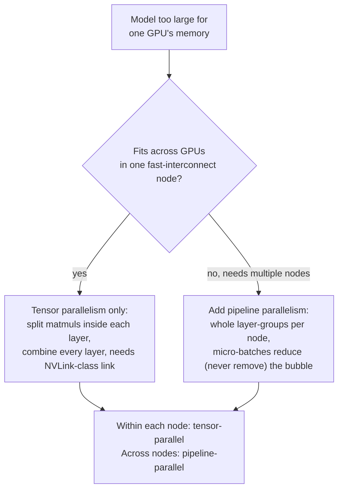

# पाठ 21. Tensor और Pipeline Parallelism

**मिशन से संबंध:** पाठ 12 ने `--tensor-parallel-size` को वह flag बताया जो एक GPU के लिए बहुत बड़े model को कई पर चलने देता है, और वहीं रुक गया। यह पाठ उस flag के भीतर का तंत्र, **tensor parallelism**, खोलता है, model को devices में बाँटने का दूसरा तरीक़ा, **pipeline parallelism**, लाता है, और उनमें से चुनने, या दोनों को जोड़ने, की प्रक्रिया देता है, जो भी tutorial में सबसे पहले दिख जाए उसकी ओर हाथ बढ़ाने के बजाय।
**मुख्य स्रोत:** [पेपर: "Megatron-LM: Training Multi-Billion Parameter Language Models Using Model Parallelism", Shoeybi et al., 2019](https://arxiv.org/abs/1909.08053), [पेपर: "GPipe: Efficient Training of Giant Neural Networks using Pipeline Parallelism", Huang et al., 2018](https://arxiv.org/abs/1811.06965)
**पूर्व-आवश्यकताएँ:** [पाठ 12](0012-vllm-tuning-knobs.md)

## वार्म-अप

1. ▢ पाठ 12 ने जिस स्तर पर सिखाया, उसमें `--tensor-parallel-size` क्या करता है?

जाँचें

वह model के weights को, और उन पर होने वाले compute को, कई GPUs में बाँटता है, ताकि एक GPU की memory में न समाने वाला model कई पर चल सके, जैसे `--tensor-parallel-size 2` के साथ 70B model के fp16 weights दो 80 GB GPUs में फैले। पाठ 12 वहीं रुक गया: matrix multiply असल में कैसे बाँटा जाता है इसकी कोई व्याख्या नहीं, और model को बाँटने के किसी वैकल्पिक तरीक़े का कोई ज़िक्र नहीं।

2. ▢ Tensor parallelism को quantization के साथ जोड़ना प्रतिस्पर्धी विकल्प मानने के बजाय समझदारी क्यों है?

जाँचें

Quantization पहली जगह model को कितनी memory चाहिए यह घटाता है; tensor parallelism जो भी memory footprint बचा है उसे ज़्यादा GPUs में फैलाता है। वे उसी बाधा की अलग धुरियों पर काम करते हैं (कितनी memory चाहिए बनाम प्रति device कितनी उपलब्ध है), इसलिए model एक ही समय में quantize भी हो सकता है और बाँटा भी जा सकता है।

## यह जानें

### Tensor parallelism असल में layer के भीतर के matrix multiplies को बाँटता है

Megatron-LM का योगदान **intra-layer** model-parallel योजना है: पूरी layers को अलग GPUs पर रखने के बजाय, वह एक अकेली transformer layer के attention और MLP blocks के *भीतर* के बड़े matrix multiplications को GPUs में बाँटता है, और हर GPU अपने हिस्से का नतीजा parallel में compute करता है। Weight matrix को या तो columns से या rows से बाँटा जाता है (दोनों बँटवारे की शैलियाँ हर block में साथ चुनी जाती हैं, ख़ास तौर पर ताकि एक शैली का output बीच में synchronization step के बिना सीधे दूसरी में जाए); दोनों GPUs के computation का अपना स्थानीय हिस्सा पूरा करने के बाद, एक communication step आंशिक नतीजों को उसी value में वापस जोड़ देता है जो हर GPU को बिना बँटे computation से मिलती। पेपर साफ़ कहता है कि इसके लिए किसी नए compiler या library की ज़रूरत नहीं, "native PyTorch में कुछ communication operations डालना" काफ़ी है, क्योंकि बँटवारा सिर्फ़ यह बदलता है कि matrix multiply का काम कैसे बाँटा जाए, यह नहीं कि layer क्या compute करती है।

### वह जोड़ने का step हर layer में critical path पर एक synchronization बिंदु है

हर GPU के आंशिक नतीजे को वापस जोड़ने वाला communication step शुरू में एक बार किया जाने वाला वैकल्पिक bookkeeping नहीं है: उसे हर transformer layer के भीतर ख़ास बिंदुओं पर, हर forward pass में, computation के अगले चरण के आगे बढ़ने से पहले होना पड़ता है, क्योंकि जब तक नतीजे जोड़े न जाएँ हर GPU के पास असली मध्यवर्ती value का सिर्फ़ एक हिस्सा होता है। इसीलिए tensor parallelism की communication लागत इस पर बढ़ती है कि model में कितनी layers हैं और कितने tokens process हो रहे हैं, और इसीलिए उसे शामिल GPUs के बीच तेज़ interconnect (जैसे एक server के भीतर NVLink) चाहिए ताकि वह प्रति-layer synchronization अड़चन न बन जाए। इसीलिए tensor parallelism को आम तौर पर एक ही node के भीतर के GPUs तक रखा जाता है: उसी प्रति-layer synchronization को धीमे network link (nodes के बीच) पर फैलाना तेज़ स्थानीय जोड़ को हर layer में दोहराई जाने वाली धीमी round trip में बदल देता है।

### Pipeline parallelism दूसरी तरह बाँटता है: पूरी layers, उनके भीतर नहीं

**Pipeline parallelism** उसी समस्या की अलग धुरी बाँटता है: एक layer के भीतर जो होता है उसे बाँटने के बजाय, वह model की *layers की श्रृंखला* को लगातार समूहों में बाँटता है (GPipe का अपना ढाँचा: layers की श्रृंखला के रूप में लिखा जा सकने वाला कोई भी network इस तरह बाँटा जा सकता है), और हर समूह को अलग accelerator पर रखता है। Data devices से क्रम में गुज़रता है, device 1 का output device 2 का input बन जाता है, वैसे ही जैसे layers एक device पर क्रम से चलतीं, बस अब हर समूह अपने GPU पर रहता है। Tensor parallelism के उलट, किसी एक layer का computation कभी नहीं बँटता, इसलिए प्रति-layer जोड़ने का कोई step नहीं है; communication सिर्फ़ एक device की layers के समूह और अगले के बीच की सीमा पर होता है।

### Naive pipelining ज़्यादातर fleet को ख़ाली रखती है; micro-batching इसका इलाज है

इस तरह layers को devices में बाँटने की एक साफ़ समस्या है: जब device 2 batch के data पर काम कर रहा है, तब device 1 ख़ाली बैठा device 2 (और आगे के devices) के ख़त्म होने का इंतज़ार करता है, तब जाकर अगला batch शुरू हो सकता है, और backpropagation के दौरान लौटते समय उल्टा होता है। GPipe का समाधान हर batch को छोटे **micro-batches** में बाँटना और उन्हें devices के क्रम से एक के बाद एक गुज़ारना है, ताकि जब तक device 1 micro-batch 1 ख़त्म करके device 2 को सौंपता है, device 1 इंतज़ार करने के बजाय micro-batch 2 शुरू कर चुका हो। यह एक साथ fleet का ज़्यादा हिस्सा व्यस्त रखता है, हालाँकि ख़ाली समय को पूरी तरह कभी ख़त्म नहीं कर सकता: हर device के पास काम होने से पहले शुरू की देरी (pipeline भरना) और अंत की निकासी की देरी (उसे ख़ाली करना) अब भी है, यानी **pipeline bubble**, जो ज़्यादा micro-batches बहने पर सिकुड़ता है पर पूरी तरह कभी ग़ायब नहीं होता।

### इन्हें चुनना (या जोड़ना) इस सवाल का जवाब है कि असल में दुर्लभ क्या है

Tensor parallelism तेज़, बार-बार होने वाली, प्रति-layer synchronization की क़ीमत पर layer के भीतर बाँटने की क्षमता ख़रीदता है, इसीलिए उसे तेज़ interconnect चाहिए और उसे आम तौर पर एक node के भीतर रखा जाता है। Pipeline parallelism एक pipeline bubble (कुछ ख़ाली समय, छोटे batches के लिए बदतर) की क़ीमत पर ऐसी communication ख़रीदता है जो सिर्फ़ समूहों की सीमाओं पर होती है, जो धीमा link सह लेती है और वही है जो model को कई nodes में फैलने देती है। जो model एक तेज़-interconnect वाले node के GPUs में समा जाए उसे सिर्फ़ tensor parallelism चाहिए; जो उसके लिए भी बहुत बड़ा हो वह अतिरिक्त nodes में फैलने के लिए pipeline parallelism की ओर जाता है, और production के multi-node deployments आम तौर पर दोनों जोड़ते हैं: हर node के भीतर tensor-parallel (तेज़ link, प्रति-layer बँटवारे), nodes के पार pipeline-parallel (धीमा link, सिर्फ़ पूरी-layer-समूहों की सीमाएँ)। यह वही "असल में बाधा क्या है" का अनुशासन है जो पाठ 12 पहले अपने tuning knobs पर लगा चुका है, यहाँ एक ही धुरी के दो flags के बीच नहीं बल्कि model को बाँटने की दो धुरियों के बीच चुनाव पर लगाया गया।

## अभ्यास

1. ▢ किसी model के attention और MLP weight matrices tensor parallelism से 4 GPUs में बाँटे गए हैं। हर GPU के matrix multiply का अपना स्थानीय हिस्सा compute करने के बाद, layer का अगला चरण आगे बढ़ने से पहले क्या होना चाहिए?

संकेत

कुछ होने तक हर GPU के पास असली नतीजे का सिर्फ़ एक हिस्सा है।

जाँचें

एक communication step हर GPU के आंशिक नतीजे को उस एक value में वापस जोड़ता है जो पूरा, बिना बँटा computation देता। यह हर layer के भीतर ख़ास बिंदुओं पर, हर forward pass में होना चाहिए, क्योंकि computation के अगले चरण को जुड़ी हुई value चाहिए, किसी एक GPU का आंशिक हिस्सा नहीं।

2. ▢ Tensor parallelism को NVLink जैसा तेज़ interconnect क्यों चाहिए, जबकि pipeline parallelism nodes के बीच धीमा link सह सकता है?

जाँचें

Tensor parallelism का जोड़ने वाला step हर layer में, हर forward pass में होता है, इसलिए उसकी communication बार-बार होती है और critical path पर बैठती है; धीमा link उसे बार-बार की अड़चन में बदल देता है। Pipeline parallelism सिर्फ़ एक device की layers के समूह और अगले के बीच की सीमा पर communicate करता है, कहीं कम बार, इसलिए वह धीमा link सह लेता है, और ठीक यही उसे कई nodes में फैलने देता है।

3. ▢ एक team model की layers को 4 GPUs में pipeline करती है पर पूरे batch को micro-batches में बाँटने के बजाय एक अकेली इकाई की तरह भेजती है। जब GPU 4 उस batch को process कर रहा है तब GPU 1 का क्या होता है?

जाँचें

GPU 1 ख़ाली बैठा रहता है: वह उस batch के लिए अपनी layers का समूह पहले ही पूरा कर चुका है और जब तक पूरा batch बाक़ी GPUs से गुज़रकर न निकल जाए और नया batch न आ जाए, उसके पास करने को कुछ नहीं। Batch को micro-batches में बाँटना ही GPU 1 को ख़ाली बैठने के बजाय अगले micro-batch पर काम शुरू करने देता है।

4. ▢ क्या batch को ज़्यादा micro-batches में बाँटने से pipeline bubble पूरी तरह ख़त्म हो जाता है, या सिर्फ़ सिकुड़ता है?

जाँचें

सिर्फ़ सिकुड़ता है। Pipeline के हर device के पास करने को काम होने से पहले शुरू की देरी, और आख़िरी micro-batch गुज़र जाने के बाद अंत की निकासी की देरी अब भी है, चाहे batch कितने भी micro-batches में बँटा हो; ज़्यादा micro-batches उस ख़ाली हिस्से को कुल काम के मुक़ाबले छोटा करते हैं, पर उसे कभी हटाते नहीं।

5. ▢ एक model एक अकेले server के 8 तेज़-interconnect वाले GPUs में आराम से समा जाता है। यह जिस parallelism चुनाव की माँग करता है उसका सही वर्णन कौन-सा दावा करता है?

    - a) सिर्फ़ pipeline parallelism, क्योंकि वह tensor parallelism से नया है
    - b) अकेला tensor parallelism काफ़ी है: तेज़ intra-node link उसके बार-बार होने वाले प्रति-layer जोड़ने के step को सह लेता है, और pipeline parallelism के फैलने के लिए कोई दूसरा node नहीं है
    - c) जब भी model को एक से ज़्यादा GPU चाहिए दोनों ज़रूरी हैं, ऐसा कोई मामला नहीं जहाँ सिर्फ़ एक लागू हो
    - d) कोई लागू नहीं होता; एक GPU के लिए बहुत बड़े model को सिर्फ़ quantization सँभाल सकता है

जाँचें

**b)** यही वह फ़ैसला लेने की प्रक्रिया है जो यह पाठ स्थापित करता है। (a) ग़लत है: नयापन कसौटी नहीं है, interconnect की गति और कितने nodes शामिल हैं यह है। (c) ग़लत है: एक तेज़-interconnect वाले node को सिर्फ़ tensor parallelism चाहिए, pipeline parallelism अपनी जगह ख़ास तौर पर तब बनाता है जब कई nodes में फैलना हो। (d) ग़लत है: quantization memory footprint घटाता है पर compute को devices में उस तरह नहीं बाँटता जैसे कोई भी parallelism योजना बाँटती है, और पाठ 12 पहले स्थापित कर चुका है कि वे एक-दूसरे की जगह लेने के बजाय जुड़ते हैं।

## असली दुनिया का अभ्यास

- [ ] जिस multi-GPU serving stack तक आपकी पहुँच है उसके लिए जाँचें कि वह tensor-parallel और pipeline-parallel degree के लिए अलग flags देता है या नहीं (vLLM का `--tensor-parallel-size` और `--pipeline-parallel-size` एक उदाहरण हैं), और नोट करें कि असल में कौन-सा सेट है और क्यों।
- [ ] अगर आपकी पहुँच multi-node GPU cluster तक है, तो एक node के भीतर GPUs के बीच और nodes के बीच का interconnect जाँचें (NVLink बनाम Ethernet/InfiniBand की bandwidth), और इस पाठ की फ़ैसला लेने की प्रक्रिया से परखें कि deployment का tensor/pipeline split उस hardware से मेल खाता है या नहीं।
- [ ] कल: Megatron-LM पेपर का वह खंड पढ़ें जो बताता है कि attention block के projections के लिए वह कौन-सी दो बँटवारे की शैलियाँ (column बनाम row) इस्तेमाल करता है, और नोट करें कि वही ख़ास जोड़ी उनके बीच अतिरिक्त synchronization step क्यों बचाती है।

## आगे बढ़ने के लिए

- [पेपर: "Megatron-LM: Training Multi-Billion Parameter Language Models Using Model Parallelism", Shoeybi et al., 2019](https://arxiv.org/abs/1909.08053)
- [पेपर: "GPipe: Efficient Training of Giant Neural Networks using Pipeline Parallelism", Huang et al., 2018](https://arxiv.org/abs/1811.06965)
- [संसाधन](../RESOURCES.md)

---

बात नहीं बन रही? ऊपर दिए मुख्य स्रोत को दोबारा पढ़ें, क्योंकि यह पाठ उसे संक्षिप्त करता है और समझ संक्षेप में ही रिसती है। जो शब्द फिसलन भरा लगे, उसके लिए [शब्दावली](../GLOSSARY.md) देखें।

अगर दिक़्क़त सामग्री की नहीं बल्कि पाठ की ही है, तो वह एक खोट है: [issue खोलें](https://github.com/TokenCemetery/teach/issues)।
