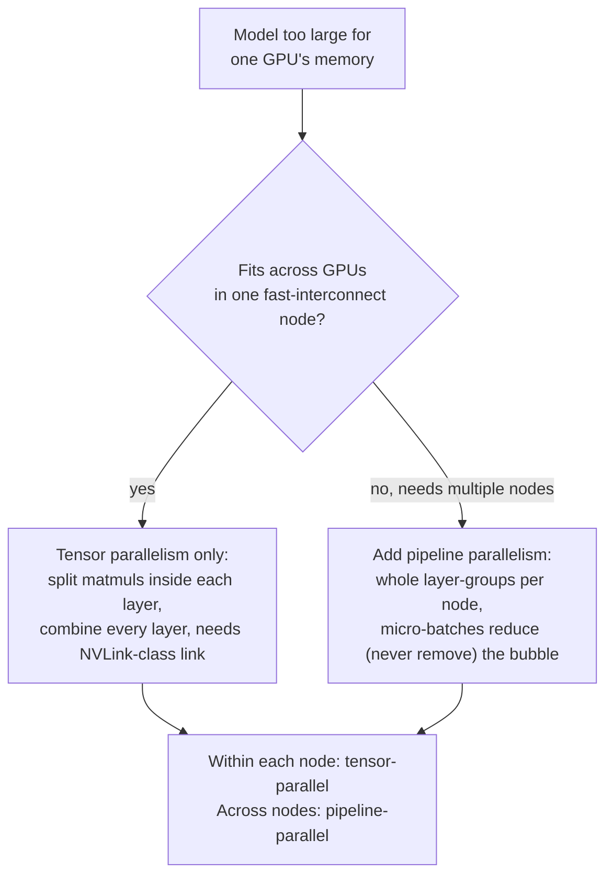

# Lição 21. Paralelismo de tensor e de pipeline

**Ligação com a missão:** A lição 12 introduziu `--tensor-parallel-size` como a flag que permite a um modelo grande demais para uma GPU rodar em várias, e parou por aí. Esta lição abre o mecanismo dentro dessa flag, o **paralelismo de tensor**, apresenta a outra forma de dividir um modelo entre dispositivos, o **paralelismo de pipeline**, e dá um procedimento de decisão para escolher entre eles, ou combinar os dois, em vez de recorrer ao que aparecer primeiro em um tutorial.
**Fonte principal:** [Artigo científico: "Megatron-LM: Training Multi-Billion Parameter Language Models Using Model Parallelism", Shoeybi et al., 2019](https://arxiv.org/abs/1909.08053), [Artigo científico: "GPipe: Efficient Training of Giant Neural Networks using Pipeline Parallelism", Huang et al., 2018](https://arxiv.org/abs/1811.06965)
**Pré-requisitos:** [Lição 12](0012-vllm-tuning-knobs.md)

## Aquecimento

1. ▢ O que a lição 12 disse que `--tensor-parallel-size` faz, no nível em que foi ensinado?

Verificação

Divide os pesos de um modelo, e o compute sobre eles, entre várias GPUs, de modo que um modelo grande demais para caber na memória de uma GPU possa rodar em várias, por exemplo, os pesos em fp16 de um modelo de 70B espalhados por duas GPUs de 80 GB com `--tensor-parallel-size 2`. A lição 12 parou aí: sem explicar como uma multiplicação de matrizes é de fato dividida e sem mencionar nenhuma forma alternativa de dividir um modelo.

2. ▢ Por que combinar paralelismo de tensor com quantização faz sentido, em vez de tratá-los como opções concorrentes?

Verificação

A quantização reduz quanta memória o modelo precisa em primeiro lugar; o paralelismo de tensor espalha a pegada de memória que restar por mais GPUs. Eles atuam em eixos diferentes da mesma restrição (quanta memória é necessária vs. quanta memória está disponível por dispositivo), então um modelo pode ser quantizado e dividido ao mesmo tempo.

## Saiba isto

### O paralelismo de tensor realmente divide as multiplicações de matrizes dentro de uma camada

A contribuição do Megatron-LM é um esquema de paralelismo de modelo **intra-camada**: em vez de colocar camadas inteiras em GPUs diferentes, ele divide entre as GPUs as grandes multiplicações de matrizes *dentro* dos blocos de atenção e de MLP de uma única camada do transformer, e faz cada GPU calcular a sua própria fatia do resultado em paralelo. Uma matriz de pesos é particionada por colunas ou por linhas (os dois estilos de partição são escolhidos juntos, por bloco, justamente para que a saída de um estilo alimente o outro diretamente, sem precisar de um passo de sincronização no meio); depois que as GPUs terminam a sua fatia local da computação, um passo de comunicação combina os resultados parciais no mesmo valor que cada GPU teria obtido de uma computação não dividida. O artigo é explícito de que isso não precisa de novo compilador nem de nova biblioteca: "a inserção de algumas operações de comunicação no PyTorch nativo" basta, porque a divisão só muda como o trabalho da multiplicação de matrizes é repartido, e não o que a camada calcula.

### Esse passo de combinação é um ponto de sincronização no caminho crítico, a cada camada

O passo de comunicação que recombina o resultado parcial de cada GPU não é uma contabilidade opcional feita uma vez na inicialização: ele precisa acontecer em pontos específicos dentro de cada camada do transformer, a cada passada forward, antes de a próxima etapa da computação poder prosseguir, porque cada GPU só tem uma fatia do valor intermediário verdadeiro até que os resultados sejam combinados. É por isso que o custo de comunicação do paralelismo de tensor escala com quantas camadas um modelo tem e quantos tokens estão sendo processados, e por que ele precisa de uma interconexão rápida entre as GPUs envolvidas (como NVLink dentro de um servidor) para evitar que essa sincronização por camada vire o gargalo. É também por isso que o paralelismo de tensor normalmente é mantido entre GPUs dentro de um único nó: esticar essa mesma sincronização por camada por um link de rede mais lento (entre nós) transforma uma combinação local rápida em uma viagem de ida e volta lenta repetida a cada camada.

### O paralelismo de pipeline divide do outro jeito: camadas inteiras, e não dentro delas

O **paralelismo de pipeline** particiona um eixo diferente do mesmo problema: em vez de dividir o que acontece dentro de uma camada, ele particiona a *sequência de camadas* do modelo em grupos consecutivos (o próprio enquadramento do GPipe: qualquer rede expressável como uma sequência de camadas pode ser dividida assim) e coloca cada grupo em um acelerador diferente. Os dados fluem pelos dispositivos em ordem, a saída do dispositivo 1 vira a entrada do dispositivo 2, do mesmo jeito que as camadas rodariam em ordem em um único dispositivo, só que cada grupo agora vive na sua própria GPU. Ao contrário do paralelismo de tensor, a computação de nenhuma camada é dividida, então não há passo de combinação por camada; a comunicação só acontece na fronteira entre o grupo de camadas de um dispositivo e o do seguinte.

### O pipeline ingênuo deixa a maior parte da frota ociosa; o micro-batching é a correção

Dividir camadas entre dispositivos assim tem um problema óbvio: enquanto o dispositivo 2 trabalha com os dados do batch, o dispositivo 1 fica ocioso esperando que o dispositivo 2 (e os seguintes) terminem antes de o próximo batch poder começar, e o inverso acontece na volta durante a retropropagação. A correção do GPipe é dividir cada batch em **micro-batches** menores e passá-los pela sequência de dispositivos um após o outro, de modo que, quando o dispositivo 1 termina o micro-batch 1 e o entrega ao dispositivo 2, o dispositivo 1 já esteja começando o micro-batch 2 em vez de esperar. Isso mantém mais da frota ocupada ao mesmo tempo, embora nunca consiga eliminar o tempo ocioso por completo: ainda há um atraso de início antes de todo dispositivo ter trabalho (encher o pipeline) e um atraso de esvaziamento no fim (esvaziá-lo), a **bolha de pipeline**, que diminui conforme mais micro-batches fluem, mas nunca desaparece por completo.

### Escolher (ou combinar) os dois é uma pergunta sobre o que realmente é escasso

O paralelismo de tensor troca uma sincronização rápida, frequente e por camada pela capacidade de dividir dentro de uma camada, e é por isso que ele quer uma interconexão rápida e normalmente é mantido dentro de um nó. O paralelismo de pipeline troca uma bolha de pipeline (algum tempo ocioso, pior para batches pequenos) por uma comunicação que só acontece nas fronteiras de grupo, que tolera um link mais lento e é o que permite a um modelo abranger vários nós, para começar. Um modelo que cabe nas GPUs de um único nó de interconexão rápida precisa apenas de paralelismo de tensor; um modelo grande demais para isso recorre ao paralelismo de pipeline para abranger nós adicionais, e os deployments de produção multi-nó comumente combinam os dois: paralelo de tensor dentro de cada nó (link rápido, divisões por camada), paralelo de pipeline entre nós (link mais lento, apenas fronteiras de grupos de camadas inteiras). Esta é a mesma disciplina do "qual é de fato a restrição" que a lição 12 já aplicou aos seus próprios parâmetros de ajuste, aplicada aqui a uma escolha entre dois eixos de divisão de um modelo, em vez de entre duas flags em um eixo.

## Prática

1. ▢ As matrizes de pesos de atenção e de MLP de um modelo são divididas entre 4 GPUs com paralelismo de tensor. O que precisa acontecer depois que cada GPU calcula a sua fatia local de uma multiplicação de matrizes, antes de a próxima etapa da camada poder prosseguir?

Dica

Cada GPU só tem parte do resultado verdadeiro até que algo aconteça.

Verificação

Um passo de comunicação combina o resultado parcial de cada GPU no valor único que a computação completa, não dividida, teria produzido. Isso precisa acontecer em pontos específicos dentro de cada camada, a cada passada forward, já que a próxima etapa da computação precisa do valor combinado, e não da fatia parcial de uma única GPU.

2. ▢ Por que o paralelismo de tensor precisa de uma interconexão rápida como o NVLink, enquanto o paralelismo de pipeline pode tolerar um link mais lento entre nós?

Verificação

O passo de combinação do paralelismo de tensor acontece a cada camada, a cada passada forward, então a sua comunicação é frequente e fica no caminho crítico; um link lento transforma isso em um gargalo repetido. O paralelismo de pipeline só se comunica na fronteira entre o grupo de camadas de um dispositivo e o do seguinte, com muito menos frequência, então tolera um link mais lento, que é exatamente o que lhe permite abranger vários nós.

3. ▢ Uma equipe faz o pipeline das camadas de um modelo por 4 GPUs, mas envia o batch inteiro como uma única unidade, em vez de dividi-lo em micro-batches. O que acontece com a GPU 1 enquanto a GPU 4 processa esse batch?

Verificação

A GPU 1 fica ociosa: ela já terminou o seu próprio grupo de camadas para esse batch e não tem mais nada a fazer até que o batch inteiro termine de passar pelas GPUs restantes e um novo batch chegue. Dividir o batch em micro-batches é o que permite à GPU 1 começar o próximo micro-batch em vez de ficar ociosa.

4. ▢ Dividir um batch em mais micro-batches elimina a bolha de pipeline por completo, ou apenas a reduz?

Verificação

Apenas a reduz. Ainda há um atraso de início antes de todo dispositivo do pipeline ter trabalho a fazer e um atraso de esvaziamento no fim, depois de o último micro-batch ter passado, qualquer que seja o número de micro-batches em que o batch é dividido; mais micro-batches tornam essa fração ociosa menor em relação ao trabalho total, mas nunca a removem.

5. ▢ Um modelo cabe confortavelmente nas 8 GPUs de interconexão rápida de um único servidor. Qual afirmação descreve corretamente a escolha de paralelismo que isso pede?

    - a) Apenas paralelismo de pipeline, já que é mais novo que o paralelismo de tensor
    - b) O paralelismo de tensor sozinho basta: o link rápido intra-nó tolera o seu passo de combinação frequente por camada, e não há um segundo nó para o paralelismo de pipeline abranger
    - c) Os dois são necessários sempre que um modelo precisa de mais de uma GPU, sem nenhum caso em que só um se aplique
    - d) Nenhum se aplica; só a quantização consegue tratar um modelo grande demais para uma GPU

Verificação

**b)** Esse é o procedimento de decisão que esta lição estabelece. (a) é falsa: a novidade não é o critério, o que conta é a velocidade da interconexão e quantos nós estão envolvidos. (c) é falsa: um único nó de interconexão rápida precisa apenas de paralelismo de tensor, e o paralelismo de pipeline se justifica especificamente ao abranger vários nós. (d) é falsa: a quantização reduz a pegada de memória, mas não divide o compute entre dispositivos como qualquer um dos dois esquemas de paralelismo faz, e a lição 12 já estabeleceu que eles se combinam em vez de um substituir o outro.

## Prática no mundo real

- [ ] Para uma stack de serving multi-GPU a que você tenha acesso, verifique se ela expõe flags separadas para o grau de paralelismo de tensor e de pipeline (`--tensor-parallel-size` e `--pipeline-parallel-size` do vLLM são um exemplo) e anote qual delas está de fato definida e por quê.
- [ ] Se você tiver acesso a um cluster de GPUs multi-nó, verifique a interconexão entre GPUs dentro de um nó versus entre nós (largura de banda de NVLink vs. Ethernet/InfiniBand) e use o procedimento de decisão desta lição para julgar se a divisão entre tensor e pipeline do deployment combina com esse hardware.
- [ ] Amanhã: leia a seção do artigo do Megatron-LM que descreve exatamente quais dois estilos de partição (coluna vs. linha) ele usa para as projeções do bloco de atenção e anote por que esse pareamento específico evita um passo extra de sincronização entre elas.

## Para ir além

- [Artigo científico: "Megatron-LM: Training Multi-Billion Parameter Language Models Using Model Parallelism", Shoeybi et al., 2019](https://arxiv.org/abs/1909.08053)
- [Artigo científico: "GPipe: Efficient Training of Giant Neural Networks using Pipeline Parallelism", Huang et al., 2018](https://arxiv.org/abs/1811.06965)
- [Recursos](../RESOURCES.md)

---

Não ficou claro? Releia a fonte principal no topo, já que esta lição a comprime e é na compressão que o entendimento escapa. Consulte o [glossário](../GLOSSARY.md) para qualquer termo que pareceu escorregadio.

Se o problema é a lição em si, e não o material, isso é um defeito: [abra uma issue](https://github.com/TokenCemetery/teach/issues).
