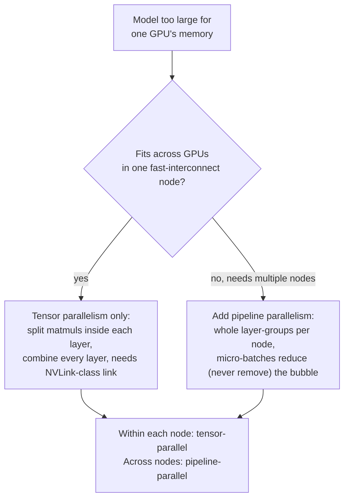

# Урок 21. Тензорный и конвейерный параллелизм

**Связь с целью курса:** Урок 12 ввёл `--tensor-parallel-size` как флаг, позволяющий модели, слишком большой для одного GPU, работать на нескольких, и на этом остановился. Этот урок раскрывает механизм внутри этого флага, **тензорный параллелизм (tensor parallelism)**, вводит другой способ разбить модель между устройствами, **конвейерный параллелизм (pipeline parallelism)**, и даёт процедуру выбора между ними или их сочетания, вместо того чтобы хвататься за тот, что первым попался в руководстве.
**Первоисточник:** [Научная статья: "Megatron-LM: Training Multi-Billion Parameter Language Models Using Model Parallelism", Shoeybi et al., 2019](https://arxiv.org/abs/1909.08053), [Научная статья: "GPipe: Efficient Training of Giant Neural Networks using Pipeline Parallelism", Huang et al., 2018](https://arxiv.org/abs/1811.06965)
**Предварительные требования:** [Урок 12](0012-vllm-tuning-knobs.md)

## Разминка

1. ▢ Что, по словам урока 12, делает `--tensor-parallel-size` на том уровне, на котором это излагалось?

Проверка

Он разделяет веса модели и вычисления над ними между несколькими GPU, так что модель, слишком большая для памяти одного GPU, может работать на нескольких, например веса модели на 70B в fp16 распределяются по двум GPU по 80 ГБ с `--tensor-parallel-size 2`. Урок 12 на этом остановился: без объяснения того, как на самом деле делится матричное умножение, и без упоминания какого-либо альтернативного способа разбить модель.

2. ▢ Почему сочетание тензорного параллелизма с квантизацией имеет смысл, а не считается конкурирующими вариантами?

Проверка

Квантизация уменьшает, сколько памяти модели нужно изначально; тензорный параллелизм распределяет остающийся объём памяти по большему числу GPU. Они действуют на разные оси одного и того же ограничения (сколько памяти нужно против сколько памяти доступно на устройство), так что модель можно одновременно квантизовать и разбить.

## Что нужно знать

### Тензорный параллелизм на самом деле разбивает матричные умножения внутри слоя

Вклад Megatron-LM это схема **внутрислойного** параллелизма модели: вместо того чтобы помещать целые слои на разные GPU, она разбивает большие матричные умножения *внутри* блоков внимания и MLP одного слоя трансформера между GPU, и каждый GPU параллельно вычисляет свой фрагмент результата. Матрица весов разбивается либо по столбцам, либо по строкам (два стиля разбиения выбираются вместе, для каждого блока, именно для того, чтобы выход одного стиля разбиения шёл прямо во второй без шага синхронизации между ними); после того как оба GPU завершили свой локальный фрагмент вычислений, один шаг обмена собирает частичные результаты обратно в то же значение, которое получил бы каждый GPU из неразделённого вычисления. Статья явно говорит, что для этого не нужны ни новый компилятор, ни библиотека: достаточно «вставки нескольких операций обмена в нативном PyTorch», потому что разбиение лишь меняет то, как делится работа матричного умножения, а не то, что вычисляет слой.

### Этот шаг сборки это точка синхронизации на критическом пути, на каждом слое

Шаг обмена, собирающий частичный результат каждого GPU, это не необязательный учёт, выполняемый один раз при запуске: он должен происходить в определённых местах внутри каждого слоя трансформера, в каждом прямом проходе, прежде чем можно будет продолжить следующий этап вычислений, поскольку каждый GPU держит лишь фрагмент истинного промежуточного значения, пока результаты не собраны. Поэтому стоимость обмена в тензорном параллелизме масштабируется с числом слоёв модели и числом обрабатываемых токенов, и поэтому ему нужен быстрый интерконнект между задействованными GPU (вроде NVLink внутри одного сервера), чтобы эта послойная синхронизация не стала узким местом. Поэтому же тензорный параллелизм обычно ограничивают GPU внутри одного узла: растягивание той же послойной синхронизации на более медленный сетевой канал (между узлами) превращает быструю локальную сборку в медленный обмен туда и обратно, повторяемый на каждом слое.

### Конвейерный параллелизм разбивает в другом направлении: целые слои, а не внутри них

**Конвейерный параллелизм** разбивает другую ось той же задачи: вместо того чтобы делить то, что происходит внутри одного слоя, он разбивает *последовательность слоёв* модели на подряд идущие группы (формулировка самого GPipe: любую сеть, выразимую как последовательность слоёв, можно разбить таким образом) и помещает каждую группу на отдельный ускоритель. Данные проходят через устройства по порядку, выход устройства 1 становится входом устройства 2, так же как слои выполнялись бы по порядку на одном устройстве, только теперь каждая группа живёт на своём GPU. В отличие от тензорного параллелизма, вычисления ни одного слоя не разбиваются, так что шага сборки на каждом слое нет; обмен происходит только на границе между группой слоёв одного устройства и следующим.

### Наивный конвейер простаивает почти весь парк; микробатчинг это исправление

У такого разбиения слоёв между устройствами есть очевидная проблема: пока устройство 2 работает с данными батча, устройство 1 простаивает, ожидая, пока устройство 2 (и последующие) закончат, прежде чем можно будет начать следующий батч, и то же самое происходит на обратном пути при обратном распространении. Исправление GPipe: разбить каждый батч на более мелкие **микробатчи (micro-batches)** и прогонять их через последовательность устройств один за другим, так что к тому времени, как устройство 1 закончит микробатч 1 и передаст его устройству 2, устройство 1 уже начинает микробатч 2 вместо ожидания. Это занимает больше парка одновременно, хотя никогда не может полностью устранить простой: по-прежнему есть задержка запуска, пока не появится работа у каждого устройства (заполнение конвейера), и задержка опустошения в конце (опустошение конвейера), **конвейерный пузырь (pipeline bubble)**, который уменьшается по мере прохода большего числа микробатчей, но никогда не исчезает полностью.

### Выбор (или сочетание) зависит от того, что на самом деле в дефиците

Тензорный параллелизм обменивает быструю, частую, послойную синхронизацию на возможность разбиения внутри слоя, и поэтому хочет быстрый интерконнект и обычно держится внутри одного узла. Конвейерный параллелизм обменивает конвейерный пузырь (некоторый простой, хуже для малых батчей) на обмен, происходящий только на границах групп, что мирится с более медленным каналом и именно позволяет модели вообще охватывать несколько узлов. Модели, помещающейся на GPU одного узла с быстрым интерконнектом, нужен только тензорный параллелизм; модель, слишком большая для этого, прибегает к конвейерному параллелизму, чтобы охватить дополнительные узлы, а продакшен-развёртывания на нескольких узлах обычно сочетают оба: тензорный параллелизм внутри каждого узла (быстрый канал, послойные разбиения), конвейерный параллелизм между узлами (более медленный канал, только границы групп целых слоёв). Это та же дисциплина «что на самом деле является ограничением», которую урок 12 уже применил к собственным параметрам настройки, только применённая здесь к выбору между двумя осями разбиения модели, а не между двумя флагами на одной оси.

## Практика

1. ▢ Матрицы весов внимания и MLP модели разбиты между 4 GPU с помощью тензорного параллелизма. Что должно произойти после того, как каждый GPU вычислил свой локальный фрагмент матричного умножения, прежде чем можно будет продолжить следующий этап слоя?

Подсказка

Каждый GPU держит лишь часть истинного результата, пока что-то не произойдёт.

Проверка

Шаг обмена собирает частичный результат каждого GPU обратно в единое значение, которое дало бы полное, неразделённое вычисление. Это должно происходить в определённых местах внутри каждого слоя, в каждом прямом проходе, поскольку следующему этапу вычислений нужно собранное значение, а не частичный фрагмент какого-то одного GPU.

2. ▢ Почему тензорному параллелизму нужен быстрый интерконнект вроде NVLink, а конвейерный параллелизм может мириться с более медленным каналом между узлами?

Проверка

Шаг сборки тензорного параллелизма происходит на каждом слое, в каждом прямом проходе, поэтому его обмен частый и лежит на критическом пути; медленный канал превращает это в повторяющееся узкое место. Конвейерный параллелизм обменивается только на границе между группой слоёв одного устройства и следующим, гораздо реже, поэтому мирится с более медленным каналом, и именно это позволяет ему охватывать несколько узлов.

3. ▢ Команда выстраивает слои модели конвейером по 4 GPU, но пропускает весь батч целиком как единое целое, а не разбивает его на микробатчи. Что происходит с GPU 1, пока GPU 4 обрабатывает этот батч?

Проверка

GPU 1 простаивает: он уже закончил свою группу слоёв для этого батча и ему нечего делать, пока весь батч не пройдёт через остальные GPU и не придёт новый батч. Разбиение батча на микробатчи позволяет GPU 1 начать следующий микробатч вместо простоя.

4. ▢ Устраняет ли разбиение батча на большее число микробатчей конвейерный пузырь полностью или лишь уменьшает его?

Проверка

Лишь уменьшает. По-прежнему есть задержка запуска, пока у каждого устройства конвейера не появится работа, и задержка опустошения в конце, после прохода последнего микробатча, независимо от того, на сколько микробатчей разбит батч; большее число микробатчей делает эту долю простоя меньше относительно общей работы, но никогда не убирает её.

5. ▢ Модель с запасом помещается на 8 быстро связанных GPU одного сервера. Какое утверждение верно описывает выбор параллелизма, который это диктует?

    - a) Только конвейерный параллелизм, поскольку он новее тензорного
    - b) Достаточно одного тензорного параллелизма: быстрый канал внутри узла мирится с его частым послойным шагом сборки, а второго узла, который охватывал бы конвейерный параллелизм, нет
    - c) Оба нужны всякий раз, когда модели требуется больше одного GPU, и нет случая, когда применим только один
    - d) Ни один не применим; модель, слишком большую для одного GPU, может решить только квантизация

Проверка

**b)** Это процедура выбора, которую устанавливает этот урок. (a) неверно: критерий не новизна, а скорость интерконнекта и число задействованных узлов. (c) неверно: одному узлу с быстрым интерконнектом нужен только тензорный параллелизм, конвейерный параллелизм окупается именно при охвате нескольких узлов. (d) неверно: квантизация уменьшает объём памяти, но не разделяет вычисления между устройствами, как любая из схем параллелизма, а урок 12 уже установил, что они сочетаются, а не заменяют друг друга.

## Практика в реальной работе

- [ ] Для стека обслуживания на нескольких GPU, к которому у вас есть доступ, проверьте, предоставляет ли он отдельные флаги для степени тензорного и конвейерного параллелизма (`--tensor-parallel-size` и `--pipeline-parallel-size` в vLLM это один из примеров), и отметьте, какой из них реально задан и почему.
- [ ] Если у вас есть доступ к кластеру GPU на нескольких узлах, проверьте интерконнект между GPU внутри одного узла и между узлами (пропускная способность NVLink и Ethernet или InfiniBand) и, используя процедуру выбора этого урока, оцените, соответствует ли разбиение развёртывания на тензорное и конвейерное этому оборудованию.
- [ ] Завтра: прочитайте раздел статьи Megatron-LM, описывающий, какие именно два стиля разбиения (по столбцам и по строкам) она использует для проекций блока внимания, и отметьте, почему именно такая пара избегает лишнего шага синхронизации между ними.

## Что почитать дальше

- [Научная статья: "Megatron-LM: Training Multi-Billion Parameter Language Models Using Model Parallelism", Shoeybi et al., 2019](https://arxiv.org/abs/1909.08053)
- [Научная статья: "GPipe: Efficient Training of Giant Neural Networks using Pipeline Parallelism", Huang et al., 2018](https://arxiv.org/abs/1811.06965)
- [Ресурсы](../RESOURCES.md)

---

Не доходит? Перечитайте первоисточник в начале: этот урок его сжимает, а при сжатии понимание как раз и теряется. Загляните в [глоссарий](../GLOSSARY.md), если какой-то термин показался скользким.

Если неясен сам урок, а не материал, это дефект: [откройте issue](https://github.com/TokenCemetery/teach/issues).
