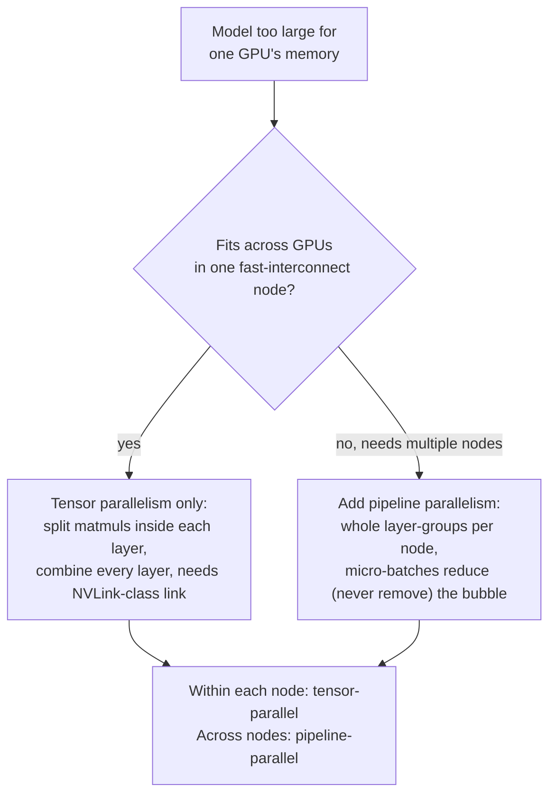

# 第 21 课：张量并行与流水线并行

**使命关联:** 第 12 课介绍了 `--tensor-parallel-size`，它是让一个单块 GPU 放不下的模型能跨多块 GPU 运行的参数，然后就到此为止了。本课打开这个参数背后的机制，即**张量并行**，介绍把模型切分到多个设备上的另一种方式，即**流水线并行**，并给出一个在二者之间做选择、或把二者结合起来的决策流程，而不是随手抓起教程里最先出现的那一个。
**主要来源:** [论文：“Megatron-LM: Training Multi-Billion Parameter Language Models Using Model Parallelism”，Shoeybi 等，2019](https://arxiv.org/abs/1909.08053)、[论文：“GPipe: Efficient Training of Giant Neural Networks using Pipeline Parallelism”，Huang 等，2018](https://arxiv.org/abs/1811.06965)
**前置知识:** [第 12 课](0012-vllm-tuning-knobs.md)

## 热身

1. ▢ 第 12 课讲 `--tensor-parallel-size` 做什么，是在什么层次上教的？

检查

它把模型的权重，以及作用在它们之上的计算，切分到多块 GPU 上，所以一个单块 GPU 的内存放不下的模型，可以跨多块 GPU 运行，例如一个 70B 模型的 fp16 权重，用 `--tensor-parallel-size 2` 摊到两块 80 GB 的 GPU 上。第 12 课就停在那里：没有解释矩阵乘法究竟是如何被划分的，也没有提到切分模型的任何其他方式。

2. ▢ 为什么把张量并行与量化结合起来是合理的，而不是把它们当作互相竞争的选项？

检查

量化缩小的是模型一开始需要多少内存；张量并行则把剩下的内存占用摊到更多的 GPU 上。它们作用于同一个约束的不同维度（需要多少内存，对比每个设备上有多少内存可用），所以一个模型可以同时被量化和被切分。

## 要点

### 张量并行实际切分的，是一层内部的矩阵乘法

Megatron-LM 的贡献是一种**层内**模型并行方案：它不是把整层整层地放在不同的 GPU 上，而是把单个 Transformer 层的注意力块和 MLP 块*内部*的大矩阵乘法，切分到多块 GPU 上，让每块 GPU 并行地计算结果中它自己的那一份。一个权重矩阵要么按列、要么按行来划分（这两种划分方式是逐块一起选定的，专门为了使一种划分方式的输出能直接送进另一种，中间不需要同步步骤）；在两块 GPU 都完成各自的局部计算之后，一个通信步骤把各个部分的结果合并回同样的值，也就是每块 GPU 在没有切分的计算中本会得到的那个值。论文明确指出，这不需要新的编译器或库，“在原生 PyTorch 中插入少量通信操作”就够了，因为这种切分只改变矩阵乘法的工作如何划分，而不改变这一层计算什么。

### 这个合并步骤，是每一层都有的、关键路径上的同步点

把每块 GPU 的部分结果重新合并的通信步骤，不是启动时只做一次的可有可无的记账：它必须在每个 Transformer 层内部的特定位置、每一次前向计算中发生，之后下一阶段的计算才能继续，因为在结果被合并之前，每块 GPU 持有的只是真实中间值的一小片。这就是为什么张量并行的通信开销，随模型的层数以及正在处理的 token 数而增长，也是为什么它需要所涉及的 GPU 之间有快速的互连（比如一台服务器内部的 NVLink），以避免这种逐层的同步成为瓶颈。这也是为什么张量并行通常只限于单个节点内的 GPU：把同样的逐层同步，拉伸到更慢的网络链路上（节点之间），会把一次快速的本地合并，变成每一层都重复一次的缓慢往返。

### 流水线并行往另一个方向切：整层，而不是层的内部

**流水线并行**划分的是同一个问题的另一个维度：它不切分一层内部发生的事，而是把模型的*层序列*划分成连续的组（GPipe 自己的表述：任何能表示为层序列的网络，都可以这样切分），并把每一组放在不同的加速器上。数据按顺序流过各个设备，设备 1 的输出成为设备 2 的输入，就像这些层在单个设备上按顺序运行一样，只不过每一组现在都住在自己的 GPU 上。与张量并行不同，没有任何一层的计算被切分，所以没有逐层的合并步骤；通信只发生在一个设备的层组与下一个设备的层组交界处。

### 朴素的流水线会让集群的大部分闲置；微批处理是修复办法

像这样把层切分到各个设备上，有一个明显的问题：当设备 2 在处理这个批次的数据时，设备 1 闲坐着，等设备 2（以及后面的设备）完成之后，下一个批次才能开始，而在反向传播的回程中，又会发生相反的情况。GPipe 的修复办法，是把每个批次拆成更小的**微批次**，一个接一个地送过设备序列，这样等设备 1 完成微批次 1 并把它交给设备 2 的时候，设备 1 已经在开始处理微批次 2，而不是干等。这让更多的设备同时保持忙碌，不过它永远无法完全消除空闲时间：在每个设备都有活干之前，仍有一个启动延迟（填充流水线），在结束时还有一个排空延迟（清空流水线），这就是**流水线气泡**，随着更多微批次流过它会缩小，但永远不会完全消失。

### 选择（或结合）它们，是一个关于究竟什么稀缺的问题

张量并行拿快速的、频繁的逐层同步，换来在一层内部做切分的能力，所以它需要快速的互连，通常限于一个节点之内。流水线并行拿一个流水线气泡（一些空闲时间，批次小时更糟），换来只发生在层组交界处的通信，这能容忍更慢的链路，也正是让模型能够跨越多个节点的原因。一个能放进单个快速互连节点的各块 GPU 的模型，只需要张量并行；一个大到放不下的模型，就要用流水线并行去跨越更多的节点，而生产环境的多节点部署通常把二者结合起来：节点内用张量并行（快速链路，逐层切分），节点间用流水线并行（较慢链路，只在整层组的边界处通信）。这与第 12 课对它自己的调优参数所应用的是同一种“究竟什么才是约束”的纪律，现在应用到了在切分模型的两个维度之间做选择，而不是在同一个维度上的两个参数之间做选择。

## 练习

1. ▢ 一个模型的注意力和 MLP 权重矩阵，用张量并行切分到 4 块 GPU 上。每块 GPU 算完它那一份局部的矩阵乘法之后，在这一层的下一阶段能继续之前，必须发生什么？

提示

在某件事发生之前，每块 GPU 只持有真实结果的一部分。

检查

一个通信步骤，把每块 GPU 的部分结果合并回完整的、没有切分的计算本会产生的那个单一的值。这必须在每一层内部的特定位置、每一次前向计算中发生，因为下一阶段的计算需要的是合并后的值，而不是任何一块 GPU 手里的那一小片。

2. ▢ 为什么张量并行需要像 NVLink 这样的快速互连，而流水线并行可以容忍节点之间更慢的链路？

检查

张量并行的合并步骤每一层、每一次前向计算都要发生，所以它的通信既频繁，又处在关键路径上；慢速链路会把它变成反复出现的瓶颈。流水线并行只在一个设备的层组与下一个设备的层组交界处通信，少得多，所以它能容忍更慢的链路，这恰恰是让它能够跨越多个节点的原因。

3. ▢ 一个团队把模型的层用流水线方式分布在 4 块 GPU 上，但把整个批次作为一个单一整体送过去，而不是拆成微批次。当 GPU 4 在处理那个批次时，GPU 1 在做什么？

检查

GPU 1 闲置：它已经为那个批次完成了它自己那一组层，在整个批次流过其余各块 GPU、并且有新的批次到来之前，没有别的事可做。把批次拆成微批次，才能让 GPU 1 去处理下一个微批次，而不是闲着。

4. ▢ 把批次拆成更多的微批次，是完全消除了流水线气泡，还是只缩小了它？

检查

只是缩小了它。无论批次被拆成多少个微批次，在流水线中的每个设备都有活干之前总有一个启动延迟，在最后一个微批次通过之后的结束处总有一个排空延迟；更多的微批次使这部分空闲占比相对于总工作量变小，但永远消除不了它。

5. ▢ 一个模型可以轻松地放进单台服务器上 8 块快速互连的 GPU。下面哪种说法正确描述了这种情形所要求的并行方式选择？

    - a) 只用流水线并行，因为它比张量并行更新
    - b) 单靠张量并行就足够了：快速的节点内链路能容忍它频繁的逐层合并步骤，而且没有第二个节点需要流水线并行去跨越
    - c) 只要模型需要不止一块 GPU，两者就都是必需的，不存在只适用其中一种的情形
    - d) 两者都不适用；只有量化才能解决单块 GPU 放不下的模型

检查

**b)** 这就是本课所确立的决策流程。(a) 是错的：判断标准不是新旧，而是互连的速度和涉及多少个节点。(c) 是错的：单个快速互连的节点只需要张量并行，流水线并行恰恰是在需要跨越多个节点时才派上用场。(d) 是错的：量化缩小内存占用，但不像两种并行方式那样把计算切分到多个设备上，而且第 12 课已经确立了它们是结合起来用，而不是互相替代。

## 实战练习

- [ ] 对你能用到的某个多 GPU 服务栈，检查它是否为张量并行度和流水线并行度提供了分开的参数（vLLM 的 `--tensor-parallel-size` 和 `--pipeline-parallel-size` 就是一个例子），并记下实际设置的是哪一个，以及为什么。
- [ ] 如果你能用到一个多节点的 GPU 集群，检查单个节点内 GPU 之间的互连与节点之间的互连（NVLink 对比以太网/InfiniBand 的带宽），并用本课的决策流程，判断这个部署的张量/流水线切分是否与那套硬件相匹配。
- [ ] 明天：读 Megatron-LM 论文中描述的那一节，看它对注意力块的投影具体用了哪两种划分方式（按列还是按行），并记下为什么这种特定的搭配，避免了二者之间多出一个同步步骤。

## 延伸阅读

- [论文：“Megatron-LM: Training Multi-Billion Parameter Language Models Using Model Parallelism”，Shoeybi 等，2019](https://arxiv.org/abs/1909.08053)
- [论文：“GPipe: Efficient Training of Giant Neural Networks using Pipeline Parallelism”，Huang 等，2018](https://arxiv.org/abs/1811.06965)
- [资源](../RESOURCES.md)

---

没学明白？请重读顶部的主要来源，因为本课是对它的压缩，而理解正是在压缩中流失的。如果有哪个术语觉得含糊，可以查看[术语表](../GLOSSARY.md)。

如果问题出在课程本身，而不是学习材料，那就是一个缺陷：[提交 issue](https://github.com/TokenCemetery/teach/issues)。
