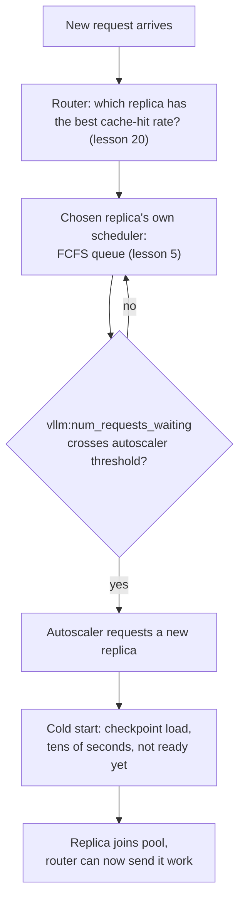

# Lección 22. Servir a nivel de flota

**Vínculo con la misión:** La lección 5 enseñó cómo el scheduler de un servidor elige la siguiente solicitud en espera de su propia cola. Una flota de muchos servidores así añade tres problemas que la lección 5 nunca tuvo que resolver: a qué servidor va una solicitud (**enrutamiento**), cuándo añadir o quitar servidores (**autoscaling**) y qué cuesta poner en línea un servidor nuevo (un **arranque en frío**, dominado por el **tiempo de carga del modelo**). Esta lección cubre los tres, y por qué hay que razonarlos juntos, no por separado.
**Fuente principal:** [Docs: "Autoscaling with KEDA" and "KV Cache Aware Routing", vLLM Production Stack](https://docs.vllm.ai/projects/production-stack), [Paper: "ServerlessLLM: Low-Latency Serverless Inference for Large Language Models", Fu et al., OSDI 2024](https://arxiv.org/abs/2401.14351)
**Requisitos previos:** [Lección 5](0005-request-scheduling.md), [Lección 20](0020-prefix-caching.md)

## Calentamiento

1. ▢ En la lección 5, ¿qué política usa el scheduler de un solo servidor para decidir qué solicitud en espera admitir a continuación?

Comprobación

First-come, first-served (FCFS): las solicitudes se admiten en un slot de lote liberado por orden de llegada.

2. ▢ ¿Qué le permite saltarse a una solicitud el prefix caching (lección 20), y en qué servidor solo funciona eso?

Comprobación

Le permite saltarse el recálculo del prefill de cualquier prefijo que comparta con algo ya guardado en caché, pero solo en el servidor concreto que ya tiene ese prefijo en su propia KV cache; la caché vive por servidor, no en toda la flota.

## Qué debes saber

### Una flota inserta una decisión antes de la cola de la lección 5: qué servidor

El scheduler FCFS de la lección 5 solo tenía que elegir entre solicitudes que ya esperaban a un servidor. Una flota de muchos servidores añade una decisión anterior: un **router de solicitudes** tiene que elegir a qué servidor va una solicitud nueva en primer lugar, antes de que el scheduler de ese servidor la vea siquiera. Si se equivoca esta elección, la cola de un servidor se hincha mientras otro está inactivo, por muy bien escrito que esté el scheduler de cada servidor.

### El enrutamiento ingenuo ignora exactamente lo que la lección 20 ya guardó en caché

Las políticas de enrutamiento simples, round-robin o menos conexiones, tratan a todos los servidores como intercambiables y enrutan solo según la carga. Pero la lección 20 estableció que una solicitud que comparte un prefijo con algo ya guardado en caché solo obtiene esa aceleración en el servidor que contiene la caché; el enrutamiento ingenuo basado en la carga puede enviar una solicitud a otro servidor menos cargado que tiene que rehacer el prefill entero desde cero. El **enrutamiento consciente de la KV cache** del vLLM Production Stack lo arregla enrutando una solicitud al servidor que ya tiene la mayor tasa de aciertos de caché para ella, convirtiendo una decisión de balanceo de carga en una decisión informada por el prefix caching, no en una preocupación aparte de él.

### El autoscaling convierte la profundidad de la cola en una decisión sobre el tamaño de la flota

Una vez enrutadas bien las solicitudes, una flota sigue necesitando crecer o reducirse con la demanda. El enfoque documentado del production stack escala el número de réplicas de servidor a partir de una métrica de colas en vivo, `vllm:num_requests_waiting`, exactamente la misma cola de espera que describió la lección 5, leída ahora por servidor y entregada a un autoscaler (KEDA) con un `minReplicaCount`, un `maxReplicaCount` y un `cooldownPeriod` para que no se añadan y quiten réplicas con cada pequeña fluctuación. Las colas, en otras palabras, no son un tema aparte del autoscaling: la profundidad de la cola es la señal que le dice a la flota que es demasiado pequeña.

### Un arranque en frío significa que una réplica recién añadida no está realmente lista

Añadir una réplica parece que debería aliviar de inmediato una cola profunda, pero las mediciones de ServerlessLLM muestran por qué no: cargar el checkpoint de un LLM en un servidor nuevo lo domina mover a memoria los pesos de un checkpoint grande, un costo que "supera con creces el tiempo necesario para generar un token durante la inferencia" (normalmente muy por debajo de 100 ms). El paper reporta que las plataformas serverless reales ven decenas de segundos de latencia al poner en línea un modelo grande, y que más del 40% de las funciones medidas en una traza de producción muestran una tasa de arranque en frío superior al 25% dentro de una ventana corta de keep-alive. Un **arranque en frío**, aquí, no tiene que ver con la cola de solicitudes; es el intervalo entre "el autoscaler decidió añadir una réplica" y "esa réplica puede atender de verdad una solicitud", y ese intervalo lo fija el tiempo de carga del modelo, no nada que controlen el scheduler o el router.

### Las tres decisiones hay que razonarlas como un solo pipeline, no por separado

El enrutamiento decide qué réplica ya en ejecución atiende una solicitud ahora; el autoscaling decide cuándo tiene que cambiar la capacidad total de la flota; la latencia de arranque en frío decide cuánta antelación necesita el autoscaler antes de que una réplica nueva sea realmente útil. Tratar el autoscaling de forma aislada, escalando solo cuando la cola ya es profunda, significa que la flota sigue arrancando en frío réplicas nuevas mucho después de que haya pasado el pico de tráfico que las disparó, ya que las propias cifras de ServerlessLLM muestran que ese intervalo puede ser de decenas de segundos. Por eso la contribución real de ServerlessLLM es optimizar directamente el lado del tiempo de carga (carga de checkpoints multinivel, manteniendo los checkpoints cerca de la GPU en lugar de en un almacén remoto), del mismo modo que este espacio de trabajo ha encontrado repetidamente que la solución a un cuello de botella de serving vive en la parte del pipeline que realmente lo causa, no en la parte más fácil de ajustar.

## Práctica

1. ▢ Una flota usa enrutamiento round-robin simple. Una solicitud que comparte un prefijo largo y costoso de prefillar con una solicitud recién atendida en el servidor A se enruta en su lugar al servidor B, que está inactivo. ¿Qué tiene que hacer el servidor B que no habría tenido que hacer si la solicitud hubiera ido al servidor A?

Pista

Piensa en dónde vive realmente la caché de la lección 20.

Comprobación

El servidor B tiene que prefillar el prefijo compartido desde cero, ya que la aceleración del prefix caching solo se aplica en el servidor que ya contiene los bloques en caché coincidentes; el enrutamiento round-robin lo ignora y puede enviar una solicitud favorable a la caché a un servidor sin ninguna caché relevante.

2. ▢ ¿Por qué el ejemplo de autoscaling del vLLM Production Stack se dispara con `vllm:num_requests_waiting` y no, por ejemplo, solo con la utilización de la GPU?

Comprobación

La profundidad de la cola de espera es la señal directa de que a un servidor (o a la flota) le llegan más solicitudes de las que puede admitir ahora mismo, que es exactamente la condición que necesita detectar un autoscaler para justificar añadir capacidad; la utilización de la GPU también puede ser alta en una flota sana y bien dimensionada, así que no distingue "ocupada pero al día" de "quedándose atrás".

3. ▢ Un autoscaler añade una réplica nueva en el instante en que la cola cruza su umbral. ¿Empieza esa réplica a atender solicitudes de inmediato?

Comprobación

No. La réplica todavía tiene que completar un arranque en frío, cargando el checkpoint del modelo en memoria, lo que las mediciones de ServerlessLLM muestran que puede tardar decenas de segundos para un modelo grande, mucho más que el tiempo de generar un solo token. La réplica no es útil hasta que termina esa carga, sin importar lo rápido que reaccionó el autoscaler.

4. ▢ ¿Por qué describe ServerlessLLM la latencia de arranque en frío como un problema aparte de todo lo que controlan un scheduler o un router de solicitudes?

Comprobación

Un scheduler decide qué solicitud en espera admitir, y un router decide qué réplica en ejecución recibe una solicitud; ninguno tiene efecto sobre cuánto tarda en cargarse un checkpoint en una réplica totalmente nueva. Ese tiempo de carga es una propiedad del tamaño del checkpoint y de la ruta de almacenamiento y de red que tiene que recorrer, que es exactamente por lo que la solución de ServerlessLLM apunta a la propia ruta de carga (almacenamiento de checkpoints multinivel y cercano a la GPU) y no al scheduler ni al router.

5. ▢ ¿Qué afirmación describe correctamente cómo se relacionan entre sí el enrutamiento, el autoscaling y los arranques en frío en el serving a nivel de flota?

    - a) Son tres problemas independientes que pueden ajustarse de forma aislada sin afectarse entre sí
    - b) El enrutamiento debería ignorar por completo la localidad de la caché, ya que el autoscaling siempre añadirá suficiente capacidad para compensar
    - c) El enrutamiento elige entre réplicas ya en ejecución usando la localidad de la caché, el autoscaling decide cuándo debería cambiar la capacidad total de la flota según la profundidad de la cola, y la latencia de arranque en frío fija cuánta antelación necesita el autoscaling antes de que una réplica nueva sea realmente útil
    - d) Los arranques en frío solo importan para la primera réplica que lanza una flota

Comprobación

**c)** Ese es el pipeline que establece esta lección. (a) es falsa: escalar demasiado tarde, sin tener en cuenta la antelación del arranque en frío, deja a una flota todavía poniéndose al día después de que haya pasado un pico de tráfico. (b) es falsa: ignorar la localidad de la caché desperdicia exactamente el beneficio del prefix caching que estableció la lección 20, y ninguna cantidad de capacidad de autoscaling arregla un fallo de caché que no tenía por qué ocurrir. (d) es falsa: cada réplica nueva que añade cualquier autoscaler, en cualquier momento de la vida de una flota, tiene que arrancar en frío del mismo modo.

## Prácticas en el mundo real

- [ ] Para un stack de serving con varias réplicas al que tengas acceso, comprueba si las solicitudes se enrutan con un balanceo de carga simple o con algo consciente de la caché, y si eso encaja con el patrón real de compartición de prefijos de la carga de trabajo.
- [ ] Encuentra la métrica que dispara el autoscaling (si la hay) en tu stack, y comprueba si es una señal de profundidad de cola como `vllm:num_requests_waiting` o algo distinto como la utilización en bruto.
- [ ] Mañana: mide cuánto tarda una réplica nueva de tu stack desde "solicitada" hasta "atendiendo su primera solicitud", y compara ese tiempo de arranque en frío con la duración típica de los picos de tráfico de tu carga de trabajo.

## Para profundizar

- [Docs: "Welcome to production-stack", vLLM Production Stack](https://docs.vllm.ai/projects/production-stack)
- [Docs: "KV Cache Aware Routing", vLLM Production Stack](https://docs.vllm.ai/projects/production-stack/en/latest/use_cases/kv-cache-aware-routing.html)
- [Docs: "Autoscaling with KEDA", vLLM Production Stack](https://docs.vllm.ai/projects/production-stack/en/latest/use_cases/autoscaling-keda.html)
- [Paper: "ServerlessLLM: Low-Latency Serverless Inference for Large Language Models", Fu et al., OSDI 2024](https://arxiv.org/abs/2401.14351)
- [Recursos](../RESOURCES.md)

---

¿No termina de quedar claro? Vuelve a leer la fuente primaria de arriba, ya que esta lección la comprime y en la compresión es donde se escapa la comprensión. Consulta el [glosario](../GLOSSARY.md) por si algún término te resultó resbaladizo.

Si lo poco claro es la propia lección y no el material, eso es un defecto: [abre un issue](https://github.com/TokenCemetery/teach/issues).
