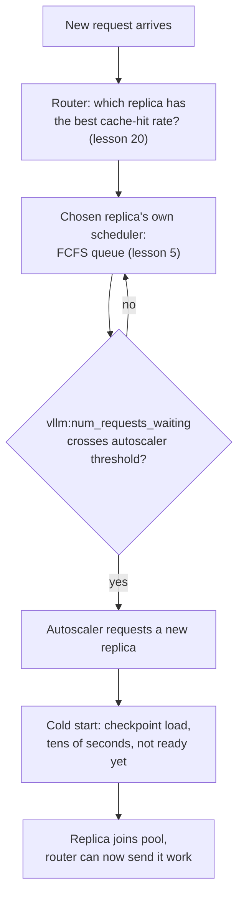

# Leçon 22. Serving à l'échelle d'une flotte

**Lien avec la mission :** La leçon 5 a appris comment l'ordonnanceur d'un seul serveur choisit la prochaine requête en attente dans sa propre file. Une flotte de nombreux serveurs de ce genre ajoute trois problèmes que la leçon 5 n'a jamais eu à résoudre : à quel serveur va une requête (le **routage**), quand ajouter ou retirer des serveurs (l'**autoscaling**), et ce que coûte la mise en ligne d'un nouveau serveur (un **cold start**, dominé par le **temps de chargement du modèle**). Cette leçon couvre les trois, et pourquoi il faut les raisonner ensemble, et non séparément.
**Source primaire :** [Doc : "Autoscaling with KEDA" and "KV Cache Aware Routing", vLLM Production Stack](https://docs.vllm.ai/projects/production-stack), [Article : "ServerlessLLM: Low-Latency Serverless Inference for Large Language Models", Fu et al., OSDI 2024](https://arxiv.org/abs/2401.14351)
**Prérequis :** [Leçon 5](0005-request-scheduling.md), [Leçon 20](0020-prefix-caching.md)

## Échauffement

1. ▢ À la leçon 5, quelle politique l'ordonnanceur d'un seul serveur utilise-t-il pour décider quelle requête en attente admettre ensuite ?

Vérifier

Premier arrivé, premier servi (FCFS) : les requêtes sont admises dans une place de batch libérée dans l'ordre d'arrivée.

2. ▢ Que permet à une requête de sauter le prefix caching (leçon 20), et sur quel serveur cela ne fonctionne-t-il que là ?

Vérifier

Il permet à une requête de sauter le recalcul du prefill pour tout préfixe qu'elle partage avec quelque chose de déjà en cache, mais seulement sur le serveur précis qui détient déjà ce préfixe en cache dans son propre KV cache ; la mise en cache vit par serveur, pas à l'échelle de la flotte.

## À savoir

### Une flotte insère une décision avant la file de la leçon 5 : quel serveur, tout court

L'ordonnanceur FCFS de la leçon 5 n'avait jamais à choisir que parmi des requêtes déjà en attente pour un seul serveur. Une flotte de nombreux serveurs ajoute une décision en amont : un **routeur de requêtes** doit choisir à quel serveur va une nouvelle requête, avant même que l'ordonnanceur propre de ce serveur la voie. Si ce choix est mauvais, la file d'un serveur gonfle pendant qu'un autre reste inactif, quelle que soit la qualité de l'ordonnanceur de chaque serveur.

### Le routage naïf ignore exactement ce que la leçon 20 avait déjà mis en cache

Les politiques de routage simples, round-robin ou moins de connexions, traitent chaque serveur comme interchangeable et routent uniquement selon la charge. Mais la leçon 20 a établi qu'une requête qui partage un préfixe avec quelque chose de déjà en cache n'obtient cette accélération que sur le seul serveur qui détient le cache ; un routage naïf fondé sur la charge peut envoyer une requête vers un autre serveur, moins chargé, qui doit refaire tout le prefill de zéro. Le **routage sensible au KV cache** (KV-cache aware routing) du vLLM Production Stack règle cela en routant une requête vers le serveur qui a déjà le taux de réussite de cache le plus élevé pour elle, ce qui transforme une décision d'équilibrage de charge en une décision éclairée par le prefix caching, et non une préoccupation séparée.

### L'autoscaling transforme la profondeur de file en décision de dimensionnement de la flotte

Une fois les requêtes bien routées, une flotte doit encore croître ou rétrécir avec la demande. L'approche documentée de la production stack fait varier le nombre de répliques de serveur à partir d'une métrique de file d'attente en direct, `vllm:num_requests_waiting`, exactement la même file d'attente que décrivait la leçon 5, lue maintenant par serveur et transmise à un autoscaler (KEDA) avec un `minReplicaCount`, un `maxReplicaCount` et un `cooldownPeriod` pour que des répliques ne soient pas ajoutées et retirées à chaque petite fluctuation. La file d'attente, autrement dit, n'est pas un sujet séparé de l'autoscaling : la profondeur de la file est le signal qui dit à la flotte qu'elle est trop petite.

### Un cold start signifie qu'une réplique nouvellement ajoutée n'est pas vraiment prête

Ajouter une réplique semble devoir soulager immédiatement une file profonde, mais les mesures de ServerlessLLM montrent pourquoi ce n'est pas le cas : charger le checkpoint d'un LLM sur un serveur neuf est dominé par le déplacement en mémoire des poids d'un gros checkpoint, un coût qui « far exceeds the time required for generating a token during inference » (normalement bien en dessous de 100 ms). L'article rapporte que de vraies plateformes serverless subissent des dizaines de secondes de latence pour mettre en ligne un gros modèle, et que plus de 40 % des fonctions mesurées dans une trace de production montrent un taux de cold start supérieur à 25 % dans une courte fenêtre de keep-alive. Un **cold start**, ici, ne concerne pas la file des requêtes ; c'est l'écart entre « l'autoscaler a décidé d'ajouter une réplique » et « cette réplique peut réellement servir une requête », et cet écart est fixé par le temps de chargement du modèle, pas par quoi que ce soit que l'ordonnanceur ou le routeur contrôle.

### Les trois décisions doivent se raisonner comme un seul pipeline, pas séparément

Le routage décide quelle réplique déjà en fonctionnement sert une requête maintenant ; l'autoscaling décide quand la capacité totale de la flotte doit changer ; la latence de cold start décide de combien d'avance l'autoscaler a besoin avant qu'une nouvelle réplique soit réellement utile. Traiter l'autoscaling isolément, en ne passant à l'échelle supérieure qu'une fois la file déjà profonde, signifie que la flotte est encore en train de faire démarrer à froid de nouvelles répliques bien après que le pic de trafic qui les a déclenchées est déjà passé, puisque les propres chiffres de ServerlessLLM montrent que cet écart peut durer des dizaines de secondes. C'est pourquoi la contribution réelle de ServerlessLLM est d'optimiser directement le côté du temps de chargement (chargement de checkpoint multi-niveaux, garder les checkpoints près du GPU plutôt que dans un magasin distant), de la même manière que cet espace de travail a trouvé à plusieurs reprises que le remède à un goulot d'étranglement de serving se trouve dans la partie du pipeline qui le cause réellement, et non dans celle qui est la plus facile à régler.

## Pratique

1. ▢ Une flotte utilise un simple routage round-robin. Une requête qui partage un long préfixe, coûteux à préremplir, avec une requête qui vient d'être servie sur le serveur A est routée vers le serveur B inactif à la place. Que doit faire le serveur B qu'il n'aurait pas eu à faire si la requête était allée au serveur A ?

Indice

Pensez à ce sur quoi vit réellement le cache de la leçon 20.

Vérifier

Le serveur B doit préremplir le préfixe partagé de zéro, puisque l'accélération du prefix caching ne s'applique que sur le serveur qui détient déjà les blocs en cache correspondants ; le routage round-robin ignore cela et peut envoyer une requête favorable au cache vers un serveur qui n'a aucun cache pertinent.

2. ▢ Pourquoi l'exemple d'autoscaling du vLLM Production Stack se déclenche-t-il sur `vllm:num_requests_waiting` plutôt que, par exemple, sur la seule utilisation du GPU ?

Vérifier

La profondeur de la file d'attente est le signal direct qu'un serveur (ou la flotte) reçoit plus de requêtes qu'il ne peut en admettre actuellement, ce qui est exactement la condition qu'un autoscaler doit détecter pour justifier l'ajout de capacité ; l'utilisation du GPU peut aussi être élevée sur une flotte saine et bien dimensionnée, donc elle ne distingue pas « occupée mais qui suit » de « qui prend du retard ».

3. ▢ Un autoscaler ajoute une nouvelle réplique à l'instant où la file franchit son seuil. Cette réplique commence-t-elle à servir des requêtes immédiatement ?

Vérifier

Non. La réplique doit encore terminer un cold start, en chargeant le checkpoint du modèle en mémoire, ce qui, d'après les mesures de ServerlessLLM, peut prendre des dizaines de secondes pour un gros modèle, bien plus que le temps de génération d'un seul token. La réplique n'est pas utile tant que ce chargement n'est pas terminé, quelle que soit la rapidité de réaction de l'autoscaler.

4. ▢ Pourquoi ServerlessLLM décrit-il la latence de cold start comme un problème distinct de tout ce que contrôlent un ordonnanceur de requêtes ou un routeur ?

Vérifier

Un ordonnanceur décide quelle requête en attente admettre, et un routeur décide quelle réplique en fonctionnement reçoit une requête ; ni l'un ni l'autre n'a d'effet sur le temps qu'il faut pour charger un checkpoint sur une toute nouvelle réplique. Ce temps de chargement est une propriété de la taille du checkpoint et du chemin de stockage/réseau qu'il doit traverser, ce qui est précisément pourquoi la solution de ServerlessLLM vise le chemin de chargement lui-même (stockage de checkpoint multi-niveaux, proche du GPU) plutôt que l'ordonnanceur ou le routeur.

5. ▢ Quelle affirmation décrit correctement la façon dont le routage, l'autoscaling et les cold starts sont liés dans le serving à l'échelle d'une flotte ?

    - a) Ce sont trois problèmes indépendants qui peuvent être réglés isolément sans s'affecter mutuellement
    - b) Le routage devrait ignorer entièrement la localité du cache, puisque l'autoscaling ajoutera toujours assez de capacité pour compenser
    - c) Le routage choisit parmi les répliques déjà en fonctionnement en utilisant la localité du cache, l'autoscaling décide quand la capacité totale de la flotte doit changer d'après la profondeur de file, et la latence de cold start fixe de combien d'avance l'autoscaling a besoin avant qu'une nouvelle réplique soit réellement utile
    - d) Les cold starts n'ont d'importance que pour la toute première réplique qu'une flotte lance

Vérifier

**c)** C'est le pipeline qu'établit cette leçon. (a) est fausse : passer à l'échelle trop tard, sans tenir compte de l'avance qu'exige le cold start, laisse une flotte encore en train de rattraper son retard après qu'un pic de trafic est passé. (b) est fausse : ignorer la localité du cache gaspille exactement le bénéfice du prefix caching qu'a établi la leçon 20, et aucune capacité d'autoscaling ne corrige un échec de cache qui n'avait pas besoin de se produire. (d) est fausse : chaque nouvelle réplique qu'un autoscaler ajoute, à n'importe quel moment de la vie d'une flotte, doit faire un cold start de la même manière.

## Exercices en situation réelle

- [ ] Pour une pile de serving multi-répliques à laquelle vous avez accès, vérifiez si les requêtes sont routées par un simple équilibrage de charge ou par quelque chose de sensible au cache, et si cela correspond au schéma réel de partage de préfixes de la charge de travail.
- [ ] Trouvez la métrique de déclenchement d'autoscaling (s'il y en a une) sur laquelle votre pile fait varier l'échelle, et vérifiez s'il s'agit d'un signal de profondeur de file comme `vllm:num_requests_waiting` ou d'autre chose comme l'utilisation brute.
- [ ] Demain : chronométrez le temps qu'une réplique neuve de votre pile met entre « demandée » et « servant sa première requête », et comparez ce temps de cold start à la durée typique des pics de trafic de votre charge de travail.

## Pour aller plus loin

- [Doc : "Welcome to production-stack", vLLM Production Stack](https://docs.vllm.ai/projects/production-stack)
- [Doc : "KV Cache Aware Routing", vLLM Production Stack](https://docs.vllm.ai/projects/production-stack/en/latest/use_cases/kv-cache-aware-routing.html)
- [Doc : "Autoscaling with KEDA", vLLM Production Stack](https://docs.vllm.ai/projects/production-stack/en/latest/use_cases/autoscaling-keda.html)
- [Article : "ServerlessLLM: Low-Latency Serverless Inference for Large Language Models", Fu et al., OSDI 2024](https://arxiv.org/abs/2401.14351)
- [Ressources](../RESOURCES.md)

---

Ça ne passe pas ? Relisez la source primaire en haut de page, car cette leçon la condense et c'est dans la condensation que la compréhension s'échappe. Consultez le [glossaire](../GLOSSARY.md) pour tout terme qui vous a paru glissant.

Si c'est la leçon elle-même qui n'est pas claire plutôt que la matière, c'est un défaut : [ouvrez une issue](https://github.com/TokenCemetery/teach/issues).
