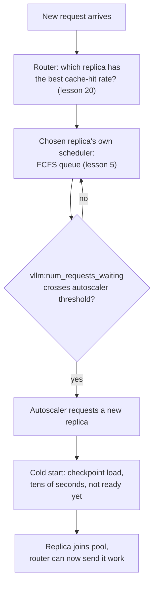

# पाठ 22. Fleet-Level Serving

**मिशन से संबंध:** पाठ 5 ने सिखाया कि एक server का scheduler अपनी ही queue में से इंतज़ार कर रही अगली request कैसे चुनता है। ऐसे कई servers का fleet तीन समस्याएँ जोड़ता है जिन्हें पाठ 5 को कभी हल नहीं करना पड़ा: request किस server को जाए (**routing**), servers कब जोड़ें या हटाएँ (**autoscaling**), और नया server online लाने की क्या क़ीमत है (**cold start**, जिस पर **model load time** हावी है)। यह पाठ तीनों को कवर करता है, और यह भी कि उन्हें अलग-अलग नहीं बल्कि साथ क्यों सोचना पड़ता है।
**मुख्य स्रोत:** [दस्तावेज़: "Autoscaling with KEDA" और "KV Cache Aware Routing", vLLM Production Stack](https://docs.vllm.ai/projects/production-stack), [पेपर: "ServerlessLLM: Low-Latency Serverless Inference for Large Language Models", Fu et al., OSDI 2024](https://arxiv.org/abs/2401.14351)
**पूर्व-आवश्यकताएँ:** [पाठ 5](0005-request-scheduling.md), [पाठ 20](0020-prefix-caching.md)

## वार्म-अप

1. ▢ पाठ 5 में, एक अकेले server का scheduler यह तय करने के लिए कौन-सी नीति इस्तेमाल करता है कि इंतज़ार कर रही कौन-सी request अगली दाख़िल हो?

जाँचें

First-come, first-served (FCFS): requests मुक्त हुए batch slot में आने के क्रम में दाख़िल होती हैं।

2. ▢ Prefix caching (पाठ 20) request को क्या छोड़ने देता है, और यह किस server पर ही काम करता है?

जाँचें

वह request को उस किसी भी prefix का prefill दोबारा compute करना छोड़ने देता है जो वह पहले से cached किसी चीज़ के साथ साझा करती है, पर सिर्फ़ उसी ख़ास server पर जिसके अपने KV cache में वह cached prefix पहले से है; caching प्रति server रहती है, पूरे fleet में नहीं।

## यह जानें

### Fleet पाठ 5 की queue से पहले एक फ़ैसला डालता है: आख़िर कौन-सा server

पाठ 5 के FCFS scheduler को सिर्फ़ उन requests में से चुनना पड़ता था जो पहले से एक server के लिए इंतज़ार कर रही थीं। कई servers का fleet एक पहले का फ़ैसला जोड़ता है: **request router** को चुनना पड़ता है कि नई request पहली जगह किस server को जाए, इससे पहले कि उस server का अपना scheduler उसे देखे। यह चुनाव ग़लत हो तो एक server की queue फूल जाती है जबकि दूसरा ख़ाली बैठा रहता है, चाहे हर server का अपना scheduler कितना भी अच्छा लिखा हो।

### Naive routing ठीक वही अनदेखा करती है जो पाठ 20 पहले cache कर चुका है

सीधी routing नीतियाँ, round-robin या least-connections, हर server को अदल-बदल योग्य मानती हैं और सिर्फ़ load के आधार पर route करती हैं। पर पाठ 20 ने स्थापित किया कि पहले से cached किसी चीज़ के साथ prefix साझा करने वाली request को वह speedup सिर्फ़ उसी एक server पर मिलता है जिसके पास cache है; naive load-आधारित routing request को किसी और, कम load वाले server पर भेज सकती है जिसे पूरा prefill शुरू से दोबारा करना पड़ता है। vLLM Production Stack की **KV-cache aware routing** इसे ठीक करती है, request को उस server पर route करके जिसके पास उसके लिए पहले से सबसे ऊँचा cache-hit rate है, load-balancing के फ़ैसले को prefix caching से सूचित फ़ैसले में बदलकर, उससे अलग कोई चिंता नहीं रहने देकर।

### Autoscaling queue depth को fleet के आकार तय करने के फ़ैसले में बदलती है

Requests ठीक से route होने के बाद भी, fleet को माँग के साथ बढ़ना या घटना पड़ता है। Production stack का दर्ज किया तरीक़ा server replicas की संख्या को एक live queueing metric, `vllm:num_requests_waiting`, पर बढ़ाता-घटाता है, ठीक वही इंतज़ार की queue जो पाठ 5 ने बताई, अब प्रति server पढ़ी जाकर autoscaler (KEDA) को दी जाती है, `minReplicaCount`, `maxReplicaCount` और एक `cooldownPeriod` के साथ ताकि हर छोटे उतार-चढ़ाव पर replicas जोड़े और हटाए न जाएँ। दूसरे शब्दों में, queueing autoscaling से अलग विषय नहीं है: queue की गहराई ही वह संकेत है जो fleet को बताता है कि वह बहुत छोटा है।

### Cold start का मतलब है कि नई जोड़ी replica असल में तैयार नहीं है

Replica जोड़ना सुनने में ऐसा लगता है कि वह गहरी queue को तुरंत राहत देगी, पर ServerlessLLM की मापें दिखाती हैं कि ऐसा क्यों नहीं होता: नए server पर LLM का checkpoint load करना एक बड़े checkpoint के weights को memory में ले जाने पर हावी है, ऐसी लागत जो "inference के दौरान एक token generate करने में लगने वाले समय से कहीं ज़्यादा" है (जो आम तौर पर 100ms से काफ़ी कम होता है)। पेपर रिपोर्ट करता है कि असली serverless platforms बड़े model को online लाने में दसियों सेकंड की latency देखते हैं, और production trace में नापे गए 40% से ज़्यादा functions का छोटी keep-alive window के भीतर cold-start rate 25% से ऊपर है। यहाँ **cold start** request queue के बारे में नहीं है; यह "autoscaler ने replica जोड़ने का फ़ैसला किया" और "वह replica सचमुच कोई request serve कर सकती है" के बीच का अंतराल है, और वह अंतराल model load time से तय होता है, किसी ऐसी चीज़ से नहीं जिसे scheduler या router नियंत्रित करता है।

### तीनों फ़ैसलों को अलग-अलग नहीं, एक pipeline की तरह सोचना पड़ता है

Routing तय करती है कि अभी चल रही कौन-सी replica किसी request को serve करे; autoscaling तय करती है कि fleet की कुल capacity को कब बदलना चाहिए; cold-start latency तय करती है कि नई replica के सचमुच उपयोगी होने से पहले autoscaler को कितना पहले से तैयारी का समय चाहिए। Autoscaling को अकेले देखना, queue के गहरे हो जाने के बाद ही scale out करना, का मतलब है कि fleet उस traffic उछाल के बीत जाने के बहुत बाद भी नई replicas को cold-start कर रहा है जिसने उन्हें चालू किया था, क्योंकि ServerlessLLM की अपनी संख्याएँ दिखाती हैं कि वह अंतराल दसियों सेकंड लंबा हो सकता है। इसीलिए ServerlessLLM का असली योगदान load-time वाले हिस्से को सीधे optimize करना है (multi-tier checkpoint loading, checkpoints को दूर के store के बजाय GPU के पास रखना), वैसे ही जैसे इस workspace ने बार-बार पाया है कि serving की अड़चन का इलाज pipeline के उसी हिस्से में है जो असल में उसे पैदा कर रहा है, उसमें नहीं जिसे tune करना सबसे आसान है।

## अभ्यास

1. ▢ एक fleet सादी round-robin routing इस्तेमाल करता है। एक request, जो server A पर अभी serve हुई request के साथ लंबा, prefill के लिए महँगा prefix साझा करती है, उसके बजाय ख़ाली पड़े server B को route हो जाती है। Server B को क्या करना पड़ता है जो उसे न करना पड़ता अगर request server A को गई होती?

संकेत

सोचें कि पाठ 20 की caching असल में किस पर रहती है।

जाँचें

Server B को साझा prefix का prefill शुरू से करना पड़ता है, क्योंकि prefix caching का speedup सिर्फ़ उसी server पर लागू होता है जिसके पास मेल खाते cached blocks पहले से हैं; round-robin routing इसे अनदेखा करती है और cache-अनुकूल request को ऐसे server पर भेज सकती है जिसके पास कोई प्रासंगिक cache है ही नहीं।

2. ▢ vLLM Production Stack का autoscaling उदाहरण अकेले, मान लें, GPU utilization के बजाय `vllm:num_requests_waiting` पर क्यों चालू होता है?

जाँचें

इंतज़ार की queue की गहराई सीधा संकेत है कि server (या fleet) के पास जितनी requests अभी दाख़िल कर सकता है उससे ज़्यादा आ रही हैं, और ठीक यही वह स्थिति है जिसे autoscaler को capacity जोड़ने को सही ठहराने के लिए पहचानना है; GPU utilization स्वस्थ, सही आकार के fleet पर भी ऊँचा हो सकता है, इसलिए वह "व्यस्त पर तालमेल बनाए हुए" और "पिछड़ रहा" में फ़र्क़ नहीं करता।

3. ▢ एक autoscaler queue के अपनी सीमा पार करते ही नई replica जोड़ देता है। क्या वह replica तुरंत requests serve करने लगती है?

जाँचें

नहीं। Replica को अब भी cold start पूरा करना है, model का checkpoint memory में load करना, जिसे ServerlessLLM की मापें दिखाती हैं कि बड़े model के लिए दसियों सेकंड ले सकता है, एक token के generation समय से कहीं ज़्यादा। जब तक वह load पूरा न हो replica उपयोगी नहीं है, चाहे autoscaler ने कितनी भी जल्दी प्रतिक्रिया दी हो।

4. ▢ ServerlessLLM cold-start latency को ऐसी चीज़ से अलग समस्या क्यों बताता है जिसे request scheduler या router नियंत्रित करता है?

जाँचें

Scheduler तय करता है कि इंतज़ार कर रही कौन-सी request दाख़िल हो, और router तय करता है कि चल रही कौन-सी replica को request मिले; दोनों में से किसी का इस पर कोई असर नहीं कि बिल्कुल नई replica पर checkpoint load करने में कितना समय लगता है। वह load time checkpoint के आकार और उस storage/network path की संपत्ति है जिससे उसे गुज़रना है, और ठीक इसीलिए ServerlessLLM का समाधान scheduler या router के बजाय loading path को ही निशाना बनाता है (multi-tier, GPU के पास checkpoint storage)।

5. ▢ Fleet-level serving में routing, autoscaling और cold starts एक-दूसरे से कैसे जुड़ते हैं, इसका सही वर्णन कौन-सा दावा करता है?

    - a) वे तीन स्वतंत्र समस्याएँ हैं जिन्हें एक-दूसरे को प्रभावित किए बिना अलग-अलग tune किया जा सकता है
    - b) Routing को cache locality पूरी तरह अनदेखी करनी चाहिए, क्योंकि autoscaling हमेशा भरपाई के लिए काफ़ी capacity जोड़ देगी
    - c) Routing पहले से चल रही replicas में से cache locality से चुनती है, autoscaling queue depth के आधार पर तय करती है कि fleet की कुल capacity कब बदले, और cold-start latency तय करती है कि नई replica के सचमुच उपयोगी होने से पहले autoscaling को कितना पहले से तैयारी का समय चाहिए
    - d) Cold starts सिर्फ़ उस पहली replica के लिए मायने रखते हैं जो fleet कभी launch करता है

जाँचें

**c)** यही वह pipeline है जो यह पाठ स्थापित करता है। (a) ग़लत है: cold-start के तैयारी-समय को गिने बिना बहुत देर से scale out करना fleet को traffic उछाल बीत जाने के बाद भी पकड़ने में लगाए रखता है। (b) ग़लत है: cache locality को अनदेखा करना ठीक वही prefix-caching फ़ायदा बरबाद करता है जो पाठ 20 ने स्थापित किया, और कोई भी autoscaling capacity उस cache miss को ठीक नहीं करती जिसे होने की ज़रूरत ही नहीं थी। (d) ग़लत है: fleet के जीवन में किसी भी बिंदु पर autoscaler जो भी नई replica जोड़े उसे उसी तरह cold-start करना पड़ता है।

## असली दुनिया का अभ्यास

- [ ] जिस multi-replica serving stack तक आपकी पहुँच है उसके लिए जाँचें कि requests सादी load balancing से route होती हैं या किसी cache-aware तरीक़े से, और क्या वह workload के असली prefix-sharing पैटर्न से मेल खाता है।
- [ ] वह autoscaling trigger metric (अगर कोई है) ढूँढें जिस पर आपका stack scale करता है, और जाँचें कि वह `vllm:num_requests_waiting` जैसा queue-depth संकेत है या कच्चे utilization जैसा कुछ और।
- [ ] कल: समय नापें कि आपके stack की नई replica को "माँगी गई" से "अपनी पहली request serve करने" तक कितना लगता है, और उस cold-start समय की तुलना अपने workload के आम traffic-उछाल की अवधि से करें।

## आगे बढ़ने के लिए

- [दस्तावेज़: "Welcome to production-stack", vLLM Production Stack](https://docs.vllm.ai/projects/production-stack)
- [दस्तावेज़: "KV Cache Aware Routing", vLLM Production Stack](https://docs.vllm.ai/projects/production-stack/en/latest/use_cases/kv-cache-aware-routing.html)
- [दस्तावेज़: "Autoscaling with KEDA", vLLM Production Stack](https://docs.vllm.ai/projects/production-stack/en/latest/use_cases/autoscaling-keda.html)
- [पेपर: "ServerlessLLM: Low-Latency Serverless Inference for Large Language Models", Fu et al., OSDI 2024](https://arxiv.org/abs/2401.14351)
- [संसाधन](../RESOURCES.md)

---

बात नहीं बन रही? ऊपर दिए मुख्य स्रोत को दोबारा पढ़ें, क्योंकि यह पाठ उसे संक्षिप्त करता है और समझ संक्षेप में ही रिसती है। जो शब्द फिसलन भरा लगे, उसके लिए [शब्दावली](../GLOSSARY.md) देखें।

अगर दिक़्क़त सामग्री की नहीं बल्कि पाठ की ही है, तो वह एक खोट है: [issue खोलें](https://github.com/TokenCemetery/teach/issues)।
