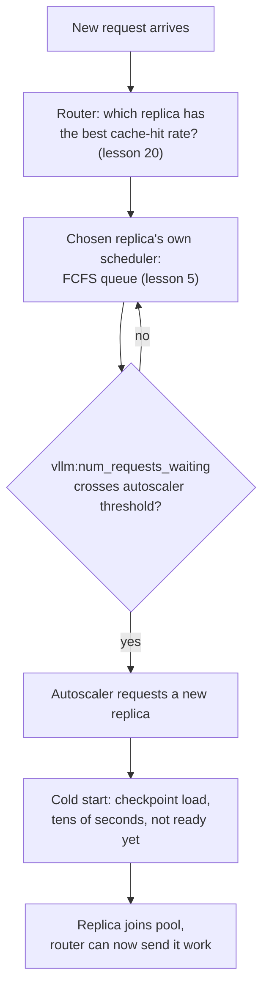

# Lição 22. Serving no nível da frota

**Ligação com a missão:** A lição 5 ensinou como o scheduler de um servidor escolhe a próxima requisição em espera da sua própria fila. Uma frota de muitos servidores assim acrescenta três problemas que a lição 5 nunca precisou resolver: para qual servidor uma requisição vai (**roteamento**), quando adicionar ou remover servidores (**autoscaling**) e quanto custa colocar um novo servidor no ar (um **cold start**, dominado pelo **tempo de carga do modelo**). Esta lição cobre os três e por que eles precisam ser pensados juntos, e não separadamente.
**Fonte principal:** [Documentação: "Autoscaling with KEDA" e "KV Cache Aware Routing", vLLM Production Stack](https://docs.vllm.ai/projects/production-stack), [Artigo científico: "ServerlessLLM: Low-Latency Serverless Inference for Large Language Models", Fu et al., OSDI 2024](https://arxiv.org/abs/2401.14351)
**Pré-requisitos:** [Lição 5](0005-request-scheduling.md), [Lição 20](0020-prefix-caching.md)

## Aquecimento

1. ▢ Na lição 5, que política o scheduler de um único servidor usa para decidir qual requisição em espera admitir em seguida?

Verificação

First-come, first-served (FCFS): as requisições são admitidas em um slot de batch liberado na ordem de chegada.

2. ▢ O que o prefix caching (lição 20) permite a uma requisição pular, e em qual servidor isso só funciona?

Verificação

Permite a uma requisição pular o recálculo do prefill de qualquer prefixo que ela compartilhe com algo já em cache, mas só no servidor específico que já guarda esse prefixo em cache no seu próprio KV cache; o cache vive por servidor, e não na frota inteira.

## Saiba isto

### Uma frota insere uma decisão antes da fila da lição 5: qual servidor, afinal

O scheduler FCFS da lição 5 só precisava escolher entre requisições que já esperavam por um servidor. Uma frota de muitos servidores acrescenta uma decisão anterior: um **roteador de requisições** precisa escolher para qual servidor uma nova requisição vai, antes de o scheduler desse servidor sequer ver a requisição. Se essa escolha for errada, a fila de um servidor incha enquanto outro fica ocioso, não importa o quão bem o scheduler de cada servidor esteja escrito.

### O roteamento ingênuo ignora exatamente o que a lição 20 já colocou em cache

As políticas de roteamento simples, round-robin ou least-connections, tratam todo servidor como intercambiável e roteiam apenas pela carga. Mas a lição 20 estabeleceu que uma requisição que compartilha um prefixo com algo já em cache só obtém esse ganho no único servidor que guarda o cache; o roteamento ingênuo baseado em carga pode enviar uma requisição para outro servidor, menos carregado, que precisa refazer o prefill inteiro do zero. O **roteamento ciente do KV cache** do vLLM Production Stack resolve isso roteando uma requisição para o servidor que já tem a maior taxa de acerto de cache para ela, transformando uma decisão de balanceamento de carga em uma decisão informada pelo prefix caching, e não uma preocupação separada dele.

### O autoscaling transforma a profundidade da fila em uma decisão de dimensionamento da frota

Uma vez que as requisições são bem roteadas, uma frota ainda precisa crescer ou encolher com a demanda. A abordagem documentada da production stack escala o número de réplicas de servidor a partir de uma métrica de fila ao vivo, `vllm:num_requests_waiting`, exatamente a mesma fila de espera que a lição 5 descreveu, agora lida por servidor e alimentada a um autoscaler (KEDA) com um `minReplicaCount`, um `maxReplicaCount` e um `cooldownPeriod`, para que réplicas não sejam adicionadas e removidas a cada pequena flutuação. A fila, em outras palavras, não é um assunto separado do autoscaling: a profundidade da fila é o sinal que diz à frota que ela está pequena demais.

### Um cold start significa que uma réplica recém-adicionada ainda não está de fato pronta

Adicionar uma réplica parece que deveria aliviar uma fila funda imediatamente, mas as medições do ServerlessLLM mostram por que não alivia: carregar o checkpoint de um LLM em um servidor novo é dominado por mover os pesos de um grande checkpoint para a memória, um custo que "supera de longe o tempo necessário para gerar um token durante a inferência" (normalmente bem abaixo de 100 ms). O artigo relata plataformas serverless reais vendo dezenas de segundos de latência para colocar um modelo grande no ar e que mais de 40% das funções medidas em um trace de produção mostram uma taxa de cold start acima de 25% dentro de uma janela curta de keep-alive. Um **cold start**, aqui, não tem a ver com a fila de requisições; é o intervalo entre "o autoscaler decidiu adicionar uma réplica" e "essa réplica de fato consegue atender uma requisição", e esse intervalo é definido pelo tempo de carga do modelo, e não por nada que o scheduler ou o roteador controlem.

### As três decisões precisam ser pensadas como um só pipeline, e não separadamente

O roteamento decide qual réplica já em execução atende uma requisição agora; o autoscaling decide quando a capacidade total da frota precisa mudar; a latência de cold start decide quanta antecedência o autoscaler precisa antes de uma nova réplica ser de fato útil. Tratar o autoscaling isoladamente, escalando só quando a fila já está funda, significa que a frota ainda está iniciando a frio novas réplicas muito depois de o pico de tráfego que as disparou já ter passado, já que os próprios números do ServerlessLLM mostram que esse intervalo pode durar dezenas de segundos. É por isso que a contribuição real do ServerlessLLM é otimizar diretamente o lado do tempo de carga (carga de checkpoint em várias camadas, mantendo checkpoints perto da GPU em vez de em um armazenamento remoto), do mesmo modo que este workspace repetidamente constatou que a correção de um gargalo de serving mora na parte do pipeline que de fato o causa, e não na parte mais fácil de ajustar.

## Prática

1. ▢ Uma frota usa roteamento round-robin simples. Uma requisição que compartilha um prefixo longo e caro de preencher com uma requisição recém-atendida no servidor A é roteada para o servidor B, ocioso. O que o servidor B precisa fazer que não precisaria fazer se a requisição tivesse ido para o servidor A?

Dica

Pense no que o cache da lição 20 realmente guarda e onde.

Verificação

O servidor B precisa fazer o prefill do prefixo compartilhado do zero, já que o ganho do prefix caching só se aplica no servidor que já guarda os blocos em cache correspondentes; o roteamento round-robin ignora isso e pode enviar uma requisição favorável ao cache para um servidor sem nenhum cache relevante.

2. ▢ Por que o exemplo de autoscaling do vLLM Production Stack dispara em `vllm:num_requests_waiting` e não, por exemplo, só na utilização da GPU?

Verificação

A profundidade da fila de espera é o sinal direto de que um servidor (ou a frota) tem mais requisições chegando do que consegue admitir no momento, que é exatamente a condição que um autoscaler precisa detectar para justificar adicionar capacidade; a utilização da GPU pode ser alta também em uma frota saudável e bem dimensionada, então ela não distingue "ocupada mas acompanhando" de "ficando para trás".

3. ▢ Um autoscaler adiciona uma nova réplica no instante em que a fila cruza o seu limite. Essa réplica começa a atender requisições imediatamente?

Verificação

Não. A réplica ainda precisa completar um cold start, carregando o checkpoint do modelo na memória, o que, segundo as medições do ServerlessLLM, pode levar dezenas de segundos para um modelo grande, muito mais do que o tempo de gerar um único token. A réplica não é útil até essa carga terminar, independentemente do quão rápido o autoscaler reagiu.

4. ▢ Por que o ServerlessLLM descreve a latência de cold start como um problema separado de qualquer coisa que um scheduler de requisições ou um roteador controlem?

Verificação

Um scheduler decide qual requisição em espera admitir, e um roteador decide qual réplica em execução recebe uma requisição; nenhum dos dois tem efeito sobre quanto tempo leva carregar um checkpoint em uma réplica novinha. Esse tempo de carga é uma propriedade do tamanho do checkpoint e do caminho de armazenamento e de rede que ele precisa atravessar, e é exatamente por isso que a correção do ServerlessLLM mira o próprio caminho de carga (armazenamento de checkpoint em várias camadas, perto da GPU) e não o scheduler ou o roteador.

5. ▢ Qual afirmação descreve corretamente como roteamento, autoscaling e cold starts se relacionam no serving no nível da frota?

    - a) São três problemas independentes que podem ser ajustados isoladamente sem afetar uns aos outros
    - b) O roteamento deve ignorar totalmente a localidade do cache, já que o autoscaling sempre adicionará capacidade suficiente para compensar
    - c) O roteamento escolhe entre réplicas já em execução usando a localidade do cache, o autoscaling decide quando a capacidade total da frota deve mudar com base na profundidade da fila, e a latência de cold start define quanta antecedência o autoscaling precisa antes de uma nova réplica ser de fato útil
    - d) Os cold starts só importam para a primeira réplica que uma frota lança

Verificação

**c)** Esse é o pipeline que esta lição estabelece. (a) é falsa: escalar tarde demais, sem levar em conta a antecedência do cold start, deixa uma frota ainda correndo atrás depois de um pico de tráfego já ter passado. (b) é falsa: ignorar a localidade do cache desperdiça exatamente o benefício do prefix caching que a lição 20 estabeleceu, e nenhuma capacidade de autoscaling conserta um cache miss que não precisava acontecer. (d) é falsa: toda nova réplica que um autoscaler adiciona, em qualquer ponto da vida de uma frota, precisa passar por um cold start do mesmo jeito.

## Prática no mundo real

- [ ] Para uma stack de serving com várias réplicas a que você tenha acesso, verifique se as requisições são roteadas por balanceamento de carga simples ou por algo ciente do cache, e se isso combina com o padrão real de compartilhamento de prefixo da carga de trabalho.
- [ ] Encontre a métrica de gatilho de autoscaling (se houver) em que a sua stack escala e verifique se é um sinal de profundidade de fila como `vllm:num_requests_waiting` ou outra coisa, como a utilização bruta.
- [ ] Amanhã: cronometre quanto tempo uma réplica nova da sua stack leva de "solicitada" até "atendendo a sua primeira requisição" e compare esse tempo de cold start com a duração típica dos picos de tráfego da sua carga de trabalho.

## Para ir além

- [Documentação: "Welcome to production-stack", vLLM Production Stack](https://docs.vllm.ai/projects/production-stack)
- [Documentação: "KV Cache Aware Routing", vLLM Production Stack](https://docs.vllm.ai/projects/production-stack/en/latest/use_cases/kv-cache-aware-routing.html)
- [Documentação: "Autoscaling with KEDA", vLLM Production Stack](https://docs.vllm.ai/projects/production-stack/en/latest/use_cases/autoscaling-keda.html)
- [Artigo científico: "ServerlessLLM: Low-Latency Serverless Inference for Large Language Models", Fu et al., OSDI 2024](https://arxiv.org/abs/2401.14351)
- [Recursos](../RESOURCES.md)

---

Não ficou claro? Releia a fonte principal no topo, já que esta lição a comprime e é na compressão que o entendimento escapa. Consulte o [glossário](../GLOSSARY.md) para qualquer termo que pareceu escorregadio.

Se o problema é a lição em si, e não o material, isso é um defeito: [abra uma issue](https://github.com/TokenCemetery/teach/issues).
