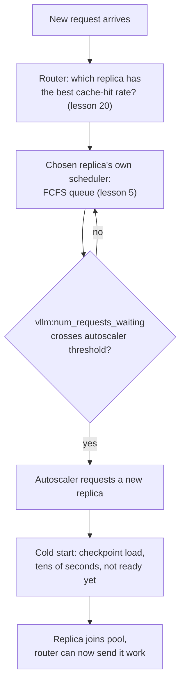

# Урок 22. Обслуживание на уровне парка серверов

**Связь с целью курса:** Урок 5 учил, как планировщик одного сервера выбирает следующий ожидающий запрос из собственной очереди. Парк из многих таких серверов добавляет три проблемы, которых уроку 5 решать не приходилось: на какой сервер вообще попадает запрос (**маршрутизация**, routing), когда добавлять или убирать серверы (**автомасштабирование**, autoscaling) и чего стоит ввод нового сервера в работу (**холодный старт**, cold start, в котором доминирует **время загрузки модели**). Этот урок охватывает все три и то, почему их нужно рассматривать вместе, а не по отдельности.
**Первоисточник:** [Документация: "Autoscaling with KEDA" and "KV Cache Aware Routing", vLLM Production Stack](https://docs.vllm.ai/projects/production-stack), [Научная статья: "ServerlessLLM: Low-Latency Serverless Inference for Large Language Models", Fu et al., OSDI 2024](https://arxiv.org/abs/2401.14351)
**Предварительные требования:** [Урок 5](0005-request-scheduling.md), [Урок 20](0020-prefix-caching.md)

## Разминка

1. ▢ Какую политику использует планировщик одного сервера из урока 5, чтобы решить, какой ожидающий запрос принять следующим?

Проверка

В порядке поступления (first-come, first-served, FCFS): запросы принимаются в освободившийся слот батча в порядке прихода.

2. ▢ Что кеширование префиксов (урок 20) позволяет запросу пропустить и на каком сервере это работает?

Проверка

Оно позволяет запросу пропустить повторное вычисление префилла для любого префикса, который он делит с чем-то уже закешированным, но только на том конкретном сервере, который уже держит этот закешированный префикс в собственном KV-кеше; кеширование живёт на каждом сервере, а не на уровне всего парка.

## Что нужно знать

### Парк вставляет решение перед очередью из урока 5: какой сервер вообще

Планировщику FCFS из урока 5 всегда приходилось выбирать только среди запросов, уже ожидающих одного сервера. Парк из многих серверов добавляет более раннее решение: **маршрутизатор запросов (request router)** должен выбрать, на какой сервер попадёт новый запрос, ещё до того, как планировщик этого сервера его увидит. Если ошибиться в этом выборе, очередь одного сервера раздуется, а другой будет простаивать, как бы хорошо ни был написан планировщик каждого сервера.

### Наивная маршрутизация игнорирует ровно то, что урок 20 уже закешировал

Простые политики маршрутизации, циклический перебор (round-robin) или наименьшее число соединений (least-connections), считают все серверы взаимозаменяемыми и маршрутизируют только по нагрузке. Но урок 20 установил, что запрос, делящий префикс с чем-то уже закешированным, получает это ускорение только на том единственном сервере, который держит кеш; наивная маршрутизация по нагрузке может отправить запрос на другой, менее нагруженный сервер, которому придётся заново выполнять весь префилл с нуля. **Маршрутизация с учётом KV-кеша (KV-cache aware routing)** из vLLM Production Stack исправляет это, направляя запрос на тот сервер, у которого уже есть наибольшая доля попаданий в кеш для него, превращая решение о балансировке нагрузки в решение, основанное на кешировании префиксов, а не в отдельную от него заботу.

### Автомасштабирование превращает глубину очереди в решение о размере парка

Когда запросы маршрутизируются хорошо, парку всё равно нужно расти или сжиматься вслед за спросом. Документированный подход продакшен-стека масштабирует число реплик сервера по живой метрике очереди, `vllm:num_requests_waiting`, то есть по той самой очереди ожидания, которую описал урок 5, только теперь она читается по каждому серверу и подаётся автоскейлеру (KEDA) с `minReplicaCount`, `maxReplicaCount` и `cooldownPeriod`, чтобы реплики не добавлялись и не убирались при каждом небольшом колебании. Иными словами, очередь это не отдельная от автомасштабирования тема: глубина очереди это сигнал, сообщающий парку, что он слишком мал.

### Холодный старт означает, что только что добавленная реплика на самом деле не готова

Добавление реплики кажется способным сразу разгрузить глубокую очередь, но измерения ServerlessLLM показывают, почему это не так: в загрузке чекпоинта LLM на свежий сервер доминирует перемещение весов большого чекпоинта в память, стоимость, которая «намного превышает время, необходимое для генерации токена во время инференса» (обычно значительно меньше 100 мс). Статья сообщает, что реальные бессерверные платформы видят десятки секунд задержки при выводе большой модели в работу и что более чем у 40% измеренных функций в продакшен-трассе доля холодных стартов превышает 25% в коротком окне удержания. **Холодный старт** здесь не про очередь запросов; это промежуток между «автоскейлер решил добавить реплику» и «эта реплика действительно может обработать запрос», и этот промежуток задаёт время загрузки модели, а не то, чем управляют планировщик или маршрутизатор.

### Три решения нужно рассматривать как единый конвейер, а не по отдельности

Маршрутизация решает, какая уже работающая реплика обслужит запрос сейчас; автомасштабирование решает, когда общую ёмкость парка нужно менять; задержка холодного старта решает, сколько упреждения нужно автоскейлеру, прежде чем новая реплика окажется действительно полезной. Рассмотрение автомасштабирования изолированно, масштабирование вширь лишь когда очередь уже глубока, означает, что парк всё ещё холодно запускает новые реплики спустя долгое время после того, как скачок трафика, который их вызвал, уже прошёл, поскольку собственные числа ServerlessLLM показывают, что этот промежуток может длиться десятки секунд. Поэтому реальный вклад ServerlessLLM в оптимизации стороны времени загрузки напрямую (многоуровневая загрузка чекпоинтов, хранение чекпоинтов рядом с GPU, а не в удалённом хранилище), так же как это рабочее пространство неоднократно обнаруживало, что исправление узкого места обслуживания лежит в той части конвейера, которая его действительно вызывает, а не в той, которую проще всего настроить.

## Практика

1. ▢ Парк использует простой циклический перебор. Запрос, делящий длинный, дорогой для префилла префикс с запросом, только что обслуженным на сервере A, направляется на простаивающий сервер B. Что серверу B приходится делать такого, чего не пришлось бы делать, если бы запрос попал на сервер A?

Подсказка

Подумайте о том, где на самом деле живёт кеширование из урока 20.

Проверка

Серверу B приходится выполнять префилл общего префикса с нуля, поскольку ускорение от кеширования префиксов применимо только на сервере, уже держащем совпадающие закешированные блоки; циклический перебор игнорирует это и может отправить удобный для кеша запрос на сервер, у которого вообще нет подходящего кеша.

2. ▢ Почему пример автомасштабирования в vLLM Production Stack срабатывает по `vllm:num_requests_waiting`, а не, скажем, по одной только загрузке GPU?

Проверка

Глубина очереди ожидания это прямой сигнал того, что на сервер (или парк) приходит больше запросов, чем он может сейчас принять, а именно это условие автоскейлеру нужно обнаружить, чтобы оправдать добавление ёмкости; загрузка GPU может быть высокой и у здорового, правильно подобранного по размеру парка, поэтому она не отличает «занят, но справляется» от «отстаёт».

3. ▢ Автоскейлер добавляет новую реплику в момент, когда очередь пересекает его порог. Начинает ли эта реплика обслуживать запросы немедленно?

Проверка

Нет. Реплике всё ещё нужно пройти холодный старт, загрузив чекпоинт модели в память, что, как показывают измерения ServerlessLLM, для большой модели может занимать десятки секунд, намного дольше времени генерации одного токена. Реплика бесполезна, пока эта загрузка не завершится, как бы быстро ни отреагировал автоскейлер.

4. ▢ Почему ServerlessLLM описывает задержку холодного старта как отдельную проблему, не зависящую от того, чем управляют планировщик запросов или маршрутизатор?

Проверка

Планировщик решает, какой ожидающий запрос принять, а маршрутизатор решает, какая работающая реплика получит запрос; ни один из них не влияет на то, сколько времени занимает загрузка чекпоинта на новую реплику. Это время загрузки есть свойство размера чекпоинта и пути хранилища и сети, по которому его нужно переместить, и именно поэтому исправление ServerlessLLM нацелено на сам путь загрузки (многоуровневое хранение чекпоинтов рядом с GPU), а не на планировщик или маршрутизатор.

5. ▢ Какое утверждение верно описывает, как связаны маршрутизация, автомасштабирование и холодные старты при обслуживании на уровне парка?

    - a) Это три независимые проблемы, которые можно настраивать по отдельности без влияния друг на друга
    - b) Маршрутизация должна полностью игнорировать локальность кеша, поскольку автомасштабирование всегда добавит достаточно ёмкости для компенсации
    - c) Маршрутизация выбирает среди уже работающих реплик по локальности кеша, автомасштабирование решает, когда общую ёмкость парка нужно менять, исходя из глубины очереди, а задержка холодного старта задаёт, сколько упреждения нужно автомасштабированию, прежде чем новая реплика окажется действительно полезной
    - d) Холодные старты важны только для самой первой реплики, которую парк когда-либо запускает

Проверка

**c)** Это конвейер, который устанавливает этот урок. (a) неверно: масштабирование вширь слишком поздно, без учёта упреждения на холодный старт, оставляет парк всё ещё догоняющим после того, как скачок трафика уже прошёл. (b) неверно: игнорирование локальности кеша расточает именно ту выгоду кеширования префиксов, которую установил урок 20, и никакая ёмкость автомасштабирования не исправит промах кеша, которого можно было избежать. (d) неверно: каждая новая реплика, которую добавляет любой автоскейлер, в любой момент жизни парка, должна проходить холодный старт так же.

## Практика в реальной работе

- [ ] Для стека обслуживания с несколькими репликами, к которому у вас есть доступ, проверьте, маршрутизируются ли запросы простой балансировкой нагрузки или чем-то с учётом кеша и соответствует ли это реальному шаблону совместного использования префиксов в вашей нагрузке.
- [ ] Найдите метрику-триггер автомасштабирования (если есть), по которой масштабируется ваш стек, и проверьте, это сигнал глубины очереди вроде `vllm:num_requests_waiting` или что-то другое, например сырая загрузка.
- [ ] Завтра: засеките, сколько времени свежая реплика в вашем стеке идёт от «запрошена» до «обслуживает свой первый запрос», и сравните это время холодного старта с типичной длительностью скачка трафика вашей нагрузки.

## Что почитать дальше

- [Документация: "Welcome to production-stack", vLLM Production Stack](https://docs.vllm.ai/projects/production-stack)
- [Документация: "KV Cache Aware Routing", vLLM Production Stack](https://docs.vllm.ai/projects/production-stack/en/latest/use_cases/kv-cache-aware-routing.html)
- [Документация: "Autoscaling with KEDA", vLLM Production Stack](https://docs.vllm.ai/projects/production-stack/en/latest/use_cases/autoscaling-keda.html)
- [Научная статья: "ServerlessLLM: Low-Latency Serverless Inference for Large Language Models", Fu et al., OSDI 2024](https://arxiv.org/abs/2401.14351)
- [Ресурсы](../RESOURCES.md)

---

Не доходит? Перечитайте первоисточник в начале: этот урок его сжимает, а при сжатии понимание как раз и теряется. Загляните в [глоссарий](../GLOSSARY.md), если какой-то термин показался скользким.

Если неясен сам урок, а не материал, это дефект: [откройте issue](https://github.com/TokenCemetery/teach/issues).
