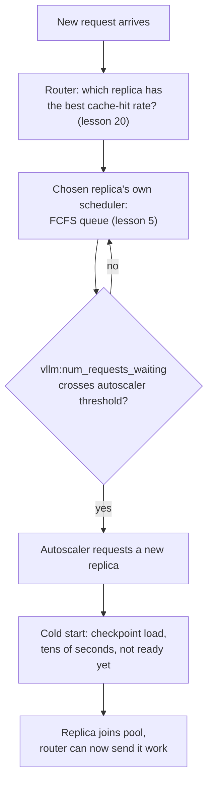

# 第 22 课：集群级服务

**使命关联:** 第 5 课讲的是，单台服务器的调度器如何从它自己的队列里挑出下一个等待的请求。由许多这样的服务器组成的集群，又带来了第 5 课从未需要解决的三个问题：请求究竟交给哪台服务器（**路由**），何时增加或移除服务器（**自动扩缩容**），以及让一台新服务器上线要付出什么代价（**冷启动**，主要由**模型加载时间**决定）。本课涵盖这三者，以及为什么必须把它们放在一起来考虑，而不是分开。
**主要来源:** [文档：“Autoscaling with KEDA”和“KV Cache Aware Routing”，vLLM Production Stack](https://docs.vllm.ai/projects/production-stack)、[论文：“ServerlessLLM: Low-Latency Serverless Inference for Large Language Models”，Fu 等，OSDI 2024](https://arxiv.org/abs/2401.14351)
**前置知识:** [第 5 课](0005-request-scheduling.md)、[第 20 课](0020-prefix-caching.md)

## 热身

1. ▢ 在第 5 课中，单台服务器的调度器用什么策略来决定接纳哪个等待中的请求？

检查

先到先服务（FCFS）：请求按到达顺序被接纳进腾出来的批次槽位。

2. ▢ 前缀缓存（第 20 课）让一个请求跳过什么，它又只在哪台服务器上有效？

检查

它让一个请求，对它与某个已缓存内容共有的任何前缀，跳过重新计算预填充，但只在恰好在自己的 KV 缓存里持有那个已缓存前缀的那台服务器上有效；缓存是每台服务器各自的，而不是整个集群共有的。

## 要点

### 集群在第 5 课的队列之前插入了一个决策：究竟交给哪台服务器

第 5 课的 FCFS 调度器只需要在已经在等待某一台服务器的请求之间做选择。由许多服务器组成的集群，在此之前又增加了一个决策：**请求路由器**必须首先挑选一个新请求交给哪台服务器，在那台服务器自己的调度器见到它之前。这个选择如果错了，无论每台服务器自己的调度器写得多好，都会出现一台服务器的队列暴涨，而另一台闲着的情况。

### 朴素的路由，恰好忽略了第 20 课已经缓存的东西

简单的路由策略，轮询或最少连接数，把每台服务器都当作可以互换的，只按负载来路由。但第 20 课确立了，一个与某个已缓存内容共享前缀的请求，只有在持有缓存的那一台服务器上才能获得那个加速；朴素的基于负载的路由，可能把请求发给另一台负载更轻、却必须从头重做整个预填充的服务器。vLLM Production Stack 的 **KV 缓存感知路由**修复了这一点，办法是把请求路由给已对它拥有最高缓存命中率的那台服务器，把一个负载均衡的决策，变成由前缀缓存提供信息的决策，而不是与它分开的另一回事。

### 自动扩缩容把队列深度变成集群规模的决策

一旦请求被很好地路由，集群仍然需要随需求增长或收缩。生产栈文档中记录的做法，是根据一个实时的排队指标 `vllm:num_requests_waiting` 来扩缩服务器副本的数量，这恰恰就是第 5 课所描述的那个等待队列，现在按每台服务器读取，并喂给自动扩缩容器（KEDA），带有 `minReplicaCount`、`maxReplicaCount` 和一个 `cooldownPeriod`，这样就不会因为每一次小的波动而增加和移除副本。换句话说，排队与自动扩缩容不是两个分开的话题：队列的深度，就是告诉集群它太小了的信号。

### 冷启动意味着新加入的副本其实还没准备好

增加一个副本，听起来应该立刻缓解很深的队列，但 ServerlessLLM 的测量表明了为什么不会：把一个 LLM 的检查点加载到一台全新的服务器上，主要开销是把一个大检查点的权重搬进内存，这笔开销“远远超过推理期间生成一个 token 所需的时间”（通常远低于 100ms）。论文报告说，真实的无服务器平台上，让一个大模型上线要花几十秒的延迟，而且在一份生产追踪中，超过 40% 被测的函数，在较短的保活窗口内冷启动率高于 25%。这里的**冷启动**，与请求队列无关；它是“自动扩缩容器决定增加一个副本”与“那个副本真的能处理请求”之间的间隔，而这个间隔是由模型加载时间决定的，不由调度器或路由器控制的任何东西决定。

### 这三个决策必须作为一条流水线来考虑，而不是分开

路由决定现在由哪个已经在运行的副本处理一个请求；自动扩缩容决定集群的总容量何时需要改变；冷启动延迟决定自动扩缩容器在一个新副本真正有用之前，需要多少提前量。孤立地对待自动扩缩容，只有在队列已经很深时才扩容，就意味着触发它们的流量高峰早已过去很久，集群还在冷启动新副本，因为 ServerlessLLM 自己的数字表明，这个间隔可以长达几十秒。这就是为什么 ServerlessLLM 真正的贡献，是直接优化加载时间这一侧（多层的检查点加载，把检查点保存在靠近 GPU 的地方，而不是远端存储），就像本工作区反复发现的那样，服务瓶颈的修复办法，在于流水线上真正造成它的那个部分，而不是最容易调的那个部分。

## 练习

1. ▢ 一个集群使用普通的轮询路由。一个与服务器 A 刚处理过的请求共享很长的、预填充代价很高的前缀的请求，却被路由到了空闲的服务器 B。如果这个请求去了服务器 A，服务器 B 现在要做的哪件事就不必做了？

提示

想想第 20 课的缓存究竟存在哪里。

检查

服务器 B 必须从头对共享的前缀做预填充，因为前缀缓存的加速只在已持有匹配缓存块的那台服务器上有效；轮询路由忽略了这一点，可能把一个适合命中缓存的请求，发给一台根本没有相关缓存的服务器。

2. ▢ 为什么 vLLM Production Stack 的自动扩缩容示例，是根据 `vllm:num_requests_waiting` 触发，而不是单看 GPU 利用率？

检查

等待队列的深度，是一台服务器（或一个集群）到达的请求多于它当前能接纳的直接信号，这恰恰是自动扩缩容器需要检测到、从而证明增加容量有理由的情况；在一个健康的、规模合适的集群上，GPU 利用率也可能很高，所以它区分不出“忙但跟得上”与“落后了”。

3. ▢ 自动扩缩容器在队列越过阈值的那一刻，就增加了一个新副本。那个副本会立刻开始处理请求吗？

检查

不会。副本仍然要完成一次冷启动，把模型的检查点加载进内存，ServerlessLLM 的测量表明，对大模型这可能要几十秒，远远长于单个 token 的生成时间。在加载完成之前，副本毫无用处，无论自动扩缩容器的反应有多快。

4. ▢ 为什么 ServerlessLLM 把冷启动延迟描述为与请求调度器或路由器所控制的任何东西都无关的单独问题？

检查

调度器决定接纳哪个等待中的请求，路由器决定哪个正在运行的副本拿到请求；二者对把检查点加载到一个全新的副本上要花多久，都没有任何影响。这个加载时间，取决于检查点的大小，以及它必须经过的存储/网络路径，这恰恰是 ServerlessLLM 的修复针对加载路径本身（多层的、靠近 GPU 的检查点存储），而不是针对调度器或路由器的原因。

5. ▢ 下面哪种说法正确描述了路由、自动扩缩容和冷启动在集群级服务中的相互关系？

    - a) 它们是三个独立的问题，可以各自单独调优，互不影响
    - b) 路由应该完全忽略缓存局部性，因为自动扩缩容总会增加足够的容量来补偿
    - c) 路由利用缓存局部性，在已经在运行的副本之间做选择，自动扩缩容根据队列深度决定集群的总容量何时应该改变，而冷启动延迟决定了自动扩缩容在一个新副本真正有用之前需要多少提前量
    - d) 冷启动只对集群启动的第一个副本要紧

检查

**c)** 这就是本课所确立的流水线。(a) 是错的：扩容太晚，又不考虑冷启动的提前量，会让集群在流量高峰过去之后还在追赶。(b) 是错的：忽略缓存局部性，恰恰浪费了第 20 课确立的前缀缓存的收益，而再多的自动扩缩容容量，也修复不了一次本不必发生的缓存未命中。(d) 是错的：任何自动扩缩容器在集群生命周期的任何时刻增加的每个新副本，都必须以同样的方式冷启动。

## 实战练习

- [ ] 对你能用到的某个多副本服务栈，检查请求是按普通的负载均衡来路由，还是按某种感知缓存的方式来路由，以及这是否与工作负载实际的前缀共享模式相匹配。
- [ ] 找到你的服务栈用来扩缩容的触发指标（如果有的话），检查它是像 `vllm:num_requests_waiting` 这样的队列深度信号，还是别的东西，比如原始的利用率。
- [ ] 明天：给你的服务栈中一个新副本，从“被请求”到“处理它的第一个请求”花了多久计时，并把这个冷启动时间与你的工作负载典型的流量高峰持续时间做比较。

## 延伸阅读

- [文档：“Welcome to production-stack”，vLLM Production Stack](https://docs.vllm.ai/projects/production-stack)
- [文档：“KV Cache Aware Routing”，vLLM Production Stack](https://docs.vllm.ai/projects/production-stack/en/latest/use_cases/kv-cache-aware-routing.html)
- [文档：“Autoscaling with KEDA”，vLLM Production Stack](https://docs.vllm.ai/projects/production-stack/en/latest/use_cases/autoscaling-keda.html)
- [论文：“ServerlessLLM: Low-Latency Serverless Inference for Large Language Models”，Fu 等，OSDI 2024](https://arxiv.org/abs/2401.14351)
- [资源](../RESOURCES.md)

---

没学明白？请重读顶部的主要来源，因为本课是对它的压缩，而理解正是在压缩中流失的。如果有哪个术语觉得含糊，可以查看[术语表](../GLOSSARY.md)。

如果问题出在课程本身，而不是学习材料，那就是一个缺陷：[提交 issue](https://github.com/TokenCemetery/teach/issues)。
