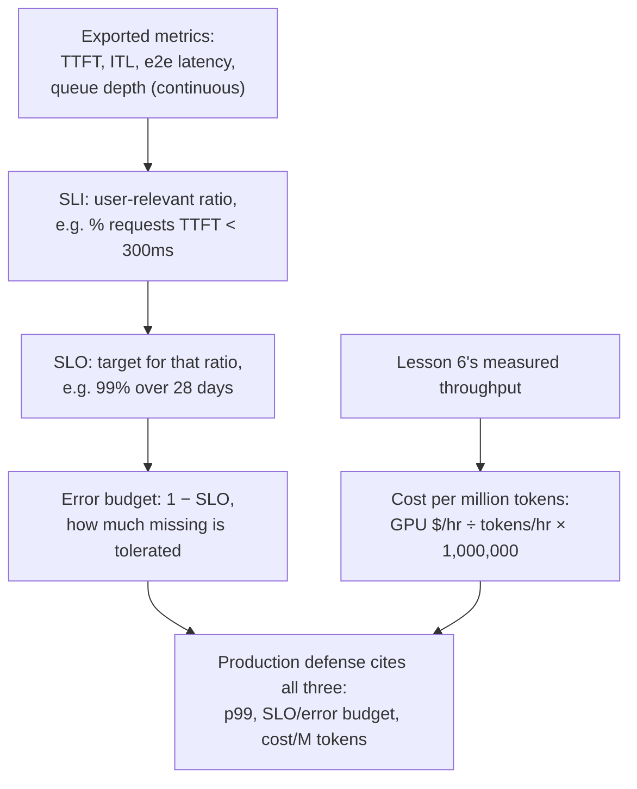

# Lección 23. Observabilidad y costo en producción

**Vínculo con la misión:** La lección 17 mostró cómo defender una cifra de p99 medida para una configuración, en un momento dado. Ejecutar esa configuración en producción necesita tres cosas más que la lección 17 nunca tuvo que cubrir: métricas **exportadas de forma continua**, no medidas una sola vez; un **objetivo de nivel de servicio (SLO)** y un **presupuesto de error** que conviertan "suficientemente bueno" en un objetivo declarado y no en el resultado de un benchmark puntual; y una cifra de **costo por millón de tokens** que hay que defender junto al p99, no en su lugar.
**Fuente principal:** [Docs: "Metrics", vLLM Project](https://docs.vllm.ai/en/stable/design/metrics/), [Google SRE Workbook: "Implementing SLOs"](https://sre.google/workbook/implementing-slos/)
**Requisitos previos:** [Lección 16](0016-p99-latency-methodology.md), [Lección 17](0017-defending-a-latency-budget-end-to-end.md)

## Calentamiento

1. ▢ ¿Qué tres cosas dijo la lección 17 que tiene que citar una configuración de latencia defendida?

Comprobación

Las propias cifras de p99 medidas, a partir de una muestra lo bastante grande y de forma realista; el razonamiento de memoria y de tamaño de lote detrás de la configuración; y la cifra de precisión medida para la cuantización que se haya aplicado.

2. ▢ ¿Por qué dice la lección 6 que el throughput y la latencia por token se compensan mediante el tamaño de lote?

Comprobación

Un lote mayor mantiene más ocupada a la GPU en cada paso, lo que aumenta el total de tokens producidos por segundo entre todas las solicitudes (throughput), pero el paso de cada solicitud individual comparte ahora tiempo de GPU con más vecinas, así que su propia latencia por token crece. El tamaño de lote es el parámetro compartido que mueve ambas cifras en direcciones opuestas.

## Qué debes saber

### Qué se exporta realmente, de forma continua, y no se mide una sola vez

El p99 de la lección 16 era una cifra calculada a partir de una ejecución de benchmark. Un servidor de producción, en cambio, exporta métricas de forma continua para que una regresión aparezca por sí sola, sin que nadie vuelva a ejecutar un benchmark. La propia documentación de métricas de vLLM enumera exactamente este conjunto como histogramas de Prometheus: **tiempo hasta el primer token (TTFT)**, **latencia entre tokens (ITL)**, **latencia de la solicitud de extremo a extremo** y **tiempo de prefill** y **tiempo de decode** por separado. Cada una se corresponde directamente con una fase que este espacio de trabajo ya enseñó: el TTFT con el prefill y el scheduler (lección 5), la ITL con el costo del decode limitado por el ancho de banda de memoria (lecciones 2 y 3), y la profundidad de la cola de espera detrás de ambas con la cola de admisión de la lección 5 y el disparador de autoscaling de la lección 22. Exportarlas es lo que convierte el recorrido diagnóstico puntual de la lección 17 en algo que se ejecuta de forma continua, en cada solicitud, sin que nadie esté mirando.

### Una métrica en bruto no es un objetivo; un SLI, un SLO y un presupuesto de error sí

Un histograma de valores de TTFT es una medición, no una decisión. El planteamiento de SRE la convierte en una en tres pasos. Un **indicador de nivel de servicio (SLI)** elige una razón concreta y relevante para el usuario a partir de esos datos en bruto, por ejemplo la fracción de solicitudes con un TTFT por debajo de 300 ms, formulada desde la perspectiva del usuario y no la del servidor. Un **objetivo de nivel de servicio (SLO)** declara un objetivo para ese SLI, por ejemplo "el 99% de las solicitudes tienen un TTFT inferior a 300 ms, medido en 28 días móviles". Un **presupuesto de error** es lo que sobra, 1 menos el SLO: con un SLO del 99%, se permite que el 1% de las solicitudes fallen sin que se considere que algo está roto. Esto no es una versión más laxa de la medición de p99 de la lección 16; es lo que hace accionable una cifra de p99 en producción, una única cifra medida con una tolerancia declarada de cuánto se le permite fallar, en lugar de la suposición de que nunca fallará.

### El presupuesto de error es lo que decide cuándo actuar, no la cifra bruta de latencia por sí sola

Una vez que existen un SLO y su presupuesto de error, cambian lo que significa una medición fallida. Una sola solicitud con un TTFT lento no es, por sí misma, un problema: se espera que ocurra hasta la tasa que permite el presupuesto de error. Lo que importa es si la *tasa* de fallos consume el presupuesto más rápido de lo que permite la ventana objetivo, la misma distinción que el diagnóstico de una sola ejecución de la lección 17 nunca tuvo que hacer, ya que solo miraba el resultado de un benchmark. Un equipo que gasta rápido su presupuesto de error tiene un problema real y actual que merece el recorrido diagnóstico completo de la lección 17; un equipo bien dentro del presupuesto no lo tiene, aunque el TTFT de una solicitud individual se viera mal por sí solo.

### El costo por millón de tokens convierte la cifra de throughput de la lección 6 en una cifra en dólares

La lección 6 ya produce la cifra que esto necesita: el throughput medido, tokens generados por segundo con el tamaño de lote en que se asentó una configuración. El **costo por millón de tokens** divide el costo horario de alquiler de una GPU entre ese throughput, convertido a tokens por hora, y escalado a un millón: `(GPU cost per hour / (throughput in tokens/sec × 3600)) × 1,000,000`. Es la misma disciplina aritmética que la fuente "Transformer Inference Arithmetic", ya citada en este espacio de trabajo, aplica a la latencia y la memoria: derivar la cifra del throughput medido y del costo de hardware conocido, en lugar de citar el precio por token anunciado por un proveedor, que se midió con el tamaño de lote de otra carga de trabajo y no se transferirá.

### Una defensa de producción cita las tres, no solo el p99

La configuración defendida de la lección 17 citaba un p99 medido y el razonamiento detrás de él. Una defensa de producción añade el SLO (y su presupuesto de error) al que se sujetan las métricas exportadas, y el costo por millón de tokens que producen el tamaño de lote y la elección de hardware de la configuración. No son cifras que compitan para promediarlas juntas: una configuración de menor latencia (lote más pequeño, más GPU) suele costar más por millón de tokens, y una configuración más barata suele tener un SLO más amplio o un presupuesto de error menor que puede prometer. Defender una configuración de producción significa declarar el p99, el SLO al que está sujeta y el costo que produce esa combinación, y ser explícito sobre cuál de las tres se sacrificó para conseguir las otras, exactamente la misma disciplina de "cuánto cuesta esto realmente" que este espacio de trabajo ha aplicado a la cuantización, al batching y ahora al lado del negocio del mismo compromiso.

## Práctica

1. ▢ Un servidor exporta de forma continua un histograma de TTFT a Prometheus. ¿Por qué ese histograma, por sí solo, no es un objetivo de nivel de servicio?

Pista

Piensa en qué falta entre una medición en bruto y un objetivo declarado.

Comprobación

El histograma son solo datos medidos; no dice nada sobre qué cuenta como aceptable. Un SLO requiere elegir una razón relevante para el usuario a partir de esos datos (el SLI, por ejemplo la fracción de solicitudes por debajo de cierto umbral de TTFT) y declarar un objetivo para ella (por ejemplo el 99% en 28 días). Sin ese paso, hay una medición pero ningún objetivo frente al que sujetarla.

2. ▢ Un servicio tiene un SLO del 99% para un TTFT inferior a 300 ms, medido en una ventana móvil de 28 días. ¿Cuál es su presupuesto de error, y qué significa esa cifra en la práctica?

Comprobación

El 1% (1 menos el SLO del 99%). En la práctica, se permite que hasta el 1% de las solicitudes de esa ventana de 28 días tenga un TTFT de 300 ms o más sin que se considere que el servicio incumple su propio objetivo; el presupuesto es lo que se vigila para decidir si esa tolerancia se está consumiendo más rápido de lo que permite la ventana.

3. ▢ Una solicitud de un servicio bien dentro del presupuesto tiene un TTFT lento. ¿Significa esa única solicitud lenta que el servicio tiene un problema?

Comprobación

No por sí misma. Un presupuesto de error existe precisamente porque se espera que cierta fracción de solicitudes incumpla el objetivo; lo que importa es la tasa a la que se consume el presupuesto en relación con la ventana del SLO, no si una solicitud concreta falló. Un servicio bien dentro de su presupuesto no tiene ningún problema actual aunque el TTFT de una solicitud se viera mal por sí solo.

4. ▢ Un equipo mide un throughput de 2,000 tokens/s con el tamaño de lote elegido, en una GPU que se alquila a 2.00 $/hora. ¿Cuál es su costo por millón de tokens?

Comprobación

`(2.00 / (2000 × 3600)) × 1,000,000 = (2.00 / 7,200,000) × 1,000,000 ≈ $0.278` por millón de tokens. La cifra de throughput es exactamente la cifra medida de la lección 6; el cálculo solo la convierte en una cifra en dólares usando el costo horario conocido de la GPU.

5. ▢ ¿Qué afirmación describe correctamente lo que tiene que citar la defensa de una configuración de producción, más allá del único p99 medido de la lección 17?

    - a) La cifra de p99 por sí sola basta; los SLO y el costo son preocupaciones de negocio separadas sin relación con el serving
    - b) Una defensa de producción añade el SLO (y su presupuesto de error) al que se sujetan las métricas exportadas, y el costo por millón de tokens que produce la configuración, ya que una configuración de menor latencia suele costar más y una más barata suele aceptar un presupuesto más amplio
    - c) El costo por millón de tokens debería minimizarse siempre sin importar la latencia resultante, ya que el costo es la única cifra que importa en producción
    - d) Un presupuesto de error sustituye la necesidad de medir el p99

Comprobación

**b)** Esa es la defensa más completa que exige esta lección, y el compromiso que esta lección nombra explícitamente entre latencia, tolerancia del SLO y costo. (a) es falsa: el p99 por sí solo no dice a qué tolerancia está sujeta la métrica, ni qué cuesta realmente la configuración que lo produce. (c) es falsa: minimizar solo el costo ignora el SLO de latencia que una carga de trabajo realmente necesita. (d) es falsa: el presupuesto de error se deriva de un SLO construido sobre métricas medidas como el p99, no sustituye medirlas.

## Prácticas en el mundo real

- [ ] Para un stack de serving al que tengas acceso, comprueba si realmente se exportan las métricas de TTFT, ITL y profundidad de cola (el endpoint `/metrics` de vLLM, o uno equivalente), y si hay algún SLO definido sobre ellas.
- [ ] Calcula tu propia cifra de costo por millón de tokens para una carga de trabajo que conozcas, con su throughput realmente medido y su costo de alquiler de GPU, en lugar de un precio por token anunciado por un proveedor.
- [ ] Mañana: elige un SLO de latencia declarado para una carga de trabajo que conozcas (o escribe uno), y calcula qué presupuesto de error implica en una ventana de tiempo realista (por ejemplo, 28 días).

## Para profundizar

- [Docs: "Metrics", vLLM Project](https://docs.vllm.ai/en/stable/design/metrics/)
- [Google SRE Workbook: "Implementing SLOs"](https://sre.google/workbook/implementing-slos/)
- [Article: "Transformer Inference Arithmetic", Kipply](https://kipp.ly/transformer-inference-arithmetic/)
- [Recursos](../RESOURCES.md)

---

¿No termina de quedar claro? Vuelve a leer la fuente primaria de arriba, ya que esta lección la comprime y en la compresión es donde se escapa la comprensión. Consulta el [glosario](../GLOSSARY.md) por si algún término te resultó resbaladizo.

Si lo poco claro es la propia lección y no el material, eso es un defecto: [abre un issue](https://github.com/TokenCemetery/teach/issues).
