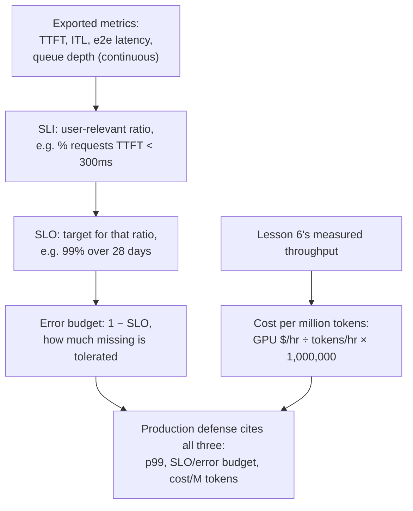

# Leçon 23. Observabilité et coût en production

**Lien avec la mission :** La leçon 17 a montré comment défendre un chiffre p99 mesuré pour une configuration, à un instant donné. Faire tourner cette configuration en production demande trois choses de plus que la leçon 17 n'a jamais eu à couvrir : des métriques **exportées en continu**, et non mesurées une fois ; un **objectif de niveau de service (SLO)** et un **budget d'erreur** qui font de « assez bon » une cible énoncée plutôt qu'un résultat de benchmark ponctuel ; et un chiffre de **coût par million de tokens** qu'il faut défendre en plus du p99, pas à sa place.
**Source primaire :** [Doc : "Metrics", vLLM Project](https://docs.vllm.ai/en/stable/design/metrics/), [Google SRE Workbook : "Implementing SLOs"](https://sre.google/workbook/implementing-slos/)
**Prérequis :** [Leçon 16](0016-p99-latency-methodology.md), [Leçon 17](0017-defending-a-latency-budget-end-to-end.md)

## Échauffement

1. ▢ Quelles trois choses la leçon 17 a-t-elle dit qu'une configuration de latence défendue doit citer ?

Vérifier

Les chiffres p99 mesurés eux-mêmes, à partir d'un échantillon assez grand et de forme réaliste ; le raisonnement sur la mémoire et la taille de batch derrière la configuration ; et le chiffre de précision mesuré pour la quantification éventuellement appliquée.

2. ▢ Pourquoi la leçon 6 dit-elle que le débit et la latence par token s'échangent l'un contre l'autre via la taille de batch ?

Vérifier

Un batch plus grand garde le GPU plus occupé à chaque étape, ce qui augmente le total de tokens produits par seconde sur toutes les requêtes (le débit), mais l'étape de chaque requête individuelle partage maintenant le temps GPU avec davantage de voisines, donc sa propre latence par token croît. La taille de batch est le paramètre partagé qui fait évoluer les deux chiffres en sens opposés.

## À savoir

### Ce qui est réellement exporté, en continu, et non mesuré une fois

Le p99 de la leçon 16 était un seul chiffre calculé à partir d'une seule exécution de benchmark. Un serveur de production exporte plutôt des métriques en continu pour qu'une régression apparaisse d'elle-même, sans que personne ne relance un benchmark. La propre documentation des métriques de vLLM liste exactement cet ensemble sous forme d'histogrammes Prometheus : le **temps jusqu'au premier token (TTFT)**, la **latence inter-token (ITL)**, la **latence de requête de bout en bout**, et des **temps de prefill** et de **decode** séparés. Chacun correspond directement à une phase que cet espace de travail a déjà enseignée : le TTFT au prefill et à l'ordonnanceur (leçon 5), l'ITL au coût du decode limité par la bande passante mémoire (leçons 2 et 3), et la profondeur de la file d'attente derrière les deux à la file d'admission de la leçon 5 et au déclencheur d'autoscaling de la leçon 22. Les exporter est ce qui transforme le parcours de diagnostic ponctuel de la leçon 17 en quelque chose qui tourne en continu, à chaque requête, sans que personne ne surveille.

### Une métrique brute n'est pas une cible ; un SLI, un SLO et un budget d'erreur le sont

Un histogramme de valeurs de TTFT est une mesure, pas une décision. Le cadrage SRE le transforme en décision en trois étapes. Un **indicateur de niveau de service (SLI)** choisit un ratio précis, pertinent pour l'utilisateur, parmi ces données brutes, par exemple la fraction de requêtes dont le TTFT est inférieur à 300 ms, formulé du point de vue de l'utilisateur plutôt que de celui du serveur. Un **objectif de niveau de service (SLO)** énonce une cible pour ce SLI, par exemple « 99 % des requêtes ont un TTFT inférieur à 300 ms, mesuré sur 28 jours glissants ». Un **budget d'erreur** est ce qui reste, 1 moins le SLO : avec un SLO de 99 %, 1 % des requêtes ont le droit de manquer la cible sans que rien ne soit considéré comme cassé. Ce n'est pas une version plus lâche de la mesure du p99 de la leçon 16 ; c'est ce qui rend un chiffre p99 exploitable en production, un chiffre mesuré unique avec une tolérance énoncée sur la fréquence à laquelle il a le droit de glisser, au lieu de l'hypothèse qu'il ne glissera jamais.

### Le budget d'erreur décide quand agir, pas le seul chiffre de latence brut

Une fois qu'un SLO et son budget d'erreur existent, ils changent le sens d'une mesure manquée. Une seule requête avec un TTFT lent n'est pas, en soi, un problème : on s'attend à ce que cela arrive jusqu'au taux que permet le budget d'erreur. Ce qui compte, c'est de savoir si le *taux* d'écarts consomme le budget plus vite que la fenêtre cible ne le permet, la même distinction que le diagnostic sur une seule exécution de la leçon 17 n'a jamais eu à faire, puisqu'il ne regardait que le résultat d'un seul benchmark. Une équipe qui brûle rapidement son budget d'erreur a un vrai problème actuel qui mérite tout le parcours de diagnostic de la leçon 17 ; une équipe bien dans son budget n'en a pas, même si le TTFT d'une requête individuelle avait l'air mauvais isolément.

### Le coût par million de tokens transforme le chiffre de débit de la leçon 6 en chiffre en dollars

La leçon 6 produit déjà le chiffre dont on a besoin ici : le débit mesuré, les tokens générés par seconde à la taille de batch sur laquelle une configuration s'est arrêtée. Le **coût par million de tokens** divise le coût horaire de location d'un GPU par ce débit, converti en tokens par heure, et ramené à un million : `(GPU cost per hour / (throughput in tokens/sec × 3600)) × 1,000,000`. C'est la même discipline arithmétique que la source « Transformer Inference Arithmetic » déjà citée dans cet espace de travail applique à la latence et à la mémoire : dériver le chiffre du débit mesuré et du coût matériel connu, plutôt que de citer le prix par token annoncé par un fournisseur, mesuré avec la taille de batch d'une autre charge de travail et qui ne se transposera pas.

### Une défense de production cite les trois, pas le p99 seul

La configuration défendue de la leçon 17 citait un p99 mesuré et le raisonnement qui le sous-tend. Une défense de production y ajoute le SLO (et son budget d'erreur) auquel les métriques exportées sont tenues, et le coût par million de tokens que produisent la taille de batch et le choix de matériel de la configuration. Ce ne sont pas des chiffres concurrents à moyenner ensemble : une configuration à plus faible latence (batch plus petit, plus de GPU) coûte généralement plus par million de tokens, et une configuration moins chère a généralement un SLO plus large ou un budget d'erreur plus petit qu'elle peut promettre. Défendre une configuration de production, c'est énoncer le p99, le SLO auquel elle est tenue et le coût que produit cette combinaison, et être explicite sur celui des trois qui a été échangé pour obtenir les autres, exactement la même discipline du « qu'est-ce que cela coûte réellement » que cet espace de travail a appliquée à la quantification, au batching, et maintenant au versant économique du même compromis.

## Pratique

1. ▢ Un serveur exporte en continu un histogramme de TTFT vers Prometheus. Pourquoi cet histogramme n'est-il pas, à lui seul, un objectif de niveau de service ?

Indice

Pensez à ce qui manque entre une mesure brute et une cible énoncée.

Vérifier

L'histogramme n'est que de la donnée mesurée ; il ne dit rien de ce qui est acceptable. Un SLO exige de choisir un ratio pertinent pour l'utilisateur parmi ces données (le SLI, par exemple la fraction de requêtes sous un certain seuil de TTFT) et d'énoncer une cible pour lui (par exemple 99 % sur 28 jours). Sans cette étape, il y a une mesure mais pas de cible à laquelle la tenir.

2. ▢ Un service a un SLO de 99 % sur un TTFT inférieur à 300 ms, mesuré sur une fenêtre glissante de 28 jours. Quel est son budget d'erreur, et que signifie ce chiffre en pratique ?

Vérifier

1 % (1 moins le SLO de 99 %). En pratique, jusqu'à 1 % des requêtes de cette fenêtre de 28 jours ont le droit d'avoir un TTFT de 300 ms ou plus sans que le service soit considéré comme non conforme à sa propre cible ; le budget est ce qui est suivi pour décider si cette tolérance est consommée plus vite que la fenêtre ne le permet.

3. ▢ Une requête d'un service bien dans son budget a un TTFT lent. Cette requête lente isolée signifie-t-elle que le service a un problème ?

Vérifier

Pas en soi. Un budget d'erreur existe précisément parce qu'on s'attend à ce qu'une certaine fraction de requêtes manque la cible ; ce qui compte, c'est le rythme auquel le budget est consommé par rapport à la fenêtre du SLO, pas le fait qu'une requête isolée ait manqué. Un service bien dans son budget n'a pas de problème actuel même si le TTFT d'une requête avait l'air mauvais isolément.

4. ▢ Une équipe mesure un débit de 2 000 tokens/s à la taille de batch choisie, sur un GPU loué 2.00 $/heure. Quel est son coût par million de tokens ?

Vérifier

`(2.00 / (2000 × 3600)) × 1,000,000 = (2.00 / 7,200,000) × 1,000,000 ≈ $0.278` par million de tokens. Le chiffre de débit est exactement le chiffre mesuré de la leçon 6 ; le calcul ne fait que le convertir en dollars avec le coût horaire connu du GPU.

5. ▢ Quelle affirmation décrit correctement ce que la défense d'une configuration de production doit citer, au-delà du p99 mesuré unique de la leçon 17 ?

    - a) Le chiffre p99 seul suffit ; les SLO et le coût sont des préoccupations commerciales séparées sans rapport avec le serving
    - b) Une défense de production ajoute le SLO (et son budget d'erreur) auquel les métriques exportées sont tenues, et le coût par million de tokens que produit la configuration, puisqu'une configuration à plus faible latence coûte généralement plus et qu'une moins chère accepte généralement un budget plus large
    - c) Le coût par million de tokens devrait toujours être minimisé quelle que soit la latence qui en résulte, puisque le coût est le seul chiffre qui compte en production
    - d) Un budget d'erreur remplace le besoin de mesurer le p99

Vérifier

**b)** C'est la défense plus complète qu'exige cette leçon, et le compromis que cette leçon nomme explicitement entre latence, tolérance du SLO et coût. (a) est fausse : le p99 seul ne dit pas à quelle tolérance la métrique est tenue, ni ce que coûte réellement la configuration qui le produit. (c) est fausse : minimiser le seul coût ignore le SLO de latence dont une charge de travail a réellement besoin. (d) est fausse : le budget d'erreur est dérivé d'un SLO bâti sur des métriques mesurées comme le p99, et ne remplace pas leur mesure.

## Exercices en situation réelle

- [ ] Pour une pile de serving à laquelle vous avez accès, vérifiez si les métriques de TTFT, d'ITL et de profondeur de file sont réellement exportées (le point d'accès `/metrics` de vLLM, ou un équivalent), et si un SLO est défini à partir d'elles.
- [ ] Calculez votre propre chiffre de coût par million de tokens pour une charge de travail que vous connaissez, avec son débit réellement mesuré et le coût de location du GPU, plutôt qu'un prix par token annoncé par un fournisseur.
- [ ] Demain : choisissez un SLO de latence énoncé pour une charge de travail que vous connaissez (ou écrivez-en un), et déterminez quel budget d'erreur il implique sur une fenêtre de temps réaliste (par exemple 28 jours).

## Pour aller plus loin

- [Doc : "Metrics", vLLM Project](https://docs.vllm.ai/en/stable/design/metrics/)
- [Google SRE Workbook : "Implementing SLOs"](https://sre.google/workbook/implementing-slos/)
- [Billet : "Transformer Inference Arithmetic", Kipply](https://kipp.ly/transformer-inference-arithmetic/)
- [Ressources](../RESOURCES.md)

---

Ça ne passe pas ? Relisez la source primaire en haut de page, car cette leçon la condense et c'est dans la condensation que la compréhension s'échappe. Consultez le [glossaire](../GLOSSARY.md) pour tout terme qui vous a paru glissant.

Si c'est la leçon elle-même qui n'est pas claire plutôt que la matière, c'est un défaut : [ouvrez une issue](https://github.com/TokenCemetery/teach/issues).
