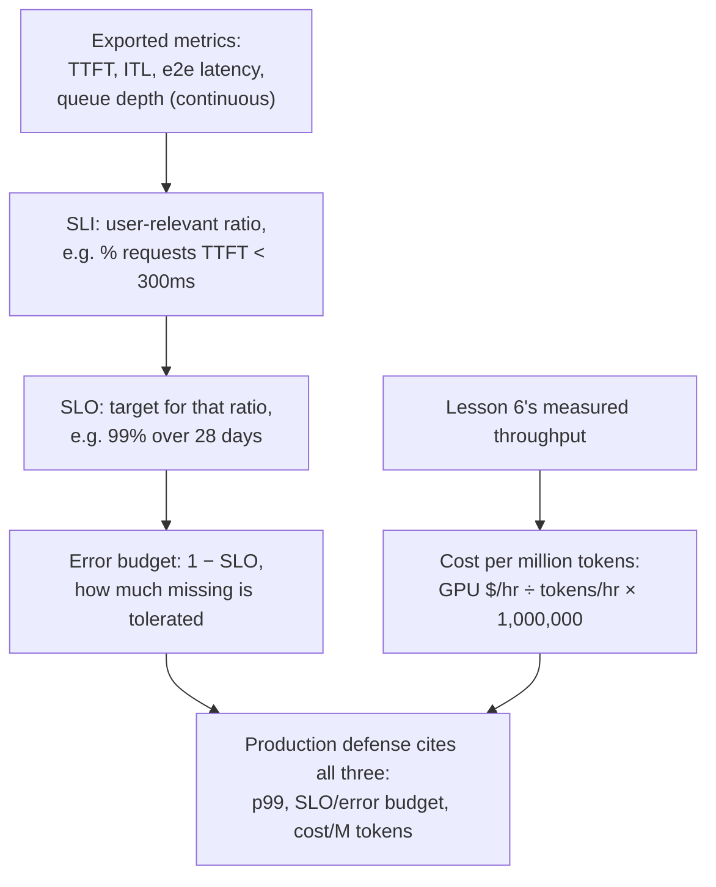

# पाठ 23. Production Observability और Cost

**मिशन से संबंध:** पाठ 17 ने दिखाया कि एक configuration के लिए, एक समय बिंदु पर, एक नापे गए p99 आँकड़े का बचाव कैसे करें। उस configuration को production में चलाने के लिए तीन और चीज़ें चाहिए जिन्हें पाठ 17 को कभी कवर नहीं करना पड़ा: **लगातार export** होने वाले metrics, एक बार नापे हुए नहीं; एक **service level objective (SLO)** और **error budget** जो "काफ़ी अच्छा" को एक बार के benchmark नतीजे के बजाय बताए गए लक्ष्य में बदलते हैं; और **cost per million tokens** का आँकड़ा जिसका बचाव p99 के साथ करना है, उसकी जगह नहीं।
**मुख्य स्रोत:** [दस्तावेज़: "Metrics", vLLM Project](https://docs.vllm.ai/en/stable/design/metrics/), [Google SRE Workbook: "Implementing SLOs"](https://sre.google/workbook/implementing-slos/)
**पूर्व-आवश्यकताएँ:** [पाठ 16](0016-p99-latency-methodology.md), [पाठ 17](0017-defending-a-latency-budget-end-to-end.md)

## वार्म-अप

1. ▢ पाठ 17 के अनुसार बचाव की गई latency configuration को कौन-सी तीन चीज़ें गिनानी चाहिए?

जाँचें

ख़ुद नापे गए p99 आँकड़े, पर्याप्त बड़े और यथार्थवादी आकार के नमूने से; configuration के पीछे का memory और batch-size का तर्क; और जो भी quantization लगाई गई उसके लिए नापी गई accuracy की संख्या।

2. ▢ पाठ 6 के अनुसार throughput और प्रति-token latency batch size के ज़रिए एक-दूसरे से सौदा क्यों करते हैं?

जाँचें

बड़ा batch GPU को हर step में ज़्यादा व्यस्त रखता है, जिससे सभी requests में प्रति सेकंड बनने वाले कुल tokens (throughput) बढ़ते हैं, पर हर अकेली request का step अब ज़्यादा पड़ोसियों के साथ GPU का समय साझा करता है, इसलिए उसकी अपनी प्रति-token latency बढ़ती है। Batch size वह साझा knob है जो दोनों संख्याओं को उल्टी दिशाओं में हिलाता है।

## यह जानें

### असल में क्या लगातार export होता है, एक बार नापा नहीं जाता

पाठ 16 का p99 एक benchmark run से निकली एक संख्या थी। इसके उलट production server metrics लगातार export करता है ताकि regression अपने आप दिख जाए, किसी को benchmark दोबारा चलाए बिना। vLLM का अपना metrics दस्तावेज़ ठीक यही सेट Prometheus histograms के रूप में सूचीबद्ध करता है: **time to first token (TTFT)**, **inter-token latency (ITL)**, **end-to-end request latency**, और अलग **prefill time** तथा **decode time**। इनमें से हर एक सीधे उस चरण से जुड़ता है जो यह workspace पहले सिखा चुका है: TTFT prefill और scheduler से (पाठ 5), ITL decode की memory-bandwidth-bound लागत से (पाठ 2 और 3), और दोनों के पीछे की इंतज़ार-queue की गहराई पाठ 5 की admission queue और पाठ 22 के autoscaling trigger से। इन्हें export करना ही पाठ 17 की एक बार की निदान-यात्रा को ऐसी चीज़ में बदलता है जो लगातार चलती है, हर request पर, बिना किसी के देखे।

### कच्चा metric लक्ष्य नहीं है; SLI, SLO और error budget हैं

TTFT values का histogram एक माप है, फ़ैसला नहीं। SRE का ढाँचा उसे तीन कदमों में फ़ैसले में बदलता है। **Service level indicator (SLI)** उस कच्चे data में से एक ख़ास, user से जुड़ा अनुपात चुनता है, उदाहरण के लिए उन requests का अंश जिनका TTFT 300ms से कम है, server के नज़रिए के बजाय user के नज़रिए से तय किया हुआ। **Service level objective (SLO)** उस SLI के लिए लक्ष्य बताता है, उदाहरण के लिए "99% requests का TTFT 300ms से कम है, पिछले 28 दिनों की rolling अवधि में नापा गया।" **Error budget** वह है जो बचता है, 1 घटा SLO: 99% SLO पर, 1% requests को चूकने की इजाज़त है बिना किसी चीज़ को टूटा हुआ माने। यह पाठ 16 की p99 माप का ढीला रूप नहीं है; यही p99 संख्या को production में काम की बनाता है, एक अकेली नापी हुई संख्या, इस बताई गई सहनशीलता के साथ कि उसे कितनी बार फिसलने की इजाज़त है, इस अंदाज़े के बजाय कि वह कभी नहीं फिसलेगी।

### कब कार्रवाई करनी है यह error budget तय करता है, अकेली कच्ची latency संख्या नहीं

SLO और उसका error budget बन जाने के बाद, वे बदल देते हैं कि चूकी हुई माप का क्या मतलब है। धीमे TTFT वाली एक अकेली request अपने आप में समस्या नहीं है: उसका उस दर तक होना अपेक्षित है जितना error budget अनुमति देता है। मायने यह रखता है कि चूकों की *दर* budget को लक्ष्य window की अनुमति से तेज़ी से खा रही है या नहीं, वही अंतर जो पाठ 17 के एक-run वाले निदान को कभी करना नहीं पड़ा, क्योंकि वह सिर्फ़ एक benchmark का नतीजा देखता था। जो team अपना error budget तेज़ी से जला रही है उसकी असली, मौजूदा समस्या है जो पाठ 17 की पूरी निदान-यात्रा के लायक़ है; जो team budget के भीतर आराम से है उसकी नहीं, भले अकेली request का TTFT अलग से देखने पर ख़राब दिखे।

### Cost per million tokens पाठ 6 की throughput संख्या को dollar के आँकड़े में बदलती है

पाठ 6 पहले ही वह संख्या देता है जो इसे चाहिए: नापा गया throughput, यानी configuration जिस batch size पर टिकी उस पर प्रति सेकंड generate होने वाले tokens। **Cost per million tokens** GPU के प्रति घंटे के किराये को उस throughput से भाग देता है, tokens प्रति घंटे में बदला हुआ, और एक million के हिसाब से scale किया हुआ: `(GPU cost per hour / (throughput in tokens/sec × 3600)) × 1,000,000`। यह वही अंकगणितीय अनुशासन है जो इस workspace में पहले से उद्धृत "Transformer Inference Arithmetic" स्रोत latency और memory पर लगाता है: संख्या को नापे गए throughput और ज्ञात hardware लागत से निकालें, किसी vendor के विज्ञापित per-token दाम को दोहराने के बजाय, जो किसी दूसरे workload के batch size पर नापा गया था और आगे लागू नहीं होगा।

### Production का बचाव तीनों गिनाता है, अकेला p99 नहीं

पाठ 17 की बचाव की गई configuration ने नापा हुआ p99 और उसके पीछे का तर्क गिनाया था। Production का बचाव उसमें वह SLO (और उसका error budget) जोड़ता है जिसके तहत exported metrics रखे जाते हैं, और वह cost per million tokens जो configuration का batch size और hardware का चुनाव पैदा करते हैं। ये आपस में औसत निकाली जाने वाली प्रतिस्पर्धी संख्याएँ नहीं हैं: कम-latency वाली configuration (छोटा batch, ज़्यादा GPUs) आम तौर पर प्रति million tokens ज़्यादा महँगी पड़ती है, और सस्ती configuration आम तौर पर चौड़ा SLO या छोटा error budget ही वादा कर सकती है। Production configuration का बचाव करने का मतलब है p99, वह SLO जिसके तहत वह रखी गई है, और उस जोड़ी से निकली लागत बताना, और साफ़ बताना कि बाक़ी दो पाने के लिए तीनों में से किसका सौदा किया गया, ठीक वही "इसकी असल में क्या क़ीमत है" का अनुशासन जो इस workspace ने quantization, batching और अब उसी trade-off के कारोबारी पक्ष पर लगाया है।

## अभ्यास

1. ▢ एक server Prometheus को TTFT का histogram लगातार export करता है। वह histogram अपने आप में service level objective क्यों नहीं है?

संकेत

सोचें कि कच्ची माप और बताए गए लक्ष्य के बीच क्या छूट रहा है।

जाँचें

Histogram सिर्फ़ नापा हुआ data है; वह कुछ नहीं कहता कि क्या स्वीकार्य माना जाए। SLO के लिए उस data में से एक user से जुड़ा अनुपात चुनना (SLI, जैसे किसी TTFT सीमा से कम वाली requests का अंश) और उसके लिए लक्ष्य बताना (जैसे 28 दिनों में 99%) ज़रूरी है। उस कदम के बिना माप है पर उसे जिस पर टिकाया जाए ऐसा कोई लक्ष्य नहीं।

2. ▢ किसी service का TTFT 300ms से कम रहने पर 99% SLO है, जो पिछले 28 दिनों की rolling window पर नापा जाता है। उसका error budget क्या है, और व्यवहार में उस संख्या का क्या मतलब है?

जाँचें

1% (1 घटा 99% SLO)। व्यवहार में, उस 28-दिन की window में 1% तक requests का TTFT 300ms या उससे ज़्यादा हो सकता है बिना service को अपने ही लक्ष्य के अनुपालन से बाहर माने; budget वही है जिसे ट्रैक किया जाता है यह तय करने के लिए कि वह सहनशीलता window की अनुमति से तेज़ी से खप रही है या नहीं।

3. ▢ budget के भीतर आराम से चल रही service की एक request का TTFT धीमा है। क्या उस अकेली धीमी request का मतलब है कि service में समस्या है?

जाँचें

अपने आप में नहीं। Error budget इसीलिए है कि requests के कुछ अंश से लक्ष्य चूकने की उम्मीद है; मायने यह रखता है कि budget SLO की window के मुक़ाबले किस दर से खप रहा है, यह नहीं कि कोई अकेली request संयोग से चूक गई। अपने budget के भीतर आराम से चल रही service की कोई मौजूदा समस्या नहीं, भले अकेली request का TTFT अलग से देखने पर ख़राब दिखे।

4. ▢ एक team अपने चुने batch size पर 2,000 tokens/sec का throughput नापती है, एक GPU पर जिसका किराया $2.00/घंटा है। उनकी cost per million tokens क्या है?

जाँचें

`(2.00 / (2000 × 3600)) × 1,000,000 = (2.00 / 7,200,000) × 1,000,000 ≈ $0.278` प्रति million tokens। Throughput का आँकड़ा ठीक पाठ 6 की नापी हुई संख्या है; हिसाब बस उसे GPU की ज्ञात प्रति घंटे की लागत से dollar के आँकड़े में बदलता है।

5. ▢ पाठ 17 के अकेले नापे गए p99 से आगे, production configuration के बचाव को क्या गिनाना चाहिए, इसका सही वर्णन कौन-सा दावा करता है?

    - a) अकेला p99 आँकड़ा काफ़ी है; SLOs और लागत serving से असंबंधित अलग कारोबारी चिंताएँ हैं
    - b) Production का बचाव उसमें वह SLO (और उसका error budget) जोड़ता है जिसके तहत exported metrics रखे गए हैं, और वह cost per million tokens जो configuration पैदा करती है, क्योंकि कम-latency वाली configuration आम तौर पर ज़्यादा महँगी होती है और सस्ती आम तौर पर चौड़ा budget स्वीकार करती है
    - c) Cost per million tokens को हमेशा न्यूनतम करना चाहिए, नतीजे में latency कुछ भी हो, क्योंकि production में अकेली लागत की संख्या मायने रखती है
    - d) Error budget p99 नापने की ज़रूरत को पूरी तरह ख़त्म कर देता है

जाँचें

**b)** यही वह पूरा बचाव है जो यह पाठ माँगता है, और latency, SLO की सहनशीलता और लागत के बीच का वह सौदा जिसे यह पाठ साफ़ नाम देता है। (a) ग़लत है: अकेला p99 यह नहीं बताता कि metric किस सहनशीलता के तहत रखा गया है, या उसे पैदा करने वाली configuration की असल में क्या लागत है। (c) ग़लत है: अकेली लागत घटाना उस latency SLO को अनदेखा करता है जो workload को असल में चाहिए। (d) ग़लत है: error budget p99 जैसे नापे गए metrics पर बने SLO से निकलता है, उन्हें नापने की जगह नहीं लेता।

## असली दुनिया का अभ्यास

- [ ] जिस serving stack तक आपकी पहुँच है उसके लिए जाँचें कि TTFT, ITL और queue-depth metrics असल में export होते हैं या नहीं (vLLM का `/metrics` endpoint, या उसके समकक्ष), और उनके विरुद्ध कोई SLO तय है या नहीं।
- [ ] किसी जाने-पहचाने workload के लिए अपना cost-per-million-tokens का आँकड़ा निकालें, उसके असली नापे गए throughput और GPU किराये से, किसी vendor के विज्ञापित per-token दाम से नहीं।
- [ ] कल: किसी जाने-पहचाने workload के लिए बताया हुआ latency SLO चुनें (या लिखें), और निकालें कि वह किसी यथार्थवादी समय window (जैसे 28 दिन) में कौन-सा error budget दर्शाता है।

## आगे बढ़ने के लिए

- [दस्तावेज़: "Metrics", vLLM Project](https://docs.vllm.ai/en/stable/design/metrics/)
- [Google SRE Workbook: "Implementing SLOs"](https://sre.google/workbook/implementing-slos/)
- [लेख: "Transformer Inference Arithmetic", Kipply](https://kipp.ly/transformer-inference-arithmetic/)
- [संसाधन](../RESOURCES.md)

---

बात नहीं बन रही? ऊपर दिए मुख्य स्रोत को दोबारा पढ़ें, क्योंकि यह पाठ उसे संक्षिप्त करता है और समझ संक्षेप में ही रिसती है। जो शब्द फिसलन भरा लगे, उसके लिए [शब्दावली](../GLOSSARY.md) देखें।

अगर दिक़्क़त सामग्री की नहीं बल्कि पाठ की ही है, तो वह एक खोट है: [issue खोलें](https://github.com/TokenCemetery/teach/issues)।
