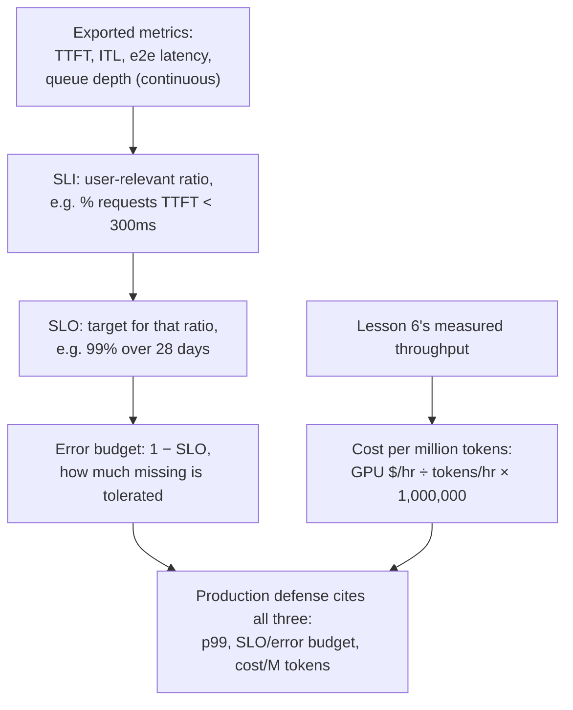

# Lição 23. Observabilidade e custo em produção

**Ligação com a missão:** A lição 17 mostrou como defender um único p99 medido para uma única configuração, em um único momento. Rodar essa configuração em produção exige mais três coisas que a lição 17 nunca precisou cobrir: métricas **exportadas continuamente**, e não medidas uma só vez; um **objetivo de nível de serviço (SLO)** e um **orçamento de erro** que transformam "bom o bastante" em uma meta declarada, e não em um resultado de benchmark pontual; e um número de **custo por milhão de tokens** que precisa ser defendido junto com o p99, e não no lugar dele.
**Fonte principal:** [Documentação: "Metrics", vLLM Project](https://docs.vllm.ai/en/stable/design/metrics/), [Google SRE Workbook: "Implementing SLOs"](https://sre.google/workbook/implementing-slos/)
**Pré-requisitos:** [Lição 16](0016-p99-latency-methodology.md), [Lição 17](0017-defending-a-latency-budget-end-to-end.md)

## Aquecimento

1. ▢ Que três coisas a lição 17 disse que uma configuração de latência defendida precisa citar?

Verificação

Os números de p99 medidos em si, de uma amostra grande o bastante e com formato realista; o raciocínio de memória e de batch size por trás da configuração; e o número de acurácia medido para qualquer quantização que tenha sido aplicada.

2. ▢ Por que a lição 6 diz que throughput e latência por token fazem trade-off um contra o outro por meio do batch size?

Verificação

Um batch maior mantém a GPU mais ocupada por passo, elevando o total de tokens produzidos por segundo entre todas as requisições (throughput), mas o passo de cada requisição individual agora divide tempo de GPU com mais vizinhas, então a sua própria latência por token cresce. O batch size é o parâmetro compartilhado que move os dois números em direções opostas.

## Saiba isto

### O que realmente é exportado, continuamente, e não medido uma só vez

O p99 da lição 16 era um número calculado a partir de uma execução de benchmark. Um servidor de produção, em vez disso, exporta métricas continuamente para que uma regressão apareça por conta própria, sem que ninguém precise rodar de novo um benchmark. A documentação de métricas do próprio vLLM lista exatamente esse conjunto como histogramas do Prometheus: **time to first token (TTFT)**, **latência entre tokens (ITL)**, **latência de requisição de ponta a ponta** e **tempo de prefill** e **tempo de decode** separados. Cada um corresponde diretamente a uma fase que este workspace já ensinou: o TTFT ao prefill e ao scheduler (lição 5), a ITL ao custo do decode limitado pela largura de banda de memória (lições 2 e 3), e a profundidade da fila de espera por trás dos dois à fila de admissão da lição 5 e ao gatilho de autoscaling da lição 22. Exportá-los é o que transforma o percurso de diagnóstico pontual da lição 17 em algo que roda continuamente, a cada requisição, sem ninguém olhando.

### Uma métrica bruta não é uma meta; um SLI, um SLO e um orçamento de erro são

Um histograma de valores de TTFT é uma medição, e não uma decisão. O enquadramento de SRE a transforma em uma em três passos. Um **indicador de nível de serviço (SLI)** escolhe uma razão específica e relevante para o usuário a partir desses dados brutos, por exemplo a fração das requisições com TTFT abaixo de 300 ms, formulada a partir da perspectiva do usuário e não da do servidor. Um **objetivo de nível de serviço (SLO)** declara uma meta para esse SLI, por exemplo "99% das requisições têm TTFT abaixo de 300 ms, medido em 28 dias corridos". Um **orçamento de erro** é o que sobra, 1 menos o SLO: com um SLO de 99%, 1% das requisições pode falhar sem que nada seja considerado quebrado. Esta não é uma versão mais frouxa da medição de p99 da lição 16; é o que torna um número de p99 acionável em produção, uma única medida com uma tolerância declarada para a frequência com que ela pode escorregar, em vez da suposição de que nunca escorregará.

### O orçamento de erro é o que decide quando agir, e não apenas o número bruto de latência

Uma vez que existem um SLO e o seu orçamento de erro, eles mudam o que uma medição que falhou significa. Uma única requisição com TTFT lento não é, por si só, um problema: espera-se que isso aconteça até a taxa que o orçamento de erro permite. O que importa é se a *taxa* de falhas está consumindo o orçamento mais depressa do que a janela da meta permite, a mesma distinção que o diagnóstico de execução única da lição 17 nunca precisou fazer, já que só olhava o resultado de um benchmark. Uma equipe queimando o seu orçamento de erro depressa tem um problema real e atual que merece o percurso de diagnóstico completo da lição 17; uma equipe bem dentro do orçamento não tem, mesmo que o TTFT de uma requisição individual tenha parecido ruim isoladamente.

### O custo por milhão de tokens transforma o número de throughput da lição 6 em um valor em dólares

A lição 6 já produz o número de que isto precisa: o throughput medido, tokens gerados por segundo no batch size em que uma configuração se fixou. O **custo por milhão de tokens** divide o custo horário de aluguel de uma GPU por esse throughput, convertido em tokens por hora, e escala para um milhão: `(GPU cost per hour / (throughput in tokens/sec × 3600)) × 1,000,000`. Esta é a mesma disciplina aritmética que a fonte "Transformer Inference Arithmetic", já citada neste workspace, aplica à latência e à memória: derivar o número a partir do throughput medido e do custo conhecido do hardware, em vez de citar o preço por token anunciado por um fornecedor, que foi medido com o batch size de outra carga de trabalho e não se transfere.

### Uma defesa de produção cita os três, e não só o p99

A configuração defendida na lição 17 citava um p99 medido e o raciocínio por trás dele. Uma defesa de produção acrescenta o SLO (e o seu orçamento de erro) a que as métricas exportadas são submetidas e o custo por milhão de tokens que o batch size e a escolha de hardware da configuração produzem. Esses não são números concorrentes para tirar a média: uma configuração de menor latência (batch menor, mais GPUs) costuma custar mais por milhão de tokens, e uma configuração mais barata costuma ter um SLO mais largo ou um orçamento de erro menor que pode prometer. Defender uma configuração de produção significa declarar o p99, o SLO a que ela é submetida e o custo que essa combinação produz, e ser explícito sobre qual dos três foi trocado para obter os outros, exatamente a mesma disciplina do "quanto isso realmente custa" que este workspace aplicou à quantização, ao batching e agora ao lado de negócio do mesmo trade-off.

## Prática

1. ▢ Um servidor exporta continuamente um histograma de TTFT para o Prometheus. Por que esse histograma, sozinho, não é um objetivo de nível de serviço?

Dica

Pense no que falta entre uma medição bruta e uma meta declarada.

Verificação

O histograma são apenas dados medidos; ele não diz nada sobre o que conta como aceitável. Um SLO exige escolher uma razão relevante para o usuário a partir desses dados (o SLI, por exemplo a fração das requisições abaixo de algum limite de TTFT) e declarar uma meta para ela (por exemplo, 99% em 28 dias). Sem esse passo, há uma medição, mas nenhuma meta a que submetê-la.

2. ▢ Um serviço tem um SLO de 99% para TTFT abaixo de 300 ms, medido em uma janela móvel de 28 dias. Qual é o seu orçamento de erro, e o que esse número significa na prática?

Verificação

1% (1 menos o SLO de 99%). Na prática, até 1% das requisições nessa janela de 28 dias podem ter um TTFT de 300 ms ou mais sem que o serviço seja considerado fora de conformidade com a sua própria meta; o orçamento é o que se acompanha para decidir se essa tolerância está sendo consumida mais depressa do que a janela permite.

3. ▢ Uma requisição de um serviço bem dentro do orçamento tem um TTFT lento. Essa única requisição lenta significa que o serviço tem um problema?

Verificação

Não por si só. Um orçamento de erro existe justamente porque se espera que alguma fração das requisições falhe a meta; o que importa é a taxa em que o orçamento está sendo consumido em relação à janela do SLO, e não se alguma requisição isolada calhou de falhar. Um serviço bem dentro do seu orçamento não tem problema atual, mesmo que o TTFT de uma requisição tenha parecido ruim isoladamente.

4. ▢ Uma equipe mede um throughput de 2.000 tokens/s no batch size escolhido, em uma GPU alugada por US$ 2,00 por hora. Qual é o custo por milhão de tokens deles?

Verificação

`(2.00 / (2000 × 3600)) × 1,000,000 = (2.00 / 7,200,000) × 1,000,000 ≈ $0.278` por milhão de tokens. O número de throughput é exatamente o número medido da lição 6; o cálculo apenas o converte em um valor em dólares usando o custo horário conhecido da GPU.

5. ▢ Qual afirmação descreve corretamente o que a defesa de uma configuração de produção precisa citar, além do p99 medido único da lição 17?

    - a) O p99 sozinho basta; SLOs e custo são preocupações de negócio separadas, sem relação com o serving
    - b) Uma defesa de produção acrescenta o SLO (e o seu orçamento de erro) a que as métricas exportadas são submetidas e o custo por milhão de tokens que a configuração produz, já que uma configuração de menor latência costuma custar mais e uma mais barata costuma aceitar um orçamento mais largo
    - c) O custo por milhão de tokens deve ser sempre minimizado, independentemente da latência resultante, já que o custo é o único número que importa em produção
    - d) Um orçamento de erro dispensa a necessidade de medir o p99

Verificação

**b)** Essa é a defesa mais completa que esta lição exige, e o trade-off que esta lição nomeia explicitamente entre latência, tolerância do SLO e custo. (a) é falsa: o p99 sozinho não diz a que tolerância a métrica é submetida, nem o que a configuração que a produz realmente custa. (c) é falsa: minimizar apenas o custo ignora o SLO de latência de que uma carga de trabalho realmente precisa. (d) é falsa: o orçamento de erro é derivado de um SLO construído sobre métricas medidas como o p99, e não um substituto para medi-las.

## Prática no mundo real

- [ ] Para uma stack de serving a que você tenha acesso, verifique se as métricas de TTFT, ITL e profundidade de fila são de fato exportadas (o endpoint `/metrics` do vLLM, ou equivalente) e se algum SLO está definido contra elas.
- [ ] Calcule o seu próprio custo por milhão de tokens para uma carga de trabalho que você conhece, usando o throughput realmente medido e o custo de aluguel da GPU, em vez do preço por token anunciado por um fornecedor.
- [ ] Amanhã: escolha um SLO de latência declarado para uma carga de trabalho que você conhece (ou escreva um) e calcule que orçamento de erro ele implica em uma janela de tempo realista (por exemplo, 28 dias).

## Para ir além

- [Documentação: "Metrics", vLLM Project](https://docs.vllm.ai/en/stable/design/metrics/)
- [Google SRE Workbook: "Implementing SLOs"](https://sre.google/workbook/implementing-slos/)
- [Artigo: "Transformer Inference Arithmetic", Kipply](https://kipp.ly/transformer-inference-arithmetic/)
- [Recursos](../RESOURCES.md)

---

Não ficou claro? Releia a fonte principal no topo, já que esta lição a comprime e é na compressão que o entendimento escapa. Consulte o [glossário](../GLOSSARY.md) para qualquer termo que pareceu escorregadio.

Se o problema é a lição em si, e não o material, isso é um defeito: [abra uma issue](https://github.com/TokenCemetery/teach/issues).
