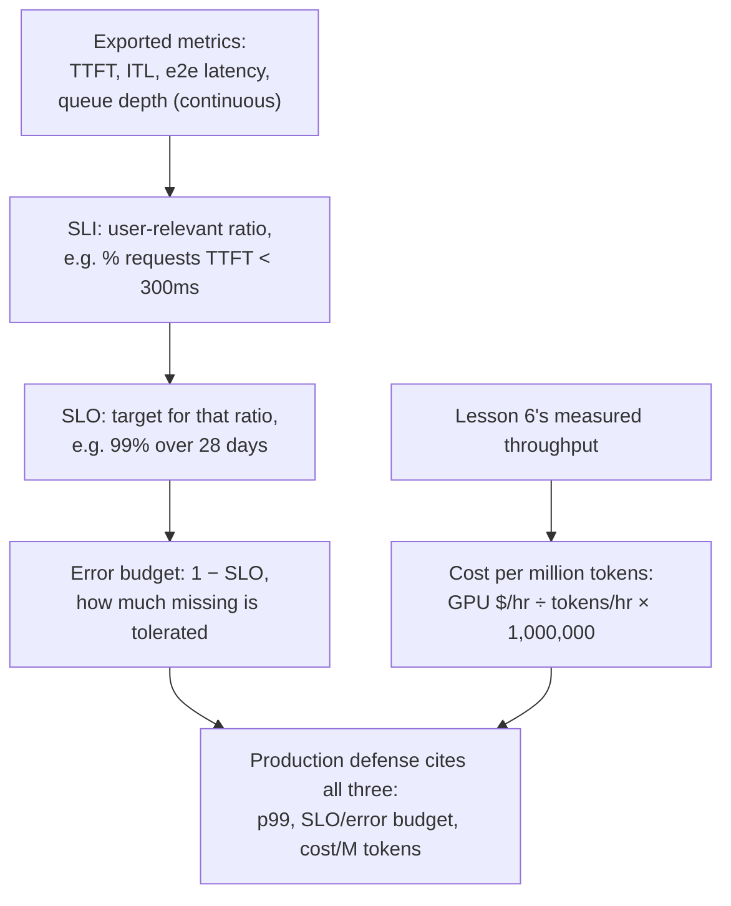

# Урок 23. Наблюдаемость и стоимость в продакшене

**Связь с целью курса:** Урок 17 показал, как защитить одно измеренное значение p99 для одной конфигурации в один момент времени. Для работы этой конфигурации в продакшене нужны ещё три вещи, которые уроку 17 охватывать не приходилось: метрики, **экспортируемые непрерывно**, а не измеренные один раз; **цель уровня обслуживания (SLO)** и **бюджет ошибок**, которые превращают «достаточно хорошо» в заявленную цель, а не в разовый результат бенчмарка; и стоимость **за миллион токенов**, которую нужно защищать наряду с p99, а не вместо него.
**Первоисточник:** [Документация: "Metrics", vLLM Project](https://docs.vllm.ai/en/stable/design/metrics/), [Google SRE Workbook: "Implementing SLOs"](https://sre.google/workbook/implementing-slos/)
**Предварительные требования:** [Урок 16](0016-p99-latency-methodology.md), [Урок 17](0017-defending-a-latency-budget-end-to-end.md)

## Разминка

1. ▢ На какие три вещи, по словам урока 17, должна ссылаться защищённая конфигурация задержки?

Проверка

На сами измеренные значения p99, из достаточно крупной и реалистичной по форме выборки; на рассуждения о памяти и размере батча, стоящие за конфигурацией; и на число по точности, измеренное для той квантизации, которая применялась.

2. ▢ Почему урок 6 говорит, что пропускная способность и задержка на токен обмениваются друг на друга через размер батча?

Проверка

Больший батч держит GPU занятым плотнее на каждом шаге, повышая общее число токенов в секунду по всем запросам (пропускную способность), но каждый отдельный запрос теперь делит время GPU с большим числом соседей, поэтому его собственная задержка на токен растёт. Размер батча это общий параметр, двигающий оба числа в противоположные стороны.

## Что нужно знать

### Что на самом деле экспортируется, непрерывно, а не измеряется один раз

P99 из урока 16 был одним числом, вычисленным по одному прогону бенчмарка. Продакшен-сервер вместо этого непрерывно экспортирует метрики, чтобы регрессия проявлялась сама, без необходимости кому-либо заново прогонять бенчмарк. Собственная документация vLLM по метрикам перечисляет именно этот набор как гистограммы Prometheus: **время до первого токена (TTFT)**, **задержку между токенами (ITL)**, **сквозную задержку запроса** и отдельные **время префилла** и **время декодирования**. Каждая напрямую соответствует фазе, которой это рабочее пространство уже учило: TTFT соответствует префиллу и планировщику (урок 5), ITL соответствует стоимости декодирования, ограниченной пропускной способностью памяти (уроки 2 и 3), а глубина очереди ожидания за обеими соответствует очереди приёма из урока 5 и триггеру автомасштабирования из урока 22. Именно их экспорт превращает разовый диагностический обход из урока 17 в нечто, работающее непрерывно, на каждом запросе, без чьего-либо наблюдения.

### Сырая метрика это не цель; SLI, SLO и бюджет ошибок это цель

Гистограмма значений TTFT это измерение, а не решение. SRE-трактовка превращает её в решение за три шага. **Индикатор уровня обслуживания (service level indicator, SLI)** выбирает из этих сырых данных конкретное, важное для пользователя отношение, например долю запросов с TTFT ниже 300 мс, сформулированное с точки зрения пользователя, а не сервера. **Цель уровня обслуживания (service level objective, SLO)** задаёт цель для этого SLI, например «у 99% запросов TTFT ниже 300 мс, измеряется на скользящем окне в 28 дней». **Бюджет ошибок (error budget)** это остаток, единица минус SLO: при SLO в 99% 1% запросов разрешено не уложиться, и при этом ничто не считается сломанным. Это не более мягкая версия измерения p99 из урока 16; это то, что делает число p99 практичным в продакшене: одно измеренное значение с заявленным допуском на то, как часто ему разрешено срываться, вместо предположения, что оно не сорвётся никогда.

### Бюджет ошибок решает, когда действовать, а не одно лишь сырое число задержки

Когда SLO и его бюджет ошибок существуют, они меняют смысл пропущенного измерения. Один запрос с медленным TTFT сам по себе не проблема: ожидается, что такое будет происходить до доли, которую допускает бюджет ошибок. Важно, расходует ли *доля* промахов бюджет быстрее, чем позволяет окно цели, то есть то различие, которое единичная диагностика из урока 17 никогда не приходилось делать, поскольку она смотрела лишь на результат одного бенчмарка. Команда, быстро сжигающая свой бюджет ошибок, имеет реальную текущую проблему, достойную полного диагностического обхода из урока 17; команда, хорошо укладывающаяся в бюджет, не имеет, даже если TTFT отдельного запроса в отдельности выглядел плохо.

### Стоимость за миллион токенов превращает число пропускной способности из урока 6 в сумму в долларах

Урок 6 уже даёт число, которое для этого нужно: измеренную пропускную способность, токенов в секунду при размере батча, на котором остановилась конфигурация. **Стоимость за миллион токенов (cost per million tokens)** делит часовую стоимость аренды GPU на эту пропускную способность, пересчитанную в токены в час, и приводит к миллиону: `(GPU cost per hour / (throughput in tokens/sec × 3600)) × 1,000,000`. Это та же арифметическая дисциплина, которую источник «Transformer Inference Arithmetic», уже цитировавшийся в этом рабочем пространстве, применяет к задержке и памяти: выводить число из измеренной пропускной способности и известной стоимости оборудования, а не повторять объявленную поставщиком цену за токен, измеренную при размере батча другой нагрузки и не переносимую.

### Продакшен-защита ссылается на все три, а не на один p99

Защищённая конфигурация из урока 17 ссылалась на измеренный p99 и стоящие за ним рассуждения. Продакшен-защита добавляет SLO (и его бюджет ошибок), которыми ограничены экспортируемые метрики, и стоимость за миллион токенов, которую дают размер батча и выбор оборудования конфигурации. Это не конкурирующие числа, которые нужно усреднять: конфигурация с меньшей задержкой (меньший батч, больше GPU) обычно стоит больше за миллион токенов, а более дешёвая конфигурация обычно имеет более широкое SLO или меньший бюджет ошибок, который она может обещать. Защитить продакшен-конфигурацию значит назвать p99, SLO, которым она ограничена, и стоимость, которую даёт это сочетание, и прямо сказать, чем из трёх пожертвовали, чтобы получить остальные, то есть та же дисциплина «чего это на самом деле стоит», которую это рабочее пространство применяло к квантизации, батчингу, а теперь и к деловой стороне того же компромисса.

## Практика

1. ▢ Сервер непрерывно экспортирует гистограмму TTFT в Prometheus. Почему эта гистограмма сама по себе не является целью уровня обслуживания?

Подсказка

Подумайте о том, чего не хватает между сырым измерением и заявленной целью.

Проверка

Гистограмма это лишь измеренные данные; она ничего не говорит о том, что считать приемлемым. SLO требует выбрать из этих данных важное для пользователя отношение (SLI, например долю запросов ниже некоторого порога TTFT) и задать для него цель (например, 99% на 28 дней). Без этого шага есть измерение, но нет цели, относительно которой его держать.

2. ▢ У сервиса SLO в 99% на TTFT ниже 300 мс, измеряемое на скользящем окне в 28 дней. Каков его бюджет ошибок и что это число означает на практике?

Проверка

1% (единица минус SLO в 99%). На практике до 1% запросов в этом 28-дневном окне разрешено иметь TTFT 300 мс или больше, и при этом сервис не считается нарушающим собственную цель; именно бюджет отслеживается, чтобы решить, расходуется ли этот допуск быстрее, чем позволяет окно.

3. ▢ У одного запроса в сервисе, хорошо укладывающемся в бюджет, медленный TTFT. Означает ли этот единичный медленный запрос, что у сервиса проблема?

Проверка

Не сам по себе. Бюджет ошибок существует именно потому, что некоторая доля запросов, как ожидается, не уложится в цель; важно, с какой скоростью расходуется бюджет относительно окна SLO, а не то, что какой-то один запрос оказался промахом. У сервиса, хорошо укладывающегося в бюджет, нет текущей проблемы, даже если TTFT одного запроса в отдельности выглядел плохо.

4. ▢ Команда измеряет пропускную способность 2000 токенов в секунду при выбранном размере батча на GPU, арендуемом за $2,00 в час. Какова их стоимость за миллион токенов?

Проверка

`(2.00 / (2000 × 3600)) × 1,000,000 = (2.00 / 7,200,000) × 1,000,000 ≈ $0.278` за миллион токенов. Значение пропускной способности это ровно измеренное число из урока 6; вычисление лишь переводит его в сумму в долларах, используя известную часовую стоимость GPU.

5. ▢ Какое утверждение верно описывает, на что должна ссылаться защита продакшен-конфигурации помимо единичного измеренного p99 из урока 17?

    - a) Одного значения p99 достаточно; SLO и стоимость это отдельные деловые заботы, не связанные с обслуживанием
    - b) Продакшен-защита добавляет SLO (и его бюджет ошибок), которыми ограничены экспортируемые метрики, и стоимость за миллион токенов, которую даёт конфигурация, поскольку конфигурация с меньшей задержкой обычно стоит больше, а более дешёвая обычно принимает более широкий бюджет
    - c) Стоимость за миллион токенов всегда следует минимизировать независимо от получающейся задержки, поскольку стоимость единственное число, которое важно в продакшене
    - d) Бюджет ошибок заменяет необходимость вообще измерять p99

Проверка

**b)** Это более полная защита, которой требует этот урок, и компромисс между задержкой, допуском SLO и стоимостью, который этот урок называет явно. (a) неверно: один p99 не говорит, каким допуском ограничена метрика и чего на самом деле стоит конфигурация, которая его даёт. (c) неверно: минимизация одной стоимости игнорирует SLO по задержке, который нагрузке реально нужен. (d) неверно: бюджет ошибок выводится из SLO, построенного поверх измеренных метрик вроде p99, а не заменяет их измерение.

## Практика в реальной работе

- [ ] Для стека обслуживания, к которому у вас есть доступ, проверьте, экспортируются ли на самом деле метрики TTFT, ITL и глубины очереди (конечная точка `/metrics` в vLLM или эквивалент) и определено ли относительно них какое-либо SLO.
- [ ] Вычислите собственное значение стоимости за миллион токенов для знакомой вам нагрузки, используя её реальную измеренную пропускную способность и стоимость аренды GPU, а не объявленную поставщиком цену за токен.
- [ ] Завтра: выберите заявленное SLO по задержке для знакомой вам нагрузки (или напишите его) и выясните, какой бюджет ошибок оно подразумевает на реалистичном временном окне (например, 28 дней).

## Что почитать дальше

- [Документация: "Metrics", vLLM Project](https://docs.vllm.ai/en/stable/design/metrics/)
- [Google SRE Workbook: "Implementing SLOs"](https://sre.google/workbook/implementing-slos/)
- [Статья: "Transformer Inference Arithmetic", Kipply](https://kipp.ly/transformer-inference-arithmetic/)
- [Ресурсы](../RESOURCES.md)

---

Не доходит? Перечитайте первоисточник в начале: этот урок его сжимает, а при сжатии понимание как раз и теряется. Загляните в [глоссарий](../GLOSSARY.md), если какой-то термин показался скользким.

Если неясен сам урок, а не материал, это дефект: [откройте issue](https://github.com/TokenCemetery/teach/issues).
