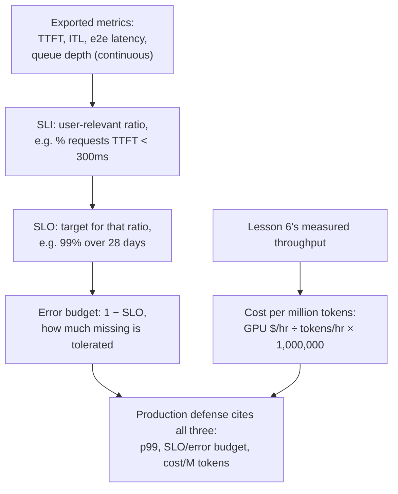

# 第 23 课：生产环境的可观测性与成本

**使命关联:** 第 17 课展示了如何为一套配置、在某一个时间点，辩护一个实测的 p99 数字。在生产环境中运行这套配置，还需要第 17 课从未需要涉及的三样东西：**持续导出**而不是只测一次的指标；把“够好了”变成一个明确的目标、而不是一次性基准测试结果的**服务级别目标（SLO）** 和**错误预算**；以及必须与 p99 一起而不是代替它来辩护的**每百万 token 成本**数字。
**主要来源:** [文档：“Metrics”，vLLM Project](https://docs.vllm.ai/en/stable/design/metrics/)、[Google SRE Workbook：“Implementing SLOs”](https://sre.google/workbook/implementing-slos/)
**前置知识:** [第 16 课](0016-p99-latency-methodology.md)、[第 17 课](0017-defending-a-latency-budget-end-to-end.md)

## 热身

1. ▢ 第 17 课说，一套被辩护的延迟配置必须引用哪三样东西？

检查

实测的 p99 数字本身，来自一个足够大、形状足够真实的样本；配置背后的内存与批大小的推理；以及为所应用的任何量化测得的精度数字。

2. ▢ 为什么第 6 课说，吞吐量和每 token 延迟通过批大小互相权衡？

检查

更大的批次让 GPU 每步更忙，提高了所有请求每秒产出的 token 总数（吞吐量），但每个单独的请求，现在一步中要与更多的邻居分享 GPU 时间，所以它自己的每 token 延迟增长了。批大小就是那个让两个数字朝相反方向变化的共用旋钮。

## 要点

### 实际导出的是什么：持续导出，而不是只测一次

第 16 课的 p99 是从一次基准测试运行中算出的一个数字。而生产服务器则持续导出指标，使退化可以自己浮现出来，不需要任何人重新跑一次基准测试。vLLM 自己的指标文档把这一组恰好列成 Prometheus 直方图：**首 token 延迟（TTFT）**、**token 间延迟（ITL）**、**端到端请求延迟**，以及分开的**预填充时间**和**解码时间**。每一个都直接对应本工作区已经教过的一个阶段：TTFT 对应预填充和调度器（第 5 课），ITL 对应解码受内存带宽限制的开销（第 2 和第 3 课），而它们背后的等待队列深度，对应第 5 课的接纳队列和第 22 课的自动扩缩容触发条件。导出它们，才能把第 17 课那次一次性的诊断流程，变成每个请求都在持续运行、不需要任何人盯着的东西。

### 原始指标不是目标；SLI、SLO 和错误预算才是

TTFT 数值的直方图是一个测量，而不是一个决策。SRE 的表述方式，分三步把它变成决策。**服务级别指标（SLI）** 从那份原始数据里挑出一个具体的、与用户相关的比率，例如 TTFT 低于 300ms 的请求所占的比例，它是从用户的角度，而不是服务器的角度来表述的。**服务级别目标（SLO）** 为那个 SLI 规定一个目标，例如“在滚动的 28 天内，99% 的请求 TTFT 低于 300ms”。**错误预算**是剩下的部分，即 1 减去 SLO：在 99% 的 SLO 下，允许 1% 的请求未达标，而不会被认为出了问题。这不是第 16 课 p99 测量的一个更宽松的版本；它是让 p99 数字在生产环境中可以据以行动的东西，是一个实测的数字，加上对它允许下滑的频率所规定的容忍度，而不是假定它永远不会下滑。

### 决定何时采取行动的，是错误预算，而不是单看原始的延迟数字

一旦有了 SLO 和它的错误预算，它们就改变了一次未达标的测量的含义。TTFT 很慢的单个请求，本身不是问题：它被预期会以错误预算所允许的速率发生。要紧的是，未达标的*速率*是否比目标窗口所允许的更快地消耗着预算，这是第 17 课的单次运行诊断从未需要做出的区分，因为它只看过一次基准测试的结果。一个正在快速烧掉错误预算的团队，有一个真实的、当前的问题，值得走完第 17 课完整的诊断流程；一个完全在预算之内的团队则没有，即使某个单独请求的 TTFT 孤立地看起来很糟。

### 每百万 token 成本，把第 6 课的吞吐量数字变成一个美元数字

第 6 课已经产生了它所需要的那个数字：实测的吞吐量，即一套配置在最终选定的批大小下，每秒生成的 token 数。**每百万 token 成本**把 GPU 的每小时租用成本，除以这个吞吐量（换算成每小时的 token 数），再放大到一百万：`(GPU cost per hour / (throughput in tokens/sec × 3600)) × 1,000,000`。这与本工作区已经引用过的“Transformer Inference Arithmetic”那份来源，对延迟和内存所应用的是同一种算术纪律：从实测的吞吐量和已知的硬件成本推导这个数字，而不是引用供应商广告中的单 token 价格，后者是在另一种工作负载的批大小下测得的，换一种配置就不再适用。

### 生产环境的辩护要引用这三者，而不只是 p99

第 17 课被辩护的配置，引用了一个实测的 p99 及其背后的推理。生产环境的辩护，则要加上导出的指标所对照的 SLO（及其错误预算），以及这套配置的批大小和硬件选择所产生的每百万 token 成本。这些不是要平均到一起的互相竞争的数字：延迟更低的配置（批次更小，GPU 更多）通常每百万 token 的成本更高，而更便宜的配置通常只能承诺更宽的 SLO 或更小的错误预算。为一套生产配置辩护，意味着说明 p99、它所对照的 SLO，以及这个组合所产生的成本，并明确说出为了得到另外两者，三者中哪一个被拿去做了交换，这与本工作区对量化、批处理所应用的“这究竟要花什么代价”是同一种纪律，现在应用到了同一权衡的商业一侧。

## 练习

1. ▢ 一台服务器持续地向 Prometheus 导出 TTFT 直方图。为什么这份直方图本身，还不是一个服务级别目标？

提示

想想在一个原始的测量与一个明确规定的目标之间，缺了什么。

检查

直方图只是测得的数据；它对什么算可以接受只字不提。SLO 要求从那份数据里挑出一个与用户相关的比率（SLI，例如低于某个 TTFT 阈值的请求所占的比例），并为它规定一个目标（例如 28 天内 99%）。没有这一步，就只有测量，没有可以对照的目标。

2. ▢ 一项服务对 TTFT 低于 300ms 设有 99% 的 SLO，在滚动的 28 天窗口内测量。它的错误预算是多少，这个数字在实践中意味着什么？

检查

1%（1 减去 99% 的 SLO）。在实践中，在那 28 天的窗口里，最多有 1% 的请求，TTFT 达到或超过 300ms，而服务仍不会被认为不符合它自己的目标；要追踪的就是这份预算，以此判断这个容忍度是否被比窗口所允许的更快地消耗着。

3. ▢ 一项完全在预算之内的服务中，有一个请求的 TTFT 很慢。这单个慢请求，是否意味着这项服务有问题？

检查

单凭它不能。错误预算存在的原因，正是预期会有一部分请求达不到目标；要紧的，是预算相对于 SLO 窗口被消耗的速率，而不是某个单独的请求碰巧达没达标。一项完全在预算之内的服务，当前没有问题，即使某个请求的 TTFT 孤立地看起来很糟。

4. ▢ 一个团队在他们选定的批大小下，测得吞吐量为 2000 token/秒，使用的 GPU 租价是每小时 $2.00。他们的每百万 token 成本是多少？

检查

`(2.00 / (2000 × 3600)) × 1,000,000 = (2.00 / 7,200,000) × 1,000,000 ≈ $0.278` 每百万 token。吞吐量数字恰好就是第 6 课的实测数字；这个计算只是利用 GPU 已知的每小时成本，把它换算成一个美元数字。

5. ▢ 在第 17 课单个实测的 p99 之外，下面哪种说法正确描述了一套生产配置的辩护需要引用什么？

    - a) 只要 p99 数字就足够了；SLO 和成本是与服务无关的、另外的商业问题
    - b) 生产环境的辩护要加上导出的指标所对照的 SLO（及其错误预算），以及这套配置所产生的每百万 token 成本，因为延迟更低的配置通常成本更高，而更便宜的配置通常接受更宽的预算
    - c) 无论由此产生的延迟如何，都应该总是把每百万 token 成本压到最低，因为成本是生产中唯一要紧的数字
    - d) 错误预算取代了测量 p99 的必要

检查

**b)** 这就是本课所要求的更完整的辩护，以及本课明确点出的、在延迟、SLO 容忍度和成本之间的交换。(a) 是错的：单靠 p99，说不清这个指标所对照的容忍度，也说不清产生它的配置实际要花多少钱。(c) 是错的：只把成本压到最低，忽略了工作负载真正需要的延迟 SLO。(d) 是错的：错误预算是由建立在 p99 这类实测指标之上的 SLO 推导出来的，不是对测量它们的替代。

## 实战练习

- [ ] 对你能用到的某个服务栈，检查 TTFT、ITL 和队列深度指标是否真的被导出（vLLM 的 `/metrics` 端点，或等价的），以及有没有针对它们定义任何 SLO。
- [ ] 针对你熟悉的某个工作负载，用它实际测得的吞吐量和 GPU 租用成本，而不是供应商广告中的单 token 价格，算出你自己的每百万 token 成本数字。
- [ ] 明天：为你熟悉的某个工作负载，选一个规定的延迟 SLO（或者自己写一个），并算出它在一个真实的时间窗口（比如 28 天）内意味着多大的错误预算。

## 延伸阅读

- [文档：“Metrics”，vLLM Project](https://docs.vllm.ai/en/stable/design/metrics/)
- [Google SRE Workbook：“Implementing SLOs”](https://sre.google/workbook/implementing-slos/)
- [文章：“Transformer Inference Arithmetic”，Kipply](https://kipp.ly/transformer-inference-arithmetic/)
- [资源](../RESOURCES.md)

---

没学明白？请重读顶部的主要来源，因为本课是对它的压缩，而理解正是在压缩中流失的。如果有哪个术语觉得含糊，可以查看[术语表](../GLOSSARY.md)。

如果问题出在课程本身，而不是学习材料，那就是一个缺陷：[提交 issue](https://github.com/TokenCemetery/teach/issues)。
