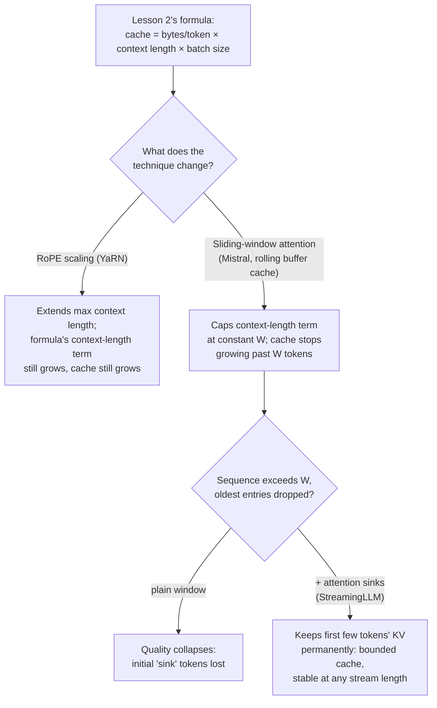

# Lección 24. Contexto largo al servir

**Vínculo con la misión:** La lección 2 dio la fórmula sobre la que corre realmente un presupuesto de capacidad: `total cache bytes = bytes per token × context length × batch size`, con la memoria creciendo de forma lineal con la longitud del contexto. Tres técnicas en tiempo de serving tocan esa fórmula de maneras distintas: el **escalado de RoPE** amplía lo largo que puede manejar un contexto un modelo, sin cambiar en absoluto el crecimiento de la fórmula; la **atención de ventana deslizante** cambia la propia fórmula, limitando la longitud del contexto a una constante; y los **attention sinks** corrigen el único modo de fallo que tiene una ventana deslizante simple, para que ese límite se mantenga de verdad con cualquier longitud de flujo.
**Fuente principal:** [Paper: "YaRN: Efficient Context Window Extension of Large Language Models", Peng et al., ICLR 2024](https://arxiv.org/abs/2309.00071), [Paper: "Mistral 7B", Jiang et al., 2023](https://arxiv.org/abs/2310.06825), [Paper: "Efficient Streaming Language Models with Attention Sinks", Xiao et al., ICLR 2024](https://arxiv.org/abs/2309.17453)
**Requisitos previos:** [Lección 2](0002-capacity-and-batch-size.md), [Lección 3](0003-growth-prefill-decode-precision.md)

## Calentamiento

1. ▢ Escribe de memoria la fórmula de la huella total de la caché de la lección 2.

Comprobación

`total cache bytes = bytes per token × context length × batch size`.

2. ▢ ¿Por qué una longitud de contexto mayor siempre significa una KV cache mayor, manteniendo fijos el tamaño de lote y el modelo?

Comprobación

Cada token adicional necesita que se guarden sus propios vectores key y value en cada capa; el tamaño de la caché es exactamente el costo por token multiplicado por cuántos tokens de caché se retienen, así que más tokens significa proporcionalmente más caché, sin nada en el mecanismo que le permita crecer más despacio que de forma lineal.

## Qué debes saber

### El escalado de RoPE amplía la longitud sin tocar en absoluto la fórmula de la caché

Los rotary position embeddings (RoPE) codifican la posición de un token para que la atención pueda saber lo lejos que están dos tokens; el problema es que un modelo entrenado con una longitud de contexto no generaliza su codificación posicional más allá de esa longitud. El **escalado de RoPE** (el enfoque de YaRN: en lugar de escalar todas las dimensiones de RoPE por el mismo factor, escala menos las dimensiones de alta frecuencia y más las de baja frecuencia, un método dirigido que el paper llama "NTK-by-parts") permite que un modelo maneje secuencias más largas de aquellas con las que se entrenó, a una fracción del costo de fine-tuning de los métodos anteriores. Pero el escalado de RoPE trata puramente de la *codificación posicional*; no cambia nada sobre cuántos keys y values se guardan por token ni cuántos tokens hay en la secuencia. Un contexto más largo manejado mediante escalado de RoPE sigue costando por completo la fórmula de la lección 2: `bytes per token × (now-longer) context length × batch size`. El escalado de RoPE compra longitud; no compra memoria.

### La atención de ventana deslizante limita en cambio la longitud del contexto a una constante

La **atención de ventana deslizante (SWA, sliding-window attention)** de Mistral 7B adopta el enfoque opuesto: en lugar de dejar que cada token atienda a toda la secuencia hasta ese momento, cada token atiende como máximo a `W` tokens previos (el ejemplo de Mistral: `W = 4096`). Junto con la SWA va una **caché de buffer rotativo**: como ningún token necesita nunca más de las `W` posiciones previas de keys y values, la caché solo necesita guardar los de `W` tokens, sobrescribiendo las entradas más antiguas a medida que llegan tokens nuevos, sin importar cuánto crezca la secuencia total. Esto cambia directamente la fórmula de la lección 2: la `context length` en el cálculo de la huella de la caché ya no es la longitud real de la secuencia, sino que queda limitada a la constante `W`, así que la caché deja de crecer cuando una secuencia supera los `W` tokens, sin importar cuánto más larga sea después.

### El alcance teórico a través de capas apiladas es real, pero la caché sigue limitada

Una sola capa solo permite que un token vea `W` tokens atrás, pero las capas apiladas lo amplían: un estado oculto en la capa `k` se nutre indirectamente de información de hasta `W × k` tokens atrás, ya que la propia ventana de la capa `k` atendió a representaciones ya moldeadas por la ventana de la capa `k-1`. La propia cifra de Mistral, `W = 4096` en 32 capas, da un alcance teórico de aproximadamente 131K tokens. Esto es real, pero es un tipo de acceso indirecto y difuso, no lo mismo que atender directamente a un token situado 131K posiciones atrás como haría la atención completa; evaluaciones posteriores encontraron que la precisión de recuperación de la información fuera de la ventana literal de `W` tokens se degrada en la práctica, por lo que este alcance teórico es un techo de lo que se puede alcanzar siquiera, no una garantía de que todo lo que hay dentro sea alcanzable bien. La ganancia en memoria de la caché (un buffer rotativo de tamaño fijo, limitado sin importar la longitud de la secuencia) es la parte que le importa a esta lección; se mantiene sin importar lo bien que se recupere realmente la información lejana.

### Los attention sinks corrigen el modo de fallo real de la atención de ventana

Una ventana deslizante simple, por sí sola, no pierde la información lejana de forma gradual, sino que se rompe: el paper de StreamingLLM muestra que cuando una secuencia supera el tamaño de la ventana y se descartan las entradas antiguas, la calidad colapsa, no se degrada. La causa que identifican es que los primeros tokens de una secuencia absorben puntuaciones de atención desproporcionadamente grandes, sin importar su contenido semántico real, un fenómeno al que llaman **attention sink**. Descartar las entradas de caché de esos tokens iniciales, que una ventana deslizante simple acaba haciendo cuando la secuencia es lo bastante larga, elimina algo de lo que el mecanismo de atención del modelo depende estructuralmente, no solo algo de contexto antiguo. **StreamingLLM** mantiene de forma permanente en la caché las entradas KV de un número pequeño y fijo de tokens iniciales, junto con la ventana deslizante habitual de tokens recientes, y solo esto recupera la mayor parte del rendimiento de la atención completa. La caché sigue siendo pequeña y acotada (un puñado de tokens sink más la ventana deslizante, no todo el historial), pero ahora funciona de verdad con cualquier longitud de flujo, con una estabilidad reportada hasta millones de tokens, en lugar de colapsar cuando se llena la ventana.

### Elegir la correcta depende de qué problema se está resolviendo realmente

El escalado de RoPE responde a "este modelo necesita manejar prompts más largos de aquellos con los que se entrenó", y paga esa longitud con memoria de caché que sigue creciendo exactamente como predice la fórmula de la lección 2; es la herramienta correcta cuando el problema son prompts largos ocasionales y el presupuesto de memoria ya los contempla. La atención de ventana deslizante más los attention sinks responden a otra pregunta, "esta carga de trabajo es un flujo en la práctica ilimitado, y la caché tiene que mantener un tamaño fijo sin importar cuánto tiempo se ejecute", a costa de que la mayoría de los tokens ya no tengan acceso directo a todo el historial. Un despliegue que sirve documentos largos ocasionales necesita lo primero; un despliegue que sirve una sesión de chat abierta que podría durar millones de tokens necesita lo segundo, y confundir ambos significa pagar un crecimiento de caché que un diseño de ventana fija debía evitar, o perder el acceso directo a contexto que un modelo con RoPE escalado debía conservar.

## Práctica

1. ▢ Un modelo se somete a fine-tuning con el escalado de RoPE de YaRN para manejar un contexto de 32K tokens, desde sus 4K originales. Para un lote de secuencias que ahora usan los 32K completos de contexto, ¿cómo se compara la huella de la KV cache con lo que habría predicho la fórmula de la lección 2 con 4K?

Pista

Pregúntate qué cambia realmente el escalado de RoPE sobre la caché.

Comprobación

La huella de la caché crece en los mismos 8x que predice la fórmula de la lección 2 para un contexto 8x más largo (32K frente a 4K), ya que el escalado de RoPE solo cambia la codificación posicional, no cuántos keys y values de tokens se guardan. Amplía lo largo que es un contexto que el modelo puede usar siquiera; no hace nada para reducir lo que cuesta ese contexto en memoria de caché.

2. ▢ Un servidor usa atención de ventana deslizante al estilo de Mistral con `W = 4096` y una caché de buffer rotativo. La secuencia de una solicitud crece hasta 50,000 tokens. ¿Cuál es el tamaño de la caché en ese punto, en comparación con un servidor sin SWA que procesa la misma secuencia?

Comprobación

La caché del servidor con SWA se mantiene limitada a la de `W = 4096` tokens, sin importar la longitud real de 50,000 tokens de la secuencia, ya que el buffer rotativo solo guarda en todo momento los keys y values de los `W` tokens más recientes. Un servidor sin SWA tendría una caché dimensionada para los 50,000 tokens completos, más de 12 veces mayor.

3. ▢ ¿Por qué una ventana deslizante simple (sin attention sinks) sufre un colapso de calidad y no una degradación gradual cuando una secuencia supera el tamaño de la ventana?

Comprobación

Los primeros tokens de una secuencia absorben puntuaciones de atención desproporcionadamente grandes sin importar su contenido, el fenómeno del "attention sink". Cuando la secuencia supera la ventana y se descartan las entradas de caché de esos tokens iniciales, el modelo pierde algo de lo que su mecanismo de atención depende estructuralmente, no solo algo de contexto antiguo y de poco valor, y por eso el efecto es un colapso y no una pérdida suave de información lejana.

4. ▢ ¿Qué añade StreamingLLM sobre una ventana deslizante simple, y qué recupera?

Comprobación

Mantiene de forma permanente en caché las entradas KV de un número pequeño y fijo de tokens iniciales, junto con la ventana deslizante habitual de tokens recientes. Esto recupera la mayor parte de la calidad de la atención completa y permite que el modelo maneje flujos en la práctica ilimitados (con una estabilidad reportada hasta millones de tokens) sin el colapso que sufre una ventana deslizante simple, manteniendo la caché pequeña y acotada, solo los tokens sink más la ventana, no todo el historial.

5. ▢ ¿Qué afirmación distingue correctamente lo que hacen el escalado de RoPE y la ventana deslizante con attention sinks sobre la fórmula de la huella de la caché de la lección 2?

    - a) Ambos reducen la huella de la caché para una longitud de contexto dada
    - b) El escalado de RoPE amplía la longitud de contexto utilizable dejando sin cambios el crecimiento lineal de la fórmula con la longitud del contexto; la atención de ventana deslizante (con los attention sinks corrigiendo su modo de fallo) limita el término de longitud de contexto a una constante, acotando la caché sin importar la longitud del flujo
    - c) La atención de ventana deslizante amplía lo largo que puede manejar un contexto un modelo, el mismo papel que desempeña el escalado de RoPE
    - d) Los attention sinks eliminan por completo la necesidad de una KV cache

Comprobación

**b)** Esa es la distinción precisa que traza esta lección. (a) es falsa: el escalado de RoPE no reduce nada de la caché, amplía la longitud de contexto y la caché crece en consecuencia. (c) es falsa: el escalado de RoPE amplía la longitud máxima utilizable; la atención de ventana deslizante, en cambio, limita la caché sin importar la longitud, una palanca completamente distinta. (d) es falsa: los attention sinks mantienen una caché pequeña (tokens sink más la ventana deslizante), no eliminan la caché.

## Prácticas en el mundo real

- [ ] Para un modelo que planees servir, comprueba si se entrenó con un método de escalado de RoPE (YaRN, NTK-aware o interpolación lineal de posiciones) y qué longitud máxima de contexto apunta ese escalado frente a su longitud original de entrenamiento.
- [ ] Para una carga de trabajo de larga duración o de streaming que tengas en mente, calcula si el crecimiento lineal de la caché de la lección 2 (un modelo con RoPE escalado) o una caché limitada de ventana deslizante más sinks encaja realmente con lo que necesita la carga de trabajo.
- [ ] Mañana: lee la sección del paper de StreamingLLM sobre añadir un token attention-sink dedicado durante el preentrenamiento, y anota qué cambia en comparación con depender de cualquier token temprano que llegue a ser un sink de forma natural.

## Para profundizar

- [Paper: "YaRN: Efficient Context Window Extension of Large Language Models", Peng et al., ICLR 2024](https://arxiv.org/abs/2309.00071)
- [Paper: "Mistral 7B", Jiang et al., 2023](https://arxiv.org/abs/2310.06825)
- [Paper: "Efficient Streaming Language Models with Attention Sinks", Xiao et al., ICLR 2024](https://arxiv.org/abs/2309.17453)
- [Recursos](../RESOURCES.md)

---

¿No termina de quedar claro? Vuelve a leer la fuente primaria de arriba, ya que esta lección la comprime y en la compresión es donde se escapa la comprensión. Consulta el [glosario](../GLOSSARY.md) por si algún término te resultó resbaladizo.

Si lo poco claro es la propia lección y no el material, eso es un defecto: [abre un issue](https://github.com/TokenCemetery/teach/issues).
