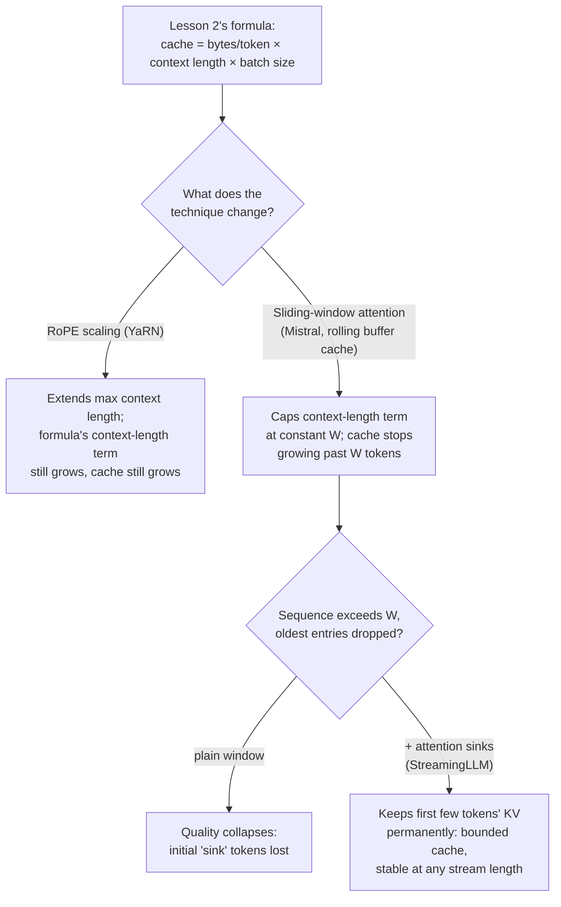

# Leçon 24. Contexte long au moment du serving

**Lien avec la mission :** La leçon 2 a donné la formule sur laquelle un budget de capacité tourne réellement : `total cache bytes = bytes per token × context length × batch size`, la mémoire croissant linéairement avec la longueur du contexte. Trois techniques au moment du serving touchent cette formule de façons différentes : le **RoPE scaling** étend la longueur de contexte qu'un modèle peut traiter, sans rien changer à la croissance de la formule ; l'**attention à fenêtre glissante** change la formule elle-même, en plafonnant la longueur du contexte à une constante ; et les **attention sinks** corrigent le seul mode de défaillance d'une fenêtre glissante simple, pour que ce plafond tienne réellement à toute longueur de flux.
**Source primaire :** [Article : "YaRN: Efficient Context Window Extension of Large Language Models", Peng et al., ICLR 2024](https://arxiv.org/abs/2309.00071), [Article : "Mistral 7B", Jiang et al., 2023](https://arxiv.org/abs/2310.06825), [Article : "Efficient Streaming Language Models with Attention Sinks", Xiao et al., ICLR 2024](https://arxiv.org/abs/2309.17453)
**Prérequis :** [Leçon 2](0002-capacity-and-batch-size.md), [Leçon 3](0003-growth-prefill-decode-precision.md)

## Échauffement

1. ▢ Écrivez de mémoire la formule de l'empreinte totale du cache de la leçon 2.

Vérifier

`total cache bytes = bytes per token × context length × batch size`.

2. ▢ Pourquoi une plus grande longueur de contexte signifie-t-elle toujours un KV cache plus grand, à taille de batch et modèle fixes ?

Vérifier

Chaque token supplémentaire a besoin de ses propres vecteurs de clés et de valeurs stockés à chaque couche ; la taille du cache est exactement le coût par token multiplié par le nombre de tokens dont le cache est conservé, donc plus de tokens signifie proportionnellement plus de cache, sans rien dans le mécanisme qui lui permette de croître plus lentement que linéairement.

## À savoir

### Le RoPE scaling étend la longueur sans toucher du tout à la formule du cache

Les embeddings de position rotatifs (RoPE) encodent la position d'un token pour que l'attention puisse savoir à quelle distance se trouvent deux tokens ; le problème est qu'un modèle entraîné à une longueur de contexte donnée ne généralise pas son encodage positionnel au-delà de cette longueur. Le **RoPE scaling** (l'approche de YaRN : plutôt que de mettre à l'échelle toutes les dimensions de RoPE du même facteur, il met moins à l'échelle les dimensions à haute fréquence et davantage les dimensions à basse fréquence, une méthode ciblée que l'article appelle « NTK-by-parts ») permet à un modèle de traiter des séquences plus longues que celles sur lesquelles il a été entraîné, pour une fraction du coût de fine-tuning des méthodes précédentes. Mais le RoPE scaling ne concerne que l'*encodage positionnel* ; il ne change rien au nombre de clés et de valeurs stockées par token ni au nombre de tokens de la séquence. Un contexte plus long traité par RoPE scaling coûte toujours en entier la formule de la leçon 2 : `bytes per token × (now-longer) context length × batch size`. Le RoPE scaling achète de la longueur ; il n'achète pas de la mémoire.

### L'attention à fenêtre glissante plafonne plutôt la longueur du contexte à une constante

L'**attention à fenêtre glissante (SWA)** de Mistral 7B adopte l'approche inverse : au lieu de laisser chaque token porter son attention sur toute la séquence jusque-là, chaque token porte son attention sur au plus `W` tokens précédents (l'exemple de Mistral : `W = 4096`). La SWA est associée à un **cache à tampon circulaire** : puisqu'aucun token n'a jamais besoin de plus de `W` positions précédentes de clés et de valeurs, le cache n'a jamais besoin de contenir que `W` tokens, en écrasant les entrées les plus anciennes à mesure que de nouveaux tokens arrivent, quelle que soit la longueur que la séquence globale atteint. Cela change directement la formule de la leçon 2 : la `context length` dans le calcul de l'empreinte du cache n'est plus la longueur réelle de la séquence, elle est plafonnée à la constante `W`, si bien que le cache cesse de croître une fois qu'une séquence dépasse `W` tokens, peu importe de combien elle s'allonge ensuite.

### L'étendue théorique à travers les couches empilées est réelle, mais le cache reste plafonné

Une seule couche ne laisse un token voir que `W` tokens en arrière, mais des couches empilées étendent cela : un état caché à la couche `k` s'appuie indirectement sur de l'information jusqu'à `W × k` tokens en arrière, puisque la fenêtre de la couche `k` a elle-même porté son attention sur des représentations déjà façonnées par la propre fenêtre de la couche `k-1`. Le chiffre de Mistral lui-même, `W = 4096` sur 32 couches, donne une étendue théorique d'environ 131K tokens. C'est réel, mais c'est un genre d'accès indirect et diffus, qui n'est pas la même chose que porter directement l'attention sur un token situé 131K positions en arrière comme le ferait l'attention complète ; des évaluations ultérieures ont constaté que la précision de récupération de l'information en dehors de la fenêtre littérale de `W` tokens se dégrade en pratique, ce qui explique que cette étendue théorique soit un plafond de ce qui est atteignable, et non une garantie que tout ce qu'elle contient est bien atteignable. Le gain de mémoire du cache (un tampon circulaire de taille fixe, plafonné quelle que soit la longueur de la séquence) est la partie qui intéresse cette leçon ; il tient quelle que soit la qualité avec laquelle l'information lointaine est réellement récupérée.

### Les attention sinks corrigent le véritable mode de défaillance de l'attention à fenêtre

Une fenêtre glissante simple, à elle seule, ne perd pas simplement l'information lointaine en douceur, elle casse : l'article de StreamingLLM montre qu'une fois qu'une séquence dépasse la taille de la fenêtre et que les anciennes entrées sont abandonnées, la qualité s'effondre, elle ne se dégrade pas. La cause qu'ils identifient est que les tout premiers tokens d'une séquence absorbent des scores d'attention démesurément élevés, quel que soit leur contenu sémantique réel, un phénomène qu'ils nomment l'**attention sink**. Abandonner les entrées de cache de ces tokens initiaux, ce qu'une fenêtre glissante simple finit par faire dès que la séquence est assez longue, retire quelque chose dont le mécanisme d'attention du modèle dépend structurellement, et pas seulement un ancien contexte. **StreamingLLM** conserve en permanence dans le cache les entrées KV d'un petit nombre fixe de tokens initiaux, en plus de la fenêtre glissante habituelle de tokens récents, et cela seul permet de retrouver l'essentiel des performances de l'attention complète. Le cache reste petit et borné (une poignée de tokens sink plus la fenêtre glissante, pas tout l'historique), mais il fonctionne maintenant réellement à toute longueur de flux, avec une stabilité rapportée jusqu'à des millions de tokens, au lieu de s'effondrer dès que la fenêtre se remplit.

### Choisir la bonne technique dépend du problème réellement à résoudre

Le RoPE scaling répond à « ce modèle doit traiter des prompts plus longs que ceux sur lesquels il a été entraîné », et paie cette longueur avec une mémoire de cache qui croît toujours exactement comme la formule de la leçon 2 le prédit ; c'est le bon outil quand de longs prompts occasionnels sont le problème et que le budget mémoire en tient déjà compte. L'attention à fenêtre glissante plus les attention sinks répondent à une autre question, « cette charge de travail est un flux effectivement illimité, et le cache doit rester de taille fixe quelle que soit la durée de son exécution », au prix du fait que la plupart des tokens n'ont plus d'accès direct à tout l'historique. Un déploiement qui sert des documents longs occasionnels a besoin de la première ; un déploiement qui sert une session de chat sans fin pouvant courir sur des millions de tokens a besoin de la seconde, et confondre les deux signifie soit payer une croissance du cache qu'une conception à fenêtre fixe devait éviter, soit perdre l'accès direct à un contexte qu'un modèle avec RoPE scaling devait conserver.

## Pratique

1. ▢ Un modèle est affiné avec le RoPE scaling de YaRN pour traiter un contexte de 32K tokens, au lieu des 4K d'origine. Pour un batch de séquences qui utilisent maintenant tout le contexte de 32K, comment l'empreinte du KV cache se compare-t-elle à ce que la formule de la leçon 2 aurait prédit à 4K ?

Indice

Demandez-vous ce que le RoPE scaling change réellement au cache.

Vérifier

L'empreinte du cache croît du même facteur 8x que la formule de la leçon 2 prédit pour un contexte 8 fois plus long (32K contre 4K), puisque le RoPE scaling ne change que l'encodage positionnel, pas le nombre de clés et de valeurs de tokens stockées. Il étend la longueur de contexte que le modèle peut utiliser ; il ne fait rien pour réduire ce que ce contexte coûte en mémoire de cache.

2. ▢ Un serveur utilise l'attention à fenêtre glissante à la Mistral avec `W = 4096` et un cache à tampon circulaire. La séquence d'une requête atteint 50 000 tokens. Quelle est la taille du cache à ce moment, par rapport à un serveur sans SWA qui traite la même séquence ?

Vérifier

Le cache du serveur SWA reste plafonné à `W = 4096` tokens, quelle que soit la longueur réelle de 50 000 tokens de la séquence, puisque le tampon circulaire ne contient jamais que les clés et les valeurs des `W` tokens les plus récents. Un serveur sans SWA aurait un cache dimensionné pour les 50 000 tokens complets, plus de 12 fois plus grand.

3. ▢ Pourquoi une fenêtre glissante simple (sans attention sinks) subit-elle un effondrement de la qualité plutôt qu'une dégradation progressive une fois qu'une séquence dépasse la taille de la fenêtre ?

Vérifier

Les premiers tokens d'une séquence absorbent des scores d'attention démesurément élevés quel que soit leur contenu, le phénomène d'« attention sink ». Une fois que la séquence dépasse la fenêtre et que les entrées de cache de ces tokens initiaux sont abandonnées, le modèle perd quelque chose sur quoi son mécanisme d'attention s'appuie structurellement, et pas seulement un ancien contexte de faible valeur, ce qui explique que l'effet soit un effondrement plutôt qu'une perte progressive de l'information lointaine.

4. ▢ Qu'ajoute StreamingLLM à une fenêtre glissante simple, et que rachète-t-il ?

Vérifier

Il conserve en permanence en cache les entrées KV d'un petit nombre fixe de tokens initiaux, en plus de la fenêtre glissante habituelle de tokens récents. Cela permet de retrouver l'essentiel de la qualité de l'attention complète et de traiter des flux effectivement illimités (stabilité rapportée jusqu'à des millions de tokens) sans l'effondrement que subit une fenêtre glissante simple, tout en gardant le cache petit et borné, juste les tokens sink plus la fenêtre, pas tout l'historique.

5. ▢ Quelle affirmation distingue correctement ce que le RoPE scaling et l'attention à fenêtre glissante avec attention sinks font chacun à la formule d'empreinte du cache de la leçon 2 ?

    - a) Les deux réduisent l'empreinte du cache pour une longueur de contexte donnée
    - b) Le RoPE scaling étend la longueur de contexte utilisable en laissant inchangée la croissance linéaire de la formule avec la longueur du contexte ; l'attention à fenêtre glissante (avec les attention sinks qui corrigent son mode de défaillance) plafonne le terme de longueur de contexte à une constante, ce qui borne le cache quelle que soit la longueur du flux
    - c) L'attention à fenêtre glissante étend la longueur de contexte qu'un modèle peut traiter, le même rôle que joue le RoPE scaling
    - d) Les attention sinks suppriment entièrement le besoin d'un KV cache

Vérifier

**b)** C'est la distinction précise que trace cette leçon. (a) est fausse : le RoPE scaling ne réduit rien au cache, il étend la longueur de contexte et le cache croît en conséquence. (c) est fausse : le RoPE scaling étend la longueur maximale utilisable ; l'attention à fenêtre glissante plafonne plutôt le cache quelle que soit la longueur, un levier entièrement différent. (d) est fausse : les attention sinks gardent un petit cache (tokens sink plus fenêtre glissante), ils ne suppriment pas le cache.

## Exercices en situation réelle

- [ ] Pour un modèle que vous prévoyez de servir, vérifiez s'il a été entraîné avec une méthode de RoPE scaling (YaRN, NTK-aware, ou interpolation linéaire des positions) et quelle longueur de contexte maximale ce scaling vise par rapport à sa longueur d'entraînement d'origine.
- [ ] Pour une charge de travail de longue durée ou en flux que vous avez en tête, déterminez si la croissance linéaire du cache de la leçon 2 (un modèle avec RoPE scaling) ou un cache plafonné, à fenêtre glissante plus sinks, correspond réellement à ce dont la charge de travail a besoin.
- [ ] Demain : lisez la section de l'article StreamingLLM sur l'ajout d'un token d'attention sink dédié pendant le pré-entraînement, et notez ce que cela change par rapport au fait de compter sur le token précoce qui devient naturellement un sink.

## Pour aller plus loin

- [Article : "YaRN: Efficient Context Window Extension of Large Language Models", Peng et al., ICLR 2024](https://arxiv.org/abs/2309.00071)
- [Article : "Mistral 7B", Jiang et al., 2023](https://arxiv.org/abs/2310.06825)
- [Article : "Efficient Streaming Language Models with Attention Sinks", Xiao et al., ICLR 2024](https://arxiv.org/abs/2309.17453)
- [Ressources](../RESOURCES.md)

---

Ça ne passe pas ? Relisez la source primaire en haut de page, car cette leçon la condense et c'est dans la condensation que la compréhension s'échappe. Consultez le [glossaire](../GLOSSARY.md) pour tout terme qui vous a paru glissant.

Si c'est la leçon elle-même qui n'est pas claire plutôt que la matière, c'est un défaut : [ouvrez une issue](https://github.com/TokenCemetery/teach/issues).
