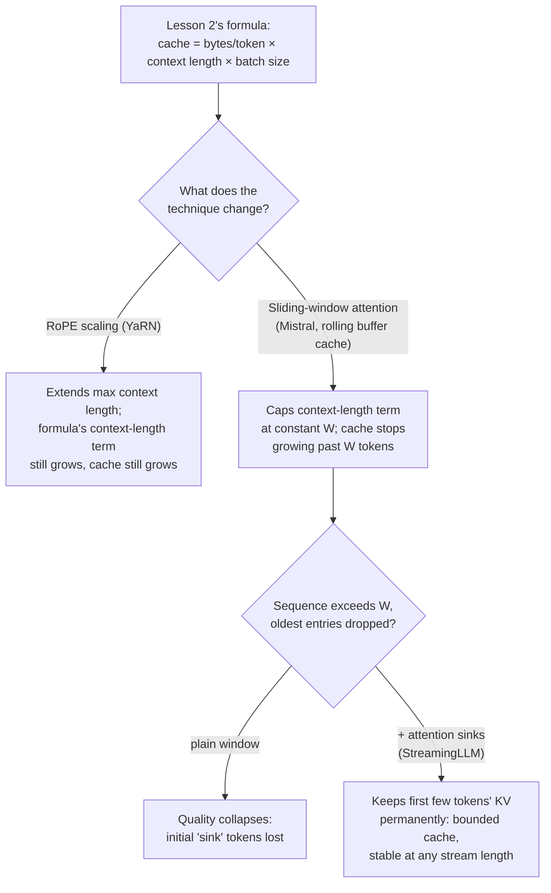

# पाठ 24. Serve Time पर Long Context

**मिशन से संबंध:** पाठ 2 ने वह formula दिया जिस पर capacity budget असल में चलता है: `total cache bytes = bytes per token × context length × batch size`, यानी memory context length के साथ रैखिक रूप से बढ़ती है। तीन serving-time तकनीकें उस formula को अलग-अलग तरह छूती हैं: **RoPE scaling** यह बढ़ाती है कि model कितना लंबा context सँभाल सकता है, formula की बढ़त को बिल्कुल बदले बिना; **sliding-window attention** formula को ही बदल देती है, context length को एक स्थिरांक पर सीमित करके; और **attention sinks** सादी sliding window की एक विफलता को ठीक करते हैं, ताकि वह सीमा किसी भी stream length पर सचमुच टिकी रहे।
**मुख्य स्रोत:** [पेपर: "YaRN: Efficient Context Window Extension of Large Language Models", Peng et al., ICLR 2024](https://arxiv.org/abs/2309.00071), [पेपर: "Mistral 7B", Jiang et al., 2023](https://arxiv.org/abs/2310.06825), [पेपर: "Efficient Streaming Language Models with Attention Sinks", Xiao et al., ICLR 2024](https://arxiv.org/abs/2309.17453)
**पूर्व-आवश्यकताएँ:** [पाठ 2](0002-capacity-and-batch-size.md), [पाठ 3](0003-growth-prefill-decode-precision.md)

## वार्म-अप

1. ▢ पाठ 2 का कुल cache footprint formula याददाश्त से लिखें।

जाँचें

`total cache bytes = bytes per token × context length × batch size`।

2. ▢ Batch size और model को स्थिर रखने पर, लंबी context length का मतलब हमेशा बड़ा KV cache क्यों होता है?

जाँचें

हर अतिरिक्त token को हर layer पर अपने key और value vectors सहेजने पड़ते हैं; cache का आकार ठीक प्रति-token लागत गुणा उतने tokens है जितनों का cache रखा जा रहा है, इसलिए ज़्यादा tokens का मतलब अनुपात में ज़्यादा cache, और तंत्र में कुछ भी उसे रैखिक से धीमा बढ़ने नहीं देता।

## यह जानें

### RoPE scaling लंबाई बढ़ाती है, cache formula को बिल्कुल छुए बिना

Rotary position embeddings (RoPE) किसी token की position encode करते हैं ताकि attention जान सके कि दो tokens कितनी दूर हैं; समस्या यह है कि एक context length पर train हुआ model अपनी positional encoding को उस length से आगे सामान्यीकृत नहीं करता। **RoPE scaling** (YaRN का तरीक़ा: हर RoPE dimension को एक ही गुणक से scale करने के बजाय, वह high-frequency dimensions को कम और low-frequency dimensions को ज़्यादा scale करता है, एक लक्षित विधि जिसे पेपर "NTK-by-parts" कहता है) model को उससे लंबे sequences सँभालने देता है जिन पर वह train हुआ था, पहले के तरीक़ों की fine-tuning लागत के एक अंश पर। पर RoPE scaling पूरी तरह *positional encoding* के बारे में है; वह इसमें कुछ नहीं बदलती कि प्रति token कितने keys और values सहेजे जाते हैं या sequence में कितने tokens हैं। RoPE scaling से सँभाला गया लंबा context भी पाठ 2 के formula की पूरी क़ीमत लेता है: `bytes per token × (अब-लंबी) context length × batch size`। RoPE scaling लंबाई ख़रीदती है; memory नहीं।

### Sliding-window attention इसके बजाय context length को एक स्थिरांक पर सीमित करती है

Mistral 7B की **sliding-window attention (SWA)** उल्टा तरीक़ा अपनाती है: हर token को अब तक के पूरे sequence पर attend करने देने के बजाय, हर token ज़्यादा से ज़्यादा `W` पिछले tokens पर attend करता है (Mistral का उदाहरण: `W = 4096`)। SWA के साथ जुड़ा है **rolling buffer cache**: क्योंकि किसी token को कभी `W` से ज़्यादा पिछले positions के keys और values नहीं चाहिए, cache को सिर्फ़ `W` tokens जितना ही रखना पड़ता है, नए tokens आने पर सबसे पुरानी entries को overwrite करते हुए, चाहे कुल sequence कितना भी लंबा हो जाए। यह पाठ 2 के formula को सीधे बदल देता है: cache-footprint की गणना में `context length` अब sequence की असली length नहीं, बल्कि स्थिरांक `W` पर सीमित है, इसलिए sequence के `W` tokens पार करने के बाद cache बढ़ना बंद कर देता है, उसके बाद वह कितना भी लंबा हो।

### Stacked layers के ज़रिए सैद्धांतिक फैलाव असली है, पर cache सीमित रहता है

एक अकेली layer token को सिर्फ़ `W` tokens पीछे तक देखने देती है, पर stacked layers इसे बढ़ाती हैं: layer `k` पर की hidden state परोक्ष रूप से `W × k` tokens पीछे तक की जानकारी लेती है, क्योंकि layer `k` की अपनी window उन representations पर attend कर चुकी थी जो layer `k-1` की अपनी window से आकार ले चुके थे। Mistral का अपना आँकड़ा, 32 layers पर `W = 4096`, लगभग 131K tokens का सैद्धांतिक फैलाव देता है। यह असली है, पर यह परोक्ष, फैली हुई क़िस्म की पहुँच है, उसी के बराबर नहीं जैसे full attention 131K positions पीछे के token पर सीधे attend करती, बाद के मूल्यांकनों में पाया गया कि शाब्दिक `W`-token window के बाहर की जानकारी का retrieval accuracy व्यवहार में गिरता है, इसीलिए यह सैद्धांतिक फैलाव इस बात की ऊपरी सीमा है कि कितना पहुँचने योग्य है, इसकी गारंटी नहीं कि उसके भीतर का सब कुछ अच्छी तरह पहुँचने योग्य है। Cache-memory की जीत (निश्चित आकार का rolling buffer, sequence length कुछ भी हो सीमित) वह हिस्सा है जिसकी इस पाठ को परवाह है; वह इससे स्वतंत्र टिकती है कि दूर की जानकारी असल में कितनी अच्छी तरह retrieve होती है।

### Attention sinks window attention की असली विफलता ठीक करते हैं

सादी sliding window, अकेली, दूर की जानकारी को सिर्फ़ धीरे-धीरे नहीं खोती, वह टूट जाती है: StreamingLLM का पेपर दिखाता है कि sequence के window size पार करते और पुरानी entries हटते ही गुणवत्ता ढह जाती है, धीरे-धीरे घटती नहीं। जो कारण वे पहचानते हैं वह यह है कि sequence के सबसे पहले कुछ tokens अपनी असली अर्थ-सामग्री से परे असमान रूप से बड़े attention scores सोख लेते हैं, एक घटना जिसे वे **attention sink** नाम देते हैं। उन शुरुआती tokens की cache entries हटाना, जो सादी sliding window अंततः तब करती है जब sequence काफ़ी लंबा हो जाए, ऐसी चीज़ हटाता है जिस पर model का attention तंत्र structurally निर्भर है, सिर्फ़ कुछ पुराना context नहीं। **StreamingLLM** शुरुआती tokens की एक छोटी, निश्चित संख्या की KV entries को हाल के tokens की आम sliding window के साथ स्थायी रूप से cache में रखता है, और अकेला यही full attention का ज़्यादातर प्रदर्शन लौटा देता है। Cache छोटा और सीमित रहता है (मुट्ठी भर sink tokens और sliding window, पूरा इतिहास नहीं), पर अब वह किसी भी stream length पर सचमुच काम करता है, लाखों tokens तक स्थिर रिपोर्ट किया गया, window भरते ही ढहने के बजाय।

### सही वाला चुनना इस पर निर्भर है कि असल में कौन-सी समस्या हल हो रही है

RoPE scaling जवाब देती है "इस model को उससे लंबे prompts सँभालने हैं जिन पर वह train हुआ था", और उस लंबाई की क़ीमत उस cache memory से चुकाती है जो ठीक वैसे बढ़ती रहती है जैसा पाठ 2 का formula अनुमान लगाता है; यह तब सही औज़ार है जब कभी-कभार लंबे prompts समस्या हों और memory budget उन्हें पहले से गिन चुका हो। Sliding-window attention और attention sinks अलग सवाल का जवाब देते हैं, "यह workload असल में असीमित stream है, और cache को एक निश्चित आकार पर रहना है चाहे वह कितना भी चले", इस क़ीमत पर कि ज़्यादातर tokens की अब पूरे इतिहास तक सीधी पहुँच नहीं रहती। कभी-कभार लंबे documents serve करने वाले deployment को पहला चाहिए; खुले-छोर वाले chat session को, जो लाखों tokens तक चल सकता है, दूसरा चाहिए, और दोनों को मिला देने का मतलब या तो उस cache बढ़त की क़ीमत चुकाना है जिससे निश्चित-window design को बचाना था, या उस context तक सीधी पहुँच खोना जिसे RoPE-scaled model को बचाए रखना था।

## अभ्यास

1. ▢ एक model को YaRN की RoPE scaling से fine-tune किया गया है ताकि वह 32K-token का context सँभाले, अपने मूल 4K से ऊपर। पूरे 32K context का इस्तेमाल करने वाले sequences के batch के लिए, KV cache footprint की तुलना उससे कैसे होती है जो पाठ 2 का formula 4K पर अनुमान लगाता?

संकेत

पूछें कि RoPE scaling cache के बारे में असल में क्या बदलती है।

जाँचें

Cache footprint उसी 8 गुना से बढ़ता है जो पाठ 2 का formula 8 गुना लंबे context (32K बनाम 4K) के लिए अनुमान लगाता है, क्योंकि RoPE scaling सिर्फ़ positional encoding बदलती है, यह नहीं कि कितने tokens के keys और values सहेजे जाते हैं। वह यह बढ़ाती है कि model कितना लंबा context इस्तेमाल कर सकता है; वह उस context की cache memory में क्या क़ीमत है उसे घटाने के लिए कुछ नहीं करती।

2. ▢ एक server `W = 4096` और rolling buffer cache के साथ Mistral-शैली की sliding-window attention इस्तेमाल करता है। एक request का sequence 50,000 tokens तक बढ़ जाता है। उस बिंदु पर cache का आकार क्या है, उसी sequence को process करने वाले बिना SWA के server की तुलना में?

जाँचें

SWA वाले server का cache `W = 4096` tokens जितने पर सीमित रहता है, sequence की असली 50,000-token length चाहे जो हो, क्योंकि rolling buffer सिर्फ़ सबसे हाल के `W` tokens के keys और values रखता है। बिना SWA वाले server के cache का आकार पूरे 50,000 tokens के लिए होता, 12 गुना से ज़्यादा बड़ा।

3. ▢ सादी sliding window (बिना attention sinks के) sequence के window size से बढ़ने पर धीरे-धीरे घटने के बजाय गुणवत्ता का ढहना क्यों झेलती है?

जाँचें

Sequence के सबसे पहले कुछ tokens अपनी सामग्री से परे असमान रूप से बड़े attention scores सोख लेते हैं, यानी "attention sink" की घटना। जब sequence window से बढ़ जाता है और उन शुरुआती tokens की cache entries हटा दी जाती हैं, तो model ऐसी चीज़ खो देता है जिस पर उसका attention तंत्र structurally निर्भर है, सिर्फ़ कुछ पुराना, कम मूल्य का context नहीं, और इसीलिए असर दूर की जानकारी के धीरे-धीरे खोने के बजाय ढहने जैसा होता है।

4. ▢ StreamingLLM सादी sliding window के ऊपर क्या जोड़ता है, और वह क्या लौटाता है?

जाँचें

वह शुरुआती tokens की एक छोटी, निश्चित संख्या की KV entries को हाल के tokens की आम sliding window के साथ स्थायी रूप से cached रखता है। यह full attention की ज़्यादातर गुणवत्ता लौटाता है और model को प्रभावी रूप से असीमित streams (लाखों tokens तक स्थिर रिपोर्ट किया गया) सँभालने देता है, उस ढहने के बिना जो सादी sliding window झेलती है, और cache को छोटा और सीमित रखते हुए, बस sink tokens और window, पूरा इतिहास नहीं।

5. ▢ कौन-सा दावा सही फ़र्क़ करता है कि RoPE scaling और sliding-window-plus-attention-sinks हर एक पाठ 2 के cache-footprint formula के साथ क्या करते हैं?

    - a) दोनों किसी दी हुई context length के लिए cache footprint घटाते हैं
    - b) RoPE scaling उपयोगी context length बढ़ाती है जबकि formula की context length में रैखिक बढ़त को जस का तस छोड़ती है; sliding-window attention (उसकी विफलता ठीक करने वाले attention sinks के साथ) context-length पद को एक स्थिरांक पर सीमित करती है, stream length कुछ भी हो cache को बाँधती है
    - c) Sliding-window attention model के सँभाल सकने वाले context की लंबाई बढ़ाती है, वही भूमिका जो RoPE scaling निभाती है
    - d) Attention sinks KV cache की ज़रूरत को पूरी तरह ख़त्म कर देते हैं

जाँचें

**b)** यही वह सटीक फ़र्क़ है जो यह पाठ खींचता है। (a) ग़लत है: RoPE scaling cache के बारे में कुछ नहीं घटाती, वह context length बढ़ाती है और cache उसी हिसाब से बढ़ता है। (c) ग़लत है: RoPE scaling अधिकतम उपयोगी length बढ़ाती है; sliding-window attention इसके बजाय length कुछ भी हो cache को सीमित करती है, जो बिल्कुल अलग उपाय है। (d) ग़लत है: attention sinks छोटा cache रखते हैं (sink tokens और sliding window), वे cache हटाते नहीं।

## असली दुनिया का अभ्यास

- [ ] जिस model को आप serve करने की सोच रहे हैं, उसके लिए जाँचें कि वह किसी RoPE-scaling विधि (YaRN, NTK-aware, या linear position interpolation) से train हुआ था या नहीं, और वह scaling अपनी मूल trained length के मुक़ाबले कौन-सी अधिकतम context length को लक्ष्य करती है।
- [ ] किसी लंबे समय तक चलने वाले या streaming workload के लिए, जिसके बारे में आप सोच रहे हैं, निकालें कि पाठ 2 की रैखिक cache बढ़त (RoPE-scaled model) या सीमित, sliding-window-plus-sink cache में से कौन-सा workload की ज़रूरत से असल में मेल खाता है।
- [ ] कल: StreamingLLM पेपर का वह खंड पढ़ें जो pre-training के दौरान एक समर्पित attention-sink token जोड़ने के बारे में है, और नोट करें कि वह उस पर निर्भर रहने की तुलना में क्या बदलता है जो कोई भी शुरुआती token संयोग से स्वाभाविक रूप से sink बन जाए।

## आगे बढ़ने के लिए

- [पेपर: "YaRN: Efficient Context Window Extension of Large Language Models", Peng et al., ICLR 2024](https://arxiv.org/abs/2309.00071)
- [पेपर: "Mistral 7B", Jiang et al., 2023](https://arxiv.org/abs/2310.06825)
- [पेपर: "Efficient Streaming Language Models with Attention Sinks", Xiao et al., ICLR 2024](https://arxiv.org/abs/2309.17453)
- [संसाधन](../RESOURCES.md)

---

बात नहीं बन रही? ऊपर दिए मुख्य स्रोत को दोबारा पढ़ें, क्योंकि यह पाठ उसे संक्षिप्त करता है और समझ संक्षेप में ही रिसती है। जो शब्द फिसलन भरा लगे, उसके लिए [शब्दावली](../GLOSSARY.md) देखें।

अगर दिक़्क़त सामग्री की नहीं बल्कि पाठ की ही है, तो वह एक खोट है: [issue खोलें](https://github.com/TokenCemetery/teach/issues)।
