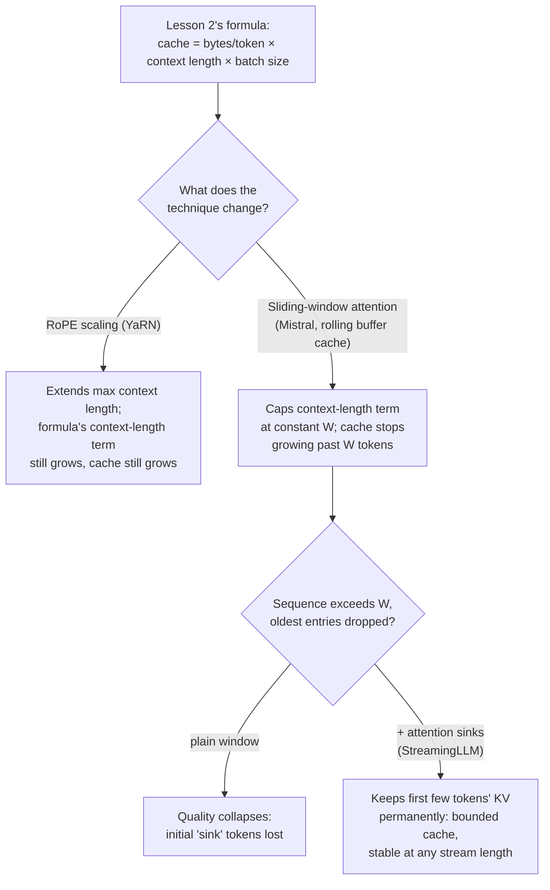

# Lição 24. Contexto longo no serving

**Ligação com a missão:** A lição 2 deu a fórmula em que um orçamento de capacidade realmente roda: `total cache bytes = bytes per token × context length × batch size`, com a memória crescendo linearmente com o comprimento do contexto. Três técnicas de tempo de serving tocam essa fórmula de maneiras diferentes: o **RoPE scaling** estende o tamanho de contexto que um modelo consegue tratar, sem mudar em nada o crescimento da fórmula; a **atenção de janela deslizante** muda a própria fórmula, limitando o comprimento do contexto a uma constante; e os **attention sinks** corrigem o único modo de falha que uma janela deslizante simples tem, de modo que esse limite realmente se sustente em qualquer comprimento de stream.
**Fonte principal:** [Artigo científico: "YaRN: Efficient Context Window Extension of Large Language Models", Peng et al., ICLR 2024](https://arxiv.org/abs/2309.00071), [Artigo científico: "Mistral 7B", Jiang et al., 2023](https://arxiv.org/abs/2310.06825), [Artigo científico: "Efficient Streaming Language Models with Attention Sinks", Xiao et al., ICLR 2024](https://arxiv.org/abs/2309.17453)
**Pré-requisitos:** [Lição 2](0002-capacity-and-batch-size.md), [Lição 3](0003-growth-prefill-decode-precision.md)

## Aquecimento

1. ▢ Escreva de memória a fórmula da pegada total de cache da lição 2.

Verificação

`total cache bytes = bytes per token × context length × batch size`.

2. ▢ Por que um comprimento de contexto maior sempre significa um KV cache maior, mantendo fixos o batch size e o modelo?

Verificação

Todo token adicional precisa dos seus próprios vetores de key e value armazenados em cada camada; o tamanho do cache é exatamente o custo por token multiplicado por quantos tokens de cache estão sendo mantidos, então mais tokens significa proporcionalmente mais cache, sem nada no mecanismo que o deixe crescer mais devagar do que linearmente.

## Saiba isto

### O RoPE scaling estende o comprimento sem tocar na fórmula do cache

Os rotary position embeddings (RoPE) codificam a posição de um token para que a atenção consiga saber a que distância dois tokens estão; o problema é que um modelo treinado em um comprimento de contexto não generaliza a sua codificação posicional além desse comprimento. O **RoPE scaling** (a abordagem do YaRN: em vez de escalar toda dimensão do RoPE pelo mesmo fator, ele escala menos as dimensões de alta frequência e mais as de baixa frequência, um método direcionado que o artigo chama de "NTK-by-parts") permite que um modelo trate sequências mais longas do que aquelas em que foi treinado, a uma fração do custo de fine-tuning dos métodos anteriores. Mas o RoPE scaling diz respeito apenas à *codificação posicional*; ele não muda nada em quantas keys e values são armazenadas por token nem em quantos tokens há na sequência. Um contexto mais longo tratado via RoPE scaling ainda custa a fórmula da lição 2 por inteiro: `bytes per token × (now-longer) context length × batch size`. O RoPE scaling compra comprimento; não compra memória.

### A atenção de janela deslizante limita o comprimento do contexto a uma constante

A **atenção de janela deslizante (SWA)** do Mistral 7B segue a abordagem oposta: em vez de deixar cada token atender a toda a sequência até ali, cada token atende no máximo a `W` tokens anteriores (o exemplo do Mistral: `W = 4096`). Associado à SWA vem um **cache em buffer rotativo**: como nenhum token precisa de mais do que as keys e values de `W` posições anteriores, o cache só precisa guardar `W` tokens, sobrescrevendo as entradas mais antigas conforme novos tokens chegam, independentemente de quanto a sequência total cresça. Isso muda diretamente a fórmula da lição 2: `context length` no cálculo da pegada do cache deixa de ser o comprimento real da sequência e passa a ser limitado pela constante `W`, então o cache para de crescer quando uma sequência passa de `W` tokens, não importa quanto ela ainda aumente depois disso.

### O alcance teórico por camadas empilhadas é real, mas o cache continua limitado

Uma única camada só deixa um token ver `W` tokens para trás, mas camadas empilhadas estendem isso: um estado oculto na camada `k` se apoia indiretamente em informação de até `W × k` tokens atrás, já que a própria janela da camada `k` atendeu a representações já moldadas pela janela da camada `k-1`. O próprio número do Mistral, `W = 4096` em 32 camadas, dá um alcance teórico de aproximadamente 131K tokens. Isso é real, mas é um tipo de acesso indireto e difuso, e não o mesmo que atender diretamente a um token 131K posições atrás como a atenção completa faria; avaliações posteriores constataram que a acurácia de recuperação de informação fora da janela literal de `W` tokens se degrada na prática, e é por isso que esse alcance teórico é um teto do que é alcançável, e não uma garantia de que tudo dentro dele seja alcançável bem. O ganho de memória de cache (um buffer rotativo de tamanho fixo, limitado independentemente do comprimento da sequência) é a parte de que esta lição se ocupa; ele vale independentemente de quão bem a informação distante é de fato recuperada.

### Os attention sinks corrigem o modo de falha real da atenção de janela

Uma janela deslizante simples, sozinha, não perde informação distante de forma gradual, ela quebra: o artigo do StreamingLLM mostra que, depois de a sequência passar do tamanho da janela e as entradas antigas serem descartadas, a qualidade colapsa, e não degrada. A causa que eles identificam é que os primeiros poucos tokens de uma sequência absorvem pontuações de atenção desproporcionalmente grandes, independentemente do seu conteúdo semântico real, um fenômeno que eles chamam de **attention sink**. Descartar as entradas de cache desses tokens iniciais, o que uma janela deslizante simples acaba fazendo quando a sequência fica longa o bastante, remove algo de que o mecanismo de atenção do modelo depende estruturalmente, e não apenas algum contexto antigo. O **StreamingLLM** mantém permanentemente no cache as entradas de KV de um pequeno número fixo de tokens iniciais, junto com a janela deslizante usual de tokens recentes, e só isso recupera a maior parte do desempenho da atenção completa. O cache continua pequeno e limitado (um punhado de sink tokens mais a janela deslizante, e não o histórico inteiro), mas agora funciona de fato em qualquer comprimento de stream, reportado estável até milhões de tokens, em vez de colapsar quando a janela enche.

### Escolher a certa depende de qual problema está realmente sendo resolvido

O RoPE scaling responde a "este modelo precisa tratar prompts mais longos do que aqueles em que foi treinado" e paga por esse comprimento com uma memória de cache que ainda cresce exatamente como a fórmula da lição 2 prevê; é a ferramenta certa quando prompts longos ocasionais são o problema e o orçamento de memória já os contempla. A atenção de janela deslizante mais os attention sinks respondem a outra pergunta, "esta carga de trabalho é um stream efetivamente ilimitado, e o cache precisa continuar de tamanho fixo por mais tempo que ela rode", ao custo de a maioria dos tokens deixar de ter acesso direto ao histórico inteiro. Um deployment que serve documentos longos ocasionais precisa da primeira; um deployment que serve uma sessão de chat aberta, que pode durar milhões de tokens, precisa da segunda, e confundir as duas significa ou pagar por um crescimento de cache que um design de janela fixa devia evitar, ou perder o acesso direto a um contexto que um modelo com RoPE scaling devia manter.

## Prática

1. ▢ Um modelo passa por fine-tuning com o RoPE scaling do YaRN para tratar um contexto de 32K tokens, acima dos 4K originais. Para um batch de sequências usando agora o contexto completo de 32K, como a pegada do KV cache se compara ao que a fórmula da lição 2 teria previsto em 4K?

Dica

Pergunte o que o RoPE scaling realmente muda no cache.

Verificação

A pegada do cache cresce nos mesmos 8x que a fórmula da lição 2 prevê para um contexto 8x mais longo (32K vs 4K), já que o RoPE scaling só muda a codificação posicional, e não quantos tokens de keys e values são armazenados. Ele estende o tamanho de contexto que o modelo consegue usar; não faz nada para reduzir o que esse contexto custa em memória de cache.

2. ▢ Um servidor usa atenção de janela deslizante no estilo Mistral com `W = 4096` e um cache em buffer rotativo. A sequência de uma requisição cresce até 50.000 tokens. Qual é o tamanho do cache nesse ponto, em comparação com um servidor sem SWA processando a mesma sequência?

Verificação

O cache do servidor com SWA continua limitado a `W = 4096` tokens, independentemente do comprimento real de 50.000 tokens da sequência, já que o buffer rotativo só guarda as keys e values dos `W` tokens mais recentes. Um servidor sem SWA teria um cache dimensionado para os 50.000 tokens inteiros, mais de 12 vezes maior.

3. ▢ Por que uma janela deslizante simples (sem attention sinks) sofre um colapso de qualidade em vez de uma degradação gradual quando uma sequência passa do tamanho da janela?

Verificação

Os primeiros poucos tokens de uma sequência absorvem pontuações de atenção desproporcionalmente grandes, independentemente do seu conteúdo, o fenômeno do "attention sink". Quando a sequência passa da janela e as entradas de cache desses tokens iniciais são descartadas, o modelo perde algo em que o seu mecanismo de atenção se apoia estruturalmente, e não apenas algum contexto antigo e de baixo valor, e é por isso que o efeito é um colapso e não uma perda suave de informação distante.

4. ▢ O que o StreamingLLM acrescenta a uma janela deslizante simples, e o que ele devolve?

Verificação

Ele mantém permanentemente em cache as entradas de KV de um pequeno número fixo de tokens iniciais, junto com a janela deslizante usual de tokens recentes. Isso recupera a maior parte da qualidade da atenção completa e permite ao modelo tratar streams efetivamente ilimitados (reportado estável até milhões de tokens) sem o colapso que uma janela deslizante simples sofre, mantendo o cache pequeno e limitado, apenas os sink tokens mais a janela, e não o histórico inteiro.

5. ▢ Qual afirmação distingue corretamente o que o RoPE scaling e a janela deslizante mais attention sinks fazem, cada um, com a fórmula de pegada de cache da lição 2?

    - a) Os dois reduzem a pegada do cache para um dado comprimento de contexto
    - b) O RoPE scaling estende o comprimento de contexto utilizável deixando inalterado o crescimento linear da fórmula com o comprimento do contexto; a atenção de janela deslizante (com attention sinks corrigindo o seu modo de falha) limita o termo de comprimento de contexto a uma constante, limitando o cache independentemente do comprimento do stream
    - c) A atenção de janela deslizante estende o tamanho de contexto que um modelo consegue tratar, o mesmo papel que o RoPE scaling cumpre
    - d) Os attention sinks eliminam por completo a necessidade de um KV cache

Verificação

**b)** Essa é a distinção precisa que esta lição traça. (a) é falsa: o RoPE scaling não reduz nada no cache, ele estende o comprimento do contexto e o cache cresce de acordo. (c) é falsa: o RoPE scaling estende o comprimento máximo utilizável; a atenção de janela deslizante, em vez disso, limita o cache independentemente do comprimento, uma alavanca completamente diferente. (d) é falsa: os attention sinks mantêm um cache pequeno (sink tokens mais a janela deslizante), eles não removem o cache.

## Prática no mundo real

- [ ] Para um modelo que você pretende servir, verifique se ele foi treinado com um método de RoPE scaling (YaRN, NTK-aware ou interpolação linear de posições) e qual comprimento máximo de contexto esse scaling mira em relação ao comprimento original de treinamento.
- [ ] Para uma carga de trabalho de longa duração ou de streaming que você tenha em mente, calcule se o crescimento linear de cache da lição 2 (um modelo com RoPE scaling) ou um cache limitado, de janela deslizante mais sinks, realmente combina com o que a carga de trabalho precisa.
- [ ] Amanhã: leia a seção do artigo do StreamingLLM sobre acrescentar um token de attention sink dedicado durante o pré-treinamento e anote o que isso muda em comparação com confiar em qualquer token inicial que por acaso se torne um sink naturalmente.

## Para ir além

- [Artigo científico: "YaRN: Efficient Context Window Extension of Large Language Models", Peng et al., ICLR 2024](https://arxiv.org/abs/2309.00071)
- [Artigo científico: "Mistral 7B", Jiang et al., 2023](https://arxiv.org/abs/2310.06825)
- [Artigo científico: "Efficient Streaming Language Models with Attention Sinks", Xiao et al., ICLR 2024](https://arxiv.org/abs/2309.17453)
- [Recursos](../RESOURCES.md)

---

Não ficou claro? Releia a fonte principal no topo, já que esta lição a comprime e é na compressão que o entendimento escapa. Consulte o [glossário](../GLOSSARY.md) para qualquer termo que pareceu escorregadio.

Se o problema é a lição em si, e não o material, isso é um defeito: [abra uma issue](https://github.com/TokenCemetery/teach/issues).
