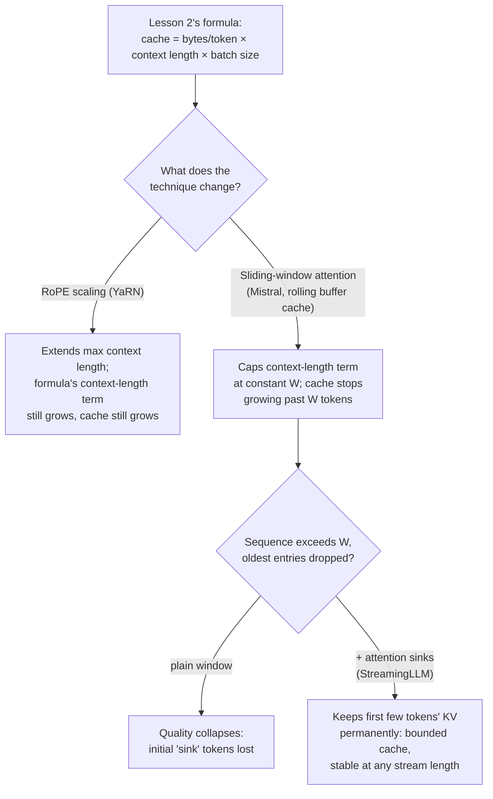

# Урок 24. Длинный контекст при обслуживании

**Связь с целью курса:** Урок 2 дал формулу, на которой на самом деле работает бюджет ёмкости: `total cache bytes = bytes per token × context length × batch size`, то есть память растёт линейно с длиной контекста. Три техники времени обслуживания затрагивают эту формулу по-разному: **масштабирование RoPE (RoPE scaling)** увеличивает длину контекста, которую модель вообще способна обработать, вовсе не меняя рост по формуле; **внимание со скользящим окном (sliding-window attention)** меняет саму формулу, ограничивая длину контекста константой; а **якоря внимания (attention sinks)** исправляют единственный режим сбоя, который есть у простого скользящего окна, так что этот предел действительно выдерживает любую длину потока.
**Первоисточник:** [Научная статья: "YaRN: Efficient Context Window Extension of Large Language Models", Peng et al., ICLR 2024](https://arxiv.org/abs/2309.00071), [Научная статья: "Mistral 7B", Jiang et al., 2023](https://arxiv.org/abs/2310.06825), [Научная статья: "Efficient Streaming Language Models with Attention Sinks", Xiao et al., ICLR 2024](https://arxiv.org/abs/2309.17453)
**Предварительные требования:** [Урок 2](0002-capacity-and-batch-size.md), [Урок 3](0003-growth-prefill-decode-precision.md)

## Разминка

1. ▢ Запишите по памяти формулу суммарного объёма кеша из урока 2.

Проверка

`total cache bytes = bytes per token × context length × batch size`.

2. ▢ Почему более длинный контекст всегда означает больший KV-кеш при неизменных размере батча и модели?

Проверка

Каждому дополнительному токену нужны собственные векторы ключей и значений, хранимые на каждом слое; размер кеша равен стоимости на токен, умноженной на то, сколько токенов кеша удерживается, так что больше токенов означает пропорционально больше кеша, и в механизме нет ничего, что позволило бы ему расти медленнее линейного.

## Что нужно знать

### Масштабирование RoPE увеличивает длину, вообще не затрагивая формулу кеша

Ротационные позиционные эмбеддинги (RoPE) кодируют позицию токена, чтобы внимание могло определить, как далеко друг от друга два токена; проблема в том, что модель, обученная на одной длине контекста, не обобщает своё позиционное кодирование за пределы этой длины. **Масштабирование RoPE** (подход YaRN: вместо того чтобы масштабировать каждое измерение RoPE на один и тот же коэффициент, он масштабирует высокочастотные измерения меньше, а низкочастотные больше, целевой метод, который статья называет «NTK-by-parts») позволяет модели обрабатывать последовательности длиннее тех, на которых она обучалась, за долю стоимости дообучения прежних методов. Но масштабирование RoPE касается исключительно *позиционного кодирования*; оно никак не меняет, сколько ключей и значений хранится на токен или сколько токенов в последовательности. Более длинный контекст, обрабатываемый через масштабирование RoPE, по-прежнему в полной мере стоит по формуле урока 2: `bytes per token × (now-longer) context length × batch size`. Масштабирование RoPE покупает длину; оно не покупает память.

### Внимание со скользящим окном вместо этого ограничивает длину контекста константой

**Внимание со скользящим окном (SWA)** из Mistral 7B идёт противоположным путём: вместо того чтобы позволять каждому токену обращать внимание на всю последовательность до этого момента, каждый токен обращает внимание не более чем на `W` предыдущих токенов (пример Mistral: `W = 4096`). В паре с SWA идёт **кольцевой буфер кеша (rolling buffer cache)**: поскольку ни одному токену не нужно больше `W` предыдущих позиций ключей и значений, кешу всегда нужно хранить лишь `W` токенов, перезаписывая самые старые записи по мере прихода новых токенов, независимо от того, насколько длинной становится вся последовательность. Это напрямую меняет формулу урока 2: `context length` в расчёте объёма кеша больше не фактическая длина последовательности, а ограничено константой `W`, так что кеш перестаёт расти, как только последовательность проходит `W` токенов, как бы длиннее она ни стала после этого.

### Теоретический охват через стопку слоёв реален, но кеш остаётся ограниченным

Один слой позволяет токену видеть лишь на `W` токенов назад, но стопка слоёв расширяет это: скрытое состояние на слое `k` косвенно опирается на информацию вплоть до `W × k` токенов назад, поскольку окно слоя `k` само обращало внимание на представления, уже сформированные окном слоя `k-1`. Собственная цифра Mistral, `W = 4096` при 32 слоях, даёт теоретический охват примерно 131 тыс. токенов. Это реально, но это косвенный, размытый вид доступа, не то же самое, что прямое обращение внимания на токен, отстоящий на 131 тыс. позиций, как это сделало бы полное внимание; последующие оценки показали, что точность извлечения информации за пределами буквального окна в `W` токенов на практике деградирует, поэтому этот теоретический охват это потолок того, что вообще достижимо, а не гарантия, что всё внутри него достижимо хорошо. Выигрыш по памяти кеша (кольцевой буфер фиксированного размера, ограниченный независимо от длины последовательности) это то, что интересует этот урок; он сохраняется независимо от того, насколько хорошо на самом деле извлекается далёкая информация.

### Якоря внимания исправляют реальный режим сбоя внимания с окном

Простое скользящее окно само по себе не просто плавно теряет далёкую информацию, оно ломается: статья о StreamingLLM показывает, что как только последовательность проходит размер окна и старые записи отбрасываются, качество обрушивается, а не деградирует. Причина, которую они выявляют, в том, что самые первые несколько токенов последовательности поглощают непропорционально большие оценки внимания независимо от их реального семантического содержимого, феномен, названный ими **якорем внимания (attention sink)**. Отбрасывание кеш-записей этих начальных токенов, которое простое скользящее окно в итоге делает, когда последовательность становится достаточно длинной, убирает то, от чего механизм внимания модели зависит структурно, а не просто какой-то старый контекст. **StreamingLLM** постоянно держит в кеше небольшое фиксированное число KV-записей начальных токенов рядом с обычным скользящим окном недавних токенов, и одно это восстанавливает большую часть качества полного внимания. Кеш остаётся малым и ограниченным (горстка токенов-якорей плюс скользящее окно, а не вся история), но теперь он действительно работает при любой длине потока, заявленная устойчивость до миллионов токенов, а не рушится, когда окно заполняется.

### Выбор подходящего зависит от того, какая проблема на самом деле решается

Масштабирование RoPE отвечает на «этой модели нужно обрабатывать промпты длиннее тех, на которых она обучалась» и платит за эту длину памятью кеша, которая по-прежнему растёт ровно так, как предсказывает формула урока 2; это правильный инструмент, когда проблема в нечастых длинных промптах, а бюджет памяти их уже учитывает. Внимание со скользящим окном плюс якоря внимания отвечают на другой вопрос: «эта нагрузка это практически неограниченный поток, и кеш должен оставаться фиксированного размера, как бы долго он ни работал», ценой того, что у большинства токенов больше нет прямого доступа ко всей истории. Развёртыванию, обслуживающему нечастые длинные документы, нужно первое; развёртыванию, обслуживающему открытую сессию чата, которая может идти миллионы токенов, нужно второе, а смешение этих двух означает либо платить за рост кеша, которого должна была избежать конструкция с фиксированным окном, либо терять прямой доступ к контексту, который должна была сохранить модель с масштабированным RoPE.

## Практика

1. ▢ Модель дообучена с масштабированием RoPE по YaRN для обработки контекста в 32 тыс. токенов, вместо исходных 4 тыс. Для батча последовательностей, теперь использующих полный контекст в 32 тыс., как объём KV-кеша соотносится с тем, что предсказала бы формула урока 2 для 4 тыс.?

Подсказка

Спросите себя, что масштабирование RoPE на самом деле меняет в кеше.

Проверка

Объём кеша растёт в те же 8 раз, которые формула урока 2 предсказывает для контекста в 8 раз длиннее (32 тыс. против 4 тыс.), поскольку масштабирование RoPE меняет только позиционное кодирование, а не то, сколько токенов ключей и значений хранится. Оно увеличивает, насколько длинный контекст модель вообще может использовать; оно ничего не делает, чтобы уменьшить, чего этот контекст стоит по памяти кеша.

2. ▢ Сервер использует внимание со скользящим окном в стиле Mistral с `W = 4096` и кольцевой буфер кеша. Последовательность запроса вырастает до 50 000 токенов. Каков размер кеша в этот момент по сравнению с сервером без SWA, обрабатывающим ту же последовательность?

Проверка

Кеш сервера с SWA остаётся ограниченным объёмом в `W = 4096` токенов независимо от фактической длины последовательности в 50 000 токенов, поскольку кольцевой буфер всегда хранит ключи и значения только самых недавних `W` токенов. У сервера без SWA кеш был бы рассчитан на все 50 000 токенов, более чем в 12 раз больше.

3. ▢ Почему простое скользящее окно (без якорей внимания) страдает обвалом качества, а не плавной деградацией, когда последовательность превышает размер окна?

Проверка

Первые несколько токенов последовательности поглощают непропорционально большие оценки внимания независимо от своего содержимого, это феномен «якоря внимания». Когда последовательность превышает окно и кеш-записи этих начальных токенов отбрасываются, модель теряет то, на что её механизм внимания структурно опирается, а не просто какой-то старый малоценный контекст, и поэтому эффект выглядит как обвал, а не плавная потеря далёкой информации.

4. ▢ Что StreamingLLM добавляет к простому скользящему окну и что это возвращает?

Проверка

Он постоянно держит в кеше небольшое фиксированное число KV-записей начальных токенов рядом с обычным скользящим окном недавних токенов. Это восстанавливает большую часть качества полного внимания и позволяет модели обрабатывать практически неограниченные потоки (заявленная устойчивость до миллионов токенов) без обвала, от которого страдает простое скользящее окно, сохраняя кеш малым и ограниченным: только токены-якоря плюс окно, а не вся история.

5. ▢ Какое утверждение верно различает, что масштабирование RoPE и скользящее окно плюс якоря внимания делают с формулой объёма кеша из урока 2?

    - a) Оба уменьшают объём кеша для заданной длины контекста
    - b) Масштабирование RoPE увеличивает пригодную длину контекста, оставляя линейный рост формулы по длине контекста неизменным; внимание со скользящим окном (с якорями внимания, исправляющими его режим сбоя) ограничивает член длины контекста константой, ограничивая кеш независимо от длины потока
    - c) Внимание со скользящим окном увеличивает длину контекста, которую модель способна обработать, играя ту же роль, что и масштабирование RoPE
    - d) Якоря внимания полностью устраняют необходимость в KV-кеше

Проверка

**b)** Это точное различие, которое проводит этот урок. (a) неверно: масштабирование RoPE ничего не уменьшает в кеше, оно увеличивает длину контекста, и кеш растёт соответственно. (c) неверно: масштабирование RoPE увеличивает максимальную пригодную длину; внимание со скользящим окном вместо этого ограничивает кеш независимо от длины, совершенно другой рычаг. (d) неверно: якоря внимания сохраняют малый кеш (токены-якоря плюс скользящее окно), они не убирают кеш.

## Практика в реальной работе

- [ ] Для модели, которую вы планируете обслуживать, проверьте, обучалась ли она с методом масштабирования RoPE (YaRN, NTK-aware или линейная интерполяция позиций) и какую максимальную длину контекста это масштабирование нацеливает по сравнению с её исходной обученной длиной.
- [ ] Для долгоработающей или потоковой нагрузки, которая у вас на уме, выясните, что на самом деле соответствует нужному нагрузке: линейный рост кеша из урока 2 (модель с масштабированным RoPE) или ограниченный кеш со скользящим окном плюс якорями.
- [ ] Завтра: прочитайте раздел статьи о StreamingLLM про добавление выделенного токена-якоря внимания при предобучении и отметьте, что это меняет по сравнению с опорой на то, какой ранний токен случайно становится якорем естественным образом.

## Что почитать дальше

- [Научная статья: "YaRN: Efficient Context Window Extension of Large Language Models", Peng et al., ICLR 2024](https://arxiv.org/abs/2309.00071)
- [Научная статья: "Mistral 7B", Jiang et al., 2023](https://arxiv.org/abs/2310.06825)
- [Научная статья: "Efficient Streaming Language Models with Attention Sinks", Xiao et al., ICLR 2024](https://arxiv.org/abs/2309.17453)
- [Ресурсы](../RESOURCES.md)

---

Не доходит? Перечитайте первоисточник в начале: этот урок его сжимает, а при сжатии понимание как раз и теряется. Загляните в [глоссарий](../GLOSSARY.md), если какой-то термин показался скользким.

Если неясен сам урок, а не материал, это дефект: [откройте issue](https://github.com/TokenCemetery/teach/issues).
