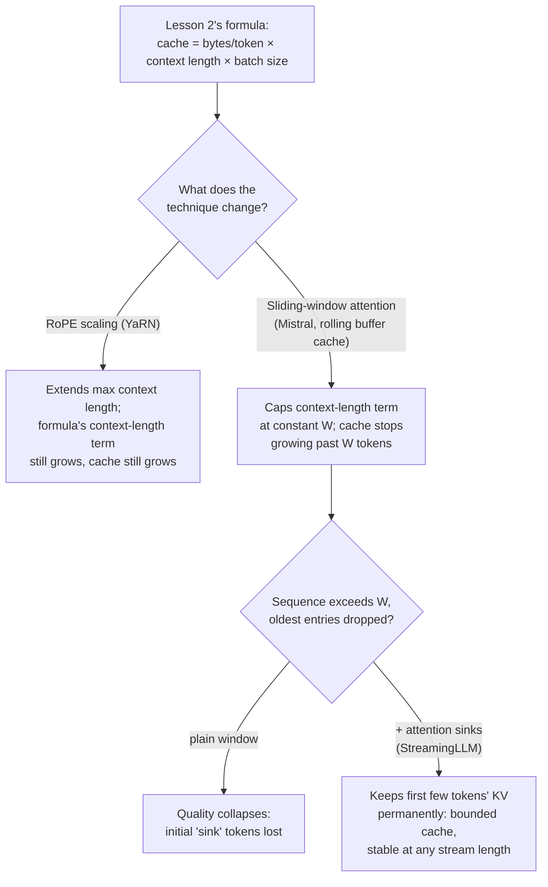

# 第 24 课：服务时的长上下文

**使命关联:** 第 2 课给出了容量预算实际运行所依据的公式：`total cache bytes = bytes per token × context length × batch size`，内存随上下文长度线性增长。三种服务时的技术，以不同的方式触及这个公式：**RoPE 缩放**扩展了模型究竟能处理多长的上下文，却完全不改变公式的增长方式；**滑动窗口注意力**改变了公式本身，把上下文长度限制在一个常数上；而**注意力汇聚点**修复了普通滑动窗口唯一的失败模式，使这个上限在任何流长度下都真正站得住。
**主要来源:** [论文：“YaRN: Efficient Context Window Extension of Large Language Models”，Peng 等，ICLR 2024](https://arxiv.org/abs/2309.00071)、[论文：“Mistral 7B”，Jiang 等，2023](https://arxiv.org/abs/2310.06825)、[论文：“Efficient Streaming Language Models with Attention Sinks”，Xiao 等，ICLR 2024](https://arxiv.org/abs/2309.17453)
**前置知识:** [第 2 课](0002-capacity-and-batch-size.md)、[第 3 课](0003-growth-prefill-decode-precision.md)

## 热身

1. ▢ 凭记忆写出第 2 课的缓存总占用公式。

检查

`total cache bytes = bytes per token × context length × batch size`。

2. ▢ 为什么在批大小和模型都固定的情况下，更长的上下文长度总是意味着更大的 KV 缓存？

检查

每多一个 token，都需要在每一层存下它自己的键向量和值向量；缓存的大小，恰好就是每个 token 的开销，乘以正在持有的缓存所对应的 token 数，所以 token 越多，缓存就成比例地越多，这套机制里没有任何东西，能让它增长得比线性更慢。

## 要点

### RoPE 缩放扩展了长度，却完全不触及缓存公式

旋转位置嵌入（RoPE）对 token 的位置做编码，使注意力能分辨两个 token 相距多远；问题在于，一个在某个上下文长度上训练出来的模型，其位置编码无法泛化到那个长度之外。**RoPE 缩放**（YaRN 的做法：不是把每个 RoPE 维度都按同一个因子缩放，而是对高频维度少缩放一些，对低频维度多缩放一些，论文把这种有针对性的方法称为“NTK-by-parts”）让模型能够处理比它训练时更长的序列，而微调成本只是更早的方法的一小部分。但 RoPE 缩放纯粹是关于*位置编码*的；它丝毫不改变每个 token 存多少键和值，也不改变序列里有多少个 token。通过 RoPE 缩放处理的更长上下文，仍然要付出第 2 课公式的全部代价：`bytes per token × (现在更长的) context length × batch size`。RoPE 缩放买来的是长度；它买不来内存。

### 滑动窗口注意力则把上下文长度限制在一个常数上

Mistral 7B 的**滑动窗口注意力（SWA）**采取了相反的做法：不让每个 token 关注到目前为止的整个序列，而是让每个 token 最多只关注前面 `W` 个 token（Mistral 的例子：`W = 4096`）。与 SWA 配套的是**滚动缓冲区缓存**：既然没有哪个 token 需要超过前面 `W` 个位置的键和值，缓存就只需要容纳 `W` 个 token 的量，随着新 token 到来，覆盖最旧的条目，无论整个序列增长到多长。这直接改变了第 2 课的公式：缓存占用计算中的 `context length`，不再是序列实际的长度，而是被限制在常数 `W` 上，所以一个序列一旦超过 `W` 个 token，缓存就不再增长，不管它之后变得多长。

### 通过层层堆叠得到的理论跨度是真实的，但缓存仍然有上限

单独一层只让一个 token 看到前面 `W` 个 token，但堆叠的层数扩展了这一点：第 `k` 层的隐藏状态，间接地汲取了最远 `W × k` 个 token 之前的信息，因为第 `k` 层的窗口本身关注的，是已经被第 `k-1` 层自己的窗口塑造过的表示。Mistral 自己的数字，32 层上 `W = 4096`，给出大约 131K 个 token 的理论跨度。这是真实的，但它是一种间接的、被稀释的访问，与像完整注意力那样直接关注 131K 个位置之前的 token 不是一回事；后续的评估发现，对于字面 `W` 个 token 的窗口之外的信息，检索准确率在实践中会下降，这就是为什么这个理论跨度，是对究竟能触达什么的一个上限，而不是对其中的一切都能被很好地触达的保证。缓存内存上的收益（一个固定大小的滚动缓冲区，无论序列多长都有上限）才是本课所关心的部分；无论远处的信息实际检索得多好，它都成立。

### 注意力汇聚点修复了窗口注意力真正的失败模式

普通的滑动窗口，单靠它自己，不只是平缓地丢失远处的信息，它会崩溃：StreamingLLM 的论文表明，一旦序列超过窗口大小，旧的条目被丢掉，质量就崩溃，而不是平缓下降。他们指出的原因是，序列中最前面的几个 token，无论它们的实际语义内容是什么，都会吸收异常大的注意力分数，他们把这种现象命名为**注意力汇聚点**。丢掉这些最初 token 的缓存条目（普通滑动窗口在序列足够长时终将这样做），去掉的是模型的注意力机制在结构上所依赖的东西，而不只是一些旧的上下文。**StreamingLLM** 在通常的近期 token 滑动窗口之外，把少量固定数量的最初 token 的 KV 条目永久保留在缓存中，仅此一点，就恢复了完整注意力的大部分表现。缓存保持小而有界（少数几个汇聚点 token 加上滑动窗口，而不是整个历史），但现在它在任何流长度下都真正有效，据报告稳定到数百万个 token，而不是在窗口填满后崩溃。

### 选哪一个，取决于究竟要解决的是什么问题

RoPE 缩放回答的是“这个模型需要处理比它训练时更长的提示词”，并且为这个长度付出的代价，是仍然恰好按第 2 课公式所预测的那样增长的缓存内存；当问题是偶尔出现的长提示词，而且内存预算已经把它们计入时，它就是合适的工具。滑动窗口注意力加上注意力汇聚点回答的是另一个问题，“这个工作负载实际上是一条无界的流，无论运行多久，缓存都必须保持固定大小”，代价是大多数 token 不再能直接访问整个历史。一个只服务偶尔的长文档的部署，需要的是前者；一个服务可能持续数百万个 token 的开放式聊天会话的部署，需要的是后者，而把二者混为一谈，意味着要么为本应由固定窗口设计避免的缓存增长付费，要么丢掉本应由 RoPE 缩放的模型保留的、对上下文的直接访问。

## 练习

1. ▢ 一个模型用 YaRN 的 RoPE 缩放做了微调，使其能处理 32K 个 token 的上下文，原来是 4K。对于现在用满 32K 上下文的一个批次的序列，KV 缓存的占用与第 2 课的公式在 4K 时所预测的相比如何？

提示

问问 RoPE 缩放实际改变了缓存的什么。

检查

缓存占用增长的倍数，与第 2 课的公式对长 8 倍的上下文（32K 对 4K）所预测的相同，即 8 倍，因为 RoPE 缩放只改变位置编码，不改变存多少个 token 的键和值。它扩展的是模型究竟能使用多长的上下文；对于降低这段上下文在缓存内存上的开销，它什么也没做。

2. ▢ 一台服务器使用 Mistral 式的滑动窗口注意力，`W = 4096`，并配有滚动缓冲区缓存。一个请求的序列增长到 50000 个 token。到那时，缓存有多大，与没有 SWA 的服务器处理同一个序列相比如何？

检查

SWA 服务器的缓存，无论序列实际有 50000 个 token 的长度，都保持在 `W = 4096` 个 token 的量上，因为滚动缓冲区只保存最近 `W` 个 token 的键和值。没有 SWA 的服务器，缓存要按完整的 50000 个 token 来定大小，要大 12 倍以上。

3. ▢ 为什么普通的滑动窗口（没有注意力汇聚点），一旦序列超过窗口大小，是质量崩溃，而不是平缓下降？

检查

序列中最前面的几个 token，无论内容是什么，都会吸收异常大的注意力分数，这就是“注意力汇聚点”现象。一旦序列超过窗口，而这些最初 token 的缓存条目被丢掉，模型就失去了它的注意力机制在结构上所依赖的东西，而不只是一些旧的、价值低的上下文，这就是为什么结果是崩溃，而不是对远处信息的平缓丢失。

4. ▢ StreamingLLM 在普通滑动窗口之上增加了什么，它换回了什么？

检查

它在通常的近期 token 滑动窗口之外，把少量固定数量的最初 token 的 KV 条目永久保留在缓存里。这恢复了完整注意力的大部分质量，使模型能够处理实际上无界的流（据报告稳定到数百万个 token），而不会出现普通滑动窗口所遭受的崩溃，同时保持缓存小而有界，只是汇聚点 token 加上窗口，而不是整个历史。

5. ▢ 下面哪种说法，正确区分了 RoPE 缩放与滑动窗口加注意力汇聚点，各自对第 2 课的缓存占用公式做了什么？

    - a) 二者都减少了给定上下文长度下的缓存占用
    - b) RoPE 缩放扩展了可用的上下文长度，而公式中随上下文长度线性增长这一点不变；滑动窗口注意力（由注意力汇聚点修复其失败模式）把上下文长度这一项限制在一个常数上，使缓存无论流多长都有界
    - c) 滑动窗口注意力扩展了模型能处理多长的上下文，与 RoPE 缩放起的是同一个作用
    - d) 注意力汇聚点完全消除了对 KV 缓存的需求

检查

**b)** 这就是本课所划出的精确区别。(a) 是错的：RoPE 缩放并不减少缓存的任何东西，它扩展的是上下文长度，缓存也随之增长。(c) 是错的：RoPE 缩放扩展的是最大可用长度；滑动窗口注意力则是无论长度多少都给缓存设上限，是完全不同的杠杆。(d) 是错的：注意力汇聚点保留的是一个小缓存（汇聚点 token 加滑动窗口），并没有去掉缓存。

## 实战练习

- [ ] 对你打算提供服务的某个模型，检查它是否用某种 RoPE 缩放方法（YaRN、NTK-aware 或线性位置插值）训练过，以及这种缩放所针对的最大上下文长度，相比它最初训练的长度是多少。
- [ ] 针对你心里的某个长时间运行或流式的工作负载，弄清楚第 2 课的线性缓存增长（RoPE 缩放的模型），还是有上限的、滑动窗口加汇聚点的缓存，究竟与这个工作负载所需要的相匹配。
- [ ] 明天：读 StreamingLLM 论文中关于在预训练期间加入专用的注意力汇聚点 token 的那一节，记下它与依赖碰巧自然成为汇聚点的某个早期 token 相比，改变了什么。

## 延伸阅读

- [论文：“YaRN: Efficient Context Window Extension of Large Language Models”，Peng 等，ICLR 2024](https://arxiv.org/abs/2309.00071)
- [论文：“Mistral 7B”，Jiang 等，2023](https://arxiv.org/abs/2310.06825)
- [论文：“Efficient Streaming Language Models with Attention Sinks”，Xiao 等，ICLR 2024](https://arxiv.org/abs/2309.17453)
- [资源](../RESOURCES.md)

---

没学明白？请重读顶部的主要来源，因为本课是对它的压缩，而理解正是在压缩中流失的。如果有哪个术语觉得含糊，可以查看[术语表](../GLOSSARY.md)。

如果问题出在课程本身，而不是学习材料，那就是一个缺陷：[提交 issue](https://github.com/TokenCemetery/teach/issues)。
