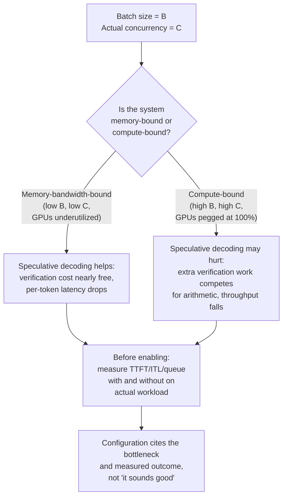

# Lección 25. Revisar una configuración de serving

**Vínculo con la misión:** La misión termina aquí: *"defender las cifras de latencia y throughput que produce"*. Esa defensa no es un ejercicio en solitario. Tendrás que revisar la configuración de otra persona, rastrear cada decisión hasta la carga de trabajo a la que dice servir y detectar el desajuste antes de que llegue a producción.
**Fuente principal:** [Docs: "Speculative Decoding", vLLM Project](https://docs.vllm.ai/en/latest/features/speculative_decoding.html)
**Requisitos previos:** [Lección 2](0002-capacity-and-batch-size.md), [Lección 6](0006-throughput-latency-tradeoff.md), [Lección 12](0012-vllm-tuning-knobs.md), [Lección 18](0018-speculative-decoding.md), [Lección 22](0022-fleet-level-serving.md), [Lección 23](0023-production-observability-and-cost.md)

## Calentamiento

1. ▢ La lección 2 nombró la fórmula que gobierna la huella de memoria de una configuración de serving. ¿Qué hace crecer la caché, y qué hace el batching con ese costo?

Comprobación

`total cache bytes = bytes per token × context length × batch size`. La caché crece de forma lineal con la longitud de contexto y con el tamaño de lote; un lote mayor significa más secuencias concurrentes, cada una con su propia KV cache.

2. ▢ La lección 6 dijo que el throughput y la latencia por token se compensan mediante el tamaño de lote. ¿Qué gobierna realmente en qué dirección se mueve el compromiso?

Comprobación

El tamaño de lote. Un lote mayor reparte la lectura de pesos de cada paso de decode entre más solicitudes (lo que aumenta el throughput) pero obliga a cada solicitud individual a esperar más sus tokens, ya que comparten tiempo de GPU con más vecinas (lo que aumenta la latencia). Cuál de las dos cifras importa más depende del SLO declarado de la carga de trabajo.

3. ▢ La lección 18 dijo que el speculative decoding verifica varios tokens en una pasada forward, aproximadamente al costo de generar un token normalmente, porque el decode está limitado por el ancho de banda de memoria. ¿Cambia ese mecanismo cuando el tamaño de lote se vuelve muy grande?

Comprobación

El mecanismo en sí (el costo de verificación limitado por el ancho de banda) no cambia. Pero sí cambia el régimen del sistema: un lote muy grande puede hacer que el sistema esté limitado por cómputo en conjunto, donde el trabajo de verificación que añade el speculative decoding compite realmente por la aritmética de la GPU en lugar de ejecutarse casi gratis. El costo por token es el mismo; lo que cambia es si ese costo es despreciable o material a la escala de tu sistema.

## Qué debes saber

### La lista de revisión: ¿encaja cada parámetro con la carga de trabajo declarada?

Cuando revises una configuración de serving, recorre esta lista. Para cada elemento, pregúntate: ¿está esta decisión realmente justificada por el cuello de botella declarado de la carga de trabajo, o se copió a ciegas de los valores por defecto de otra carga de trabajo?

**1. ¿Está la configuración de batching ajustada a la concurrencia y al SLO de la carga de trabajo?**

La lección 6 enseña que el tamaño de lote intercambia throughput por latencia por token. Una configuración que declara "tamaño de lote = 128, SLO = 300 ms de p99 de TTFT" tiene que mostrar que un tamaño de lote de 128 entrega realmente 300 ms con la concurrencia declarada. Si la carga de trabajo son 10 usuarios concurrentes, un lote de 128 significa rellenar con 118 solicitudes vacías o desperdiciar tiempo de GPU en un lote artificialmente grande. Si la carga de trabajo son 1000 usuarios concurrentes y un lote de 128 significa solo un 12% de utilización, la configuración deja throughput sobre la mesa. El parámetro hay que elegirlo con mediciones sobre la carga de trabajo real, no adivinarlo.

**2. ¿Se gana su lugar el esquema de cuantización para el objetivo de latencia de esta carga de trabajo?**

La lección 9 enseña el compromiso: una cuantización de menor ancho de bits ahorra memoria y acelera el decode (limitado por ancho de banda), pero pierde precisión y puede acelerar el prefill de forma distinta según la implementación. Antes de adoptar la cuantización int4 porque otro equipo lo hizo, mide la pérdida de precisión de tu propia tarea con tu propio tamaño de lote. Algunas cargas de trabajo son insensibles a la pérdida; otras no. Una configuración que dice "cuantización int4" sin citar su impacto de precisión medido en *esta* tarea no ha justificado realmente esa elección.

**3. ¿Aborda la estrategia de paralelismo un cuello de botella real?**

La lección 21 enseña el tensor parallelism y el pipeline parallelism como dos maneras distintas de dividir un modelo entre GPU. Una configuración que usa tensor parallelism de 8 vías en un nodo de 4 GPU carece de sentido: ya has dividido entre todas las GPU que tienes, y el alto costo de comunicación (NVLink o red) se está pagando por nada. La elección debería remontarse a una medición: "el modelo es demasiado grande para caber en la memoria de una sola GPU, así que necesitamos paralelismo; con 4 GPU el tensor parallelism se atasca en la comunicación, así que añadimos pipeline parallelism para las etapas restantes". Sin esa historia, la configuración tiene parámetros girados pero no decisiones tomadas.

**4. ¿Está el speculative decoding activado por la razón correcta, para el tamaño de lote de esta carga de trabajo?**

La lección 18 dice que el speculative decoding es una palanca de latencia: reduce la latencia por token verificando varios tokens por pasada forward costosa. La lección 23 estableció que en producción se cita un SLO. La documentación de vLLM es explícita: el speculative decoding reduce la latencia entre tokens "con QPS (consultas por segundo) medio-bajo, cargas de trabajo limitadas por memoria". El detalle es decisivo. Cuando el tamaño de lote es pequeño (QPS bajo), el sistema está limitado por el ancho de banda de memoria y el costo extra de verificación del speculative decoding es casi gratis (el mecanismo de la lección 18 se cumple). Cuando el tamaño de lote es muy grande (QPS alto, limitado por cómputo), el cómputo extra de verificación compite por la aritmética de la GPU y puede reducir el throughput; la latencia de una solicitud individual puede mejorar, pero el throughput global de la flota puede no hacerlo. Una configuración que dice "speculative decoding activado" porque "suena bien" no ha medido realmente si la carga de trabajo está limitada por ancho de banda o por cómputo con el tamaño de lote elegido. Nómbralo: "Speculative decoding activado para cargas de trabajo de QPS bajo con tamaño de lote ≤ 32, donde el ancho de banda de memoria es el cuello de botella. Desactivado para tamaño de lote > 64, donde el cómputo se convierte en el cuello de botella y el costo extra de verificación reduciría el throughput de la flota".

### Llevar un cambio a través de aquello de lo que otros dependen

Una flota de serving tiene llamadores en vivo a mitad de solicitud cuando despliegas una configuración, una versión de modelo o un esquema de cuantización nuevos. Un cambio de configuración que altera en silencio la distribución de salida, como cambiar la cuantización o activar el speculative decoding, puede romper a un consumidor aguas abajo (una puerta de eval, un llamador con expectativas fijas sobre la distribución de latencia, un sistema que espera una coincidencia exacta de la salida) sin que el equipo de serving sepa por qué.

**Estrategia de despliegue seguro:**

1. **Haz un canary de una configuración nueva en una pequeña porción del tráfico** antes de un cambio total. No para comprobar si el servidor sigue en pie, sino para medir cómo afecta el cambio a la distribución de salida y a la distribución de latencia, y si un consumidor aguas abajo lo nota.
2. **Escalona el cambio igual que escalonas una versión de modelo**: un canary, vigilando regresiones que un consumidor aguas abajo podría detectar antes que tú, y luego un despliegue gradual si el canary está limpio.
3. **Comunica el cambio a los llamadores antes de desplegarlo a escala.** Un cambio de configuración no es un detalle de implementación puro; puede desplazar ligeramente una distribución de latencia o de salida (la cuantización, los raros fallos de verificación del speculative decoding), y los sistemas aguas abajo construidos sobre supuestos estrictos podrían romperse.

Esto no es paranoia. Un ejemplo real: pasar de cuantización float16 a int8 puede desplazar la distribución de salida lo suficiente para que una puerta de eval ajustada a salidas float16 empiece a rechazar respuestas válidas; la flota de serving parece estar bien (mismo throughput de solicitudes, mismo p99) pero el pipeline de eval aguas abajo empieza a fallar en silencio. Un despliegue escalonado lo detecta porque alguien que vigila la tasa de aceptación de la puerta de eval durante la fase de canary ve que baja y pregunta por qué antes de desplegar a escala.

### Decir cuándo la respuesta habitual es incorrecta, y resolver una afirmación en disputa desde la fuente primaria

El speculative decoding es aquí el caso de estudio, porque la respuesta depende de verdad del cuello de botella actual de tu carga de trabajo.

La lección 18 presenta el speculative decoding como una ganancia de latencia: verificar varios tokens de forma barata en una pasada forward en lugar de generarlos uno a uno. Eso es exactamente correcto para las condiciones que describe el paper y las que documenta vLLM: **cuando el sistema está limitado por el ancho de banda de memoria** (lote pequeño, QPS bajo). En ese régimen, el trabajo extra de verificación no cuesta casi nada y la latencia por token baja de forma medible.

Pero **con tamaño de lote y QPS altos, cuando el sistema pasa a estar limitado por cómputo**, los tokens extra de verificación que propone el modelo borrador añaden trabajo de cómputo que ahora compite realmente con otras solicitudes por la aritmética de la GPU. El costo ya no es despreciable: la pasada forward del modelo objetivo hace más trabajo (verificar varios tokens), y ese trabajo extra desplaza tiempo que podría haberse dedicado a generar tokens para otras solicitudes del lote. La latencia por solicitud aún puede mejorar (los tokens de tu propia solicitud llegan algo más rápido), pero el throughput de la flota, el total de tokens generados por segundo entre todas las solicitudes, puede caer, y el throughput es lo que gobierna el compromiso de tamaño de lote de la lección 6 y de lo que depende el costo por millón de tokens de la lección 23.

La documentación de vLLM lo dice directamente: "Speculative Decoding... para reducir la latencia entre tokens con QPS (consultas por segundo) medio-bajo, cargas de trabajo limitadas por memoria". Esa formulación no es accidental. Con QPS alto, en un sistema limitado por cómputo, el speculative decoding puede perjudicar el throughput global aunque mejore la latencia de cada solicitud. La respuesta correcta no es "activa el speculative decoding" ni "desactívalo siempre"; la respuesta correcta es **"mide primero el cuello de botella de tu carga de trabajo"**.

Para resolver qué es verdad en tu configuración:

1. **Mide el cuello de botella actual de tu sistema** con tu tamaño de lote y QPS reales: ¿es el factor limitante el ancho de banda de memoria o la aritmética? Las métricas de la lección 23 (TTFT, ITL, profundidad de cola) te lo dicen. Si el sistema está limitado por el cómputo (profundidad de cola alta, utilización de memoria baja, todas las GPU al 100% de utilización), el cuello de botella es el cómputo y es probable que el speculative decoding perjudique. Si el sistema está limitado por memoria (utilización de memoria alta, GPU infrautilizadas), el cuello de botella es el ancho de banda de memoria y es probable que el speculative decoding ayude.
2. **Compara dos mediciones:** mide el throughput de extremo a extremo (total de tokens/s entre todas las solicitudes) y la latencia por solicitud con el speculative decoding activado y desactivado, con tu tamaño de lote y concurrencia reales.
3. **Cita lo que mediste.** Una configuración debería decir: "El speculative decoding está desactivado porque esta carga de trabajo se ejecuta con un tamaño de lote de 256 solicitudes y un QPS de 80 solicitudes/s, que es de alta concurrencia y está limitada por cómputo. Medimos un throughput de 3,200 tokens/s con spec decode activado y de 3,400 tokens/s con él desactivado. La latencia por solicitud es ligeramente mayor con spec decode desactivado (258 ms frente a 245 ms), pero el throughput de la flota es el cuello de botella para este SLO, no la latencia por solicitud".

## Práctica

1. ▢ Una configuración propone un tamaño de lote de 256 para una carga de trabajo cuyo SLO declarado es "p99 de TTFT por debajo de 500 ms con 20 usuarios concurrentes". Mides el TTFT con un lote de 256 y encuentras que el p99 es de 1200 ms. ¿Cuál es el error real de la configuración?

Pista

¿Encaja un lote de 256 con la concurrencia declarada de 20 usuarios?

Comprobación

Un tamaño de lote de 256 es absurdamente grande para 20 usuarios concurrentes. Con 20 usuarios, el sistema estará inactivo esperando a que las solicitudes llenen el lote, desperdiciando tiempo de GPU. El TTFT medido lo demuestra: el tamaño de lote es un parámetro que intercambia throughput por latencia, y esta configuración ha intercambiado la latencia en la dirección equivocada. La solución no es "ajustar el TTFT" sino "usar un tamaño de lote de 16-32 ajustado a la concurrencia real, no a una concurrencia de fantasía".

2. ▢ Estás revisando una configuración que activa el speculative decoding, y la justificación es "el speculative decoding reduce la latencia, y la latencia es importante". ¿Es suficiente esta justificación?

Comprobación

No. El speculative decoding *puede* reducir la latencia, pero solo cuando el sistema está limitado por el ancho de banda de memoria. Con alta concurrencia y tamaño de lote grande, donde el cuello de botella es el cómputo, en realidad puede reducir el throughput de la flota mientras mejora la latencia por solicitud. La configuración necesita medir el cuello de botella real de la carga de trabajo y citar el resultado: "Medido con B=X, C=Y: el throughput con spec-decode activado es Z1, desactivado es Z2; elegimos según cuál maximiza la métrica que importa para este SLO".

3. ▢ Un equipo quiere cambiar su cuantización de serving de float16 a int8 y desplegarla de golpe en toda la flota. ¿Cuál es el problema de este plan?

Comprobación

La cuantización cambia la distribución de salida. Un consumidor aguas abajo (una puerta de eval, un sistema de monitorización, un llamador con expectativas estrictas sobre la salida) podría romperse en silencio. El enfoque correcto: hacer un canary del cambio primero en una pequeña porción del tráfico, vigilar a los consumidores aguas abajo (puertas de eval, distribuciones de latencia, tasas de éxito de los llamadores) en busca de regresiones, y desplegar de forma gradual. Esto no es un mero detalle de implementación.

4. ▢ Una configuración declara "tensor parallelism: 8 vías, en 4 GPU". ¿Qué tiene esto de incorrecto?

Pista

¿Cuántas GPU hay disponibles, y de cuántas maneras se divide el modelo?

Comprobación

Carece de sentido: no se puede dividir un modelo en 8 vías en 4 GPU. O bien la configuración quería dividirlo en 4 vías (el tensor parallelism aprovechando por completo el hardware disponible), o bien necesita más GPU. Una estrategia de paralelismo debe ajustarse al hardware disponible, o no ha justificado realmente esa elección. Comprueba si el equipo midió que este esquema de paralelismo concreto (tensor frente a pipeline) es mejor que las alternativas para este modelo y este hardware.

5. ▢ ¿Qué afirmación describe correctamente cuándo ayuda el speculative decoding y cuándo puede perjudicar el throughput global de la flota?

    - a) El speculative decoding siempre reduce la latencia y siempre mejora el throughput, así que debería activarse en todos los despliegues
    - b) El speculative decoding reduce la latencia entre tokens en sistemas limitados por el ancho de banda de memoria (baja concurrencia), pero con alta concurrencia, donde el cuello de botella es el cómputo, el trabajo extra de verificación puede reducir el throughput de la flota aunque mejore la latencia por solicitud
    - c) El speculative decoding solo es útil con tamaños de lote muy grandes y no debería activarse con lotes pequeños
    - d) El speculative decoding reduce el throughput y solo debería activarse si la latencia es más importante que el throughput

Comprobación

**b)** Este es el compromiso genuino que enseña esta lección. (a) es falsa: el speculative decoding ayuda bajo condiciones de cuello de botella concretas, no de forma universal. (c) es al revés: ayuda más con lotes pequeños, donde el sistema está limitado por memoria. (d) es falsa: con el tamaño de lote adecuado mejora tanto la latencia como el throughput; el problema solo aparece con el tamaño de lote equivocado, donde intercambia throughput por latencia.

## Prácticas en el mundo real

- [ ] Toma una configuración de serving de tu propio trabajo (o una configuración pública, como los despliegues de ejemplo de vLLM). Para cada parámetro (tamaño de lote, cuantización, paralelismo, speculative decoding, prefix caching), comprueba si la configuración cita la carga de trabajo para la que se ajustó y la medición que justificó esa elección. Anota qué parámetros están justificados y cuáles son solo valores por defecto.
- [ ] Elige uno de los parámetros de configuración anteriores y compara dos ajustes distintos con la misma carga de trabajo, midiendo el throughput y la latencia con cada uno. Registra qué métrica importa más para tu SLO y si la elección configurada es la correcta.
- [ ] Mañana: diseña un plan de despliegue seguro para un cambio de configuración que estés planeando (por ejemplo, cambiar la cuantización, habilitar una función, cambiar el tamaño de lote). Incluye a quién hay que notificar, qué métricas vigilarás en el canary y qué desencadenaría una reversión.

## Para profundizar

- [Docs: "Speculative Decoding", vLLM Project](https://docs.vllm.ai/en/latest/features/speculative_decoding.html)
- [Paper: "Fast Inference from Transformers via Speculative Decoding", Leviathan et al., 2022](https://arxiv.org/abs/2211.17192)
- [Recursos](../RESOURCES.md)

---

¿No termina de quedar claro? Vuelve a leer la fuente primaria de arriba, ya que esta lección la comprime y en la compresión es donde se escapa la comprensión. Consulta el [glosario](../GLOSSARY.md) por si algún término te resultó resbaladizo.

Si lo poco claro es la propia lección y no el material, eso es un defecto: [abre un issue](https://github.com/TokenCemetery/teach/issues).
