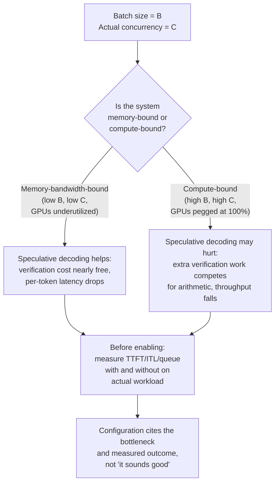

# Leçon 25. Relire une configuration de serving

**Lien avec la mission :** La mission s'achève ici : *« défendre les chiffres de latence et de débit qu'elle produit »*. Cette défense n'est pas un exercice solitaire. Vous aurez à relire la configuration de quelqu'un d'autre, à remonter chaque choix jusqu'à la charge de travail qu'il prétend servir, et à repérer l'incohérence avant qu'elle n'atteigne la production.
**Source primaire :** [Doc : "Speculative Decoding", vLLM Project](https://docs.vllm.ai/en/latest/features/speculative_decoding.html)
**Prérequis :** [Leçon 2](0002-capacity-and-batch-size.md), [Leçon 6](0006-throughput-latency-tradeoff.md), [Leçon 12](0012-vllm-tuning-knobs.md), [Leçon 18](0018-speculative-decoding.md), [Leçon 22](0022-fleet-level-serving.md), [Leçon 23](0023-production-observability-and-cost.md)

## Échauffement

1. ▢ La leçon 2 a nommé la formule qui gouverne l'empreinte mémoire d'une configuration de serving. Qu'est-ce qui fait croître le cache, et que fait le batching à ce coût ?

Vérifier

`total cache bytes = bytes per token × context length × batch size`. Le cache croît linéairement avec la longueur de contexte et la taille de batch ; un batch plus grand signifie plus de séquences concurrentes, chacune détenant son propre KV cache.

2. ▢ La leçon 6 a dit que le débit et la latence par token s'échangent l'un contre l'autre via la taille de batch. Qu'est-ce qui gouverne réellement le sens dans lequel l'échange se déplace ?

Vérifier

La taille de batch. Un batch plus grand répartit la lecture des poids de chaque étape de decode sur davantage de requêtes (ce qui augmente le débit) mais force chaque requête individuelle à attendre plus longtemps ses tokens puisqu'ils partagent le temps GPU avec davantage de voisines (ce qui augmente la latence). Lequel des deux chiffres compte le plus dépend du SLO annoncé de la charge de travail.

3. ▢ La leçon 18 a dit que le décodage spéculatif vérifie plusieurs tokens en une seule passe avant, à peu près pour le coût de la génération d'un token normalement, parce que le décodage est limité par la bande passante mémoire. Ce mécanisme change-t-il quand votre taille de batch devient très grande ?

Vérifier

Le mécanisme lui-même (un coût de vérification limité par la bande passante) ne change pas. Mais le régime du système change : un très grand batch peut rendre le système limité par le calcul dans son ensemble, auquel cas le travail de vérification qu'ajoute le décodage spéculatif entre réellement en concurrence pour l'arithmétique du GPU au lieu de tourner presque gratuitement. Le coût par token est le même ; ce qui change, c'est si ce coût est négligeable ou significatif à l'échelle de votre système.

## À savoir

### La liste de relecture : chaque paramètre correspond-il à la charge de travail annoncée ?

Quand vous relisez une configuration de serving, parcourez cette liste. Pour chaque point, demandez-vous : ce choix est-il réellement justifié par le goulot d'étranglement annoncé de la charge de travail, ou a-t-il été copié par mimétisme à partir des valeurs par défaut d'une autre charge de travail ?

**1. La configuration de batching est-elle adaptée à la concurrence et au SLO de la charge de travail ?**

La leçon 6 enseigne que la taille de batch échange le débit contre la latence par token. Une configuration qui énonce « batch size = 128, SLO = 300ms p99 TTFT » doit montrer qu'une taille de batch de 128 délivre réellement 300 ms sous la concurrence annoncée. Si la charge de travail est de 10 utilisateurs concurrents, un batch de 128 signifie compléter avec 118 requêtes vides ou gaspiller du temps GPU sur un batch artificiellement grand. Si la charge de travail est de 1000 utilisateurs concurrents et qu'un batch de 128 ne donne que 12 % d'utilisation, la configuration laisse du débit sur la table. Le paramètre doit être choisi à partir de mesures sur la charge de travail réelle, et non deviné.

**2. Le schéma de quantification mérite-t-il réellement sa place pour l'objectif de latence de cette charge de travail ?**

La leçon 9 enseigne le compromis : une quantification à plus faible largeur de bits économise de la mémoire et accélère le decode (limité par la bande passante), mais perd de la précision et peut accélérer le prefill différemment selon l'implémentation. Avant d'adopter la quantification int4 parce qu'une autre équipe l'a fait, mesurez la perte de précision de votre propre tâche à votre propre taille de batch. Certaines charges de travail sont insensibles à la perte ; d'autres non. Une configuration qui dit « int4 quantization » sans citer son impact de précision mesuré sur *cette* tâche n'a pas réellement justifié ce choix.

**3. La stratégie de parallélisme répond-elle à un vrai goulot d'étranglement ?**

La leçon 21 enseigne le parallélisme tensoriel et le parallélisme de pipeline comme deux façons différentes de répartir un modèle entre des GPU. Une configuration qui utilise un parallélisme tensoriel à 8 voies sur un nœud de 4 GPU n'a pas de sens : vous avez déjà réparti sur tous les GPU dont vous disposez, et le coût de communication élevé (NVLink ou réseau) est payé pour rien. Le choix devrait remonter à une mesure : « le modèle est trop grand pour tenir dans la mémoire d'un seul GPU, il nous faut donc du parallélisme ; à 4 GPU le parallélisme tensoriel est limité par la communication, nous avons donc ajouté le parallélisme de pipeline pour les étages restants ». Sans cette histoire, la configuration a des paramètres tournés mais pas de choix faits.

**4. Le décodage spéculatif est-il activé pour la bonne raison, pour la taille de batch de cette charge de travail ?**

La leçon 18 dit que le décodage spéculatif est un levier de latence : il réduit la latence par token en vérifiant plusieurs tokens par passe avant coûteuse. La leçon 23 a établi qu'en production, on cite un SLO. La documentation de vLLM est explicite : le décodage spéculatif réduit la latence inter-token "under medium-to-low QPS (queries per second), memory-bound workloads." Ce détail est porteur de sens. Quand la taille de batch est petite (QPS bas), le système est limité par la bande passante mémoire et le coût de vérification supplémentaire du décodage spéculatif est presque gratuit (le mécanisme de la leçon 18 tient). Quand la taille de batch est très grande (QPS élevé, limité par le calcul), le calcul de vérification supplémentaire entre en concurrence pour l'arithmétique du GPU et peut réellement diminuer le débit : la latence d'une requête individuelle peut s'améliorer, mais le débit global de la flotte peut ne pas le faire. Une configuration qui dit « décodage spéculatif activé » parce que « ça a l'air bien » n'a pas réellement mesuré si la charge de travail est limitée par la bande passante ou par le calcul à la taille de batch choisie. Nommez-le : « Décodage spéculatif activé pour les charges de travail à QPS bas avec une taille de batch ≤ 32, où la bande passante mémoire est le goulot d'étranglement. Désactivé pour une taille de batch > 64 où le calcul devient le goulot d'étranglement et où le coût de vérification supplémentaire diminuerait le débit de la flotte. »

### Faire passer un changement à travers ce dont les autres dépendent

Une flotte de serving a des appelants en direct en pleine requête quand vous déployez une nouvelle configuration, une nouvelle version de modèle ou un nouveau schéma de quantification. Un changement de configuration qui modifie silencieusement la distribution de sortie, comme changer de quantification ou activer le décodage spéculatif, peut casser un consommateur en aval (une porte d'eval, un appelant avec des attentes codées en dur sur la distribution de latence, un système qui attend une correspondance exacte des sorties) sans que l'équipe de serving sache pourquoi.

**Stratégie de déploiement sûre :**

1. **Faites un canary de la nouvelle configuration sur une petite tranche du trafic** avant une bascule complète. Non pas pour tester si le serveur reste en marche, mais pour mesurer comment le changement affecte la distribution de sortie et la distribution de latence, et si un consommateur en aval le remarque.
2. **Échelonnez le changement comme vous échelonnez une version de modèle** : un canary, une surveillance des régressions qu'un consommateur en aval pourrait détecter avant vous, puis un déploiement progressif si le canary est propre.
3. **Communiquez le changement aux appelants avant de le déployer à grande échelle.** Un changement de configuration n'est pas un pur détail d'implémentation ; il peut décaler légèrement une distribution de latence ou de sortie (la quantification, les rares échecs de vérification du décodage spéculatif), et les systèmes en aval bâtis sur des hypothèses serrées peuvent casser.

Ce n'est pas de la paranoïa. Un exemple réel : passer de la quantification float16 à int8 peut décaler suffisamment la distribution de sortie pour qu'une porte d'eval réglée sur des sorties float16 se mette à rejeter des réponses valides ; la flotte de serving a l'air d'aller bien (même débit de requêtes, même p99) mais le pipeline d'eval en aval se met silencieusement à échouer. Un déploiement échelonné le détecte parce que quelqu'un qui surveille le taux d'acceptation de la porte d'eval pendant la phase de canary le voit baisser et demande pourquoi avant le déploiement à grande échelle.

### Dire quand la réponse habituelle est fausse, et trancher une affirmation contestée à partir de la source primaire

Le décodage spéculatif est l'étude de cas ici, parce que la réponse dépend réellement du goulot d'étranglement actuel de votre charge de travail.

La leçon 18 présente le décodage spéculatif comme un gain de latence : vérifier plusieurs tokens à bas coût en une seule passe avant au lieu de les générer un par un. C'est exactement juste pour les conditions que décrit l'article et que documente vLLM : **quand le système est limité par la bande passante mémoire** (petit batch, QPS bas). Dans ce régime, le travail de vérification supplémentaire ne coûte presque rien et la latence par token baisse sensiblement.

Mais **à une taille de batch et un QPS élevés, quand le système devient limité par le calcul**, les tokens de vérification supplémentaires que le draft model propose ajoutent un travail de calcul qui entre maintenant réellement en concurrence avec d'autres requêtes pour l'arithmétique du GPU. Le coût n'est plus négligeable : la passe avant du modèle cible fait plus de travail (vérifier plusieurs tokens), et ce travail supplémentaire déplace du temps qui aurait pu être passé à générer des tokens pour d'autres requêtes du batch. La latence par requête peut quand même s'améliorer (les tokens de votre propre requête arrivent un peu plus vite), mais le débit de la flotte, le total de tokens générés par seconde sur toutes les requêtes, peut chuter, et le débit est ce que gouverne le compromis de taille de batch de la leçon 6 et ce dont dépend le coût par million de tokens de la leçon 23.

La documentation de vLLM l'énonce directement : "Speculative Decoding... to reduce inter-token latency under medium-to-low QPS (queries per second), memory-bound workloads." Cette formulation n'est pas accidentelle. Sous un QPS élevé, avec un système limité par le calcul, le décodage spéculatif peut nuire au débit global même s'il améliore la latence des requêtes individuelles. La bonne réponse n'est ni « activez le décodage spéculatif » ni « désactivez-le toujours » ; la bonne réponse est **« mesurez d'abord le goulot d'étranglement de votre charge de travail »**.

Pour trancher ce qui est vrai pour votre configuration :

1. **Mesurez le goulot d'étranglement actuel de votre système** à votre taille de batch et votre QPS réels : est-ce la bande passante mémoire ou l'arithmétique qui est le facteur limitant ? Les métriques de la leçon 23 (TTFT, ITL, profondeur de file) vous le disent. Si le système est limité par le calcul (profondeur de file élevée, faible utilisation de la mémoire, tous les GPU à 100 % d'utilisation), le calcul est le goulot d'étranglement et le décodage spéculatif risque de nuire. Si le système est limité par la mémoire (utilisation élevée de la mémoire, GPU sous-utilisés), la bande passante mémoire est le goulot d'étranglement et le décodage spéculatif risque d'aider.
2. **Comparez deux mesures :** mesurez le débit de bout en bout (total de tokens/s sur toutes les requêtes) et la latence par requête avec le décodage spéculatif activé et désactivé, à votre taille de batch et votre concurrence réelles.
3. **Citez ce que vous avez mesuré.** Une configuration devrait dire : « Le décodage spéculatif est désactivé parce que cette charge de travail tourne à une taille de batch de 256 requêtes et un QPS de 80 requêtes/s, ce qui est une forte concurrence et un régime limité par le calcul. Nous avons mesuré un débit de 3 200 tokens/s avec le décodage spéculatif activé et de 3 400 tokens/s avec lui désactivé. La latence par requête est légèrement plus élevée avec le décodage spéculatif désactivé (258 ms contre 245 ms) mais le débit de la flotte est le goulot d'étranglement pour ce SLO, pas la latence par requête. »

## Pratique

1. ▢ Une configuration propose une taille de batch de 256 pour une charge de travail dont le SLO annoncé est « p99 TTFT sous 500 ms pour 20 utilisateurs concurrents ». Vous mesurez le TTFT à un batch de 256 et trouvez un p99 de 1200 ms. Quelle est la véritable erreur de la configuration ?

Indice

Un batch de 256 correspond-il à la concurrence annoncée de 20 utilisateurs ?

Vérifier

Une taille de batch de 256 est absurdement grande pour 20 utilisateurs concurrents. À 20 utilisateurs, le système sera inactif à attendre que les requêtes remplissent le batch, ce qui gaspille du temps GPU. Le TTFT mesuré le prouve : la taille de batch est un paramètre qui échange le débit contre la latence, et cette configuration a échangé la latence dans le mauvais sens. La solution n'est pas de « régler le TTFT » mais d'« utiliser une taille de batch de 16 à 32 adaptée à la concurrence réelle, et non à une concurrence imaginaire ».

2. ▢ Vous relisez une configuration qui active le décodage spéculatif, et la justification est « le décodage spéculatif réduit la latence, et la latence est importante ». Cette justification est-elle suffisante ?

Vérifier

Non. Le décodage spéculatif *peut* réduire la latence, mais seulement quand le système est limité par la bande passante mémoire. À forte concurrence et grande taille de batch, quand le calcul est le goulot d'étranglement, il peut en réalité réduire le débit de la flotte tout en améliorant la latence par requête. La configuration doit mesurer le goulot d'étranglement de la charge de travail réelle et citer le résultat : « Mesuré à B=X, C=Y : le débit avec le décodage spéculatif activé est Z1, désactivé Z2 ; nous avons choisi selon ce qui maximise la métrique qui compte pour ce SLO. »

3. ▢ Une équipe veut passer sa quantification de serving de float16 à int8 et la déployer d'un seul coup sur toute la flotte. Quel est le problème de ce plan ?

Vérifier

La quantification change la distribution de sortie. Un consommateur en aval (une porte d'eval, un système de surveillance, un appelant avec des attentes serrées sur les sorties) peut casser silencieusement. La bonne approche : faire d'abord un canary du changement sur une petite tranche de trafic, surveiller les consommateurs en aval (portes d'eval, distributions de latence, taux de réussite des appelants) pour y déceler des régressions, et déployer progressivement. Ce n'est pas un pur détail d'implémentation.

4. ▢ Une configuration énonce « tensor parallelism: 8-way, on 4 GPUs ». Qu'est-ce qui ne va pas ?

Indice

Combien de GPU sont disponibles, et en combien de parts le modèle est-il réparti ?

Vérifier

Cela n'a pas de sens : on ne peut pas répartir un modèle en 8 parts sur 4 GPU. Soit la configuration voulait le répartir en 4 parts (le parallélisme tensoriel exploitant pleinement le matériel disponible), soit il lui faut plus de GPU. Une stratégie de parallélisme doit être adaptée au matériel disponible, sinon elle n'a pas réellement justifié ce choix. Vérifiez si l'équipe a mesuré que ce schéma de parallélisme précis (tensoriel contre pipeline) est meilleur que les alternatives pour ce modèle et ce matériel.

5. ▢ Quelle affirmation décrit correctement quand le décodage spéculatif aide et quand il peut nuire au débit global de la flotte ?

    - a) Le décodage spéculatif réduit toujours la latence et améliore toujours le débit, donc il devrait être activé sur tous les déploiements
    - b) Le décodage spéculatif réduit la latence inter-token sur les systèmes limités par la bande passante mémoire (faible concurrence), mais à forte concurrence, où le calcul est le goulot d'étranglement, le travail de vérification supplémentaire peut réduire le débit de la flotte même si la latence par requête s'améliore
    - c) Le décodage spéculatif n'est utile que pour de très grandes tailles de batch et ne devrait pas être activé pour de petits batchs
    - d) Le décodage spéculatif réduit le débit et ne devrait être activé que si la latence est plus importante que le débit

Vérifier

**b)** C'est le véritable compromis qu'enseigne cette leçon. (a) est fausse : le décodage spéculatif aide dans des conditions de goulot d'étranglement précises, pas universellement. (c) est à l'envers : il aide le plus aux petits batchs, où le système est limité par la mémoire. (d) est fausse : à la bonne taille de batch, il améliore à la fois la latence et le débit ; le problème n'existe qu'à la mauvaise taille de batch, où il échange du débit contre de la latence.

## Exercices en situation réelle

- [ ] Prenez une configuration de serving de votre propre travail (ou une configuration publique, comme les déploiements d'exemple de vLLM). Pour chaque paramètre (taille de batch, quantification, parallélisme, décodage spéculatif, prefix caching), vérifiez si la configuration cite la charge de travail pour laquelle elle a été réglée et la mesure qui a justifié ce choix. Écrivez quels paramètres sont justifiés et lesquels ne sont que des valeurs par défaut.
- [ ] Choisissez un paramètre de configuration parmi ceux ci-dessus et comparez deux réglages différents sur la même charge de travail, en mesurant le débit et la latence avec chacun. Notez quelle métrique compte le plus pour votre SLO et si le choix configuré est le bon.
- [ ] Demain : concevez un plan de déploiement sûr pour un changement de configuration que vous prévoyez (par exemple, changer de quantification, activer une fonctionnalité, changer la taille de batch). Incluez qui doit être prévenu, quelles métriques vous surveillerez pendant le canary, et ce qui déclencherait un retour en arrière.

## Pour aller plus loin

- [Doc : "Speculative Decoding", vLLM Project](https://docs.vllm.ai/en/latest/features/speculative_decoding.html)
- [Article : "Fast Inference from Transformers via Speculative Decoding", Leviathan et al., 2022](https://arxiv.org/abs/2211.17192)
- [Ressources](../RESOURCES.md)

---

Ça ne passe pas ? Relisez la source primaire en haut de page, car cette leçon la condense et c'est dans la condensation que la compréhension s'échappe. Consultez le [glossaire](../GLOSSARY.md) pour tout terme qui vous a paru glissant.

Si c'est la leçon elle-même qui n'est pas claire plutôt que la matière, c'est un défaut : [ouvrez une issue](https://github.com/TokenCemetery/teach/issues).
