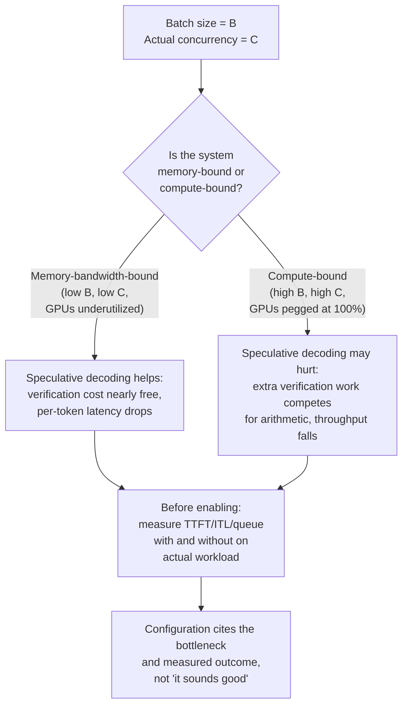

# पाठ 25. Serving Configuration की समीक्षा

**मिशन से संबंध:** मिशन यहीं ख़त्म होता है: *"उससे निकलने वाली latency और throughput की संख्याओं का बचाव करना।"* वह बचाव अकेले का अभ्यास नहीं है। आपको किसी और की configuration की समीक्षा करनी होगी, हर चुनाव को उस workload तक वापस ढूँढना होगा जिसे वह serve करने का दावा करता है, और बेमेल को production तक पहुँचने से पहले पहचानना होगा।
**मुख्य स्रोत:** [दस्तावेज़: "Speculative Decoding", vLLM Project](https://docs.vllm.ai/en/latest/features/speculative_decoding.html)
**पूर्व-आवश्यकताएँ:** [पाठ 2](0002-capacity-and-batch-size.md), [पाठ 6](0006-throughput-latency-tradeoff.md), [पाठ 12](0012-vllm-tuning-knobs.md), [पाठ 18](0018-speculative-decoding.md), [पाठ 22](0022-fleet-level-serving.md), [पाठ 23](0023-production-observability-and-cost.md)

## वार्म-अप

1. ▢ पाठ 2 ने वह formula बताया जो serving configuration के memory footprint को नियंत्रित करता है। Cache के बढ़ने का कारण क्या है, और batching उस लागत का क्या करती है?

जाँचें

`total cache bytes = bytes per token × context length × batch size`। Cache context length और batch size के साथ रैखिक रूप से बढ़ता है; बड़े batch का मतलब है ज़्यादा concurrent sequences, जिनमें से हर एक अपना KV cache रखता है।

2. ▢ पाठ 6 ने कहा कि throughput और प्रति-token latency batch size के ज़रिए एक-दूसरे से सौदा करते हैं। असल में कौन तय करता है कि सौदा किस दिशा में जाए?

जाँचें

Batch size। बड़ा batch prefill की लागत को ज़्यादा requests में बाँटता है (throughput बढ़ाता है) पर हर अकेली request को अपने tokens के लिए ज़्यादा इंतज़ार करवाता है क्योंकि वे GPU का समय ज़्यादा पड़ोसियों के साथ साझा करते हैं (latency बढ़ाता है)। दोनों संख्याओं में से कौन ज़्यादा मायने रखती है यह workload के बताए SLO पर निर्भर करता है।

3. ▢ पाठ 18 ने कहा कि speculative decoding कई tokens को एक forward pass में verify करता है, लगभग उतनी लागत पर जितनी एक token आम तौर पर generate करने की है, क्योंकि decoding memory-bandwidth-bound है। क्या वह तंत्र तब बदल जाता है जब आपका batch size बहुत बड़ा हो जाए?

जाँचें

तंत्र ख़ुद (bandwidth-bound verification की लागत) नहीं बदलता। पर system का दौर बदल जाता है: बहुत बड़ा batch पूरे system को compute-bound बना सकता है, जहाँ speculative decoding जो verification का काम जोड़ता है वह लगभग मुफ़्त चलने के बजाय असल में GPU के arithmetic के लिए होड़ करता है। प्रति-token लागत वही है; जो बदलता है वह यह है कि आपके system के पैमाने पर वह लागत नगण्य है या मायने रखती है।

## यह जानें

### समीक्षा की checklist: क्या हर knob बताए गए workload से मेल खाता है?

जब आप किसी serving configuration की समीक्षा करें, तो इस सूची से गुज़रें। हर एक के लिए पूछें: क्या यह चुनाव workload की बताई अड़चन से सचमुच justify होता है, या इसे किसी दूसरे workload के defaults से बिना सोचे उठा लिया गया था?

**1. क्या batching configuration workload की concurrency और SLO से मेल खाती है?**

पाठ 6 सिखाता है कि batch size throughput को प्रति-token latency के विरुद्ध तौलता है। जो configuration कहती है "batch size = 128, SLO = 300ms p99 TTFT" उसे दिखाना होगा कि बताई गई concurrency के तहत batch size 128 असल में 300ms देता है। अगर workload 10 concurrent users का है, तो 128 के batch का मतलब है 118 ख़ाली requests से padding करना या कृत्रिम रूप से बड़े batch पर GPU का समय बरबाद करना। अगर workload 1000 concurrent users का है और batch 128 का मतलब सिर्फ़ 12% utilization है, तो configuration throughput मेज़ पर छोड़ रही है। Knob असली workload पर माप के साथ चुना जाना चाहिए, अंदाज़े से नहीं।

**2. क्या quantization scheme इस workload के latency लक्ष्य के लिए अपनी जगह कमा रही है?**

पाठ 9 सौदा सिखाता है: कम bit-width की quantization memory बचाती है और decode (bandwidth-bound) को तेज़ करती है, पर accuracy खोती है और implementation के हिसाब से prefill को अलग ढंग से तेज़ कर सकती है। इसलिए कि किसी और team ने int4 quantization अपनाई, उसे अपनाने से पहले, अपने ही batch size पर अपने ही task की accuracy की हानि नापें। कुछ workloads उस हानि के प्रति असंवेदनशील होते हैं; कुछ नहीं। जो configuration "int4 quantization" कहती है पर *इस* task पर उसके नापे गए accuracy प्रभाव का हवाला नहीं देती, उसने उस चुनाव को असल में justify नहीं किया।

**3. क्या parallelism की रणनीति असली अड़चन को सँभालती है?**

पाठ 21 tensor parallelism और pipeline parallelism को model को GPUs में बाँटने के दो अलग तरीक़ों के रूप में सिखाता है। 4-GPU node पर 8-way tensor parallelism इस्तेमाल करने वाली configuration बेतुकी है: आप पहले ही अपने पास के सभी GPUs में बाँट चुके हैं, और ऊँची communication लागत (NVLink या network) बेकार में चुकाई जा रही है। चुनाव किसी माप तक लौटना चाहिए: "model किसी एक GPU की memory में समाने के लिए बहुत बड़ा है, इसलिए हमें parallelism चाहिए; 4 GPUs पर tensor parallelism communication पर अटकता है, इसलिए हमने बचे चरणों के लिए pipeline parallelism जोड़ा।" उस कहानी के बिना, configuration में knobs घुमाए गए हैं पर चुनाव नहीं किए गए।

**4. क्या speculative decoding सही कारण से, इस workload के batch size के लिए चालू है?**

पाठ 18 कहता है कि speculative decoding latency का उपाय है: यह हर महँगे forward pass पर कई tokens verify करके प्रति-token latency घटाता है। पाठ 23 ने स्थापित किया कि production में आप एक SLO का हवाला देते हैं। vLLM के दस्तावेज़ साफ़ हैं: speculative decoding inter-token latency को "medium-to-low QPS (queries per second), memory-bound workloads के तहत" घटाता है। यह ब्योरा बोझ ढोता है। जब batch size छोटा है (कम QPS), system memory-bandwidth-bound है और speculative decoding की अतिरिक्त verification लागत लगभग मुफ़्त है (पाठ 18 का तंत्र टिकता है)। जब batch size बहुत बड़ा है (ऊँचा QPS, compute-bound), अतिरिक्त verification compute GPU के arithmetic के लिए होड़ करता है और असल में throughput घटा सकता है, एक अकेली request की latency सुधर सकती है, पर fleet का कुल throughput शायद न सुधरे। जो configuration "speculative decoding enabled" इसलिए कहती है कि "यह अच्छा सुनाई देता है" उसने नहीं नापा कि चुने हुए batch size पर workload bandwidth-bound है या compute-bound। उसे नाम दें: "Speculative decoding कम-QPS workloads के लिए चालू है जिनका batch size ≤ 32 है, जहाँ memory bandwidth अड़चन है। batch size > 64 के लिए बंद है जहाँ compute अड़चन बन जाता है और अतिरिक्त verification लागत fleet का throughput घटा देती।"

### उन चीज़ों के बीच से बदलाव को गुज़ारना जिन पर दूसरे निर्भर हैं

Serving fleet के नए configuration, model version या quantization scheme को deploy करते समय बीच में चलते हुए असली callers होते हैं। जो configuration बदलाव चुपचाप output distribution बदल देता है, जैसे quantization बदलना या speculative decoding चालू करना, वह किसी downstream उपभोक्ता को (eval gate, latency distribution के बारे में hardcoded उम्मीदें रखने वाला caller, सटीक output मिलान की उम्मीद करने वाला system) तोड़ सकता है, बिना serving team को पता चले कि क्यों।

**सुरक्षित rollout की रणनीति:**

1. **पूरा cutover करने से पहले नई configuration को traffic के छोटे हिस्से पर canary करें।** यह जाँचने के लिए नहीं कि server चलता रहता है, बल्कि यह नापने के लिए कि बदलाव output distribution और latency distribution को कैसे प्रभावित करता है, और कोई downstream उपभोक्ता इसे भाँपता है या नहीं।
2. **बदलाव को उसी तरह stage करें जैसे आप model version को stage करते हैं**: एक canary, उन regressions के लिए monitoring जो कोई downstream उपभोक्ता आपसे पहले पकड़ सकता है, फिर canary साफ़ रहे तो rolling rollout।
3. **बड़े पैमाने पर rollout करने से पहले बदलाव की जानकारी callers को दें।** Configuration का बदलाव कोई विशुद्ध implementation ब्योरा नहीं है; वह latency distribution या output को थोड़ा खिसका सकता है (quantization, speculative decoding की दुर्लभ verification विफलताएँ), और कसी हुई मान्यताओं पर बने downstream systems टूट सकते हैं।

यह वहम नहीं है। एक असली उदाहरण: float16 से int8 quantization पर जाना output distribution को इतना खिसका सकता है कि float16 outputs के लिए tune किया गया eval gate वैध जवाबों को ठुकराने लगे; serving fleet ठीक दिखता है (वही request throughput, वही p99) पर downstream eval pipeline चुपचाप फ़ेल होने लगती है। Staged rollout यह पकड़ लेता है क्योंकि canary चरण में eval gate की स्वीकृति दर देख रहा कोई व्यक्ति उसे गिरते देखता है और बड़े पैमाने पर rollout से पहले पूछता है कि क्यों।

### यह कहना कि आम जवाब कब ग़लत है, और विवादित दावे का निपटारा मुख्य स्रोत से करना

Speculative decoding यहाँ का केस स्टडी है, क्योंकि जवाब सचमुच आपके workload की मौजूदा अड़चन पर निर्भर करता है।

पाठ 18 speculative decoding को latency की जीत की तरह पेश करता है: कई tokens को एक-एक करके generate करने के बजाय एक forward pass में सस्ते में verify करना। यह ठीक उन शर्तों के लिए सही है जो पेपर बताता है और जो vLLM दर्ज करता है: **जब system memory-bandwidth-bound हो** (छोटा batch, कम QPS)। उस दौर में अतिरिक्त verification का काम लगभग कुछ नहीं लेता और प्रति token latency नापने लायक़ घटती है।

पर **ऊँचे batch size और ऊँचे QPS पर, जब system compute-bound हो जाता है**, draft model जो अतिरिक्त verification tokens सुझाता है वे ऐसा compute काम जोड़ते हैं जो अब सचमुच दूसरी requests के साथ GPU के arithmetic के लिए होड़ करता है। लागत अब नगण्य नहीं है: target model का forward pass ज़्यादा काम कर रहा है (कई tokens verify करते हुए), और वह अतिरिक्त काम उस समय को खा जाता है जो batch की दूसरी requests के लिए tokens generate करने में लग सकता था। प्रति-request latency अब भी सुधर सकती है (आपकी अपनी request के tokens थोड़े तेज़ आते हैं), पर fleet का throughput, यानी सभी requests में प्रति सेकंड generate होने वाले कुल tokens, गिर सकता है, और throughput वही है जिसे पाठ 6 का batch-size सौदा नियंत्रित करता है और जिस पर पाठ 23 की cost-per-million-tokens निर्भर है।

vLLM का दस्तावेज़ यह सीधे कहता है: "Speculative Decoding... medium-to-low QPS (queries per second), memory-bound workloads के तहत inter-token latency घटाने के लिए।" यह शब्द-चयन संयोग नहीं है। ऊँचे QPS पर, compute-bound system में, speculative decoding अलग-अलग request की latency सुधारते हुए भी कुल throughput को चोट पहुँचा सकता है। सही जवाब न "speculative decoding चालू करो" है न "हमेशा बंद रखो"; सही जवाब है **"पहले अपने workload की अड़चन नापो।"**

यह तय करने के लिए कि आपकी configuration के लिए क्या सच है:

1. **अपने असली batch size और QPS पर system की मौजूदा अड़चन नापें**: सीमित करने वाला कारक memory bandwidth है या arithmetic? पाठ 23 के metrics (TTFT, ITL, queue depth) आपको बताते हैं। अगर system CPU-limited है (ऊँची queue depth, कम memory utilization, सभी GPUs 100% utilization पर अटके), तो compute अड़चन है और speculative decoding के नुक़सान करने की संभावना है। अगर system memory-limited है (ऊँचा memory utilization, GPUs कम इस्तेमाल हुए), तो memory bandwidth अड़चन है और speculative decoding के मदद करने की संभावना है।
2. **दो मापों की तुलना करें:** अपने असली batch size और concurrency पर speculative decoding चालू और बंद करके end-to-end throughput (सभी requests में कुल tokens/sec) और प्रति-request latency नापें।
3. **जो नापा उसका हवाला दें।** Configuration को कहना चाहिए: "Speculative decoding बंद है क्योंकि यह workload 256-request के batch size पर चलता है और QPS 80 requests/sec है, जो high-concurrency और compute-bound है। हमने spec decode चालू होने पर throughput 3,200 tokens/sec और बंद होने पर 3,400 tokens/sec नापा। Spec decode बंद होने पर प्रति-request latency थोड़ी ज़्यादा है (258ms बनाम 245ms) पर इस SLO के लिए fleet throughput अड़चन है, प्रति-request latency नहीं।"

## अभ्यास

1. ▢ एक configuration ऐसे workload के लिए batch size 256 प्रस्तावित करती है जिसका बताया SLO "20 concurrent users पर p99 TTFT 500ms से कम" है। आप batch 256 पर TTFT नापते हैं और p99 1200ms पाते हैं। Configuration की असली ग़लती क्या है?

संकेत

क्या batch 256, 20 users की बताई गई concurrency से मेल खाता है?

जाँचें

20 concurrent users के लिए batch size 256 बेतुके ढंग से बड़ा है। 20 users पर system batch भरने के लिए requests का इंतज़ार करता ख़ाली बैठेगा, GPU का समय बरबाद करता हुआ। नापा गया TTFT इसे साबित करता है: batch size वह knob है जो throughput को latency के विरुद्ध तौलता है, और इस configuration ने latency का सौदा ग़लत दिशा में किया है। इलाज "TTFT tune करना" नहीं बल्कि "काल्पनिक concurrency के बजाय असली concurrency से मेल खाता batch size 16-32 इस्तेमाल करना" है।

2. ▢ आप ऐसी configuration की समीक्षा कर रहे हैं जो speculative decoding चालू करती है, और justification है "speculative decoding latency घटाता है, और latency अहम है।" क्या यह justification काफ़ी है?

जाँचें

नहीं। Speculative decoding latency घटा *सकता* है, पर सिर्फ़ तब जब system memory-bandwidth-bound हो। ऊँची concurrency और बड़े batch size पर, जहाँ compute अड़चन है, वह प्रति-request latency सुधारते हुए भी fleet का throughput घटा सकता है। Configuration को असली workload की अड़चन नापनी और नतीजे का हवाला देना चाहिए: "B=X, C=Y पर नापा गया: spec-decode चालू होने पर throughput Z1 है, बंद होने पर Z2; हमने उसके आधार पर चुना जो इस SLO के लिए मायने रखने वाले metric को अधिकतम करे।"

3. ▢ एक team अपनी serving quantization float16 से int8 पर बदलना चाहती है और उसे पूरे fleet पर एक साथ rollout करना चाहती है। इस योजना में क्या समस्या है?

जाँचें

Quantization output distribution बदलती है। कोई downstream उपभोक्ता (eval gate, monitoring system, सख़्त output उम्मीदों वाला caller) चुपचाप टूट सकता है। सही तरीक़ा: बदलाव को पहले traffic के छोटे हिस्से पर canary करें, regressions के लिए downstream उपभोक्ताओं (eval gates, latency distributions, callers की सफलता दरें) पर नज़र रखें, और धीरे-धीरे rollout करें। यह विशुद्ध implementation ब्योरा नहीं है।

4. ▢ एक configuration कहती है "tensor parallelism: 8-way, 4 GPUs पर।" इसमें क्या ग़लत है?

संकेत

कितने GPUs उपलब्ध हैं, और model कितने तरीक़ों से बाँटा जा रहा है?

जाँचें

बेतुका: आप 4 GPUs पर model को 8 तरीक़ों से नहीं बाँट सकते। या तो configuration का मतलब उसे 4 तरीक़ों से बाँटना था (tensor parallelism उपलब्ध hardware का पूरा इस्तेमाल करते हुए), या उसे और GPUs चाहिए। Parallelism की रणनीति उपलब्ध hardware से मेल खानी चाहिए, वरना उसने उस चुनाव को असल में justify नहीं किया। जाँचें कि team ने नापा कि यह ख़ास parallelism योजना (tensor बनाम pipeline) इस model और इस hardware के लिए विकल्पों से बेहतर है या नहीं।

5. ▢ कौन-सा कथन सही वर्णन करता है कि speculative decoding कब मदद करता है और कब fleet के कुल throughput को चोट पहुँचा सकता है?

    - a) Speculative decoding हमेशा latency घटाता है और हमेशा throughput सुधारता है, इसलिए उसे सभी deployments पर चालू करना चाहिए
    - b) Speculative decoding memory-bandwidth-bound systems (कम concurrency) पर inter-token latency घटाता है, पर ऊँची concurrency पर जहाँ compute अड़चन है, अतिरिक्त verification का काम प्रति-request latency सुधरने पर भी fleet का throughput घटा सकता है
    - c) Speculative decoding सिर्फ़ बहुत बड़े batch sizes के लिए उपयोगी है और छोटे batches के लिए चालू नहीं करना चाहिए
    - d) Speculative decoding throughput घटाता है और उसे तभी चालू करना चाहिए जब latency throughput से ज़्यादा अहम हो

जाँचें

**b)** यही वह असली trade-off है जो यह पाठ सिखाता है। (a) ग़लत है: speculative decoding ख़ास अड़चन की स्थितियों में मदद करता है, सार्वभौमिक रूप से नहीं। (c) उल्टा है: वह छोटे batches पर सबसे ज़्यादा मदद करता है जहाँ system memory-bound है। (d) ग़लत है: सही batch size पर वह latency और throughput दोनों सुधारता है; मुद्दा सिर्फ़ ग़लत batch size पर है जहाँ वह throughput के बदले latency लेता है।

## असली दुनिया का अभ्यास

- [ ] अपने काम की कोई serving configuration लें (या कोई public config, जैसे vLLM के उदाहरण deployments)। हर knob (batch size, quantization, parallelism, speculative decoding, prefix caching) के लिए जाँचें कि configuration उस workload का हवाला देती है जिसके लिए वह tune हुई थी और उस माप का जिसने उस चुनाव को justify किया। लिखें कि कौन-से knobs justified हैं और कौन-से सिर्फ़ defaults हैं।
- [ ] ऊपर में से कोई एक config knob चुनें और एक ही workload पर दो अलग settings की तुलना करें, हर एक के साथ throughput और latency नापते हुए। दर्ज करें कि आपके SLO के लिए कौन-सा metric ज़्यादा मायने रखता है और configured चुनाव सही है या नहीं।
- [ ] कल: उस configuration बदलाव के लिए सुरक्षित rollout योजना बनाएँ जिसकी आप योजना बना रहे हैं (जैसे quantization बदलना, कोई feature चालू करना, batch size बदलना)। उसमें शामिल करें कि किसे सूचित करना है, canary में आप कौन-से metrics देखेंगे, और क्या rollback को चालू करेगा।

## आगे बढ़ने के लिए

- [दस्तावेज़: "Speculative Decoding", vLLM Project](https://docs.vllm.ai/en/latest/features/speculative_decoding.html)
- [पेपर: "Fast Inference from Transformers via Speculative Decoding", Leviathan et al., 2022](https://arxiv.org/abs/2211.17192)
- [संसाधन](../RESOURCES.md)

---

बात नहीं बन रही? ऊपर दिए मुख्य स्रोत को दोबारा पढ़ें, क्योंकि यह पाठ उसे संक्षिप्त करता है और समझ संक्षेप में ही रिसती है। जो शब्द फिसलन भरा लगे, उसके लिए [शब्दावली](../GLOSSARY.md) देखें।

अगर दिक़्क़त सामग्री की नहीं बल्कि पाठ की ही है, तो वह एक खोट है: [issue खोलें](https://github.com/TokenCemetery/teach/issues)।
