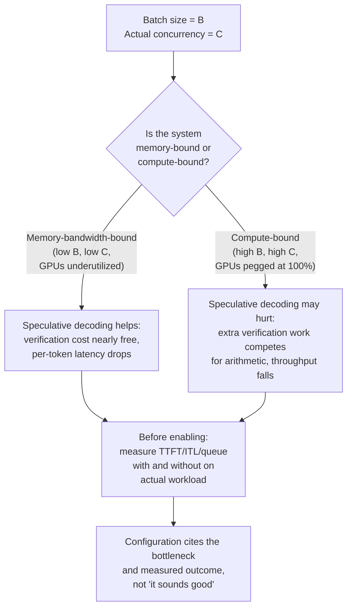

# Lição 25. Revisando uma configuração de serving

**Ligação com a missão:** A missão termina aqui: *"defender os números de latência e throughput que ele produz."* Essa defesa não é um exercício solitário. Você vai precisar revisar a configuração de outra pessoa, rastrear cada escolha até a carga de trabalho que ela diz atender e perceber a incompatibilidade antes que ela chegue à produção.
**Fonte principal:** [Documentação: "Speculative Decoding", vLLM Project](https://docs.vllm.ai/en/latest/features/speculative_decoding.html)
**Pré-requisitos:** [Lição 2](0002-capacity-and-batch-size.md), [Lição 6](0006-throughput-latency-tradeoff.md), [Lição 12](0012-vllm-tuning-knobs.md), [Lição 18](0018-speculative-decoding.md), [Lição 22](0022-fleet-level-serving.md), [Lição 23](0023-production-observability-and-cost.md)

## Aquecimento

1. ▢ A lição 2 nomeou a fórmula que governa a pegada de memória de uma configuração de serving. O que faz o cache crescer, e o que o batching faz com esse custo?

Verificação

`total cache bytes = bytes per token × context length × batch size`. O cache cresce linearmente com o comprimento do contexto e com o batch size; um batch maior significa mais sequências concorrentes, cada uma guardando o seu próprio KV cache.

2. ▢ A lição 6 disse que throughput e latência por token fazem trade-off um contra o outro por meio do batch size. O que de fato governa em que direção o trade-off se move?

Verificação

O batch size. Um batch maior amortiza o custo de prefill entre mais requisições (elevando o throughput), mas obriga cada requisição individual a esperar mais pelos seus tokens, já que eles dividem o tempo de GPU com mais vizinhas (elevando a latência). Qual dos dois números importa mais depende do SLO declarado da carga de trabalho.

3. ▢ A lição 18 disse que a speculative decoding verifica vários tokens em uma passada forward, aproximadamente o custo de gerar um token normalmente, porque o decode é limitado pela largura de banda de memória. Esse mecanismo muda quando o seu batch size fica muito grande?

Verificação

O mecanismo em si (custo de verificação limitado pela largura de banda) não muda. Mas o regime do sistema muda: um batch muito grande pode tornar o sistema limitado por compute no geral, em que o trabalho de verificação que a speculative decoding acrescenta realmente compete por aritmética da GPU em vez de rodar quase de graça. O custo por token é o mesmo; o que muda é se esse custo é desprezível ou material na escala do seu sistema.

## Saiba isto

### O checklist de revisão: cada parâmetro combina com a carga de trabalho declarada?

Ao revisar uma configuração de serving, percorra esta lista. Para cada item, pergunte: essa escolha é de fato justificada pelo gargalo declarado da carga de trabalho, ou foi copiada por ritual dos padrões de outra carga de trabalho?

**1. A configuração de batching combina com a concorrência e o SLO da carga de trabalho?**

A lição 6 ensina que o batch size troca throughput por latência por token. Uma configuração que declara "batch size = 128, SLO = 300 ms de TTFT p99" precisa mostrar que o batch size 128 de fato entrega 300 ms sob a concorrência declarada. Se a carga de trabalho são 10 usuários concorrentes, um batch de 128 significa preencher com 118 requisições vazias ou desperdiçar tempo de GPU com um batch artificialmente grande. Se a carga de trabalho são 1000 usuários concorrentes e o batch 128 significa apenas 12% de utilização, a configuração está deixando throughput na mesa. O parâmetro precisa ser escolhido com medições na carga de trabalho real, e não por chute.

**2. O esquema de quantização está de fato compensando para a meta de latência desta carga de trabalho?**

A lição 9 ensina o trade-off: a quantização em menos bits economiza memória e acelera o decode (limitado pela largura de banda), mas perde acurácia e pode acelerar o prefill de forma diferente, dependendo da implementação. Antes de adotar a quantização int4 porque outra equipe adotou, meça a perda de acurácia da sua própria tarefa no seu próprio batch size. Algumas cargas de trabalho são insensíveis à perda; outras não. Uma configuração que diz "quantização int4" sem citar o seu impacto de acurácia medido nesta tarefa não justificou de fato essa escolha.

**3. A estratégia de paralelismo realmente trata de um gargalo real?**

A lição 21 ensina o paralelismo de tensor e o paralelismo de pipeline como duas formas diferentes de dividir um modelo entre GPUs. Uma configuração que usa paralelismo de tensor de 8 vias em um nó de 4 GPUs não faz sentido: você já dividiu entre todas as GPUs que tem, e o alto custo de comunicação (NVLink ou rede) está sendo pago por nada. A escolha deve remontar a uma medição: "o modelo é grande demais para caber na memória de qualquer GPU sozinha, então precisamos de paralelismo; com 4 GPUs o paralelismo de tensor vira gargalo de comunicação, então adicionamos paralelismo de pipeline para os estágios restantes." Sem essa história, a configuração tem parâmetros girados, mas não escolhas feitas.

**4. A speculative decoding está ligada pelo motivo certo, para o batch size desta carga de trabalho?**

A lição 18 diz que a speculative decoding é uma alavanca de latência: ela reduz a latência por token ao verificar vários tokens por passada forward cara. A lição 23 estabeleceu que, em produção, você cita um SLO. A documentação do vLLM é explícita: a speculative decoding reduz a latência entre tokens "sob cargas de QPS (consultas por segundo) médio a baixo, limitadas por memória". O detalhe é decisivo. Quando o batch size é pequeno (QPS baixo), o sistema é limitado pela largura de banda de memória e o custo extra de verificação da speculative decoding é quase de graça (o mecanismo da lição 18 se sustenta). Quando o batch size é muito grande (QPS alto, limitado por compute), o compute extra de verificação compete por aritmética da GPU e pode de fato reduzir o throughput (a latência de uma requisição individual pode melhorar, mas o throughput geral da frota pode não melhorar). Uma configuração que diz "speculative decoding habilitada" porque "soa bem" não mediu de fato se a carga de trabalho é limitada pela largura de banda ou por compute no batch size escolhido. Nomeie: "Speculative decoding habilitada para cargas de QPS baixo com batch size ≤ 32, em que a largura de banda de memória é o gargalo. Desabilitada para batch size > 64, em que o compute vira o gargalo e o custo extra de verificação reduziria o throughput da frota."

### Levando uma mudança adiante por aquilo de que outros dependem

Uma frota de serving tem chamadores ativos no meio de uma requisição quando você faz o deploy de uma nova configuração, versão de modelo ou esquema de quantização. Uma mudança de configuração que altera silenciosamente a distribuição de saída, como trocar a quantização ou habilitar a speculative decoding, pode quebrar um consumidor downstream (um gate de eval, um chamador com expectativas fixas sobre a distribuição de latência, um sistema que espera correspondência exata de saída) sem que a equipe de serving saiba por quê.

**Estratégia de rollout seguro:**

1. **Faça um canary da nova configuração em uma pequena fatia do tráfego** antes de uma virada completa. Não para testar se o servidor continua de pé, mas para medir como a mudança afeta a distribuição de saída e a distribuição de latência, e se um consumidor downstream percebe.
2. **Faça a mudança em estágios do mesmo jeito que faz com uma versão de modelo**: um canary, monitorando regressões que um consumidor downstream possa detectar antes de você, e depois um rollout gradual se o canary estiver limpo.
3. **Comunique a mudança aos chamadores antes de aplicá-la em larga escala.** Uma mudança de configuração não é um mero detalhe de implementação; ela pode deslocar um pouco uma distribuição de latência ou de saída (quantização, as raras falhas de verificação da speculative decoding), e sistemas downstream construídos sobre suposições rígidas podem quebrar.

Isso não é paranoia. Um exemplo real: trocar float16 por quantização int8 pode deslocar a distribuição de saída o bastante para que um gate de eval ajustado para saídas em float16 comece a rejeitar respostas válidas; a frota de serving parece bem (mesmo throughput de requisições, mesmo p99), mas o pipeline de eval downstream começa a falhar silenciosamente. Um rollout em estágios pega isso porque alguém observando a taxa de aceitação do gate de eval durante a fase de canary vê que ela cai e pergunta por quê antes de aplicar em larga escala.

### Dizer quando a resposta de sempre está errada, e resolver uma alegação contestada a partir da fonte primária

A speculative decoding é o estudo de caso aqui, porque a resposta realmente depende do gargalo atual da sua carga de trabalho.

A lição 18 apresenta a speculative decoding como uma vitória de latência: verificar vários tokens de forma barata em uma passada forward em vez de gerá-los um de cada vez. Isso está exatamente certo para as condições que o artigo descreve e para as condições que o vLLM documenta: **quando o sistema é limitado pela largura de banda de memória** (batch pequeno, QPS baixo). Nesse regime, o trabalho extra de verificação de fato custa quase nada e a latência por token cai de forma mensurável.

Mas **em batch size alto e QPS alto, quando o sistema passa a ser limitado por compute**, os tokens de verificação extras que o modelo draft propõe acrescentam trabalho de compute que agora genuinamente compete com outras requisições por aritmética da GPU. O custo deixa de ser desprezível: a passada forward do modelo alvo está fazendo mais trabalho (verificando vários tokens), e esse trabalho extra desloca tempo que poderia ter sido gasto gerando tokens para outras requisições do batch. A latência por requisição ainda pode melhorar (os tokens da sua própria requisição chegam um pouco mais rápido), mas o throughput da frota (o total de tokens gerados por segundo entre todas as requisições) pode cair, e o throughput é o que o trade-off de batch size da lição 6 governa e do que o custo por milhão de tokens da lição 23 depende.

A documentação do vLLM afirma isso diretamente: "Speculative Decoding... para reduzir a latência entre tokens sob cargas de QPS (consultas por segundo) médio a baixo, limitadas por memória." Essa formulação não é acidental. Sob QPS alto, em um sistema limitado por compute, a speculative decoding pode prejudicar o throughput geral mesmo melhorando a latência de uma requisição individual. A resposta certa não é "ligue a speculative decoding" nem "desligue sempre"; a resposta certa é **"meça primeiro o gargalo da sua carga de trabalho."**

Para resolver qual das duas é verdadeira para a sua configuração:

1. **Meça o gargalo atual do seu sistema** no seu batch size e QPS reais: a largura de banda de memória ou a aritmética é o fator limitante? As métricas da lição 23 (TTFT, ITL, profundidade de fila) dizem isso. Se o sistema é limitado por CPU (profundidade de fila alta, utilização de memória baixa, todas as GPUs cravadas em 100% de utilização), o compute é o gargalo e a speculative decoding provavelmente vai prejudicar. Se o sistema é limitado por memória (utilização de memória alta, GPUs subutilizadas), a largura de banda de memória é o gargalo e a speculative decoding provavelmente vai ajudar.
2. **Compare duas medições:** meça o throughput de ponta a ponta (total de tokens/s entre todas as requisições) e a latência por requisição com a speculative decoding ligada e desligada, no seu batch size e concorrência reais.
3. **Cite o que você mediu.** Uma configuração deveria dizer: "A speculative decoding está desabilitada porque esta carga de trabalho roda com batch size de 256 requisições e o QPS é de 80 requisições/s, o que é alta concorrência e limitado por compute. Medimos o throughput em 3.200 tokens/s com a speculative decoding ligada e 3.400 tokens/s com ela desligada. A latência por requisição é um pouco maior com a speculative decoding desligada (258 ms vs 245 ms), mas o throughput da frota é o gargalo para este SLO, e não a latência por requisição."

## Prática

1. ▢ Uma configuração propõe batch size 256 para uma carga de trabalho cujo SLO declarado é "TTFT p99 abaixo de 500 ms com 20 usuários concorrentes". Você mede o TTFT com batch 256 e descobre que o p99 é 1200 ms. Qual é o erro real da configuração?

Dica

O batch 256 combina com a concorrência declarada de 20 usuários?

Verificação

O batch size 256 é absurdamente grande para 20 usuários concorrentes. Com 20 usuários, o sistema ficará ocioso esperando as requisições encherem o batch, desperdiçando tempo de GPU. O TTFT medido prova isso: o batch size é um parâmetro que troca throughput por latência, e esta configuração trocou a latência na direção errada. A correção não é "ajustar o TTFT", mas "usar um batch size de 16 a 32, compatível com a concorrência real, e não com uma concorrência de fantasia."

2. ▢ Você está revisando uma configuração que habilita a speculative decoding, e a justificativa é "a speculative decoding reduz a latência, e a latência é importante". Essa justificativa é suficiente?

Verificação

Não. A speculative decoding *pode* reduzir a latência, mas só quando o sistema é limitado pela largura de banda de memória. Em alta concorrência e batch size grande, em que o compute é o gargalo, ela pode de fato reduzir o throughput da frota enquanto melhora a latência por requisição. A configuração precisa medir o gargalo real da carga de trabalho e citar o resultado: "Medido com B=X, C=Y: o throughput com spec-decode ligada é Z1, desligada é Z2; escolhemos com base em qual maximiza a métrica que importa para este SLO."

3. ▢ Uma equipe quer trocar a quantização do seu serving de float16 para int8 e aplicá-la de uma vez em toda a frota. Qual é o problema desse plano?

Verificação

A quantização muda a distribuição de saída. Um consumidor downstream (um gate de eval, um sistema de monitoramento, um chamador com expectativas rígidas de saída) pode quebrar silenciosamente. A abordagem certa: faça um canary da mudança em uma pequena fatia do tráfego primeiro, monitore os consumidores downstream (gates de eval, distribuições de latência, taxas de sucesso dos chamadores) em busca de regressões e aplique gradualmente. Isso não é um mero detalhe de implementação.

4. ▢ Uma configuração declara "paralelismo de tensor: 8 vias, em 4 GPUs". O que há de errado nisso?

Dica

Quantas GPUs estão disponíveis, e em quantas vias o modelo está sendo dividido?

Verificação

Não faz sentido: você não consegue dividir um modelo em 8 vias em 4 GPUs. Ou a configuração pretendia dividi-lo em 4 vias (o paralelismo de tensor aproveitando por completo o hardware disponível), ou ela precisa de mais GPUs. Uma estratégia de paralelismo precisa ser compatível com o hardware disponível, ou não justificou de fato essa escolha. Verifique se a equipe mediu que esse esquema de paralelismo específico (tensor vs. pipeline) é melhor do que as alternativas para este modelo e este hardware.

5. ▢ Qual afirmação descreve corretamente quando a speculative decoding ajuda versus quando pode prejudicar o throughput geral da frota?

    - a) A speculative decoding sempre reduz a latência e sempre melhora o throughput, então deve ser habilitada em todos os deployments
    - b) A speculative decoding reduz a latência entre tokens em sistemas limitados pela largura de banda de memória (baixa concorrência), mas em alta concorrência, em que o compute é o gargalo, o trabalho extra de verificação pode reduzir o throughput da frota mesmo com a latência por requisição melhorando
    - c) A speculative decoding só é útil para batch sizes muito grandes e não deve ser habilitada para batches pequenos
    - d) A speculative decoding reduz o throughput e só deve ser habilitada se a latência for mais importante que o throughput

Verificação

**b)** Esse é o trade-off genuíno que esta lição ensina. (a) é falsa: a speculative decoding ajuda sob condições específicas de gargalo, e não de forma universal. (c) é o inverso: ela ajuda mais em batches pequenos, em que o sistema é limitado por memória. (d) é falsa: no batch size certo, ela melhora tanto a latência quanto o throughput; o problema só ocorre no batch size errado, em que ela troca throughput por latência.

## Prática no mundo real

- [ ] Pegue uma configuração de serving do seu próprio trabalho (ou uma configuração pública, como os deployments de exemplo do vLLM). Para cada parâmetro (batch size, quantização, paralelismo, speculative decoding, prefix caching), verifique se a configuração cita a carga de trabalho para a qual foi ajustada e a medição que justificou essa escolha. Anote quais parâmetros são justificados e quais são apenas padrões.
- [ ] Escolha um parâmetro de configuração dos acima e compare duas configurações diferentes na mesma carga de trabalho, medindo throughput e latência com cada uma. Registre qual métrica importa mais para o seu SLO e se a escolha configurada é a certa.
- [ ] Amanhã: desenhe um plano de rollout seguro para uma mudança de configuração que você esteja planejando (por exemplo, trocar a quantização, habilitar uma funcionalidade, mudar o batch size). Inclua quem precisa ser avisado, quais métricas você vai monitorar no canary e o que dispararia um rollback.

## Para ir além

- [Documentação: "Speculative Decoding", vLLM Project](https://docs.vllm.ai/en/latest/features/speculative_decoding.html)
- [Artigo científico: "Fast Inference from Transformers via Speculative Decoding", Leviathan et al., 2022](https://arxiv.org/abs/2211.17192)
- [Recursos](../RESOURCES.md)

---

Não ficou claro? Releia a fonte principal no topo, já que esta lição a comprime e é na compressão que o entendimento escapa. Consulte o [glossário](../GLOSSARY.md) para qualquer termo que pareceu escorregadio.

Se o problema é a lição em si, e não o material, isso é um defeito: [abra uma issue](https://github.com/TokenCemetery/teach/issues).
