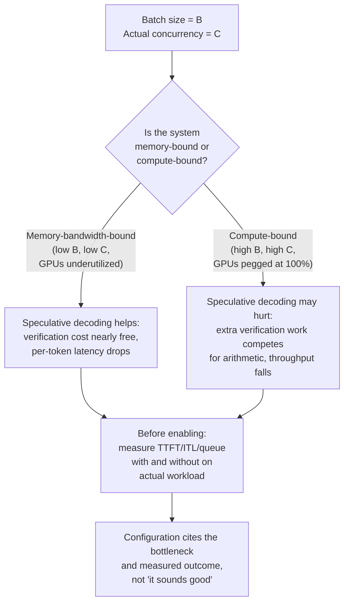

# Урок 25. Ревью конфигурации обслуживания

**Связь с целью курса:** Цель курса заканчивается здесь: *«защищать получаемые им показатели задержки и пропускной способности».* Эта защита не одиночное упражнение. Вам придётся делать ревью чужой конфигурации, прослеживать каждый выбор до нагрузки, которой он якобы служит, и замечать несоответствие до того, как оно попадёт в продакшен.
**Первоисточник:** [Документация: "Speculative Decoding", vLLM Project](https://docs.vllm.ai/en/latest/features/speculative_decoding.html)
**Предварительные требования:** [Урок 2](0002-capacity-and-batch-size.md), [Урок 6](0006-throughput-latency-tradeoff.md), [Урок 12](0012-vllm-tuning-knobs.md), [Урок 18](0018-speculative-decoding.md), [Урок 22](0022-fleet-level-serving.md), [Урок 23](0023-production-observability-and-cost.md)

## Разминка

1. ▢ Урок 2 назвал формулу, которая определяет объём памяти конфигурации обслуживания. Что заставляет кеш расти и что делает с этой стоимостью батчинг?

Проверка

`total cache bytes = bytes per token × context length × batch size`. Кеш растёт линейно с длиной контекста и размером батча; больший батч означает больше одновременных последовательностей, каждая из которых держит собственный KV-кеш.

2. ▢ Урок 6 сказал, что пропускная способность и задержка на токен обмениваются друг на друга через размер батча. Что на самом деле определяет, в какую сторону движется этот обмен?

Проверка

Размер батча. Больший батч распределяет стоимость префилла на большее число запросов (повышая пропускную способность), но заставляет каждый отдельный запрос ждать свои токены дольше, поскольку они делят время GPU с большим числом соседей (повышая задержку). Какое из двух чисел важнее, зависит от заявленного SLO нагрузки.

3. ▢ Урок 18 сказал, что спекулятивное декодирование проверяет несколько токенов за один прямой проход, примерно по цене генерации одного токена в обычном режиме, потому что декодирование ограничено пропускной способностью памяти. Меняется ли этот механизм, когда размер батча становится очень большим?

Проверка

Сам механизм (стоимость проверки, ограниченная пропускной способностью) не меняется. Но режим системы меняется: очень большой батч может сделать систему в целом ограниченной вычислениями, где работа по проверке, которую добавляет спекулятивное декодирование, на самом деле конкурирует за арифметику GPU, а не выполняется почти бесплатно. Стоимость на токен та же; меняется то, пренебрежимо ли мала эта стоимость или существенна в масштабе вашей системы.

## Что нужно знать

### Чек-лист ревью: соответствует ли каждый параметр заявленной нагрузке?

Делая ревью конфигурации обслуживания, пройдитесь по этому списку. Для каждого пункта спросите: действительно ли этот выбор оправдан заявленным узким местом нагрузки или он слепо скопирован из значений по умолчанию другой нагрузки?

**1. Соответствует ли конфигурация батчинга конкурентности и SLO нагрузки?**

Урок 6 учит, что размер батча обменивает пропускную способность на задержку на токен. Конфигурация, заявляющая «размер батча = 128, SLO = 300 мс p99 TTFT», должна показать, что размер батча 128 действительно даёт 300 мс при заявленной конкурентности. Если нагрузка это 10 одновременных пользователей, батч в 128 означает добивание 118 пустыми запросами или трату времени GPU на искусственно большой батч. Если нагрузка это 1000 одновременных пользователей, а батч 128 означает всего 12% загрузки, конфигурация оставляет пропускную способность на столе. Параметр нужно выбирать по измерениям на реальной нагрузке, а не наугад.

**2. Оправдывает ли схема квантизации своё место для целевой задержки этой нагрузки?**

Урок 9 учит компромиссу: квантизация с меньшей разрядностью экономит память и ускоряет декодирование (ограниченное пропускной способностью), но теряет точность и может по-разному ускорять префилл в зависимости от реализации. Прежде чем принять квантизацию int4, потому что так сделала другая команда, измерьте потерю точности вашей собственной задачи при вашем собственном размере батча. Некоторые нагрузки нечувствительны к потере; некоторые нет. Конфигурация, говорящая «квантизация int4» без ссылки на измеренное влияние на точность именно *этой* задачи, этот выбор на самом деле не обосновала.

**3. Действительно ли стратегия параллелизма решает реальное узкое место?**

Урок 21 учит тензорному и конвейерному параллелизму как двум разным способам разбить модель между GPU. Конфигурация, использующая 8-кратный тензорный параллелизм на узле с 4 GPU, бессмысленна: вы уже разбили модель по всем имеющимся GPU, а высокая стоимость обмена (NVLink или сеть) оплачивается впустую. Выбор должен прослеживаться до измерения: «модель слишком велика, чтобы поместиться в память любого одного GPU, поэтому нужен параллелизм; на 4 GPU тензорный параллелизм упирается в обмен, поэтому мы добавили конвейерный параллелизм для оставшихся стадий». Без такой истории в конфигурации параметры повёрнуты, но выборов не сделано.

**4. Включено ли спекулятивное декодирование по правильной причине, для размера батча этой нагрузки?**

Урок 18 говорит, что спекулятивное декодирование это рычаг задержки: оно снижает задержку на токен, проверяя несколько токенов за один дорогой прямой проход. Урок 23 установил, что в продакшене вы ссылаетесь на SLO. Документация vLLM явна: спекулятивное декодирование снижает задержку между токенами «при средней и низкой QPS (запросов в секунду), для нагрузок, ограниченных памятью». Эта деталь несёт нагрузку. Когда размер батча мал (низкая QPS), система ограничена пропускной способностью памяти, и дополнительная стоимость проверки при спекулятивном декодировании почти бесплатна (механизм из урока 18 действует). Когда размер батча очень велик (высокая QPS, ограничение вычислениями), дополнительные вычисления проверки конкурируют за арифметику GPU и действительно могут снизить пропускную способность: задержка одного отдельного запроса может улучшиться, но общая пропускная способность парка может не улучшиться. Конфигурация, которая говорит «спекулятивное декодирование включено», потому что «звучит хорошо», на самом деле не измерила, ограничена ли нагрузка пропускной способностью памяти или вычислениями при выбранном размере батча. Назовите это: «Спекулятивное декодирование включено для нагрузок с низкой QPS и размером батча ≤ 32, где узкое место это пропускная способность памяти. Выключено для размера батча > 64, где узким местом становятся вычисления и дополнительная стоимость проверки снизила бы пропускную способность парка».

### Проведение изменения через то, от чего зависят другие

У парка обслуживания есть живые вызывающие стороны посреди запроса, когда вы выкатываете новую конфигурацию, версию модели или схему квантизации. Изменение конфигурации, которое молча меняет распределение вывода, например смена квантизации или включение спекулятивного декодирования, может сломать нижестоящего потребителя (шлюз эвала, вызывающую сторону с зашитыми ожиданиями о распределении задержки, систему, ожидающую точного совпадения вывода), а команда обслуживания не поймёт почему.

**Безопасная стратегия выкатки:**

1. **Выпустите новую конфигурацию канарейкой на малую долю трафика** до полного переключения. Не чтобы проверить, остаётся ли сервер живым, а чтобы измерить, как изменение влияет на распределение вывода и распределение задержки и замечает ли это нижестоящий потребитель.
2. **Ведите изменение поэтапно так же, как версию модели**: канарейка, мониторинг регрессий, которые нижестоящий потребитель мог бы обнаружить раньше вас, затем постепенная выкатка, если канарейка чистая.
3. **Сообщите об изменении вызывающим сторонам до выкатки в большом масштабе.** Изменение конфигурации это не чисто деталь реализации; оно может слегка сдвинуть распределение задержки или вывод (квантизация, редкие сбои проверки при спекулятивном декодировании), а нижестоящие системы, построенные на жёстких допущениях, могут сломаться.

Это не паранойя. Реальный пример: переход с float16 на квантизацию int8 может сдвинуть распределение вывода настолько, что шлюз эвала, настроенный на выводы float16, начнёт отвергать корректные ответы; парк обслуживания выглядит нормально (та же пропускная способность запросов, тот же p99), а нижестоящий конвейер эвала молча начинает падать. Поэтапная выкатка это ловит, потому что тот, кто следит за долей принятия шлюза эвала на фазе канарейки, видит её падение и спрашивает почему, прежде чем выкатывать в большом масштабе.

### Умение сказать, когда обычный ответ неверен, и разрешить спорное заявление по первоисточнику

Спекулятивное декодирование это здесь разбираемый случай, потому что ответ действительно зависит от текущего узкого места вашей нагрузки.

Урок 18 представляет спекулятивное декодирование как выигрыш в задержке: дёшево проверять несколько токенов за один прямой проход вместо генерации их по одному. Это в точности верно для условий, которые описывает статья и которые документирует vLLM: **когда система ограничена пропускной способностью памяти** (малый батч, низкая QPS). В этом режиме дополнительная работа по проверке стоит почти ничего, а задержка на токен заметно падает.

Но **при большом размере батча и высокой QPS, когда система становится ограниченной вычислениями**, дополнительные токены для проверки, предлагаемые черновой моделью, добавляют вычислительную работу, которая теперь действительно конкурирует с другими запросами за арифметику GPU. Стоимость больше не пренебрежимо мала: прямой проход целевой модели выполняет больше работы (проверяет несколько токенов), и эта лишняя работа вытесняет время, которое можно было потратить на генерацию токенов для других запросов в батче. Задержка на запрос всё ещё может улучшиться (токены вашего собственного запроса приходят чуть быстрее), но пропускная способность парка, то есть общее число токенов в секунду по всем запросам, может упасть, а именно пропускной способностью управляет компромисс размера батча из урока 6 и от неё зависит стоимость за миллион токенов из урока 23.

Документация vLLM говорит об этом прямо: «Speculative Decoding... to reduce inter-token latency under medium-to-low QPS (queries per second), memory-bound workloads.» Эта формулировка не случайна. При высокой QPS, в системе, ограниченной вычислениями, спекулятивное декодирование может навредить общей пропускной способности, даже улучшая задержку отдельного запроса. Правильный ответ не «включите спекулятивное декодирование» и не «всегда выключайте»; правильный ответ **«сначала измерьте узкое место вашей нагрузки»**.

Чтобы разрешить, что верно для вашей конфигурации:

1. **Измерьте текущее узкое место вашей системы** при вашем реальном размере батча и QPS: что ограничивает, пропускная способность памяти или арифметика? Метрики из урока 23 (TTFT, ITL, глубина очереди) подскажут. Если система ограничена CPU (большая глубина очереди, низкое использование памяти, все GPU упёрты в 100% загрузки), узкое место вычисления, и спекулятивное декодирование скорее навредит. Если система ограничена памятью (высокое использование памяти, GPU недогружены), узкое место пропускная способность памяти, и спекулятивное декодирование скорее поможет.
2. **Сравните два измерения:** измерьте сквозную пропускную способность (общее число токенов в секунду по всем запросам) и задержку на запрос при включённом и выключенном спекулятивном декодировании, при вашем реальном размере батча и конкурентности.
3. **Сошлитесь на то, что измерили.** Конфигурация должна говорить: «Спекулятивное декодирование выключено, потому что эта нагрузка работает с размером батча 256 запросов и QPS 80 запросов в секунду, то есть при высокой конкурентности и с ограничением вычислениями. Мы измерили пропускную способность 3200 токенов в секунду при включённом спекулятивном декодировании и 3400 токенов в секунду при выключенном. Задержка на запрос чуть выше при выключенном спекулятивном декодировании (258 мс против 245 мс), но для этого SLO узкое место пропускная способность парка, а не задержка на запрос».

## Практика

1. ▢ Конфигурация предлагает размер батча 256 для нагрузки, заявленное SLO которой «p99 TTFT ниже 500 мс при 20 одновременных пользователях». Вы измеряете TTFT при батче 256 и находите, что p99 равен 1200 мс. В чём настоящая ошибка конфигурации?

Подсказка

Соответствует ли батч 256 заявленной конкурентности в 20 пользователей?

Проверка

Размер батча 256 абсурдно велик для 20 одновременных пользователей. При 20 пользователях система будет простаивать в ожидании, пока запросы заполнят батч, тратя время GPU впустую. Измеренный TTFT это доказывает: размер батча это параметр, обменивающий пропускную способность на задержку, и эта конфигурация обменяла задержку не в ту сторону. Исправление не «настроить TTFT», а «использовать размер батча 16-32, соответствующий реальной конкурентности, а не воображаемой».

2. ▢ Вы делаете ревью конфигурации, включающей спекулятивное декодирование, и обоснование таково: «спекулятивное декодирование снижает задержку, а задержка важна». Достаточно ли этого обоснования?

Проверка

Нет. Спекулятивное декодирование *может* снизить задержку, но только когда система ограничена пропускной способностью памяти. При высокой конкурентности и большом размере батча, где узким местом являются вычисления, оно может на самом деле снизить пропускную способность парка, улучшая задержку на запрос. Конфигурация должна измерить реальное узкое место нагрузки и сослаться на результат: «Измерено при B=X, C=Y: пропускная способность с включённым спекулятивным декодированием Z1, с выключенным Z2; мы выбрали то, что максимизирует метрику, важную для этого SLO».

3. ▢ Команда хочет перевести квантизацию обслуживания с float16 на int8 и выкатить это сразу на весь парк. В чём проблема этого плана?

Проверка

Квантизация меняет распределение вывода. Нижестоящий потребитель (шлюз эвала, система мониторинга, вызывающая сторона с жёсткими ожиданиями вывода) может молча сломаться. Правильный подход: сначала выпустить изменение канарейкой на малую долю трафика, следить за нижестоящими потребителями (шлюзы эвала, распределения задержки, доли успеха вызывающих сторон) на предмет регрессий и выкатывать постепенно. Чисто деталью реализации это не является.

4. ▢ Конфигурация заявляет «тензорный параллелизм: 8-кратный, на 4 GPU». Что с этим не так?

Подсказка

Сколько GPU доступно и на сколько частей разбивается модель?

Проверка

Бессмыслица: нельзя разбить модель на 8 частей на 4 GPU. Либо конфигурация имела в виду разбиение на 4 части (тензорный параллелизм, полностью использующий имеющееся оборудование), либо ей нужно больше GPU. Стратегию параллелизма нужно согласовать с доступным оборудованием, иначе она этот выбор на самом деле не обосновала. Проверьте, измеряла ли команда, что именно эта схема параллелизма (тензорная или конвейерная) лучше альтернатив для этой модели и этого оборудования.

5. ▢ Какое утверждение верно описывает, когда спекулятивное декодирование помогает, а когда может навредить общей пропускной способности парка?

    - a) Спекулятивное декодирование всегда снижает задержку и всегда повышает пропускную способность, поэтому его следует включать во всех развёртываниях
    - b) Спекулятивное декодирование снижает задержку между токенами в системах, ограниченных пропускной способностью памяти (низкая конкурентность), но при высокой конкурентности, где узкое место вычисления, дополнительная работа по проверке может снизить пропускную способность парка, даже когда задержка на запрос улучшается
    - c) Спекулятивное декодирование полезно только для очень больших размеров батча, и его не следует включать для малых батчей
    - d) Спекулятивное декодирование снижает пропускную способность, и его следует включать, только если задержка важнее пропускной способности

Проверка

**b)** Это настоящий компромисс, которому учит этот урок. (a) неверно: спекулятивное декодирование помогает при определённых условиях узкого места, а не универсально. (c) поставлено с ног на голову: оно больше всего помогает при малых батчах, где система ограничена памятью. (d) неверно: при правильном размере батча оно улучшает и задержку, и пропускную способность; проблема лишь при неправильном размере батча, где оно обменивает пропускную способность на задержку.

## Практика в реальной работе

- [ ] Возьмите конфигурацию обслуживания из вашей собственной работы (или публичную, например примеры развёртываний vLLM). Для каждого параметра (размер батча, квантизация, параллелизм, спекулятивное декодирование, кеширование префиксов) проверьте, ссылается ли конфигурация на нагрузку, под которую она настроена, и на измерение, оправдавшее этот выбор. Запишите, какие параметры обоснованы, а какие просто значения по умолчанию.
- [ ] Выберите один параметр конфигурации из перечисленных и сравните две разные настройки на одной и той же нагрузке, измеряя пропускную способность и задержку для каждой. Запишите, какая метрика важнее для вашего SLO и верен ли настроенный выбор.
- [ ] Завтра: разработайте безопасный план выкатки для изменения конфигурации, которое вы планируете (например, смена квантизации, включение функции, изменение размера батча). Включите, кого нужно уведомить, какие метрики вы будете отслеживать на канарейке и что вызовет откат.

## Что почитать дальше

- [Документация: "Speculative Decoding", vLLM Project](https://docs.vllm.ai/en/latest/features/speculative_decoding.html)
- [Научная статья: "Fast Inference from Transformers via Speculative Decoding", Leviathan et al., 2022](https://arxiv.org/abs/2211.17192)
- [Ресурсы](../RESOURCES.md)

---

Не доходит? Перечитайте первоисточник в начале: этот урок его сжимает, а при сжатии понимание как раз и теряется. Загляните в [глоссарий](../GLOSSARY.md), если какой-то термин показался скользким.

Если неясен сам урок, а не материал, это дефект: [откройте issue](https://github.com/TokenCemetery/teach/issues).
