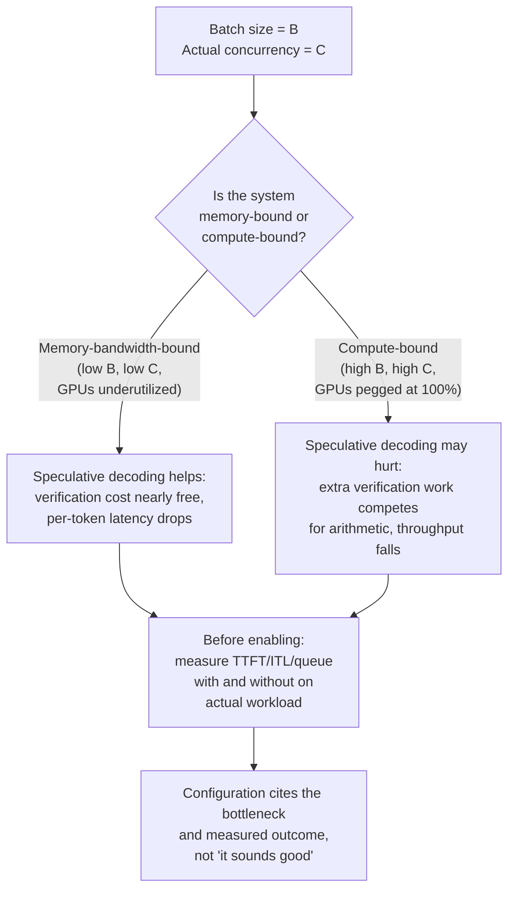

# 第 25 课：评审一份服务配置

**使命关联:** 使命到这里结束：*“为它产生的延迟和吞吐量数字辩护。”* 这种辩护不是一个人的练习。你需要评审别人的配置，把每个选择追溯回它所声称服务的工作负载，并在不匹配的地方到达生产环境之前把它找出来。
**主要来源:** [文档：“Speculative Decoding”，vLLM Project](https://docs.vllm.ai/en/latest/features/speculative_decoding.html)
**前置知识:** [第 2 课](0002-capacity-and-batch-size.md)、[第 6 课](0006-throughput-latency-tradeoff.md)、[第 12 课](0012-vllm-tuning-knobs.md)、[第 18 课](0018-speculative-decoding.md)、[第 22 课](0022-fleet-level-serving.md)、[第 23 课](0023-production-observability-and-cost.md)

## 热身

1. ▢ 第 2 课点名了决定一套服务配置的内存占用的公式。是什么导致缓存增长，批处理对这笔开销做了什么？

检查

`total cache bytes = bytes per token × context length × batch size`。缓存随上下文长度和批大小线性增长；更大的批次意味着更多的并发序列，每个序列都持有它自己的 KV 缓存。

2. ▢ 第 6 课说，吞吐量和每 token 延迟通过批大小互相权衡。究竟是什么决定了这个权衡朝哪个方向移动？

检查

批大小。更大的批次把预填充的开销分摊到更多请求上（提高吞吐量），却迫使每个单独的请求为它的 token 等待更久，因为它们与更多的邻居分享 GPU 时间（提高延迟）。这两个数字中哪一个更要紧，取决于工作负载所规定的 SLO。

3. ▢ 第 18 课说，推测解码在一次前向计算中验证若干个 token，开销大致相当于正常生成一个 token，因为解码受内存带宽限制。当你的批大小变得非常大时，这个机制会变吗？

检查

机制本身（受带宽限制的验证开销）不变。但系统所处的状态变了：很大的批次可以使系统整体变得受算力限制，推测解码所增加的验证工作，这时实际上是在争夺 GPU 的算术资源，而不是几乎免费地运行。每个 token 的开销是一样的；变的是，在你的系统规模上，这笔开销是可以忽略，还是举足轻重。

## 要点

### 评审清单：每个参数是否与所述的工作负载相匹配？

评审一份服务配置时，把这份清单过一遍。对其中每一项都问：这个选择，真的是由工作负载所述的瓶颈来证明其合理的吗，还是从另一个工作负载的默认值里照搬来的？

**1. 批处理配置是否与工作负载的并发和 SLO 相匹配？**

第 6 课讲的是，批大小在吞吐量与每 token 延迟之间做权衡。一份写着“批大小 = 128，SLO = p99 TTFT 300ms”的配置，需要证明批大小 128 在所述的并发下，确实能达到 300ms。如果工作负载是 10 个并发用户，批大小 128 就意味着要用 118 个空请求来填充，或者把 GPU 时间浪费在一个人为放大的批次上。如果工作负载是 1000 个并发用户，而批大小 128 意味着只有 12% 的利用率，那么这份配置就是把吞吐量留在了桌上。这个参数必须用在实际工作负载上的测量来选，而不是靠猜。

**2. 量化方案对这个工作负载的延迟目标来说，真的物有所值吗？**

第 9 课讲的是这个权衡：更低位宽的量化节省内存、加快解码（受带宽限制），但会损失精度，并且对预填充的加速，视实现而可能不同。在因为别的团队用了 int4 就采用 int4 量化之前，先在你自己的批大小下，测量你自己任务的精度损失。有些工作负载对这种损失不敏感；有些则不然。一份写着“int4 量化”、却没有引用它在*这个*任务上实测的精度影响的配置，实际上并没有证明这个选择是合理的。

**3. 并行策略是否真的解决了一个真实的瓶颈？**

第 21 课把张量并行和流水线并行，讲成把模型切分到多块 GPU 上的两种不同方式。一份在 4 块 GPU 的节点上使用 8 路张量并行的配置是荒谬的：你已经在你拥有的所有 GPU 上做了切分，而高昂的通信开销（NVLink 或网络）是白白在付。这个选择应该能追溯到一次测量：“模型太大，任何单块 GPU 的内存都放不下，所以我们需要并行；在 4 块 GPU 上，张量并行受通信的瓶颈限制，所以我们为剩下的阶段加上了流水线并行。”没有这个故事，这份配置就只是旋钮被拧了，而没有做出选择。

**4. 开启推测解码，是否真的出于正确的原因，并且适合这个工作负载的批大小？**

第 18 课说，推测解码是一个延迟杠杆：它通过每次昂贵的前向计算验证多个 token，降低每 token 延迟。第 23 课确立了，在生产环境中，你要引用一个 SLO。vLLM 的文档说得很明确：推测解码降低 token 间延迟，是“在中低 QPS（每秒查询数）、受内存限制的工作负载下”。这个细节是承重的。当批大小很小（QPS 低）时，系统受内存带宽限制，推测解码额外的验证开销几乎是免费的（第 18 课的机制成立）。当批大小非常大（QPS 高，受算力限制）时，额外的验证计算会争夺 GPU 的算术资源，实际上可能降低吞吐量，单个请求的延迟可能改善，但集群整体的吞吐量可能并没有。一份写着“已启用推测解码”、理由是“听起来不错”的配置，并没有真正测量过，在所选的批大小下，工作负载究竟是受带宽限制还是受算力限制。要把它说出来：“对批大小 ≤ 32 的低 QPS 工作负载启用推测解码，那里内存带宽是瓶颈。对批大小 > 64 的情形禁用，那里算力成为瓶颈，额外的验证开销会降低集群吞吐量。”

### 让一次改动穿过别人所依赖的东西

当你部署一个新的配置、模型版本或量化方案时，服务集群里有正在处理中的调用方请求。一次悄悄改变输出分布的配置改动，比如切换量化或启用推测解码，可能让下游的消费者（一道评测关卡、一个对延迟分布有硬编码预期的调用方、一个期望输出精确匹配的系统）出问题，而服务团队并不知道原因。

**安全的上线策略：**

1. **在完全切换之前，先在一小部分流量上做金丝雀发布**新的配置。目的不是测试服务器是否保持运行，而是测量这次改动如何影响输出分布和延迟分布，以及下游的消费者是否察觉到。
2. **像对模型版本做分阶段上线那样，对这次改动做分阶段上线**：先做金丝雀，监控下游消费者可能比你更早发现的退化，如果金丝雀干净，再做滚动上线。
3. **在大规模上线之前，先把这次改动告知调用方。** 配置改动不是纯粹的实现细节；它可能略微改变延迟分布或输出（量化、推测解码罕见的验证失败），而建立在严格假设之上的下游系统可能会出问题。

这不是多疑。一个真实的例子：从 float16 切换到 int8 量化，可能足以改变输出分布，使一道针对 float16 输出调好的评测关卡，开始拒绝有效的答案；服务集群看起来一切正常（请求吞吐量一样，p99 一样），但下游的评测流水线却悄悄开始失败。分阶段上线能抓到这个问题，因为在金丝雀阶段盯着评测关卡通过率的人，会看到它下降，并在大规模上线之前问为什么。

### 说出惯常的答案何时是错的，并从一手来源裁定有争议的说法

推测解码是这里的案例研究，因为答案确实取决于你的工作负载当前的瓶颈。

第 18 课把推测解码讲成一个延迟上的收益：在一次前向计算中廉价地验证多个 token，而不是一个一个地生成。对于论文所描述的条件，以及 vLLM 所记录的条件，这完全正确：**当系统受内存带宽限制时**（批次小、QPS 低）。在那种状态下，额外的验证工作确实几乎不花什么，每 token 的延迟也明显下降。

但是**在批大小大、QPS 高、系统变得受算力限制时**，草稿模型提出的额外验证 token，增加的计算工作现在真的与其他请求争夺 GPU 的算术资源。这笔开销不再可以忽略：目标模型的前向计算在做更多的工作（验证多个 token），而这些额外的工作，挤占了本可以用来为批次中其他请求生成 token 的时间。单个请求的延迟可能仍然改善（你自己请求的 token 到得稍快一点），但集群吞吐量，也就是所有请求每秒生成的 token 总数，可能下降，而吞吐量正是第 6 课的批大小权衡所支配的，也是第 23 课的每百万 token 成本所依赖的。

vLLM 的文档直接说了这一点：“推测解码……用于在中低 QPS（每秒查询数）、受内存限制的工作负载下降低 token 间延迟。” 这种措辞不是偶然的。在高 QPS、受算力限制的系统下，推测解码可能损害整体吞吐量，即使它改善了单个请求的延迟。正确的答案不是“开启推测解码”，也不是“总是关掉它”；正确的答案是 **“先测量你的工作负载的瓶颈。”**

要判定对你的配置来说哪个说法为真：

1. **在你实际的批大小和 QPS 下，测量你的系统当前的瓶颈：** 限制因素是内存带宽还是算术？第 23 课的指标（TTFT、ITL、队列深度）会告诉你。如果系统受 CPU 限制（队列深度高，内存利用率低，所有 GPU 都顶在 100% 的利用率上），那么算力就是瓶颈，推测解码很可能有害。如果系统受内存限制（内存利用率高，GPU 利用不足），那么内存带宽就是瓶颈，推测解码很可能有帮助。
2. **比较两次测量：** 在你实际的批大小和并发下，测量开启和关闭推测解码时的端到端吞吐量（所有请求每秒的 token 总数）和单个请求的延迟。
3. **引用你测量的结果。** 一份配置应该这样说：“推测解码被禁用，因为这个工作负载以 256 个请求的批大小运行，QPS 为每秒 80 个请求，这是高并发、受算力限制的。我们测得，开启推测解码时吞吐量为 3200 token/秒，关闭时为 3400 token/秒。关闭推测解码时，单个请求的延迟略高（258ms 对 245ms），但这个 SLO 的瓶颈是集群吞吐量，而不是单个请求的延迟。”

## 练习

1. ▢ 一份配置为一个工作负载提出批大小 256，该工作负载所述的 SLO 是“20 个并发用户下 p99 TTFT 低于 500ms”。你测量批大小 256 下的 TTFT，发现 p99 是 1200ms。这份配置真正的错误是什么？

提示

批大小 256 与所述的 20 个用户的并发匹配吗？

检查

批大小 256，对 20 个并发用户来说大得离谱。在 20 个用户下，系统会闲着等请求把批次填满，浪费 GPU 时间。测得的 TTFT 证明了这一点：批大小是在吞吐量与延迟之间做权衡的旋钮，而这份配置把延迟朝错误的方向交换掉了。修复办法不是“调 TTFT”，而是“使用与实际并发相匹配的 16 到 32 的批大小，而不是想象出来的并发”。

2. ▢ 你在评审一份启用了推测解码的配置，它的理由是“推测解码降低延迟，而延迟很重要”。这个理由充分吗？

检查

不充分。推测解码*可以*降低延迟，但只有在系统受内存带宽限制时。在高并发和大批次下，算力是瓶颈，它实际上可能降低集群吞吐量，同时改善单个请求的延迟。配置需要测量实际工作负载的瓶颈，并引用结果：“在 B=X、C=Y 下测得：开启推测解码的吞吐量为 Z1，关闭为 Z2；我们根据哪一个使这个 SLO 所关心的指标最大化来选择。”

3. ▢ 一个团队想把他们服务的量化从 float16 切换到 int8，并一次性推给整个集群。这个计划有什么问题？

检查

量化会改变输出分布。下游的消费者（一道评测关卡、一个监控系统、一个对输出有严格预期的调用方）可能悄悄出问题。正确的做法：先在一小部分流量上做金丝雀发布，监控下游的消费者（评测关卡、延迟分布、调用方成功率）有没有退化，再逐步推出。这可不是纯粹的实现细节。

4. ▢ 一份配置写着“张量并行：8 路，在 4 块 GPU 上”。这有什么问题？

提示

有多少块 GPU 可用，模型又被切成了几份？

检查

这是荒谬的：你不能在 4 块 GPU 上把模型切成 8 份。要么这份配置本意是切成 4 份（张量并行把现有硬件用满），要么它需要更多的 GPU。并行策略必须与可用的硬件相匹配，否则就没有证明这个选择是合理的。要检查团队是否测量过，对这个模型和这套硬件来说，这种特定的并行方案（张量对比流水线）优于其他方案。

5. ▢ 下面哪种说法，正确描述了推测解码什么时候有帮助、什么时候可能损害集群整体吞吐量？

    - a) 推测解码总是降低延迟，也总是提高吞吐量，所以应该在所有部署上启用
    - b) 推测解码在受内存带宽限制的系统（低并发）上降低 token 间延迟，但在高并发、算力是瓶颈时，额外的验证工作可能降低集群吞吐量，即使单个请求的延迟有所改善
    - c) 推测解码只对很大的批大小有用，不应该为小批次启用
    - d) 推测解码降低吞吐量，只有在延迟比吞吐量更重要时才应该启用

检查

**b)** 这就是本课所讲的真正的权衡。(a) 是错的：推测解码在特定的瓶颈条件下有帮助，而不是普遍如此。(c) 说反了：它在系统受内存限制的小批次下帮助最大。(d) 是错的：在合适的批大小下，它同时改善延迟和吞吐量；问题只出在不合适的批大小下，那时它是拿吞吐量去换延迟。

## 实战练习

- [ ] 拿一份你自己工作中的服务配置（或者一份公开的配置，比如 vLLM 的示例部署）。对每个参数（批大小、量化、并行、推测解码、前缀缓存），检查这份配置是否引用了它所调优针对的工作负载，以及证明这个选择合理的测量。写下哪些参数是有依据的，哪些只是默认值。
- [ ] 从上面挑一个配置参数，在同一个工作负载上比较两种不同的设置，分别测量每种设置下的吞吐量和延迟。记下对你的 SLO 来说哪个指标更要紧，以及所配置的选择是不是正确的那个。
- [ ] 明天：为你正在计划的一次配置改动（例如切换量化、启用某个功能、改变批大小）设计一个安全的上线计划。包括需要通知谁、你会在金丝雀阶段监控哪些指标，以及什么情况会触发回滚。

## 延伸阅读

- [文档：“Speculative Decoding”，vLLM Project](https://docs.vllm.ai/en/latest/features/speculative_decoding.html)
- [论文：“Fast Inference from Transformers via Speculative Decoding”，Leviathan 等，2022](https://arxiv.org/abs/2211.17192)
- [资源](../RESOURCES.md)

---

没学明白？请重读顶部的主要来源，因为本课是对它的压缩，而理解正是在压缩中流失的。如果有哪个术语觉得含糊，可以查看[术语表](../GLOSSARY.md)。

如果问题出在课程本身，而不是学习材料，那就是一个缺陷：[提交 issue](https://github.com/TokenCemetery/teach/issues)。
