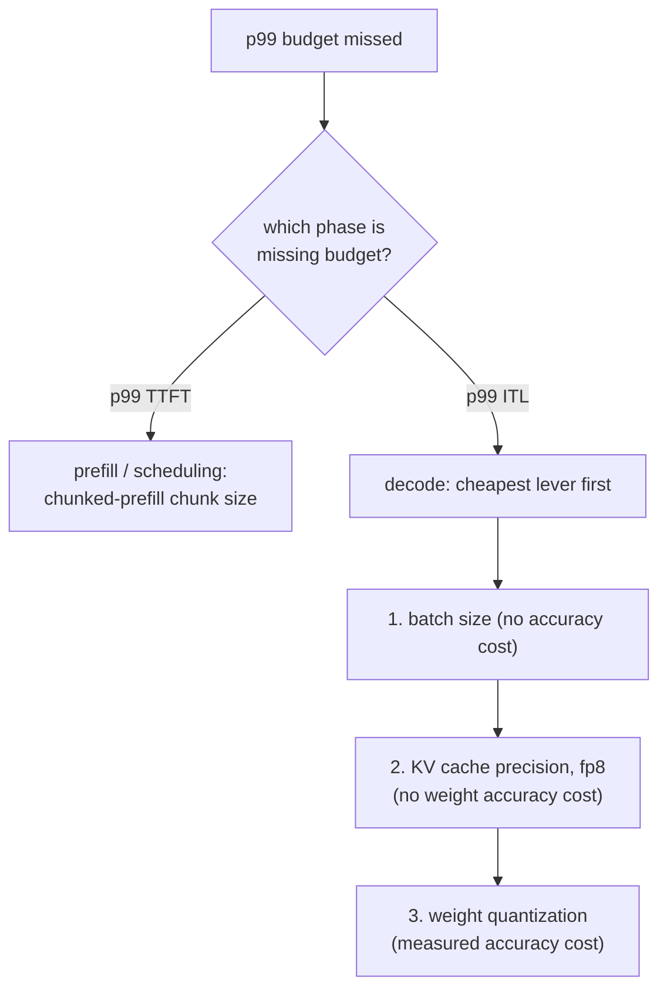

# Presupuesto de latencia

Medir y defender un presupuesto de latencia p99. Pensado para consultar al diagnosticar un incumplimiento.

## p99, no el promedio

El **p99** es el valor por debajo del cual cae el 99% de las solicitudes medidas; solo el 1% peor es más lento. Un promedio puede parecer bueno mientras oculta un problema real: el [head-of-line blocking](batching.md#admission-order-and-head-of-line-blocking) solo golpea a la pequeña fracción de solicitudes con la mala suerte de compartir un paso con un prefill grande, así que apenas mueve un promedio sobre miles de solicitudes por lo demás rápidas mientras vuelve dramáticamente más lento a ese 1% desafortunado.

## Dos cifras, no una

La "latencia de la solicitud" se divide en al menos dos números, cada uno dominado por una fase distinta y moldeado por palancas distintas:

| Cifra | Dominada por | Moldeada por |
|---|---|---|
| Tiempo hasta el primer token (TTFT) | Prefill | Scheduling, tamaño de chunk del chunked prefill |
| Latencia entre tokens (ITL) | Decode | Tamaño de lote, precisión de la caché, cuantización de pesos |

Fundirlas en una cifra mezclada oscurece a qué palanca apunta realmente un mal resultado.

## Qué hace fiable una medición de p99

- **Suficientes muestras.** Un p99 de 20 solicitudes en realidad informa sobre la más lenta de todas, no una estimación estable de la cola; una cifra fiable suele necesitar muestras de cientos a miles.
- **Carga realista.** Una concurrencia realista (para que el comportamiento del batching y del scheduling se ponga realmente a prueba) y una mezcla realista de longitudes de prompt y de salida: el [desperdicio del batching estático](batching.md#static-batching-wastes-capacity-on-uneven-finish-times) y el head-of-line blocking dependen ambos de una varianza de longitud de solicitud que un benchmark de longitud uniforme nunca saca a la luz.

## Orden de diagnóstico: primero la fase, luego la palanca más barata



Revisar las palancas de la fase equivocada desperdicia esfuerzo: ajustar el tamaño de chunk no hace nada por un problema de ITL limitado por el decode, y reducir el lote no hace nada por un problema de TTFT causado por un prefill grande que detiene la cola. Dentro de la rama del decode, el orden sigue al costo: primero el tamaño de lote (gratis), luego la precisión de la caché (sin costo de precisión de pesos), y luego la cuantización de pesos (cuesta precisión medida, así que solo hay que recurrir a ella cuando las palancas más baratas se han agotado o son insuficientes).

## Cadena resuelta

Un modelo de 13B en una GPU de 80 GB, medido con un benchmark realista de 2,000 solicitudes: p99 del TTFT cómodamente dentro del presupuesto, p99 de la ITL de 80 ms frente a un presupuesto de 50 ms.

```text
TTFT fine -> rules out scheduling; this is a decode-phase, ITL problem
1. batch size already at the lesson-6-defended figure -> shrinking further costs needed throughput, skip
2. quantize weights to int8 -> ITL drops to 65 ms, accuracy delta measured against the unquantized model
   still over budget; two options remain:
   a. shrink batch size further (free, if it still meets required concurrency)
   b. quantize to int4 with AWQ (frees more time, further measured accuracy cost)
-> pick whichever closes the gap without paying for more than the budget needs
```

## Qué debe citar la defensa final

1. **Las propias cifras de p99 medidas**, a partir de una muestra lo bastante grande y realista para fiarse de ella.
2. **El razonamiento de memoria y de tamaño de lote** detrás del [techo de capacidad](kv-cache.md#capacity-budget) y del [tamaño de lote defendido](batching.md#the-throughputlatency-trade-off) en que se asentó la configuración.
3. **La cifra de precisión** medida para la [cuantización](quantization-at-serve-time.md#defending-the-choice-means-citing-three-numbers), si hubo alguna, que se aplicó para llegar hasta ahí.

Una configuración que alcanza su objetivo de latencia por suerte, sin ninguna de estas tres cosas escrita, está tan indefensa como una que no lo alcanza.

## Relacionado

- [Lección 16](../lessons/0016-p99-latency-methodology.md), [Lección 17](../lessons/0017-defending-a-latency-budget-end-to-end.md)
- [KV cache](kv-cache.md), [Batching](batching.md), [Cuantización al servir](quantization-at-serve-time.md): las palancas que recorre el orden de diagnóstico de esta hoja
