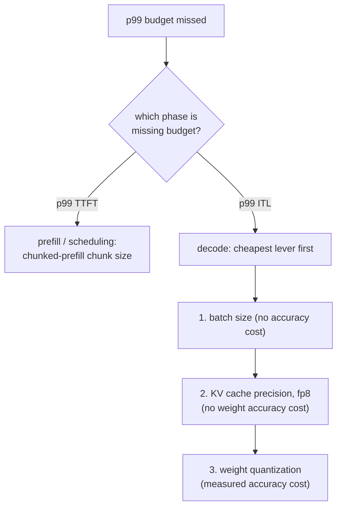

# Budget de latence

Mesurer et défendre un budget de latence p99. Conçu pour la consultation lors du diagnostic d'un dépassement.

## Le p99, pas la moyenne

Le **p99** est la valeur en dessous de laquelle se situent 99 % des requêtes mesurées ; seul le pire 1 % est plus lent. Une moyenne peut avoir l'air correcte tout en cachant un vrai problème : le [head-of-line blocking](batching.md#admission-order-and-head-of-line-blocking) ne frappe que la petite fraction de requêtes assez malchanceuses pour partager une étape avec un gros prefill, si bien qu'il déplace à peine une moyenne portant sur des milliers de requêtes par ailleurs rapides tout en rendant ce 1 % malchanceux considérablement plus lent.

## Deux chiffres, pas un

La « latence d'une requête » se divise en au moins deux chiffres, chacun dominé par une phase différente et façonné par des leviers différents :

| Chiffre | Dominé par | Façonné par |
|---|---|---|
| Temps jusqu'au premier token (TTFT) | Prefill | Ordonnancement, taille de morceau du chunked prefill |
| Latence inter-token (ITL) | Decode | Taille de batch, précision du cache, quantification des poids |

Les fondre en un seul chiffre mélangé masque quel levier un mauvais résultat désigne réellement.

## Ce qui rend une mesure du p99 digne de confiance

- **Assez d'échantillons.** Un p99 calculé à partir de 20 requêtes rapporte en réalité sur la seule plus lente, et non sur une estimation stable de la queue ; un chiffre digne de confiance demande généralement des échantillons de l'ordre de centaines à milliers.
- **Une charge réaliste.** Une concurrence réaliste (pour que le comportement du batching et de l'ordonnancement soit réellement sollicité) et un mélange réaliste de longueurs de prompt et de sortie : le [gaspillage du batching statique](batching.md#static-batching-wastes-capacity-on-uneven-finish-times) et le head-of-line blocking dépendent tous deux d'une variance de longueur de requête qu'un benchmark à longueur uniforme ne fait jamais apparaître.

## Ordre de diagnostic : la phase d'abord, puis le levier le moins cher



Vérifier les leviers de la mauvaise phase fait perdre de l'effort : régler la taille de morceau ne fait rien pour un problème d'ITL lié au decode, et réduire le batch ne fait rien pour un problème de TTFT causé par un gros prefill qui bloque la file. Dans la branche du decode, l'ordre suit le coût : la taille de batch d'abord (gratuite), puis la précision du cache (aucun coût de précision des poids), puis la quantification des poids (coûte de la précision mesurée, donc à n'employer qu'une fois les leviers moins chers épuisés ou insuffisants).

## Chaîne illustrée

Un modèle 13B sur un GPU de 80 GB, mesuré à partir d'un benchmark réaliste de 2 000 requêtes : p99 du TTFT confortablement sous le budget, p99 de l'ITL de 80 ms face à un budget de 50 ms.

```text
TTFT fine -> rules out scheduling; this is a decode-phase, ITL problem
1. batch size already at the lesson-6-defended figure -> shrinking further costs needed throughput, skip
2. quantize weights to int8 -> ITL drops to 65 ms, accuracy delta measured against the unquantized model
   still over budget; two options remain:
   a. shrink batch size further (free, if it still meets required concurrency)
   b. quantize to int4 with AWQ (frees more time, further measured accuracy cost)
-> pick whichever closes the gap without paying for more than the budget needs
```

## Ce que la défense finale doit citer

1. **Les chiffres p99 mesurés** eux-mêmes, à partir d'un échantillon assez grand et réaliste pour être digne de confiance.
2. **Le raisonnement sur la mémoire et la taille de batch** derrière le [plafond de capacité](kv-cache.md#capacity-budget) et la [taille de batch défendue](batching.md#the-throughputlatency-trade-off) sur lesquels la configuration s'est arrêtée.
3. **Le chiffre de précision** mesuré pour la [quantification](quantization-at-serve-time.md#defending-the-choice-means-citing-three-numbers) éventuellement appliquée pour y arriver.

Une configuration qui atteint sa cible de latence par chance, sans aucun de ces trois éléments consignés, est aussi peu défendue que celle qui la manque.

## Voir aussi

- [Leçon 16](../lessons/0016-p99-latency-methodology.md), [Leçon 17](../lessons/0017-defending-a-latency-budget-end-to-end.md)
- [KV cache](kv-cache.md), [Batching](batching.md), [Quantification au moment du serving](quantization-at-serve-time.md) : les leviers que parcourt l'ordre de diagnostic de cette fiche
