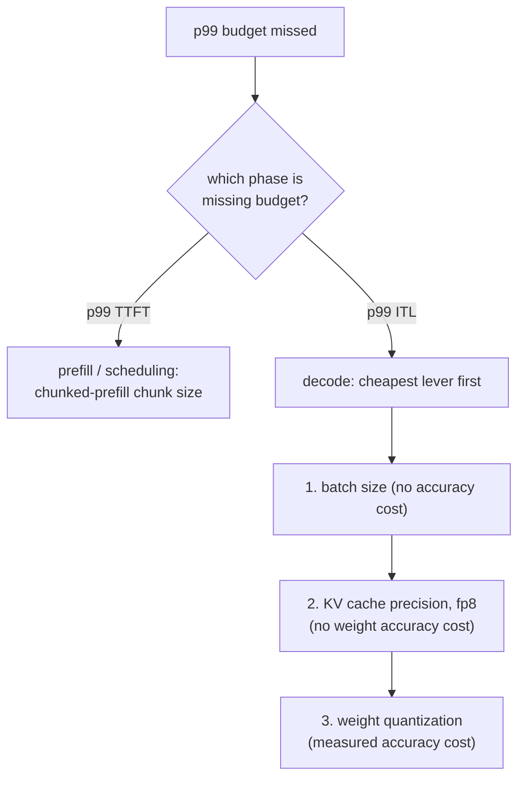

# Latency Budget

p99 latency budget को नापना और उसका बचाव करना। चूक का निदान करते समय खोजने के लिए बनाया गया।

## p99, औसत नहीं

**p99** वह मान है जिसके नीचे नापी गई 99% requests आती हैं; सिर्फ़ सबसे बुरी 1% उससे धीमी होती हैं। औसत ठीक दिख सकता है जबकि असली समस्या छिपी हो: [head-of-line blocking की समस्या](batching.md#admission-order-and-head-of-line-blocking) सिर्फ़ requests के उस छोटे हिस्से पर पड़ती है जो इतनी बदक़िस्मत थीं कि बड़े prefill के साथ एक step साझा करें, इसलिए हज़ारों बाक़ी तेज़ requests के औसत को वह मुश्किल से हिलाती है, जबकि उस बदक़िस्मत 1% को नाटकीय रूप से धीमा कर देती है।

## दो आँकड़े, एक नहीं

"Request latency" कम से कम दो संख्याओं में बँटती है, जिनमें से हर एक पर अलग चरण हावी है और जिन्हें अलग उपाय आकार देते हैं:

| आँकड़ा | किस पर हावी | किससे आकार लेता है |
|---|---|---|
| Time to first token (TTFT) | Prefill | Scheduling, chunked-prefill का chunk size |
| Inter-token latency (ITL) | Decode | Batch size, cache की precision, weight quantization |

इन्हें एक मिली-जुली संख्या में समेटना यह धुँधला कर देता है कि ख़राब नतीजा असल में किस उपाय की ओर इशारा करता है।

## p99 माप को भरोसेमंद क्या बनाता है

- **पर्याप्त नमूने।** 20 requests से निकला p99 असल में सबसे धीमी अकेली request पर रिपोर्ट कर रहा है, स्थिर पूँछ का अनुमान नहीं; भरोसेमंद आँकड़े को आम तौर पर सैकड़ों से हज़ारों नमूने चाहिए।
- **यथार्थवादी load।** यथार्थवादी concurrency (ताकि batching और scheduling का व्यवहार असल में तनाव में आए) और prompt/output lengths का यथार्थवादी मिश्रण: [static-batching की बरबादी](batching.md#static-batching-wastes-capacity-on-uneven-finish-times) और head-of-line blocking दोनों उस request-length variance पर निर्भर हैं जिसे एकसमान-length वाला benchmark कभी सामने नहीं लाता।

## निदान का क्रम: पहले चरण, फिर सबसे सस्ता उपाय



ग़लत चरण के उपाय जाँचना मेहनत बरबाद करता है: chunk size tune करने से decode-bound ITL समस्या का कुछ नहीं बनता, और batch घटाने से बड़े prefill के queue रोकने से पैदा हुई TTFT समस्या का कुछ नहीं बनता। Decode वाली शाखा के भीतर, क्रम लागत का पीछा करता है: पहले batch size (मुफ़्त), फिर cache की precision (weight accuracy की कोई क़ीमत नहीं), फिर weight quantization (नापी गई accuracy की क़ीमत, इसलिए उस तक तभी पहुँचें जब सस्ते उपाय ख़त्म हो चुके हों या काफ़ी न हों)।

## हल की हुई कड़ी

एक 80 GB GPU पर 13B model, 2,000 requests के यथार्थवादी benchmark से नापा गया: p99 TTFT budget के काफ़ी नीचे, p99 ITL 50 ms budget के विरुद्ध 80 ms।

```text
TTFT fine -> rules out scheduling; this is a decode-phase, ITL problem
1. batch size already at the lesson-6-defended figure -> shrinking further costs needed throughput, skip
2. quantize weights to int8 -> ITL drops to 65 ms, accuracy delta measured against the unquantized model
   still over budget; two options remain:
   a. shrink batch size further (free, if it still meets required concurrency)
   b. quantize to int4 with AWQ (frees more time, further measured accuracy cost)
-> pick whichever closes the gap without paying for more than the budget needs
```

## अंतिम बचाव को क्या गिनाना है

1. **ख़ुद नापे गए p99 आँकड़े**, इतने बड़े और यथार्थवादी नमूने से जिस पर भरोसा हो।
2. **Memory और batch-size का तर्क** उस [capacity सीमा](kv-cache.md#capacity-budget) और [बचाव किया गया batch size](batching.md#the-throughputlatency-trade-off) के पीछे जिस पर configuration टिकी।
3. **Accuracy की संख्या** जो वहाँ पहुँचने के लिए लगाई गई किसी भी [quantization के लिए](quantization-at-serve-time.md#defending-the-choice-means-citing-three-numbers), अगर कोई, नापी गई।

जो configuration इन तीनों में से कुछ भी लिखे बिना क़िस्मत से अपना latency लक्ष्य पा लेती है, वह उतनी ही बिना बचाव की है जितनी वह जो उसे चूक जाती है।

## संबंधित

- [पाठ 16](../lessons/0016-p99-latency-methodology.md), [पाठ 17](../lessons/0017-defending-a-latency-budget-end-to-end.md)
- [KV Cache शीट](kv-cache.md), [Batching शीट](batching.md), [Serve Time पर Quantization शीट](quantization-at-serve-time.md): वे उपाय जिनसे इस शीट का निदान-क्रम गुज़रता है
