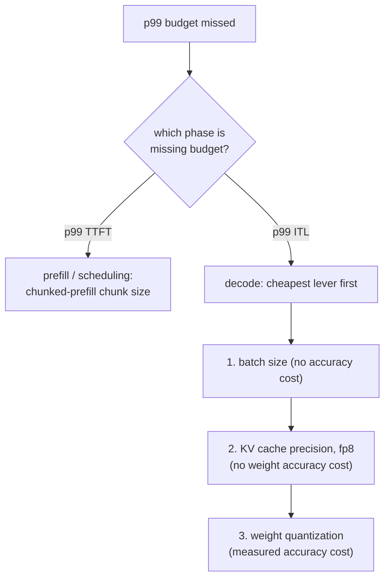

# Orçamento de Latência

Medir e defender um orçamento de latência p99. Feito para consulta ao diagnosticar uma falha.

## p99, e não a média

O **p99** é o valor abaixo do qual caem 99% das requisições medidas; só o 1% pior é mais lento. Uma média pode parecer boa e esconder um problema real: o [head-of-line blocking](batching.md#admission-order-and-head-of-line-blocking) só atinge a pequena fração de requisições azaradas o bastante para dividir um passo com um prefill grande, então mal move uma média entre milhares de requisições que de resto são rápidas, enquanto torna esse 1% azarado dramaticamente mais lento.

## Dois números, e não um

A "latência da requisição" se divide em pelo menos dois números, cada um dominado por uma fase diferente e moldado por alavancas diferentes:

| Número | Dominado por | Moldado por |
|---|---|---|
| Time to first token (TTFT) | Prefill | Scheduling, tamanho do chunk do chunked prefill |
| Latência entre tokens (ITL) | Decode | Batch size, precisão do cache, quantização de pesos |

Fundi-los em um único número misturado obscurece para qual alavanca um mau resultado realmente aponta.

## O que torna confiável uma medição de p99

- **Amostras suficientes.** Um p99 calculado a partir de 20 requisições na verdade está reportando sobre a única mais lenta, e não uma estimativa estável da cauda; um número confiável tipicamente precisa de amostras na casa das centenas a milhares.
- **Carga realista.** Concorrência realista (para que o comportamento de batching e de scheduling seja de fato exigido) e uma mistura realista de comprimentos de prompt e de saída: o [desperdício do batching estático](batching.md#static-batching-wastes-capacity-on-uneven-finish-times) e o head-of-line blocking dependem da variância de comprimento das requisições, que um benchmark de comprimento uniforme nunca traz à tona.

## Ordem de diagnóstico: primeiro a fase, depois a alavanca mais barata



Verificar as alavancas da fase errada desperdiça esforço: ajustar o tamanho do chunk não faz nada por um problema de ITL limitado pelo decode, e reduzir o batch não faz nada por um problema de TTFT causado por um prefill grande travando a fila. Dentro do ramo do decode, a ordem segue o custo: primeiro o batch size (de graça), depois a precisão do cache (sem custo de acurácia dos pesos), depois a quantização de pesos (custa acurácia medida, então só recorra a ela quando as alavancas mais baratas estiverem esgotadas ou forem insuficientes).

## Cadeia resolvida

Um modelo de 13B em uma GPU de 80 GB, medido a partir de um benchmark realista de 2.000 requisições: p99 do TTFT confortavelmente abaixo do orçamento, ITL p99 de 80 ms contra um orçamento de 50 ms.

```text
TTFT fine -> rules out scheduling; this is a decode-phase, ITL problem
1. batch size already at the lesson-6-defended figure -> shrinking further costs needed throughput, skip
2. quantize weights to int8 -> ITL drops to 65 ms, accuracy delta measured against the unquantized model
   still over budget; two options remain:
   a. shrink batch size further (free, if it still meets required concurrency)
   b. quantize to int4 with AWQ (frees more time, further measured accuracy cost)
-> pick whichever closes the gap without paying for more than the budget needs
```

## O que a defesa final deve citar

1. **Os números de p99 medidos** em si, de uma amostra grande e realista o bastante para ser confiável.
2. **O raciocínio de memória e de batch size** por trás do [teto de capacidade](kv-cache.md#capacity-budget) e do [batch size defendido](batching.md#the-throughputlatency-trade-off) em que a configuração se fixou.
3. **O número de acurácia** medido para qualquer [quantização](quantization-at-serve-time.md#defending-the-choice-means-citing-three-numbers) que, se houve, tenha sido aplicada para chegar lá.

Uma configuração que atinge a sua meta de latência por sorte, sem nenhuma dessas três coisas anotada, está tão indefesa quanto uma que a perde.

## Relacionado

- [Lição 16](../lessons/0016-p99-latency-methodology.md), [Lição 17](../lessons/0017-defending-a-latency-budget-end-to-end.md)
- [KV cache](kv-cache.md), [Batching](batching.md), [Quantização no Serving](quantization-at-serve-time.md): as alavancas que a ordem de diagnóstico desta folha percorre
